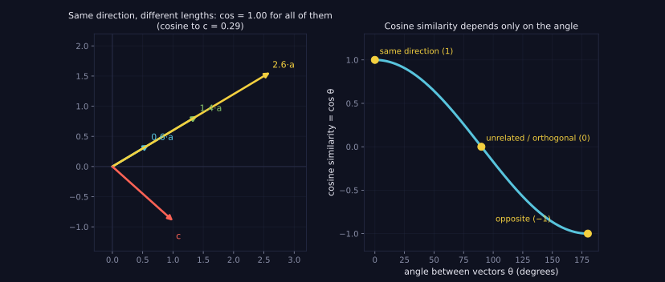
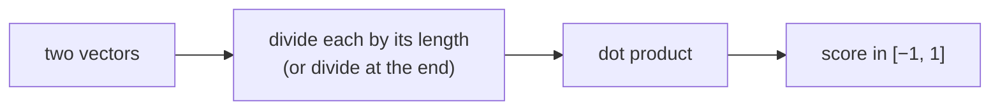

> Tier 1 · Mathematics for AI · **Level: beginner** · Reading time: about 9 minutes

# 1.17 Cosine similarity

**Metadata** — Tier: 1 · Phase: 1 · Priority: P0 · Difficulty: 2/5 · Interview: Very high · Hands-on: Very high
Prerequisites: 1.10, 1.15, 1.16 · Leads to: Tier 6 Embeddings, Tier 20 RAG, Tier 7 Attention

> **In plain words**
> **Cosine similarity** tells you **whether two vectors point the same way**, ignoring how long they are. It is a number from **−1 to 1**: `1` means the same direction, `0` means unrelated (a right angle), `−1` means opposite.
> It is the standard way to ask "are these two pieces of text about the same thing?" using their embeddings.

**You need first:** 1.10 Dot product, 1.15 Norms.

> **Figure 1.17-1 — cosine similarity looks only at direction**
>
> 
>
> *How to read it:* **left** — `0.6·a`, `1.4·a` and `2.6·a` all have cosine 1.00 with `a`, because stretching does not change direction; the red vector `c` is at an angle and has cosine 0.29. **Right** — cosine similarity is just `cos θ`: 1 for the same direction, 0 for a right angle, −1 for opposite directions.
>
> *Generated by* `tier-01-mathematics/figures/src/t1_geometry.py`.

**Words you'll meet on this page**

| Word | What it means here |
|---|---|
| cosine similarity | `a·b / (‖a‖‖b‖)`: the cosine of the angle |
| normalise | scale a vector to length 1 |
| orthogonal | at a right angle; cosine 0 |
| embedding | a vector standing for a text, image, etc. (Tier 6) |
| threshold | the score above which we call two things "similar" |

### 1. What is it?
`cos(a, b) = (a · b) / (‖a‖ ‖b‖)`, a value in [−1, 1]. It is `1` for the same direction, `0` for orthogonal (unrelated) and `−1` for opposite.

### 2. Why does it exist?
The raw dot product grows with the vectors' lengths. Cosine divides the lengths out, so only **direction** is compared. That is what we want when length is not meaning: a long and a short document on the same topic, a loud and a quiet embedding.

### 3. Detailed explanation
- **Origin:** `a·b = ‖a‖‖b‖cos θ` (1.10), so `cos θ = a·b / (‖a‖‖b‖)`.
- **Scale invariance:** `cos(a, c·b) = cos(a, b)` for `c > 0`.
- **Zero vector problem:** if a vector has length 0 you divide by zero. This really happens in production (an empty text gives a zero embedding). Handle it explicitly.
- **Rounding:** floating-point error can push the result a hair outside [−1, 1]; clip before `arccos`.
- **Normalise once:** if all vectors are scaled to length 1, cosine equals the plain dot product, so search becomes one matrix multiplication.
- **A score is not a probability.** A "0.78" from one embedding model is not comparable with a "0.78" from another. Choose thresholds by testing on your own data.

### 4. How does it work?
Dot product, divided by the product of the two lengths. For all pairs at once: normalise the rows of `X` `(n, d)` and `Y` `(m, d)`, then `X̂ Ŷᵀ` gives an `(n, m)` table of similarities.

### 5. Simple example
Two documents with the same word proportions, but one twice as long: `[2, 4, 6]` and `[1, 2, 3]`. Same direction, so cosine = 1.

**With numbers.** `a = [1, 0]`, `b = [1, 1]`:
- dot product: `1·1 + 0·1 = 1`
- lengths: `‖a‖ = 1`, `‖b‖ = √2 ≈ 1.414`
- cosine: `1 / 1.414 ≈ 0.707` (an angle of 45°)

Scaling `b` by 100 changes the dot product to 100 but the cosine stays 0.707.

### 6. Technical example
Semantic search: embed the query, compare with chunk embeddings, return the top-k by cosine. Attention scores are dot products, which are cosine scaled by the vector lengths.

### 7. Code
**① By hand (plain Python).**

```python
import math

def cosine(a, b):
    na = math.sqrt(sum(x * x for x in a))
    nb = math.sqrt(sum(x * x for x in b))
    if na == 0 or nb == 0:
        raise ValueError("cosine is undefined for a zero vector")
    return sum(x * y for x, y in zip(a, b)) / (na * nb)

print(cosine([1, 0], [1, 1]))
print(cosine([1, 0], [100, 100]))
print(cosine([1, 2, 3], [2, 4, 6]))
print(cosine([1, 0], [0, 1]), cosine([1, 0], [-1, 0]))
```

```text
0.7071067811865475
0.7071067811865475
1.0
0.0 -1.0
```

**② With NumPy.** All pairs at once.

```python
import numpy as np

rng = np.random.default_rng(0)
X = rng.standard_normal((4, 6))
Y = rng.standard_normal((3, 6))
Xn = X / np.linalg.norm(X, axis=1, keepdims=True)         # normalise rows
Yn = Y / np.linalg.norm(Y, axis=1, keepdims=True)
sim = Xn @ Yn.T
print("similarity table shape:", sim.shape)
print("all within [-1, 1]:", bool(sim.min() >= -1 and sim.max() <= 1))
```

```text
similarity table shape: (4, 3)
all within [-1, 1]: True
```

**③ With PyTorch.**

```python
import torch
import torch.nn.functional as F

a = torch.tensor([[1.0, 0.0], [1.0, 1.0]])
b = torch.tensor([[1.0, 1.0], [0.0, 1.0]])
print([round(v, 4) for v in F.cosine_similarity(a, b, dim=1).tolist()])
```

```text
[0.7071, 0.7071]
```

### 8. Input → Process → Output



<details>
<summary><b>Beyond the basics (sections 9–16)</b> — real-world use, limits, mistakes. Skip on a first read.</summary>

### 9. Enterprise use case
Support-bot retrieval ranks knowledge-base chunks by cosine; ticket deduplication and clustering; "similar items" recommendations.

### 10. AI engineering connection
Embedding retrieval (Tier 20), reranking features, semantic caching (reuse a stored answer if a new query's cosine to an old one passes a calibrated threshold), embedding evaluation.

### 11. Advantages
Length-invariant, bounded, cheap, and works well for text embeddings.

### 12. Limitations
Ignores magnitude (which is sometimes informative); not a true metric; undefined for zero vectors; in high dimension scores sit in a narrow band, which makes thresholds fragile.

### 13. Trade-offs
Cosine (direction) versus dot product (direction and magnitude; can favour high-norm items) versus L2. Normalise-then-dot gives cosine at dot-product speed.

### 14. Common mistakes
Using the raw dot product on unnormalised embeddings and calling it cosine; comparing scores between models; using a global threshold without calibration; not handling zero vectors; mixing up similarity (higher = closer) with distance (lower = closer).

### 15. Performance / cost
`O(d)` per pair. Normalise at write time to avoid repeating the norm. One million documents × 1,536-dimensional float32 vectors take about 6 GB; beyond brute force, use approximate indexes.

### 16. Security
A semantic cache keyed on cosine can return another user's cached answer if it is not scoped per tenant or permission. Retrieval must filter by access rights.

</details>

### 17. Interview explanation
"Cosine similarity is the dot product divided by the two vector lengths, so it measures only the angle. I use it for embeddings because length isn't meaning. If I normalise vectors once at ingest, cosine becomes a dot product, which is fast. And I calibrate thresholds on real data, because scores aren't comparable across models."

### 18. Rapid-fire answer
`cos = a·b / (‖a‖‖b‖)`, range [−1, 1], scale-invariant; equals the dot product on unit vectors.

### 19. Interview questions
- **Basic:** What is the cosine of orthogonal vectors? Of opposite vectors?
- **Intermediate:** Cosine versus Euclidean versus dot product for embeddings?
- **Advanced:** Show `‖a − b‖² = 2 − 2cos` for unit vectors. Why does it matter for vector databases?
- **Scenario:** A semantic cache returns wrong answers for a few queries. What do you check (threshold, tenant scope, near-empty queries, model change)?

### 20. Hands-on exercise
**Goal:** see how the ranking can differ between cosine and dot product.

1. Make a query `q = [1, 0]` and three documents: `d1 = [1, 0.1]`, `d2 = [10, 5]`, `d3 = [0.9, 0]`.
2. Rank the documents by dot product and by cosine.
3. Explain why the orders differ.

<details>
<summary>Show a solution</summary>

```python
import numpy as np

q = np.array([1.0, 0.0])
docs = np.array([[1.0, 0.1], [10.0, 5.0], [0.9, 0.0]])
dot = docs @ q
cos = dot / (np.linalg.norm(docs, axis=1) * np.linalg.norm(q))
print("dot product:", dot, "-> best document:", int(dot.argmax()) + 1)
print("cosine     :", cos.round(3), "-> best document:", int(cos.argmax()) + 1)
```

```text
dot product: [ 1.  10.   0.9] -> best document: 2
cosine     : [0.995 0.894 1.   ] -> best document: 3
```

Document 2 is long, so its dot product is large even though it points a bit away from the query; cosine ignores its length and prefers document 3, which points exactly the same way.
</details>

### 21. Revision questions
1. What do the values −1, 0 and 1 mean?
2. Why is cosine scale-invariant?
3. What breaks at the zero vector?

### 22. Related concepts
1.10 Dot product · 1.16 Distance metrics · Tier 6 Embeddings · Tier 20 RAG

### 23. One-line memory hook
**Cosine = the angle, not the length: normalise once, then dot.**

<details>
<summary><b>For reviewers</b> (not part of the lesson)</summary>

- Status: DRAFT, learner-first layout (Author: Claude). Code is executed by `tests/test_md_snippets.py`.
- TESTED earlier: known values, scale invariance, opposite/orthogonal cases, zero-vector error, all-pairs matches pairwise (`code/linalg_core.py`).
- Figure numbers (cosine 0.29 for `c`) come from the figure script.
</details>
