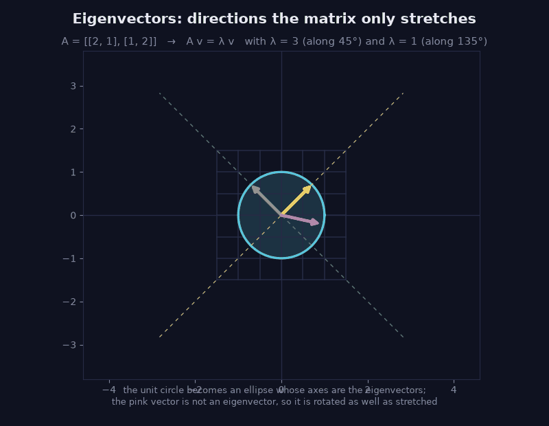
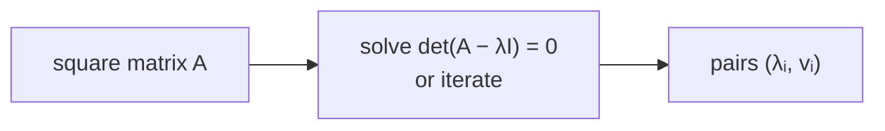

> Tier 1 · Mathematics for AI · **Level: intermediate (take it slowly)** · Reading time: about 12 minutes

# 1.18 Eigenvalues and eigenvectors

**Metadata** — Tier: 1 · Phase: 1 · Priority: P1 · Difficulty: 4/5 · Interview: Medium-High · Hands-on: Medium
Prerequisites: 1.3, 1.11, 1.12, 1.15 · Leads to: 1.19 SVD, PCA (Tier 2), RNN stability (Tier 5), optimisation curvature (Tier 4)

> **In plain words**
> Most vectors get **turned and stretched** when you multiply them by a matrix. But a few special directions are only **stretched (or shrunk, or flipped)**; they stay on their own line.
> Those special directions are the **eigenvectors**; the stretch factors are the **eigenvalues**. They show you the matrix's "natural axes".

**You need first:** 1.3 Matrices, 1.11 Matrix multiplication, 1.12 Transpose, 1.15 Norms.

> **Figure 1.18-1 — eigenvectors under the matrix [[2, 1], [1, 2]] (animated)**
>
> 
>
> *How to read it:* the matrix is applied gradually. The circle becomes an ellipse whose axes are the eigenvectors: the yellow one is stretched 3× (λ = 3, along 45°), the teal one is unchanged (λ = 1, along 135°). The pink vector is **not** an eigenvector, so it is both stretched and rotated. Eigenvectors are exactly the directions that stay on their own line.
>
> *Generated by* `tier-01-mathematics/figures/src/t1_linalg_calculus.py`. The dominant eigenvalue is checked against `power_iteration`.

**Words you'll meet on this page**

| Word | What it means here |
|---|---|
| eigenvector `v` | a direction that `A` only stretches: `Av = λv` |
| eigenvalue `λ` | the stretch factor for that direction |
| symmetric matrix | equal to its transpose; has nice, real eigenvectors |
| orthonormal | at right angles to each other and each of length 1 |
| power iteration | a simple method: multiply by `A` again and again |
| spectral radius | the largest `|λ|` |

### 1. What is it?
For a square matrix `A`, a non-zero vector `v` is an **eigenvector** with **eigenvalue** `λ` if

`A v = λ v`

`A` only scales `v` by the factor `λ`; it does not change its direction.

### 2. Why does it exist?
A matrix can do complicated things: rotate, shear, stretch. Eigenvectors are the special axes where it does something *simple* (just scaling). Knowing them tells you the matrix's dominant directions, stability, curvature and variance.

### 3. Detailed explanation
- **How to find them:** solve `det(A − λI) = 0` for `λ`, then solve `(A − λI)v = 0` for `v`.
- **What `λ` means:** `λ > 1` stretches, `0 < λ < 1` shrinks, `λ < 0` flips, `λ = 0` means the matrix is singular (1.14).
- **Symmetric matrices** (covariance matrices, `AᵀA`) always have **real** eigenvalues and **orthonormal** eigenvectors, so `S = QΛQᵀ`. Use `np.linalg.eigh` for them.
- **Rotations** have no real eigenvector: a 90° rotation `[[0, −1], [1, 0]]` has the complex eigenvalues `±i`.
- **Powers:** `Aᵏv = λᵏv`. Repeatedly multiplying is dominated by the largest `|λ|`. If it is above 1 things explode, below 1 they fade. This is the linear-algebra root of exploding and vanishing gradients in RNNs (Tier 5).
- **Handy facts:** the **sum** of the eigenvalues equals the trace (sum of the diagonal); the **product** equals the determinant.

### 4. How does it work? Power iteration
To find the dominant eigenvector, start with any vector and repeat: multiply by `A`, then rescale to length 1. The vector turns toward the direction with the largest `|λ|`. The ratio `vᵀAv / vᵀv` (the Rayleigh quotient) estimates `λ`. Real libraries use more robust methods.

### 5. Simple example
**By hand with `A = [[2, 1], [1, 2]]`.**

Try `v = [1, 1]`: `A v = [2·1 + 1·1, 1·1 + 2·1] = [3, 3] = 3·[1, 1]`. So `[1, 1]` is an eigenvector with `λ = 3`.

Try `v = [1, −1]`: `A v = [2 − 1, 1 − 2] = [1, −1] = 1·[1, −1]`. Another eigenvector, with `λ = 1`.

Try `v = [1, 0]` (not an eigenvector): `A v = [2, 1]`. It points in a new direction, so it was turned as well as stretched.

Check the facts: trace = 2 + 2 = 4 = 3 + 1 ✓; determinant = 4 − 1 = 3 = 3 · 1 ✓.

### 6. Technical example
- **PCA:** the principal components are eigenvectors of the covariance matrix; the eigenvalues are the variances along them (1.32).
- **PageRank:** the dominant eigenvector of a link matrix.
- **Loss-surface curvature:** the eigenvalues of the Hessian say how curved the loss is in each direction (1.46); a wide spread makes optimisation hard.

### 7. Code
**① By hand (plain Python).** Power iteration on the 2 × 2 example.

```python
import math

A = [[2, 1], [1, 2]]
v = [1.0, 0.0]                                   # any starting vector
for _ in range(30):
    w = [A[0][0] * v[0] + A[0][1] * v[1], A[1][0] * v[0] + A[1][1] * v[1]]   # A v
    norm = math.hypot(*w)
    v = [w[0] / norm, w[1] / norm]               # rescale to length 1
Av = [A[0][0] * v[0] + A[0][1] * v[1], A[1][0] * v[0] + A[1][1] * v[1]]
lam = Av[0] * v[0] + Av[1] * v[1]                # Rayleigh quotient
print("eigenvalue:", round(lam, 4), " eigenvector:", [round(x, 4) for x in v])
```

```text
eigenvalue: 3.0  eigenvector: [0.7071, 0.7071]
```

**② With NumPy.**

```python
import numpy as np

A = np.array([[2.0, 1.0], [1.0, 2.0]])
w, Q = np.linalg.eigh(A)                          # eigh: for symmetric matrices
print("eigenvalues:", w)
print("eigenvectors (columns):\n", Q.round(4))
print("A v = λ v holds:", np.allclose(A @ Q[:, 1], w[1] * Q[:, 1]))
print("rebuild A = Q Λ Qᵀ:", np.allclose(Q @ np.diag(w) @ Q.T, A))
rot = np.array([[0.0, -1.0], [1.0, 0.0]])
print("rotation's eigenvalues:", np.linalg.eigvals(rot))
```

```text
eigenvalues: [1. 3.]
eigenvectors (columns):
 [[-0.7071  0.7071]
 [ 0.7071  0.7071]]
A v = λ v holds: True
rebuild A = Q Λ Qᵀ: True
rotation's eigenvalues: [0.+1.j 0.-1.j]
```

**③ With PyTorch.**

```python
import torch

A = torch.tensor([[2.0, 1.0], [1.0, 2.0]])
values, vectors = torch.linalg.eigh(A)
print("eigenvalues:", values.tolist())
```

```text
eigenvalues: [1.0, 3.0]
```

### 8. Input → Process → Output



<details>
<summary><b>Beyond the basics (sections 9–16)</b> — real-world use, limits, mistakes. Skip on a first read.</summary>

### 9. Enterprise use case
Dimensionality reduction (PCA) for feature compression and anomaly detection on high-dimensional telemetry.

### 10. AI engineering connection
PCA and whitening of embeddings, loss-surface curvature, stability of recurrent dynamics, spectral normalisation of weights, graph methods such as spectral clustering.

### 11. Advantages
Explains a matrix with a few numbers; splits a symmetric transformation into independent axes.

### 12. Limitations
Square matrices only; may be complex; some matrices cannot be diagonalised; non-symmetric matrices have non-orthogonal, badly conditioned eigenvectors. For rectangular data use SVD (1.19).

### 13. Trade-offs
A full decomposition costs `O(n³)`. Partial (top-k) methods are far cheaper when only the leading components matter.

### 14. Common mistakes
Using `eig` instead of `eigh` for symmetric matrices (the result can be complex and unsorted); assuming eigenvectors are unique (their sign and scale are arbitrary); forgetting to centre data before computing a covariance matrix; treating numerical noise as symmetry.

### 15. Performance / cost
Dense eigendecomposition is roughly `O(n³)`. For embeddings of width 4,096 that is feasible; for `n = 10⁶` it is not (use randomised or truncated methods).

### 16. Security
Nothing beyond input-size limits.

</details>

### 17. Interview explanation
"An eigenvector is a direction a matrix only stretches, and the eigenvalue is the stretch factor. For symmetric matrices like a covariance matrix, the eigenvectors are orthogonal axes ordered by importance, which is PCA. In recurrent networks the largest eigenvalue of the recurrent matrix tells you whether signals explode or fade."

### 18. Rapid-fire answer
`Av = λv`; symmetric means real λ and orthogonal v; the largest `|λ|` dominates repeated products.

### 19. Interview questions
- **Basic:** Define an eigenvector and an eigenvalue.
- **Intermediate:** Why does a rotation matrix have complex eigenvalues? What does `λ = 0` imply?
- **Advanced:** How does the spectral radius relate to exploding gradients in RNNs? Why `eigh` for symmetric matrices?
- **Scenario:** Embeddings occupy a narrow cone (anisotropy). How would the covariance eigenvalue spectrum show it, and what would you do?

### 20. Hands-on exercise
**Goal:** find the main direction of a tilted cloud of points.

1. Make 500 points with a strong correlation (for example `x`, and `y = 2x + small noise`).
2. Compute their covariance matrix.
3. Find its eigenvectors. Which one points along the cloud, and what share of the variance does it carry?

<details>
<summary>Show a solution</summary>

```python
import numpy as np

rng = np.random.default_rng(0)
x = rng.standard_normal(500)
y = 2 * x + 0.3 * rng.standard_normal(500)
cov = np.cov(np.stack([x, y]))
w, Q = np.linalg.eigh(cov)                  # eigenvalues in increasing order
main = Q[:, -1]                              # eigenvector with the largest eigenvalue
print("main direction:", (main * np.sign(main[0])).round(3), "(slope y/x about 2)")
print("share of variance:", round(float(w[-1] / w.sum()), 3))
```

```text
main direction: [0.441 0.897] (slope y/x about 2)
share of variance: 0.997
```

The first eigenvector points along the cloud (slope about 2) and carries almost all of the variance: that is PCA.
</details>

### 21. Revision questions
1. What equation defines an eigenvector?
2. What is special about the eigendecomposition of a symmetric matrix?
3. What does power iteration converge to, and when does it fail?

### 22. Related concepts
1.19 SVD · 1.32 Covariance · 1.46 Optimisation landscapes · Tier 5 RNN gradients

### 23. One-line memory hook
**Eigenvectors are a matrix's natural axes; eigenvalues say how hard it pulls along each.**

<details>
<summary><b>For reviewers</b> (not part of the lesson)</summary>

- Status: DRAFT, learner-first layout (Author: Claude). Code is executed by `tests/test_md_snippets.py`.
- TESTED earlier: power iteration vs NumPy, `Av = λv` residual, symmetric reconstruction and orthonormality (`code/linalg_core.py`).
- The first draft's example `[[4, 1], [2, 3]]` (λ = 5 and 2) is replaced by `[[2, 1], [1, 2]]` so the page matches Figure 1.18-1.
- PCA is referenced as Tier 2 content; whether PCA has its own concept in the frozen roadmap is the open PROPOSE_ADDITION (see `reviews/author_open_items.md`).
</details>
