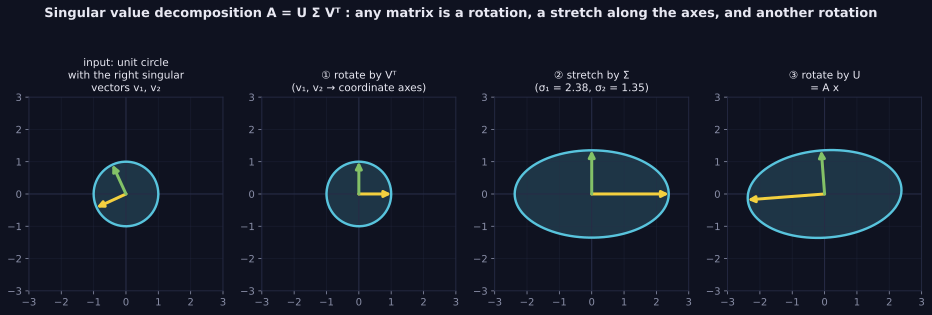
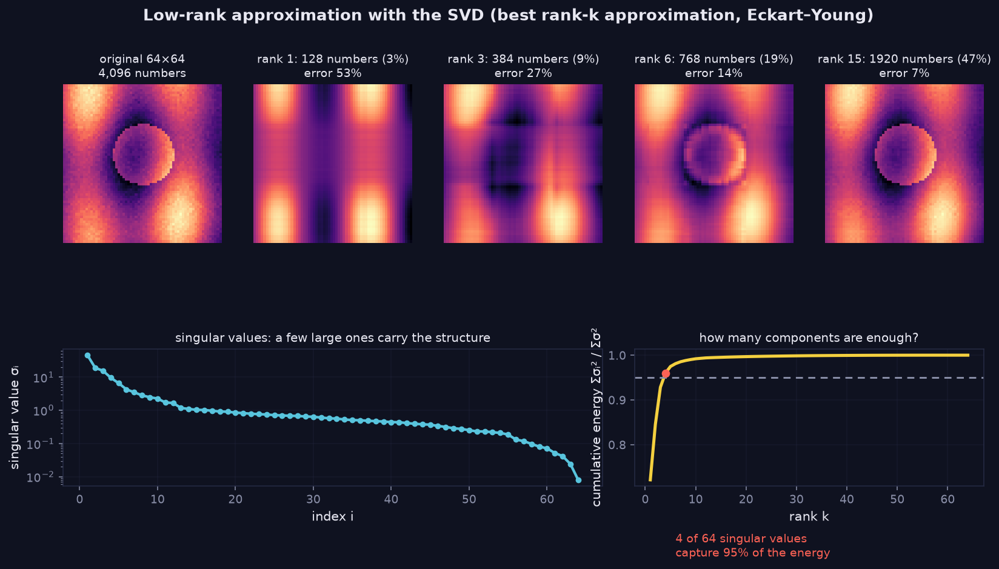
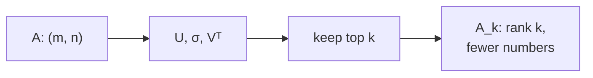

> Tier 1 · Mathematics for AI · **Level: intermediate (take it slowly)** · Reading time: about 12 minutes

# 1.19 Singular Value Decomposition (SVD)

**Metadata** — Tier: 1 · Phase: 1 · Priority: P1 · Difficulty: 4/5 · Interview: High · Hands-on: Medium-High
Prerequisites: 1.11, 1.12, 1.14, 1.18 · Leads to: PCA (Tier 2), LoRA / low-rank adaptation (Tier 10), embedding compression, pseudo-inverse

> **In plain words**
> **SVD** says that **any** matrix can be broken into three simple steps: **rotate, stretch along the axes, rotate again**.
> The stretch amounts, the **singular values**, tell you which directions matter most. Keep only the biggest few and you get a smaller, simpler matrix that is still very close to the original. That idea powers image compression, PCA and LoRA.

**You need first:** 1.11 Matrix multiplication, 1.12 Transpose, 1.14 Inverse, 1.18 Eigenvalues.

> **Figure 1.19-1 — SVD as rotate-stretch-rotate**
>
> 
>
> *How to read it:* any matrix `A = UΣVᵀ` acts as a rotation `Vᵀ`, a stretch `Σ` along the axes (σ₁ = 2.38 and σ₂ = 1.35 here), and another rotation `U`. A circle turns into an ellipse whose axis lengths are the singular values.
>
> **Figure 1.19-2 — keeping only the top singular values**
>
> 
>
> *How to read it:* keeping only the top `k` singular values gives the best rank-`k` approximation. The 64×64 image needs 4,096 numbers; rank 6 uses 768 (19%) with 14% error; 4 of the 64 singular values already carry 95% of the "energy".
>
> *Generated by* `tier-01-mathematics/figures/src/t1_linalg_calculus.py`.

**Words you'll meet on this page**

| Word | What it means here |
|---|---|
| singular values `σ` | the stretch amounts, largest first, never negative |
| `U`, `V` | the two rotation (orthogonal) matrices |
| rank | the number of non-zero singular values: how many independent directions |
| low-rank approximation | keep only the top `k` singular values |
| energy | `Σ σᵢ²`: a measure of how much "content" the matrix has |
| pseudo-inverse | an "almost inverse" for any matrix, built from the SVD |

### 1. What is it?
Any real `m × n` matrix can be written `A = U Σ Vᵀ`:

- `U` (`m × m`) and `V` (`n × n`) are orthogonal matrices (rotations or reflections);
- `Σ` (`m × n`) is diagonal, holding the **singular values** `σ₁ ≥ σ₂ ≥ … ≥ 0`.

The "economy" form (`full_matrices=False`) keeps only `r = min(m, n)` columns: `U (m×r)`, `σ (r)`, `Vᵀ (r×n)`.

### 2. Why does it exist?
Eigendecomposition (1.18) needs a square matrix and can give complex numbers. SVD exists for **every** matrix.

### 3. Detailed explanation
- Singular values are the square roots of the eigenvalues of `AᵀA`.
- **Rank** = number of non-zero singular values.
- **Condition number** `κ = σ_max / σ_min` (1.14).
- **Eckart–Young theorem:** keeping the top `k` terms, `A_k = Σ_{i≤k} σᵢ uᵢ vᵢᵀ`, gives the **best possible** rank-`k` approximation. The error is exactly `√(σ_{k+1}² + … + σ_r²)`.
- **Pseudo-inverse:** `A⁺ = V Σ⁺ Uᵀ` (invert the non-zero `σ`s) gives least-squares answers when `A` is not invertible.
- **PCA** is the SVD of the *centred* data matrix.
- **Signs are ambiguous:** `(uᵢ, vᵢ)` and `(−uᵢ, −vᵢ)` are equally valid. Never test for a specific sign.

### 4. How does it work?
Picture the unit circle (or sphere) being mapped to an ellipse (or ellipsoid). The `σᵢ` are the lengths of its semi-axes, the `vᵢ` the input directions that become those axes, and the `uᵢ` the output directions. Computation uses iterative methods (about `O(mn·min(m,n))`); randomised or truncated SVD is much cheaper for the top `k`.

### 5. Simple example
**An image is a matrix of brightness values.** The first few singular values capture the broad shapes; the later ones capture fine detail and noise. Keep the top few and the picture is still recognisable (Figure 1.19-2).

**A tiny case by hand.** `A = [[3, 0], [0, 2]]` just stretches the x-axis by 3 and the y-axis by 2, so its singular values are 3 and 2, and `U = V = I`. A matrix like `[[1, 1], [1, 1]]` has singular values 2 and 0: only one direction survives (rank 1), so one term already reproduces it exactly.

### 6. Technical example
- **Compression:** a 4096 × 4096 weight matrix has 16.8 million numbers. Rank-16 factors, (4096 × 16) and (16 × 4096), have about 131 thousand: roughly 128 times fewer.
- **LoRA (Tier 10)** assumes the fine-tuning update `ΔW` is low-rank, `ΔW = BA`, so only two thin matrices are trained.
- **Latent semantic analysis, embedding denoising, whitening.**

### 7. Code
**① By hand (plain Python).** For a rank-1 matrix, SVD can be seen directly: rows are multiples of one row.

```python
A = [[1, 2, 3],
     [2, 4, 6],
     [3, 6, 9]]            # every row is a multiple of [1, 2, 3]
u = [1, 2, 3]              # column pattern
v = [1, 2, 3]              # row pattern
rebuilt = [[u[i] * v[j] for j in range(3)] for i in range(3)]
print("one outer product rebuilds A exactly:", rebuilt == A)
print("stored numbers: 9 in A, but only", len(u) + len(v), "in the two vectors")
```

```text
one outer product rebuilds A exactly: True
stored numbers: 9 in A, but only 6 in the two vectors
```

**② With NumPy.**

```python
import numpy as np

M = np.random.default_rng(0).standard_normal((20, 12))
U, s, Vt = np.linalg.svd(M, full_matrices=False)
print("shapes:", U.shape, s.shape, Vt.shape)
print("exact rebuild:", np.allclose((U * s) @ Vt, M))

k = 4
Mk = (U[:, :k] * s[:k]) @ Vt[:k]                       # keep top-k terms
print("rank of the approximation:", np.linalg.matrix_rank(Mk))
print("error equals √(sum of dropped σ²):", np.isclose(np.linalg.norm(M - Mk), np.sqrt(np.sum(s[k:] ** 2))))
```

```text
shapes: (20, 12) (12,) (12, 12)
exact rebuild: True
rank of the approximation: 4
error equals √(sum of dropped σ²): True
```

**③ With PyTorch.**

```python
import torch

M = torch.arange(12.0).reshape(3, 4)
U, S, Vh = torch.linalg.svd(M, full_matrices=False)
print("singular values:", [round(v, 3) for v in S.tolist()])
print("rank:", torch.linalg.matrix_rank(M).item(), "(rows are linear in the row index)")
```

```text
singular values: [22.409, 1.955, 0.0]
rank: 2 (rows are linear in the row index)
```

### 8. Input → Process → Output



<details>
<summary><b>Beyond the basics (sections 9–16)</b> — real-world use, limits, mistakes. Skip on a first read.</summary>

### 9. Enterprise use case
Compressing embedding stores or model weights; denoising sensor and telemetry matrices; recommender systems (matrix factorisation).

### 10. AI engineering connection
LoRA and rank analysis of weight updates; embedding dimensionality reduction; analysing collapse; stability checks (singular values of weights and Jacobians); spectral normalisation.

### 11. Advantages
Exists for every matrix; gives the optimal low-rank approximation; numerically stable; reveals rank and conditioning.

### 12. Limitations
Linear only (cannot capture curved structure); a full SVD costs `O(mn·min(m,n))`; truncation can discard rare but important signal.

### 13. Trade-offs
A lower rank `k` is smaller and smoother but reconstructs less exactly. Choose `k` by the share of energy kept (`Σσᵢ² / Σσ²`) or by the task metric, not by guesswork.

### 14. Common mistakes
Forgetting to centre data before PCA; confusing `Vᵀ` with `V` (NumPy returns `Vt`); using `full_matrices=True` on tall matrices (a huge `U`); testing for specific signs; applying SVD to features with very different scales without standardising.

### 15. Performance / cost
A full SVD of a 10,000 × 10,000 float64 matrix needs about 800 MB per matrix and is slow; use randomised or truncated SVD for the top `k`. Factorising saves `mn − k(m + n)` numbers but adds a second matrix multiplication at inference.

### 16. Security
The low-rank structure of released weights or embeddings might help model-extraction or membership-inference attacks. REVIEW_REQUIRED: cite specific literature before publishing this claim.

</details>

### 17. Interview explanation
"SVD factors any matrix into a rotation, a scaling by singular values, and another rotation. Keeping the top k singular values gives the best rank-k approximation, which is the idea behind PCA, embedding compression and LoRA. It's more general than eigendecomposition because it works on any rectangular matrix."

### 18. Rapid-fire answer
`A = UΣVᵀ`; the top-k truncation is the best rank-k approximation; PCA is the SVD of centred data.

### 19. Interview questions
- **Basic:** What are `U`, `Σ` and `V`? What does rank mean here?
- **Intermediate:** SVD versus eigendecomposition? How do singular values relate to eigenvalues of `AᵀA`?
- **Advanced:** State Eckart–Young. Why does LoRA's low-rank assumption make sense? How do you choose `k`?
- **Scenario:** You must shrink a 4096 × 4096 layer by 8×. What rank gives that, and how would you check the accuracy loss?

### 20. Hands-on exercise
**Goal:** compress a matrix and find how many singular values you need.

1. Make a 40 × 40 matrix that is a rank-3 pattern plus a little noise.
2. Compute its singular values and the share of energy kept by the top `k`.
3. Find the smallest `k` that keeps 95% of the energy.

<details>
<summary>Show a solution</summary>

```python
import numpy as np

rng = np.random.default_rng(0)
A = rng.standard_normal((40, 3)) @ rng.standard_normal((3, 40)) + 0.05 * rng.standard_normal((40, 40))
s = np.linalg.svd(A, compute_uv=False)
energy = np.cumsum(s ** 2) / np.sum(s ** 2)
k = int(np.argmax(energy >= 0.95)) + 1
print("top singular values:", s[:5].round(2))
print("smallest k keeping 95% energy:", k)
```

```text
top singular values: [49.04 39.99 28.99  0.62  0.56]
smallest k keeping 95% energy: 3
```

Three big singular values stand out (the true rank), then the noise values are tiny.
</details>

### 21. Revision questions
1. What are the shapes in the economy SVD?
2. What does Eckart–Young guarantee?
3. How do you read the rank and condition number from the singular values?

### 22. Related concepts
1.14 Inverse · 1.18 Eigenvalues · 1.32 Covariance · Tier 2 PCA · Tier 10 LoRA

### 23. One-line memory hook
**SVD: rotate, stretch, rotate, and keep only the biggest stretches.**

<details>
<summary><b>For reviewers</b> (not part of the lesson)</summary>

- Status: DRAFT, learner-first layout (Author: Claude). Code is executed by `tests/test_md_snippets.py`.
- TESTED earlier: reconstruction, Eckart–Young error identity, resulting rank, parameter-count saving (`code/linalg_core.py`).
- Section 16 (extraction/membership-inference) remains REVIEW_REQUIRED, as in the first draft.
</details>
