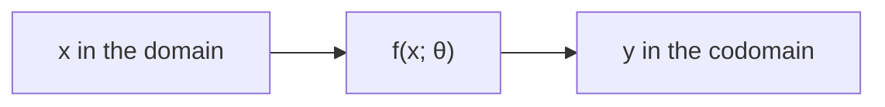

> Tier 1 · Mathematics for AI · **Level: absolute beginner** · Reading time: about 8 minutes

# 1.20 Functions

**Metadata** — Tier: 1 · Phase: 1 · Priority: P0 · Difficulty: 1/5 · Interview: Medium · Hands-on: High
Prerequisites: 1.1–1.4 · Leads to: 1.21 Derivatives, 1.25 Chain rule, Tier 3 activations and layers

> **In plain words**
> A **function** is a **machine**: you put something in, it follows a fixed rule, and exactly one thing comes out.
> A neural network is a long chain of such machines, with a final "how wrong was it?" machine at the end.

**You need first:** 1.1–1.4 (scalars to tensors): the things that go in and out.

> **Figure 1.20-1 — a network is functions in a chain**
>
> ```mermaid
> flowchart LR
>     X["input x"] --> A["linear<br/>W₁x + b₁"]
>     A --> B["ReLU<br/>max(0, ·)"]
>     B --> C["linear<br/>W₂· + b₂"]
>     C --> D["softmax"]
>     D --> E["prediction ŷ"]
>     E --> F["loss L(ŷ, y)<br/>one number"]
> ```
>
> *How to read it:* each box is a function. The output of one is the input of the next: that is **composition**, written `g(f(x))`. The last box turns the prediction and the correct answer into one score, the loss.

**Words you'll meet on this page**

| Word | What it means here |
|---|---|
| function `f` | a rule giving exactly one output for each input |
| domain / codomain | the allowed inputs / the possible outputs |
| composition | feeding one function's output into the next: `g(f(x))` |
| linear | `f(ax + by) = a f(x) + b f(y)`; no curves |
| nonlinear | anything that is not linear (curved, bent) |
| activation function | the nonlinear function between layers (ReLU, sigmoid, tanh) |
| parameters `θ` | the adjustable numbers inside a function |

### 1. What is it?
A rule `f: X → Y` that gives every input in the domain `X` **exactly one** output in the codomain `Y`. The inputs and outputs can be scalars, vectors or tensors: `f: ℝⁿ → ℝᵐ` takes `n` numbers and returns `m` numbers.

### 2. Why does it exist?
It is the language for "something that turns inputs into outputs". A model, a layer, an activation, a loss and a metric are all functions.

### 3. Detailed explanation
- **Composition:** `(g ∘ f)(x) = g(f(x))`. A neural network is a long composition of simple functions.
- **Linear vs nonlinear.** A function is *linear* if `f(ax + by) = a f(x) + b f(y)`. **Stacking linear layers gives only another linear layer**: `W₂(W₁x) = (W₂W₁)x`. Without nonlinear activations, depth adds nothing. This is why every network puts a nonlinearity between layers.
- **Scalar-valued** (`ℝⁿ → ℝ`, like a loss) versus **vector-valued** (`ℝⁿ → ℝᵐ`, like a layer).
- **Handy properties:** monotonic (always rising), bounded, smooth (has derivatives), invertible, convex (1.45).
- **Inputs versus parameters:** `f(x; θ)`. During training `x` is fixed and `θ` changes; during use it is the other way around.
- **Pure functions:** same input, same output, no hidden state. They are easy to test; randomness and state should be explicit.

### 4. How does it work?
You evaluate the rule at the input. Functions you will meet constantly:

| Function | Rule | Output range |
|---|---|---|
| linear | `Wx + b` | any |
| ReLU | `max(0, x)` | 0 to ∞ |
| sigmoid | `1 / (1 + e⁻ˣ)` | (0, 1) |
| tanh | hyperbolic tangent | (−1, 1) |
| softmax | vector → probabilities that sum to 1 | (0, 1) each |
| loss | `L(ŷ, y)` → one number | ≥ 0 |

### 5. Simple example
**A vending machine.** Money and a button go in; a snack comes out. The same input always gives the same snack: that is what makes it a function.

**With numbers.** `f(x) = 2x + 1`:

| x | f(x) |
|---|---|
| 0 | 1 |
| 1 | 3 |
| 2 | 5 |

Compose with `g(x) = x²`: `g(f(1)) = g(3) = 9`.

### 6. Technical example
`ŷ = softmax(W₂ · ReLU(W₁x + b₁) + b₂)` is a composition of five functions, with the loss `L(ŷ, y)` on the end.

### 7. Code
**① By hand (plain Python).**

```python
def f(x): return 2 * x + 1
def g(x): return x ** 2

print([f(x) for x in (0, 1, 2)])
print("g(f(1)) =", g(f(1)))
```

```text
[1, 3, 5]
g(f(1)) = 9
```

**② With NumPy.** Why activations matter: linear layers collapse into one.

```python
import numpy as np

rng = np.random.default_rng(7)
x = rng.standard_normal(5)
W1 = rng.standard_normal((4, 5))
W2 = rng.standard_normal((3, 4))
relu = lambda v: np.maximum(v, 0)

print("two linear layers = one layer:", np.allclose(W2 @ (W1 @ x), (W2 @ W1) @ x))
print("with ReLU in between, still one layer?", np.allclose(W2 @ relu(W1 @ x), (W2 @ W1) @ x))
```

```text
two linear layers = one layer: True
with ReLU in between, still one layer? False
```

**③ With PyTorch.** A tiny network as a composition.

```python
import torch

net = torch.nn.Sequential(torch.nn.Linear(5, 4), torch.nn.ReLU(), torch.nn.Linear(4, 3), torch.nn.Softmax(dim=-1))
x = torch.ones(1, 5)
y = net(x)
print("output shape:", tuple(y.shape), " sums to 1:", round(y.sum().item(), 4))
```

```text
output shape: (1, 3)  sums to 1: 1.0
```

### 8. Input → Process → Output



<details>
<summary><b>Beyond the basics (sections 9–16)</b> — real-world use, limits, mistakes. Skip on a first read.</summary>

### 9. Enterprise use case
Feature transformations in a data pipeline are functions. Versioning them and keeping them pure keeps training and serving consistent and avoids "training/serving skew".

### 10. AI engineering connection
Layers, activations, losses, metrics, tokenisers and even tools an agent calls ("function calling") are functions with typed inputs and outputs.

### 11. Advantages
Complex behaviour from simple parts, each of which can be tested.

### 12. Limitations
A function gives one output per input. One-to-many behaviour (sampling) needs randomness modelled explicitly (1.27).

### 13. Trade-offs
Deeper composition is more expressive but harder to optimise and debug.

### 14. Common mistakes
Forgetting nonlinearity between layers; confusing the domain (softmax acts on a vector, not a single number); hidden global state or randomness inside "functions".

### 15. Performance / cost
The cost of a composition is the sum of its parts; the memory kept for backpropagation grows with depth.

### 16. Security
Treat every function exposed to a model (a tool call) as an untrusted-input boundary: validate its arguments.

</details>

### 17. Interview explanation
"A function maps inputs to outputs. A neural network is a big composition of simple functions, linear maps and nonlinearities, with a loss function at the end. The nonlinearities matter because stacked linear maps would collapse into a single linear map."

### 18. Rapid-fire answer
A function maps each input to one output; networks are compositions; nonlinearity prevents the stack collapsing.

### 19. Interview questions
- **Basic:** What are the domain and codomain of a linear layer `ℝ⁵ → ℝ⁴`?
- **Intermediate:** Why can't a deep network made only of linear layers model XOR?
- **Advanced:** Which properties do you want in an activation (differentiable, non-saturating, cheap)?
- **Scenario:** Training and serving predictions differ. List function-level causes.

### 20. Hands-on exercise
**Goal:** see where each activation is flat.

1. Define sigmoid, tanh and ReLU.
2. Evaluate them at `x = −5, −1, 0, 1, 5`.
3. For which inputs is each nearly constant (so its slope is nearly 0)?

<details>
<summary>Show a solution</summary>

```python
import numpy as np

x = np.array([-5, -1, 0, 1, 5], dtype=float)
print("x      :", x)
print("sigmoid:", (1 / (1 + np.exp(-x))).round(3))
print("tanh   :", np.tanh(x).round(3))
print("relu   :", np.maximum(x, 0))
```

```text
x      : [-5. -1.  0.  1.  5.]
sigmoid: [0.007 0.269 0.5   0.731 0.993]
tanh   : [-1.    -0.762  0.     0.762  1.   ]
relu   : [0. 0. 0. 1. 5.]
```

Sigmoid and tanh are flat for large `|x|` (they saturate); ReLU is flat only for negative `x`.
</details>

### 21. Revision questions
1. Define composition.
2. Why do networks need nonlinearity?
3. What is the difference between scalar-valued and vector-valued functions?

### 22. Related concepts
1.21 Derivatives · 1.25 Chain rule · Tier 3 Activation functions

### 23. One-line memory hook
**A network is functions stacked; nonlinearity stops the stack collapsing.**

<details>
<summary><b>For reviewers</b> (not part of the lesson)</summary>

- Status: DRAFT, learner-first layout (Author: Claude). Code is executed by `tests/test_md_snippets.py`.
- TESTED earlier: `test_linear_layers_collapse_without_nonlinearity` (`code/calculus_prob.py`).
</details>
