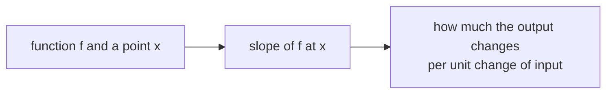

> Tier 1 · Mathematics for AI · **Level: beginner** · Reading time: about 10 minutes

# 1.21 Derivatives

**Metadata** — Tier: 1 · Phase: 1 · Priority: P0 · Difficulty: 2/5 · Interview: High · Hands-on: High
Prerequisites: 1.20 Functions · Leads to: 1.22–1.25, Tier 4 optimisation

> **In plain words**
> The **derivative** tells you **how fast a function's output changes when you nudge its input**. It is the **slope** of the curve at a point.
> Training a model asks exactly this question: "if I nudge this weight a little, does the error go up or down, and by how much?"

**You need first:** 1.20 Functions.

> **Figure 1.21-1 — the derivative as the limit of secant slopes (animated)**
>
> 
>
> *How to read it:* for `f(x) = x³` at `x₀ = 0.7`, the slope of the line through two points is 4.52 when the gap `h ≈ 1`, 1.99 when `h ≈ 0.23` and 1.47 when `h = 0.001`. The tangent slope is `3x₀² = 1.47`. The derivative is the number these slopes **approach** as `h → 0`.
>
> *Generated by* `tier-01-mathematics/figures/src/t1_linalg_calculus.py`.

**Words you'll meet on this page**

| Word | What it means here |
|---|---|
| derivative `f′(x)` | the slope of `f` at `x`; rate of change |
| tangent line | the straight line that just touches the curve at a point |
| secant line | a line through two points of the curve |
| finite difference | estimating the slope from two nearby points |
| automatic differentiation | the computer applies the chain rule exactly (1.25) |
| learning rate `η` | how far we step along the slope |

### 1. What is it?
The rate of change of a function:

`f′(x) = lim_{h→0} (f(x + h) − f(x)) / h`

Geometrically it is the slope of the tangent line at `x`.

### 2. Why does it exist?
To answer "if I change the input a little, how does the output change?" The sign says which way (up or down); the size says how strongly.

### 3. Detailed explanation
- `f′(x) > 0`: the function is rising. `f′(x) < 0`: falling. `f′(x) = 0`: a flat spot (a minimum, a maximum or a saddle).
- **Small-step rule:** `f(x + h) ≈ f(x) + f′(x)·h`.
- **Rules to know:** sum rule; product rule `(fg)′ = f′g + fg′`; chain rule (1.25). Common ones: `(xⁿ)′ = n·xⁿ⁻¹`, `(eˣ)′ = eˣ`, `(ln x)′ = 1/x`, sigmoid `σ′ = σ(1 − σ)`, `tanh′ = 1 − tanh²`.
- **ReLU** has a kink at 0 where the derivative does not exist. Frameworks simply pick a value (usually 0). It works because landing exactly on 0 is rare.
- **Gradient descent in one dimension:** `x ← x − η·f′(x)`: step against the slope.

### 4. How does it work? Three ways to get a derivative
1. **By hand** (symbolic): use the rules.
2. **Numerically** (finite differences): `(f(x + h) − f(x − h)) / 2h`. Its error shrinks like `h²`, but if `h` is *too* small, rounding errors take over (floating-point cancellation, 1.40). There is a sweet spot (about `1e-5` in float64).
3. **Automatic differentiation:** the computer applies the chain rule to your program: exact and fast. This is what PyTorch does.

### 5. Simple example
**A speedometer.** Distance travelled is a function of time; its derivative is your speed.

**By hand with numbers.** `f(x) = x²` at `x = 3`. The exact rule gives `f′(3) = 2·3 = 6`. Check with secant slopes:

| Step `h` | Slope `(f(3 + h) − f(3)) / h` |
|---|---|
| 1 | `(16 − 9) / 1 = 7` |
| 0.1 | `(9.61 − 9) / 0.1 = 6.1` |
| 0.001 | `≈ 6.001` |

The slopes close in on 6, the derivative.

### 6. Technical example
For the squared error `(w·x − y)²`, the derivative with respect to the weight `w` is `2(w·x − y)·x`. It tells you how much the error changes per unit change of `w`.

### 7. Code
**① By hand (plain Python).** Finite differences.

```python
def derivative(f, x, h=1e-5):
    return (f(x + h) - f(x - h)) / (2 * h)       # central difference

print("d/dx x^3 at 2   :", round(derivative(lambda x: x ** 3, 2.0), 4), "(exact 12)")
print("d/dx x^2 at 3   :", round(derivative(lambda x: x ** 2, 3.0), 4), "(exact 6)")
for h in (1.0, 0.1, 0.001):
    print("secant slope, h =", h, "->", round(((3 + h) ** 2 - 9) / h, 4))
```

```text
d/dx x^3 at 2   : 12.0 (exact 12)
d/dx x^2 at 3   : 6.0 (exact 6)
secant slope, h = 1.0 -> 7.0
secant slope, h = 0.1 -> 6.1
secant slope, h = 0.001 -> 6.001
```

**② With NumPy.** The sweet spot for `h`.

```python
import numpy as np

def derivative(f, x, h):
    return (f(x + h) - f(x - h)) / (2 * h)

for h in (1e-1, 1e-3, 1e-5, 1e-9, 1e-13):
    err = abs(derivative(np.exp, 1.0, h) - np.e)
    print(f"h = {h:.0e}   error = {err:.2e}")
```

```text
h = 1e-01   error = 4.53e-03
h = 1e-03   error = 4.53e-07
h = 1e-05   error = 5.86e-11
h = 1e-09   error = 6.60e-09
h = 1e-13   error = 4.56e-04
```

**③ With PyTorch.** Automatic differentiation gives the exact slope.

```python
import torch

x = torch.tensor(3.0, requires_grad=True)
y = x ** 2
y.backward()                        # compute dy/dx
print("autograd says dy/dx =", x.grad.item())
```

```text
autograd says dy/dx = 6.0
```

### 8. Input → Process → Output



<details>
<summary><b>Beyond the basics (sections 9–16)</b> — real-world use, limits, mistakes. Skip on a first read.</summary>

### 9. Enterprise use case
Sensitivity analysis: "how does the predicted churn change per extra support call?" is a derivative of the model's output.

### 10. AI engineering connection
Backpropagation computes derivatives of the loss; optimisers (SGD, Adam) use them; saturating activations (derivative near 0) cause vanishing gradients.

### 11. Advantages
Local, cheap, and exact with autodiff.

### 12. Limitations
Only local information: it says nothing about faraway regions. Undefined at kinks and jumps.

### 13. Trade-offs
Numerical differentiation is simple but slow and approximate; autodiff is exact but needs framework support. Use numerical derivatives to *check* analytic ones.

### 14. Common mistakes
Choosing a huge or tiny `h`; confusing `f′(x)` with `f(x)`; forgetting the activation's derivative in hand-written backprop.

### 15. Performance / cost
A numerical derivative needs two function evaluations per input dimension: impossible for billions of parameters, hence autodiff.

### 16. Security
The gradient of a model's output with respect to its input is used to craft adversarial examples; exposing raw gradients exposes attack information.

</details>

### 17. Interview explanation
"The derivative tells you how fast the output changes when you nudge the input. In training, the derivative of the loss with respect to a weight tells us which way to move the weight to reduce the loss, and the learning rate says how far."

### 18. Rapid-fire answer
Derivative = instantaneous rate of change = slope; training follows it downhill.

### 19. Interview questions
- **Basic:** What is the derivative of `x³`? Of `eˣ`?
- **Intermediate:** What is `σ′` and its maximum? Why does this cause vanishing gradients?
- **Advanced:** Why does ReLU work although it is not differentiable at 0? Why is the central difference better than the forward difference?
- **Scenario:** Your numerical gradient check disagrees with autograd by 1e-2. What do you check (h, dtype, non-smooth operations, bugs)?

### 20. Hands-on exercise
**Goal:** find the best step size for a finite difference.

1. Estimate the derivative of `sin` at `x = 1` (exact: `cos(1)`) using the forward difference `(f(x + h) − f(x)) / h`.
2. Try `h = 10⁻¹ … 10⁻¹⁶`.
3. Which `h` gives the smallest error? What happens for the smallest `h`?

<details>
<summary>Show a solution</summary>

```python
import numpy as np

exact = np.cos(1.0)
for k in range(1, 17, 3):
    h = 10.0 ** -k
    approx = (np.sin(1.0 + h) - np.sin(1.0)) / h
    print(f"h = 1e-{k:<2}  error = {abs(approx - exact):.2e}")
```

```text
h = 1e-1   error = 4.29e-02
h = 1e-4   error = 4.21e-05
h = 1e-7   error = 4.18e-08
h = 1e-10  error = 5.85e-08
h = 1e-13  error = 7.34e-04
h = 1e-16  error = 5.40e-01
```

The error first shrinks as `h` shrinks, then grows again once rounding errors dominate.
</details>

### 21. Revision questions
1. What is the definition of the derivative?
2. What does `f′ = 0` mean?
3. What is the maximum of the sigmoid's derivative? (0.25)

### 22. Related concepts
1.22 Partial derivatives · 1.23 Gradients · 1.25 Chain rule · Tier 4 Optimisers

### 23. One-line memory hook
**Derivative = slope: which way, and how steeply, the output moves when you nudge the input.**

<details>
<summary><b>For reviewers</b> (not part of the lesson)</summary>

- Status: DRAFT, learner-first layout (Author: Claude). Code is executed by `tests/test_md_snippets.py`.
- TESTED earlier: known derivatives; tiny `h` noisier than moderate `h`; ReLU away from 0 and at the kink (`code/calculus_prob.py`).
- Figure numbers (4.52, 1.99, 1.47) are from the figure script. The "sweet spot about 1e-5" statement applies to float64 central differences.
</details>
