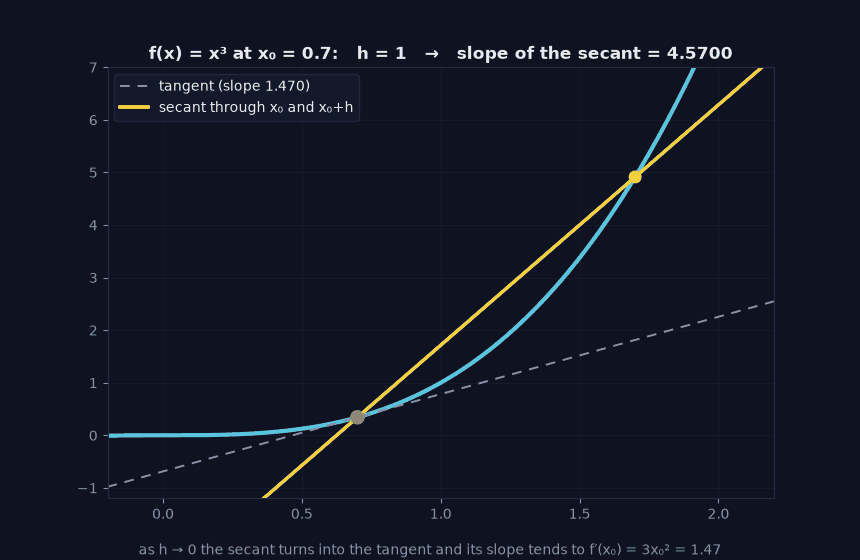

> Tier 1 — Mathematics for AI · Status: DRAFT (Author: Claude) · Code: `code/calculus_prob.py` — TESTED

# 1.21 Derivatives

**Metadata** — Tier: 1 · Phase: 1 · Priority: P0 · Difficulty: 2/5 · Interview: High · Hands-on: High
Prerequisites: 1.20 · Leads to: 1.22–1.25, Tier 4 optimization

### 1. What is it?
The rate of change of a function: `f′(x) = lim_{h→0} (f(x+h) − f(x)) / h`. Geometrically, the slope of the tangent line at `x`.

### 2. Why does it exist?
To answer "if I nudge the input a little, how does the output change?" Training is exactly this question asked about the loss with respect to each parameter.

### 3. Detailed explanation
- `f′(x) > 0`: increasing; `< 0`: decreasing; `= 0`: a flat point (minimum, maximum or saddle).
- First-order approximation: `f(x+h) ≈ f(x) + f′(x)h`.
- Rules: sum, product `(fg)′ = f′g + fg′`, quotient, chain (1.25). Common: `(xⁿ)′ = nxⁿ⁻¹`, `(eˣ)′ = eˣ`, `(ln x)′ = 1/x`, `σ′ = σ(1−σ)`, `tanh′ = 1 − tanh²`.
- ReLU has a kink at 0 with no derivative; frameworks pick a convention (subgradient, usually 0). It works in practice because exactly hitting 0 is rare.
- Gradient descent in 1-D: `x ← x − η f′(x)`.

### 4. How does it work?
Three ways to get derivatives: **symbolic** (by hand), **numerical** (finite differences), **automatic differentiation** (exact, by applying the chain rule to the program). Numerical central difference `(f(x+h) − f(x−h))/2h` has error `O(h²)`. Too-small `h` causes floating-point cancellation, so there is a sweet spot (≈1e-5 for float64 here); in float32 it is far worse.

> **Figure 1.21-1 — the derivative as the limit of secant slopes (animated)**



*How to read it:* For f(x) = x³ at x₀ = 0.7 the secant slope is 4.52 when h ≈ 1, 1.99 when h ≈ 0.23 and 1.47 when h = 0.001; the tangent slope is 3x₀² = 1.47. The derivative is the number these slopes approach as h → 0.

*Generated by* `tier-01-mathematics/figures/src/t1_linalg_calculus.py` *from this chapter's code, so the numbers are computed, not typed in.*

### 5. Simple example
Speedometer: the derivative of distance with respect to time.

### 6. Technical example
`d/dw (w·x − y)² = 2(w·x − y)x`: how the squared error changes with a weight.

### 7. Code
```python
import numpy as np
from calculus_prob import derivative
print(derivative(lambda x: x**3, 2.0))     # ≈ 12.0  (3·2²)
print(derivative(np.exp, 1.0))             # ≈ 2.71828
print(abs(derivative(np.exp, 1, 1e-13) - np.e) > abs(derivative(np.exp, 1, 1e-5) - np.e))  # True
```
TESTED: known derivatives; tiny `h` is noisier than moderate `h`; ReLU away from 0 and at the kink.

### 8. Input → Process → Output
`f, x → slope at x → how much output changes per unit input change`

### 9. Enterprise use case
Sensitivity analysis: "how does predicted churn change per extra support call?" (a derivative of the model's output).

### 10. AI engineering connection
Backpropagation computes derivatives of the loss; optimizers (SGD, Adam) use them; saturating activations (derivative ≈ 0) cause vanishing gradients.

### 11. Advantages
Local, cheap, exact with autodiff.

### 12. Limitations
Local information only (says nothing about distant regions); undefined at kinks and discontinuities.

### 13. Trade-offs
Numerical differentiation: simple but slow/inaccurate. Autodiff: exact but needs framework support. Use numerical only to *check* analytic gradients.

### 14. Common mistakes
Using a forward difference with huge or tiny `h`; confusing `f′(x)` with `f(x)`; forgetting derivatives of the activation in manual backprop.

### 15. Performance / cost
Numerical derivative costs two function evaluations per input dimension, impossible for billions of parameters, hence autodiff.

### 16. Security
Gradients of a model's output with respect to inputs are used to craft adversarial examples; exposing raw gradients is exposing attack information.

### 17. Interview explanation
"The derivative tells you how fast the output changes when you nudge the input. In training, the derivative of the loss with respect to a weight tells us which way to move the weight to reduce the loss, and the learning rate says how far."

### 18. Rapid-fire
Derivative = instantaneous rate of change = slope; training follows it downhill.

### 19. Interview questions
- Basic: Derivative of `x³`? of `eˣ`?
- Intermediate: What are `σ′` and its maximum? Why does this cause vanishing gradients?
- Advanced: Why does ReLU work despite not being differentiable at 0? Why is central difference better than forward difference?
- Scenario: Your numerical gradient check disagrees with autograd by 1e-2. What do you check (h, dtype, non-smooth ops, bugs)?

### 20. Hands-on exercise
Compute forward and central differences of `sin` at 1.0 for `h = 10⁻¹…10⁻¹⁶` in float64; plot error vs `h` and find the minimum.

### 21. Revision questions
1) Definition? 2) Meaning of `f′=0`? 3) Maximum of `σ′`? (0.25)

### 22. Related concepts
1.22 Partial derivatives · 1.23 Gradients · 1.25 Chain rule · Tier 4

### 23. Memory hook
**Derivative = slope: which way and how steeply the output moves when you nudge the input.**
