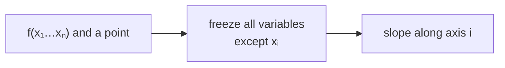

> Tier 1 · Mathematics for AI · **Level: beginner** · Reading time: about 8 minutes

# 1.22 Partial derivatives

**Metadata** — Tier: 1 · Phase: 1 · Priority: P0 · Difficulty: 2/5 · Interview: Medium-High · Hands-on: High
Prerequisites: 1.21 Derivatives · Leads to: 1.23 Gradients, 1.24 Jacobians

> **In plain words**
> When a result depends on **several inputs**, a **partial derivative** asks: "how much does the result change if I nudge **just this one input** and keep all the others fixed?"
> It is like a mixing desk: wiggle one slider, leave the rest alone, and listen to what changes.

**You need first:** 1.21 Derivatives.

> **Figure 1.22-1 — a partial derivative is the slope along one axis**
>
> ```mermaid
> flowchart LR
>     F["f(x, y) = x² + 3xy<br/>at the point (1, 2)"] --> X["wiggle x only<br/>(freeze y = 2)<br/>∂f/∂x = 2x + 3y = 8"]
>     F --> Y["wiggle y only<br/>(freeze x = 1)<br/>∂f/∂y = 3x = 3"]
> ```
>
> *How to read it:* standing at the point `(1, 2)`, moving in the `x` direction makes `f` rise at rate 8 per unit; moving in the `y` direction makes it rise at rate 3. Two slopes, one for each direction. The next concept (1.23) bundles them into a single vector, the gradient.

**Words you'll meet on this page**

| Word | What it means here |
|---|---|
| partial derivative `∂f/∂xᵢ` | slope of `f` along `xᵢ`, others held fixed |
| `∂` ("partial") | the symbol used instead of `d` when there are several variables |
| held fixed | treated as a constant while differentiating |
| Hessian | the table of second-order partials; describes curvature |

### 1. What is it?
For `f(x₁, …, xₙ)`, the partial derivative `∂f/∂xᵢ` is the derivative with respect to `xᵢ` while all other variables are held constant.

### 2. Why does it exist?
Models have millions or billions of parameters. We need the effect of changing **one** parameter at a time. Collect all those effects and you have the full picture, the gradient (1.23).

### 3. Detailed explanation
**Recipe:** pretend every other variable is a constant and differentiate as usual.

Example: `f(x, y) = x² + 3xy`.
- `∂f/∂x`: treat `y` as a constant: `2x + 3y`.
- `∂f/∂y`: treat `x` as a constant: `3x`.
- At `(1, 2)`: `∂f/∂x = 2·1 + 3·2 = 8` and `∂f/∂y = 3·1 = 3`.

Second-order partials form the **Hessian**, which describes curvature. For smooth functions the order does not matter: `∂²f/∂x∂y = ∂²f/∂y∂x`.

### 4. How does it work?
Exactly like one-variable differentiation, once per variable. Numerically: nudge one coordinate at a time by a tiny step and measure the change in `f`.

### 5. Simple example
A house price depends on area, number of rooms and age. `∂price/∂area` is the change in price for one extra square metre, with rooms and age unchanged.

**Check with numbers.** `f(x, y) = x² + 3xy` at `(1, 2)`, so `f = 1 + 6 = 7`.

| Nudge | New point | New `f` | Change in `f` | Rate (change / 0.01) |
|---|---|---|---|---|
| `x` by +0.01 | (1.01, 2) | 7.0801 | +0.0801 | 8.01 |
| `y` by +0.01 | (1, 2.01) | 7.03 | +0.03 | 3.00 |

The rates are about 8 and 3, matching the formulas.

### 6. Technical example
For the squared error `L = (w·x + b − y)²`: `∂L/∂wᵢ = 2(w·x + b − y)·xᵢ` and `∂L/∂b = 2(w·x + b − y)`. Each weight gets its own number.

### 7. Code
**① By hand (plain Python).**

```python
def f(x, y):
    return x ** 2 + 3 * x * y

x, y, h = 1.0, 2.0, 1e-6
df_dx = (f(x + h, y) - f(x - h, y)) / (2 * h)       # wiggle x only
df_dy = (f(x, y + h) - f(x, y - h)) / (2 * h)       # wiggle y only
print("df/dx ≈", round(df_dx, 4), "  exact 2x + 3y =", 2 * x + 3 * y)
print("df/dy ≈", round(df_dy, 4), "  exact 3x      =", 3 * x)
```

```text
df/dx ≈ 8.0   exact 2x + 3y = 8.0
df/dy ≈ 3.0   exact 3x      = 3.0
```

**② With NumPy.** One coordinate at a time, for any number of variables.

```python
import numpy as np

def partials(f, point, h=1e-6):
    point = np.asarray(point, dtype=float)
    out = np.zeros_like(point)
    for i in range(len(point)):
        e = np.zeros_like(point)
        e[i] = h                                      # nudge only coordinate i
        out[i] = (f(point + e) - f(point - e)) / (2 * h)
    return out

f = lambda v: v[0] ** 2 + 3 * v[0] * v[1]
print(partials(f, [1.0, 2.0]).round(4))
```

```text
[8. 3.]
```

**③ With PyTorch.** Autograd returns all partials in one backward pass.

```python
import torch

v = torch.tensor([1.0, 2.0], requires_grad=True)
f = v[0] ** 2 + 3 * v[0] * v[1]
f.backward()
print("partials [∂f/∂x, ∂f/∂y] =", v.grad.tolist())
```

```text
partials [∂f/∂x, ∂f/∂y] = [8.0, 3.0]
```

### 8. Input → Process → Output



<details>
<summary><b>Beyond the basics (sections 9–16)</b> — real-world use, limits, mistakes. Skip on a first read.</summary>

### 9. Enterprise use case
Feature attribution: the sensitivity of a score to each input feature (local explanations).

### 10. AI engineering connection
Each weight's update is driven by its own partial derivative of the loss. Backpropagation computes all of them efficiently at once.

### 11. Advantages
Breaks a high-dimensional problem into per-coordinate effects.

### 12. Limitations
Ignores interactions: changing two variables together is not simply the sum of the separate effects beyond first order.

### 13. Trade-offs
One-at-a-time numerical partials cost `2n` evaluations; autodiff costs a small multiple of one forward pass.

### 14. Common mistakes
Forgetting that "held fixed" is false when other variables actually depend on `xᵢ` (then you need the chain rule); mixing up `∂` and `d`.

### 15. Performance / cost
Reverse-mode autodiff returns all `n` partials of a scalar loss for roughly 2–3× the cost of the forward pass. This is why deep learning is feasible.

### 16. Security
Nothing specific.

</details>

### 17. Interview explanation
"A partial derivative measures how the output changes when I wiggle one input and freeze the rest. Collect all of them for the loss and you get the gradient, which tells every parameter which way to move."

### 18. Rapid-fire answer
`∂f/∂xᵢ` = slope along axis `i` with the others fixed; all of them together make the gradient.

### 19. Interview questions
- **Basic:** What is `∂/∂y` of `x² + 3xy`?
- **Intermediate:** Why are mixed partials equal for smooth functions?
- **Advanced:** Why is reverse mode cheaper than finite differences when there are many inputs?
- **Scenario:** Two features are strongly correlated. Why can per-feature partials mislead?

### 20. Hands-on exercise
**Goal:** derive and check the partials of a tiny loss.

1. Take one data point `x = 2`, `y = 5` and the model `ŷ = w·x + b`, with loss `L = (w·x + b − y)²`. Use `w = 1`, `b = 0`.
2. By hand: `∂L/∂w = 2(w·x + b − y)·x` and `∂L/∂b = 2(w·x + b − y)`. Compute both.
3. Verify with finite differences.

<details>
<summary>Show a solution</summary>

```python
def L(w, b, x=2.0, y=5.0):
    return (w * x + b - y) ** 2

w, b, h = 1.0, 0.0, 1e-6
print("by hand  : dL/dw =", 2 * (w * 2 + b - 5) * 2, " dL/db =", 2 * (w * 2 + b - 5))
print("numerical: dL/dw =", round((L(w + h, b) - L(w - h, b)) / (2 * h), 4),
      " dL/db =", round((L(w, b + h) - L(w, b - h)) / (2 * h), 4))
```

```text
by hand  : dL/dw = -12.0  dL/db = -6.0
numerical: dL/dw = -12.0  dL/db = -6.0
```

Both are negative: raising `w` or `b` would reduce the error (the prediction 2 is below the target 5).
</details>

### 21. Revision questions
1. What is held fixed in a partial derivative?
2. How many partial derivatives does a loss over 10⁹ weights have?
3. What is `∂f/∂x` for `f = x² + 3xy`?

### 22. Related concepts
1.23 Gradients · 1.24 Jacobians · 1.25 Chain rule

### 23. One-line memory hook
**Partial derivative: wiggle one knob, freeze the rest.**

<details>
<summary><b>For reviewers</b> (not part of the lesson)</summary>

- Status: DRAFT, learner-first layout (Author: Claude). Code is executed by `tests/test_md_snippets.py`.
- TESTED earlier: `test_gradient_matches_analytic` (`code/calculus_prob.py`).
- The figure is a Mermaid diagram; a 3-D slope picture is covered by Figure 1.23-1 in the next concept.
</details>
