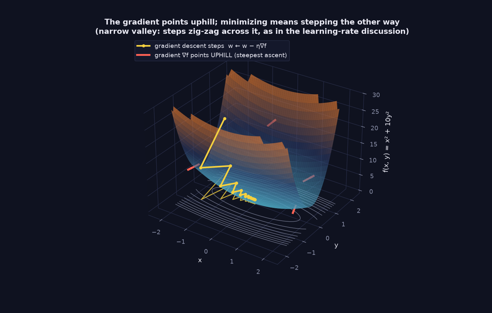
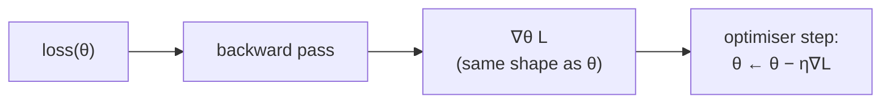

> Tier 1 · Mathematics for AI · **Level: beginner** · Reading time: about 11 minutes

# 1.23 Gradients

**Metadata** — Tier: 1 · Phase: 1 · Priority: P0 · Difficulty: 2/5 · Interview: Very high · Hands-on: Very high
Prerequisites: 1.15, 1.22 · Leads to: 1.24, 1.25, 1.46, Tier 4 (optimisers)

> **In plain words**
> The **gradient** is a **list of all the partial derivatives**, one per input. It forms an arrow that points **uphill**, in the direction where the function grows fastest.
> To make a loss smaller, take a small step the **opposite** way. That single idea, repeated, is how neural networks learn.

**You need first:** 1.22 Partial derivatives, 1.15 Norms.

> **Figure 1.23-1 — the gradient points uphill (3-D)**
>
> 
>
> *How to read it:* on `f(x, y) = x² + 10y²` the red arrows are the gradient: they point in the direction of steepest **increase**. Gradient descent steps the opposite way (yellow path). Because the valley is much steeper in `y` than in `x`, the steps bounce across the valley while creeping along it; this is why the learning rate must stay small enough (below `2/λmax` of the curvature, Tier 2.25). The contours are projected on the floor.
>
> *Generated by* `tier-01-mathematics/figures/src/t1_linalg_calculus.py`. The path uses `calculus_prob.numerical_gradient`.

**Words you'll meet on this page**

| Word | What it means here |
|---|---|
| gradient `∇f` | the vector of partial derivatives; points uphill |
| gradient descent | repeat: `x ← x − η∇f(x)` |
| learning rate `η` | step size |
| level set / contour | points where `f` has the same value |
| critical point | where `∇f = 0` (minimum, maximum or saddle) |
| vanishing / exploding gradient | gradients too small to learn / too large to stay stable |
| gradient clipping | shrinking a gradient whose norm exceeds a limit |

### 1. What is it?
For a function `f: ℝⁿ → ℝ` that returns one number (like a loss), the gradient is

`∇f(x) = [∂f/∂x₁, …, ∂f/∂xₙ]`

It has the **same shape as `x`**: one entry per parameter.

### 2. Why does it exist?
It packs "how to change every parameter to change the loss" into one object. It points in the direction of steepest increase, so its negative is the direction of steepest decrease.

### 3. Detailed explanation
- **Steepest ascent** is `∇f`, **steepest descent** is `−∇f`, and `‖∇f‖` is how steep the slope is.
- `∇f` is **perpendicular to the contour lines**.
- `∇f = 0` marks a **critical point**. In big networks, saddle points are far more common than bad local minima (1.47).
- **Gradient descent:** `x ← x − η∇f(x)`. For `f = ‖x‖²` the gradient is `2x`, so each step multiplies `x` by `(1 − 2η)`. It converges for `0 < η < 1` and **diverges** when `|1 − 2η| > 1`, for example `η = 1.5`.
- **Scale problems:** vanishing gradients (nearly 0: nothing is learned) and exploding gradients (huge steps). Remedies: good initialisation, normalisation, residual connections, and clipping by the global norm (1.15).
- **Gradient checking:** compare autodiff gradients with central differences; a relative error around `1e-6`–`1e-7` in float64 is a pass.

### 4. How does it work?
Backpropagation (1.25) computes `∇_θ L` for **all** parameters in a single backward pass. Optimisers (Tier 4) turn gradients into updates: plain steps, momentum, Adam, and so on.

### 5. Simple example
**A foggy hillside.** You cannot see the valley, but you can feel which way the ground rises most steeply under your feet. That feeling is the gradient. Step the opposite way and you go downhill.

**With numbers.** `f(x, y) = x² + y²`, starting at `(3, −4)`.

| Step | Point | Gradient `(2x, 2y)` | New point `= point − 0.1·gradient` |
|---|---|---|---|
| 0 | (3, −4) | (6, −8) | (2.4, −3.2) |
| 1 | (2.4, −3.2) | (4.8, −6.4) | (1.92, −2.56) |
| 2 | (1.92, −2.56) | (3.84, −5.12) | (1.536, −2.048) |

Each step multiplies the point by 0.8, so it slides toward the minimum at `(0, 0)`.

### 6. Technical example
For `L(w) = ‖Xw − y‖²` the gradient is `∇L = 2Xᵀ(Xw − y)`. Note the transpose (1.12) that the chain rule produces.

### 7. Code
**① By hand (plain Python).** Gradient descent on `x² + y²`.

```python
x, y, lr = 3.0, -4.0, 0.1
for step in range(3):
    gx, gy = 2 * x, 2 * y            # the gradient
    x, y = x - lr * gx, y - lr * gy  # step the opposite way
    print("step", step + 1, "->", (round(x, 3), round(y, 3)))
```

```text
step 1 -> (2.4, -3.2)
step 2 -> (1.92, -2.56)
step 3 -> (1.536, -2.048)
```

**② With NumPy.** Convergence, and divergence with too large a learning rate.

```python
import numpy as np

def descend(grad, x0, lr, steps):
    x = np.array(x0, dtype=float)
    for _ in range(steps):
        x = x - lr * grad(x)
    return x

grad = lambda v: 2 * v                                   # gradient of ||v||^2
print("lr 0.1 :", descend(grad, [3.0, -4.0], 0.1, 200).round(6) + 0.0)
print("lr 1.5 :", descend(grad, [1.0], 1.5, 20))        # |1 - 2*1.5| = 2 > 1: blows up
```

```text
lr 0.1 : [0. 0.]
lr 1.5 : [1048576.]
```

**③ With PyTorch.** The standard training-loop pattern.

```python
import torch

w = torch.tensor([3.0, -4.0], requires_grad=True)
opt = torch.optim.SGD([w], lr=0.1)
for step in range(3):
    opt.zero_grad()                  # clear old gradients (a classic bug if forgotten)
    loss = (w ** 2).sum()
    loss.backward()                  # fills w.grad with the gradient
    opt.step()                       # w <- w - lr * w.grad
    print("step", step + 1, [round(v, 3) for v in w.tolist()])
```

```text
step 1 [2.4, -3.2]
step 2 [1.92, -2.56]
step 3 [1.536, -2.048]
```

### 8. Input → Process → Output



<details>
<summary><b>Beyond the basics (sections 9–16)</b> — real-world use, limits, mistakes. Skip on a first read.</summary>

### 9. Enterprise use case
Monitoring gradient norms during training jobs catches divergence early and saves GPU hours.

### 10. AI engineering connection
Everything in training: SGD and Adam, clipping, mixed-precision loss scaling (to stop gradients underflowing), LoRA (gradients only flow through small adapters), and adversarial attacks (gradient with respect to the input).

### 11. Advantages
One vector gives a locally best direction, and backprop makes it cheap.

### 12. Limitations
Only local information; sensitive to scaling and conditioning; noisy with mini-batches; says nothing about the global optimum.

### 13. Trade-offs
Learning rate: large is fast but unstable, small is stable but slow. Batch size: noise versus compute.

### 14. Common mistakes
Wrong sign (ascending instead of descending); forgetting `zero_grad` so gradients accumulate; confusing the gradient's shape with the loss's shape; calling `backward()` on a non-scalar loss; forgetting that gradients only flow through differentiable paths (detached tensors, `argmax`).

### 15. Performance / cost
The backward pass costs roughly twice the forward pass. Activations must be stored (or recomputed with checkpointing), so memory grows with depth × batch × sequence length.

### 16. Security
Gradient leakage: gradients shared in federated or distributed training can reveal training data. Adversarial examples use input gradients (FGSM and relatives).

</details>

### 17. Interview explanation
"The gradient is the vector of partial derivatives of the loss. It points uphill, so we step the opposite way, scaled by the learning rate. Backprop computes it for all parameters in one backward pass. In practice I watch the gradient norm and clip it to keep training stable."

### 18. Rapid-fire answer
`∇L` points uphill; step `−η∇L`; same shape as the parameters; clip it when it explodes.

### 19. Interview questions
- **Basic:** What is a gradient and which way does it point?
- **Intermediate:** Why does a too-large learning rate diverge? (Show it with `f = x²`.)
- **Advanced:** What causes vanishing and exploding gradients, and how do you fix them? How do you do a gradient check?
- **Scenario:** The loss is flat from step 0. What do you inspect (learning rate, dead ReLUs, detached graph, zero gradients, label bug)?

### 20. Hands-on exercise
**Goal:** find the largest stable learning rate for a stretched valley.

1. Use `f(x, y) = x² + 10y²`, so the gradient is `(2x, 20y)`.
2. Start at `(1, 1)` and run 50 steps of gradient descent for `η` = 0.01, 0.05, 0.09, 0.11.
3. Print the final distance from the origin. Which learning rates converge?

<details>
<summary>Show a solution</summary>

```python
import numpy as np

for lr in (0.01, 0.05, 0.09, 0.11):
    p = np.array([1.0, 1.0])
    for _ in range(50):
        p = p - lr * np.array([2 * p[0], 20 * p[1]])
    print(f"lr = {lr:<4}  distance from the minimum after 50 steps: {np.linalg.norm(p):.3g}")
```

```text
lr = 0.01  distance from the minimum after 50 steps: 0.364
lr = 0.05  distance from the minimum after 50 steps: 0.00515
lr = 0.09  distance from the minimum after 50 steps: 5.11e-05
lr = 0.11  distance from the minimum after 50 steps: 9.1e+03
```

The steep `y` direction has curvature 20, so steps larger than `2/20 = 0.1` overshoot and diverge. That is the "zig-zag" in the figure.
</details>

### 21. Revision questions
1. What is the shape of `∇f`?
2. Why do we use `−∇f` to minimise?
3. What does `∇f = 0` imply?

### 22. Related concepts
1.22 Partial derivatives · 1.24 Jacobians · 1.25 Chain rule · 1.46–1.47 Landscapes · Tier 4 Optimisers

### 23. One-line memory hook
**Gradient = a compass pointing uphill; walk the other way, in small steps.**

<details>
<summary><b>For reviewers</b> (not part of the lesson)</summary>

- Status: DRAFT, learner-first layout (Author: Claude). Code is executed by `tests/test_md_snippets.py`.
- TESTED earlier: ascent direction, convergence, divergence with a large learning rate (`code/calculus_prob.py`).
- The figure's "learning rate must stay below 2/λmax (Tier 2.25)" reference is inherited from the first draft; check the cross-reference number in the Critic pass.
</details>
