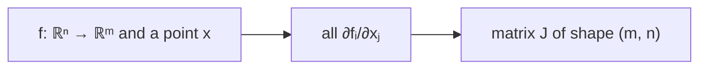

> Tier 1 · Mathematics for AI · **Level: intermediate** · Reading time: about 10 minutes

# 1.24 Jacobians

**Metadata** — Tier: 1 · Phase: 1 · Priority: P1 · Difficulty: 3/5 · Interview: Medium · Hands-on: Medium
Prerequisites: 1.3, 1.11, 1.23 · Leads to: 1.25 Chain rule, backprop (Tier 3), attention and softmax analysis

> **In plain words**
> A gradient describes one output. A **Jacobian** describes **many outputs at once**: it is a table that says, for **every output** and **every input**, "if this input moves a little, how much does that output move?"
> Think of a mixing desk with several sliders in and several speakers out: the Jacobian is the full wiring chart showing how strongly each slider affects each speaker.

**You need first:** 1.3 Matrices, 1.11 Matrix multiplication, 1.23 Gradients.

> **Figure 1.24-1 — a Jacobian is a table of sensitivities**
>
> ```mermaid
> flowchart LR
>     X["inputs (x, y)"] --> F["f(x, y) = (x²y, 5x + sin y)"]
>     F --> O["outputs (f₁, f₂)"]
>     J["Jacobian at (1, 2)<br/>row 1 (f₁): [ 2xy , x² ] = [ 4 , 1 ]<br/>row 2 (f₂): [ 5 , cos y ] = [ 5 , −0.42 ]"]
> ```
>
> *How to read it:* each **row** is the gradient of one output; each **column** shows how all outputs react to one input. At the point `(1, 2)`, nudging `x` changes `f₁` at rate 4 and `f₂` at rate 5; nudging `y` changes `f₁` at rate 1 and `f₂` at rate −0.42.

**Words you'll meet on this page**

| Word | What it means here |
|---|---|
| Jacobian `J` | the `m × n` matrix of all partial derivatives of an `n`-input, `m`-output function |
| vector–Jacobian product (VJP) | `vᵀJ`: what backprop computes, without building `J` |
| Jacobian–vector product (JVP) | `J v`: the forward-mode version |
| diagonal matrix | non-zero only on the diagonal |
| Hessian | second derivatives of a *scalar* function (curvature) |

### 1. What is it?
For `f: ℝⁿ → ℝᵐ`, the Jacobian is the `m × n` matrix

`J[i, j] = ∂fᵢ / ∂xⱼ`

It is the best **linear** approximation of `f` near a point: `f(x + δ) ≈ f(x) + J δ`.

### 2. Why does it exist?
Gradients (1.23) handle a function with one output. A layer has many outputs, so we need a matrix describing how every output responds to every input.

### 3. Detailed explanation
- The gradient of a scalar function is a Jacobian with a single row.
- A linear map `f(x) = Ax` has `J = A` everywhere.
- An element-wise activation `φ(x)` has a **diagonal** Jacobian `diag(φ′(x))`: each output depends only on its own input.
- Softmax `p = softmax(z)` has `J = diag(p) − ppᵀ`. It is symmetric, its columns each sum to 0 (the outputs always sum to 1), and it is singular.
- **Chain rule:** `J_{g∘f} = J_g(f(x)) · J_f(x)` (1.25).
- **Never build the full Jacobian of a big layer.** For a layer 4,096 wide, `J` has 16.8 million entries *per token*. Backprop instead computes **vector–Jacobian products** `vᵀJ`, which cost about as much as the forward pass.
- **Forward mode** computes `Jv` (cheap when there are few inputs). **Reverse mode** computes `vᵀJ` (cheap when there are few outputs, such as a single loss). Deep learning uses reverse mode.

### 4. How does it work?
Row `i` is the gradient of output `fᵢ`. Column `j` shows how all the outputs react to `xⱼ`. Numerically: nudge each input in turn and look at how all outputs change.

### 5. Simple example
A map from a rectangle's (width, height) to (area, perimeter):

`f(w, h) = (w·h, 2w + 2h)`, so `J = [[h, w], [2, 2]]`.

At `(w, h) = (3, 5)`: `J = [[5, 3], [2, 2]]`. Making the rectangle 0.1 wider changes the area by about `5 × 0.1 = 0.5` and the perimeter by `2 × 0.1 = 0.2`.

### 6. Technical example
Backward through a softmax layer: `dz = (diag(p) − ppᵀ)·dp`. With cross-entropy loss this collapses into the simple `dz = p − y` (see 1.37).

### 7. Code
**① By hand (plain Python).** The Jacobian of `f(x, y) = (x²y, 5x + sin y)` at (1, 2): by formula and by nudging.

```python
import math

def f(x, y):
    return (x * x * y, 5 * x + math.sin(y))

x, y, h = 1.0, 2.0, 1e-6
exact = [[2 * x * y, x * x], [5.0, math.cos(y)]]
numeric = [[(f(x + h, y)[i] - f(x - h, y)[i]) / (2 * h), (f(x, y + h)[i] - f(x, y - h)[i]) / (2 * h)] for i in range(2)]
print("by formula  :", [[round(v, 4) for v in row] for row in exact])
print("by nudging  :", [[round(v, 4) for v in row] for row in numeric])
```

```text
by formula  : [[4.0, 1.0], [5.0, -0.4161]]
by nudging  : [[4.0, 1.0], [5.0, -0.4161]]
```

**② With NumPy.** The softmax Jacobian formula.

```python
import numpy as np

def softmax(z):
    e = np.exp(z - z.max())
    return e / e.sum()

z = np.array([0.5, -1.0, 2.0, 0.0])
p = softmax(z)
J = np.diag(p) - np.outer(p, p)
print("shape:", J.shape)
print("columns sum to 0:", np.allclose(J.sum(axis=0), 0))
print("symmetric:", np.allclose(J, J.T))
```

```text
shape: (4, 4)
columns sum to 0: True
symmetric: True
```

**③ With PyTorch.** The library can build small Jacobians for you.

```python
import torch
from torch.autograd.functional import jacobian

def f(v):
    x, y = v
    return torch.stack([x * x * y, 5 * x + torch.sin(y)])

print(jacobian(f, torch.tensor([1.0, 2.0])))
```

```text
tensor([[ 4.0000,  1.0000],
        [ 5.0000, -0.4161]])
```

### 8. Input → Process → Output



<details>
<summary><b>Beyond the basics (sections 9–16)</b> — real-world use, limits, mistakes. Skip on a first read.</summary>

### 9. Enterprise use case
Sensitivity and robustness analysis of multi-output models, for example how each risk score reacts to each input feature.

### 10. AI engineering connection
Backprop is repeated vector–Jacobian products. Jacobian norms measure layer stability and Lipschitz behaviour (the spectral norm of weights). Normalising flows use Jacobian determinants.

### 11. Advantages
A complete first-order description of a multi-output function.

### 12. Limitations
Large (`m × n`), purely local, and first-order only.

### 13. Trade-offs
An explicit Jacobian is good for debugging and small systems; matrix-free products are what training uses.

### 14. Common mistakes
Shape errors (`m × n` versus `n × m`); building huge Jacobians; forgetting that element-wise operations have cheap diagonal Jacobians; confusing the Jacobian (first derivatives, a matrix) with the Hessian (second derivatives of a scalar).

### 15. Performance / cost
A full Jacobian needs `m` backward passes (reverse mode) or `n` forward passes (forward mode). A vector–Jacobian product needs one backward pass.

### 16. Security
Input–output Jacobians quantify model sensitivity and can guide adversarial attacks and model extraction. Limit access to gradients for deployed models.

</details>

### 17. Interview explanation
"The Jacobian is the matrix of partial derivatives for a function with a vector output. It tells how each output reacts to each input. In backprop we never build it; we multiply a vector by it, a vector–Jacobian product, which is how one backward pass gets all the gradients."

### 18. Rapid-fire answer
Jacobian = `m × n` derivative matrix; backprop uses vector–Jacobian products; softmax `J = diag(p) − ppᵀ`.

### 19. Interview questions
- **Basic:** What is the Jacobian of `Ax`? Of an element-wise ReLU?
- **Intermediate:** What is the difference between Jacobian, gradient and Hessian?
- **Advanced:** Why is reverse mode used for training, and forward mode when there are few inputs?
- **Scenario:** A layer is 4,096 wide. Why can't you build its Jacobian for every token in a batch?

### 20. Hands-on exercise
**Goal:** compute a Jacobian by hand and check it.

1. For `f(x, y) = (x + y, x·y)`, write the Jacobian by hand.
2. Evaluate it at `(2, 3)`.
3. Check with PyTorch's `jacobian`.

<details>
<summary>Show a solution</summary>

```python
import torch
from torch.autograd.functional import jacobian

# by hand: [[1, 1], [y, x]]  -> at (2, 3): [[1, 1], [3, 2]]
f = lambda v: torch.stack([v[0] + v[1], v[0] * v[1]])
print(jacobian(f, torch.tensor([2.0, 3.0])))
```

```text
tensor([[1., 1.],
        [3., 2.]])
```

</details>

### 21. Revision questions
1. What shape is the Jacobian of a function `ℝⁿ → ℝᵐ`?
2. For which operations is it diagonal?
3. What does "VJP" stand for?

### 22. Related concepts
1.23 Gradients · 1.25 Chain rule · 1.37 Cross-entropy · Tier 3 Backpropagation

### 23. One-line memory hook
**Jacobian: every output's sensitivity to every input, in one matrix.**

<details>
<summary><b>For reviewers</b> (not part of the lesson)</summary>

- Status: DRAFT, learner-first layout (Author: Claude). Code is executed by `tests/test_md_snippets.py`.
- TESTED earlier: linear map `J = A`, element-wise `tanh` diagonal, softmax formula and zero column sums (`code/calculus_prob.py`).
- The first draft's exercise function `(x²y, 5x + sin y)` is now the worked example; the exercise uses a simpler function.
</details>
