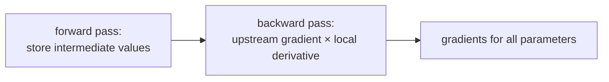

> Tier 1 · Mathematics for AI · **Level: beginner–intermediate** · Reading time: about 12 minutes

# 1.25 Chain rule

**Metadata** — Tier: 1 · Phase: 1 · Priority: P0 · Difficulty: 3/5 · Interview: Very high · Hands-on: Very high
Prerequisites: 1.20–1.24 · Leads to: Tier 3 Backpropagation, Tier 4 vanishing and exploding gradients

> **In plain words**
> If one thing depends on a second thing, which depends on a third, then **the overall rate of change is the product of the individual rates of change along the chain**.
> Like gears: if gear A turns 2× for each turn of B, and B turns 3× for each turn of C, then A turns 6× for each turn of C.
> **Backpropagation is exactly this rule, applied backwards through a network.**

**You need first:** 1.20 Functions, 1.21 Derivatives (and a glance at 1.22–1.24).

> **Figure 1.25-1 — multiply along the path**
>
> ```mermaid
> flowchart LR
>     X["x"] -->|"du/dx"| U["u = f(x)"]
>     U -->|"dy/du"| Y["y = g(u)"]
>     Y -->|"dL/dy"| L["loss L"]
> ```
>
> *How to read it:* each arrow carries a local derivative. To find `dL/dx`, **multiply the numbers along the path**: `dL/dx = (dL/dy)(dy/du)(du/dx)`. If a variable reaches the loss along **several** paths, add the contributions of the paths.

**Words you'll meet on this page**

| Word | What it means here |
|---|---|
| composition | one function fed into another: `g(f(x))` |
| local derivative | the derivative of one small step |
| upstream gradient | the gradient arriving from the loss side |
| backpropagation | the chain rule applied efficiently, from output to input |
| gradient check | comparing the formula's gradient with finite differences |
| activation checkpointing | recomputing activations instead of storing them |

### 1. What is it?
If `y = g(u)` and `u = f(x)`, then

`dy/dx = (dy/du) · (du/dx)`

For vectors, use Jacobians: `J_{g∘f}(x) = J_g(f(x)) · J_f(x)`.

### 2. Why does it exist?
A network is a long composition of simple functions (1.20). The chain rule gives the derivative of the whole from the derivatives of the small parts, so we only ever have to differentiate simple pieces.

### 3. Detailed explanation
- **Multiply along a path.** If one factor is almost 0, the whole product vanishes; if factors are above 1 it explodes. A sigmoid has `σ′ ≤ 0.25`, so ten sigmoid layers contribute at most `0.25¹⁰ ≈ 9.5 × 10⁻⁷`.
- **Add across paths.** A variable can influence the output in several ways (a shared weight; a residual connection `x + F(x)`, whose derivative is `1 + F′`, keeping a gradient path alive).
- **Reverse-mode autodiff:** do a forward pass and store intermediate values; then walk backward, multiplying each node's local derivative by the gradient arriving from above.
- **Worked example (2-layer network, one output):** `z = w₁x`, `a = tanh(z)`, `ŷ = w₂a`, `L = (ŷ − y)²`. Walking backward:
  `dL/dŷ = 2(ŷ − y)` → `dL/dw₂ = dL/dŷ · a` → `dL/da = dL/dŷ · w₂` → `dL/dz = dL/da · (1 − a²)` → `dL/dw₁ = dL/dz · x`.

### 4. How does it work?
Each node remembers its inputs. In the backward pass it receives the upstream gradient, multiplies by its own local derivative, passes the result downstream, and adds up contributions if it was used more than once.

### 5. Simple example
**Differentiate `y = sin(x²)`.** Let `u = x²`, so `y = sin(u)`.
- `du/dx = 2x`
- `dy/du = cos(u)`
- Multiply: `dy/dx = cos(x²) · 2x`.

At `x = 1`: `cos(1) · 2 = 0.5403 × 2 = 1.0806`.

Check with a nudge: `sin(1.001²) − sin(1)` over `0.001` is about `1.0806`.

### 6. Technical example
The code below does manual backpropagation for the 2-layer worked example and compares it with PyTorch's autograd. Matching to many decimals is the standard **gradient check** for custom layers.

### 7. Code
**① By hand (plain Python).** Forward, then backward with the chain rule, then a nudge check.

```python
import math

x, y, w1, w2 = 0.8, 0.7, 0.5, -0.4

def forward(w1, w2):
    z = w1 * x
    a = math.tanh(z)
    y_hat = w2 * a
    return (y_hat - y) ** 2, a, y_hat

loss, a, y_hat = forward(w1, w2)
dL_dyhat = 2 * (y_hat - y)
dL_dw2 = dL_dyhat * a                         # chain: loss <- y_hat <- w2
dL_da = dL_dyhat * w2
dL_dz = dL_da * (1 - a ** 2)                  # tanh'(z) = 1 - tanh(z)^2
dL_dw1 = dL_dz * x
print("backprop:", round(dL_dw1, 6), round(dL_dw2, 6))

h = 1e-6                                      # nudge check
print("nudging :", round((forward(w1 + h, w2)[0] - forward(w1 - h, w2)[0]) / (2 * h), 6),
      round((forward(w1, w2 + h)[0] - forward(w1, w2 - h)[0]) / (2 * h), 6))
```

```text
backprop: 0.466552 -0.647418
nudging : 0.466552 -0.647418
```

**② With NumPy.** The same chain for a small vector network, with the gradient check.

```python
import numpy as np

rng = np.random.default_rng(7)
x = rng.standard_normal(3)
W1 = rng.standard_normal((4, 3))
W2 = rng.standard_normal(4)
y = 0.7

def loss_fn(W1, W2):
    a = np.tanh(W1 @ x)
    return (W2 @ a - y) ** 2, a

L, a = loss_fn(W1, W2)
dyhat = 2 * (W2 @ a - y)
dW2 = dyhat * a
dz = dyhat * W2 * (1 - a ** 2)
dW1 = np.outer(dz, x)

h = 1e-6
num = np.zeros_like(W2)
for i in range(4):
    e = np.zeros(4); e[i] = h
    num[i] = (loss_fn(W1, W2 + e)[0] - loss_fn(W1, W2 - e)[0]) / (2 * h)
print("dW2 matches finite differences:", np.allclose(dW2, num, atol=1e-6))
print("shapes:", dW1.shape, dW2.shape)
```

```text
dW2 matches finite differences: True
shapes: (4, 3) (4,)
```

**③ With PyTorch.** Autograd does the backward walk for you.

```python
import torch

x = torch.tensor(0.8)
w1 = torch.tensor(0.5, requires_grad=True)
w2 = torch.tensor(-0.4, requires_grad=True)
loss = (w2 * torch.tanh(w1 * x) - 0.7) ** 2
loss.backward()
print("autograd:", round(w1.grad.item(), 6), round(w2.grad.item(), 6))
```

```text
autograd: 0.466552 -0.647418
```

*Compare the three outputs: the hand-written backward pass, the nudge check and autograd agree.*

### 8. Input → Process → Output



<details>
<summary><b>Beyond the basics (sections 9–16)</b> — real-world use, limits, mistakes. Skip on a first read.</summary>

### 9. Enterprise use case
Gradient checking is a standard unit test when implementing custom layers or operations in an internal ML framework.

### 10. AI engineering connection
Backpropagation, autograd, custom GPU operations (which must supply their backward), gradient checkpointing (trade compute for memory), and residual connections (an additive gradient path).

### 11. Advantages
Modular: to add a layer, write only its local derivative.

### 12. Limitations
Needs stored activations (memory); multiplying many factors causes vanishing or exploding gradients; non-differentiable steps (argmax, sampling, rounding) break the chain.

### 13. Trade-offs
Storing activations is fast but memory-hungry; recomputing them is slower but saves memory. For non-differentiable steps use straight-through estimators or REINFORCE.

### 14. Common mistakes
Forgetting to add contributions of multiple paths; wrong order in the matrix chain rule (transposes!); applying the activation derivative at the wrong point (pre- versus post-activation); detaching tensors by accident.

### 15. Performance / cost
Backward is about twice the forward cost; peak memory is dominated by stored activations, which is why checkpointing and smaller batches exist.

### 16. Security
Nothing beyond gradient leakage (see 1.23).

</details>

### 17. Interview explanation
"The chain rule says the derivative of a composition is the product of local derivatives along the path. Backprop is just that: run forward and store things, then multiply local derivatives backward. If those factors are small the gradient vanishes, which is why we use ReLU, good initialisation, normalisation and residual connections."

### 18. Rapid-fire answer
`d(g∘f) = g′(f)·f′`; backprop = the chain rule run backwards; multiply along paths, add across paths.

### 19. Interview questions
- **Basic:** Differentiate `sin(x²)`.
- **Intermediate:** Why do sigmoid networks suffer from vanishing gradients?
- **Advanced:** Derive `dL/dW₁` for the two-layer network. How do residual connections change the gradient?
- **Scenario:** A custom layer trains but the loss plateaus. How do you verify its backward is correct?

### 20. Hands-on exercise
**Goal:** differentiate a three-step chain and check it.

1. Let `y = (3x + 1)²` and `L = ln(y)`, so `L = ln((3x + 1)²)`.
2. By the chain rule, `dL/dx = (1/y) · 2(3x + 1) · 3`. Compute it at `x = 1`.
3. Verify with autograd.

<details>
<summary>Show a solution</summary>

```python
import torch

x = torch.tensor(1.0, requires_grad=True)
y = (3 * x + 1) ** 2
L = torch.log(y)
L.backward()
by_hand = (1 / 16) * 2 * 4 * 3        # y = 16, 2(3x+1) = 8, inner derivative 3
print("by hand :", by_hand)
print("autograd:", x.grad.item())
```

```text
by hand : 1.5
autograd: 1.5
```

</details>

### 21. Revision questions
1. State the chain rule.
2. Why do we add contributions across paths?
3. Why must activations be stored during the forward pass?

### 22. Related concepts
1.23 Gradients · 1.24 Jacobians · Tier 3 Backpropagation · Tier 4 Vanishing and exploding gradients

### 23. One-line memory hook
**Multiply along the path, add across the paths, and check with finite differences.**

<details>
<summary><b>For reviewers</b> (not part of the lesson)</summary>

- Status: DRAFT, learner-first layout (Author: Claude). Code is executed by `tests/test_md_snippets.py`.
- TESTED earlier: manual backprop vs numerical gradient for `W₁` and `W₂` (`code/calculus_prob.py`), and autograd vs manual with torch 2.14.1 (`lab/lab_04_pytorch.py::t_1_25_autograd_vs_manual`).
- The `0.25¹⁰ ≈ 9.5×10⁻⁷` bound is arithmetic: 0.25 raised to the 10th power.
</details>
