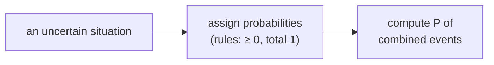

> Tier 1 · Mathematics for AI · **Level: absolute beginner** · Reading time: about 8 minutes

# 1.26 Probability

**Metadata** — Tier: 1 · Phase: 1 · Priority: P0 · Difficulty: 2/5 · Interview: High · Hands-on: Medium
Prerequisites: 1.1 · Leads to: 1.27–1.38 (everything probabilistic), Tier 2, LLM sampling

> **In plain words**
> **Probability** is a number between **0 and 1** that says **how likely something is**. 0 means impossible, 1 means certain, 0.5 means a coin flip.
> AI uses it everywhere because data is noisy and answers are rarely certain: a model's output is often a list of probabilities over the possible answers.

**You need first:** 1.1 Scalars. If you can divide one number by another, you are ready.

> **Figure 1.26-1 — a fair die and the event "even or at least 5"**
>
> ```mermaid
> flowchart LR
>     S["sample space Ω<br/>1 2 3 4 5 6"] --> A["event A: even<br/>2 4 6 → 3/6"]
>     S --> B["event B: at least 5<br/>5 6 → 2/6"]
>     A --> U["A or B<br/>2 4 5 6 → 4/6"]
>     B --> U
> ```
>
> *How to read it:* all possible outcomes form the **sample space**. An **event** is a chosen subset of outcomes. Because `6` is in both `A` and `B`, adding 3/6 + 2/6 would count it twice, so we subtract the overlap (1/6): `P(A or B) = 3/6 + 2/6 − 1/6 = 4/6`.

**Words you'll meet on this page**

| Word | What it means here |
|---|---|
| sample space `Ω` | the set of all possible outcomes |
| event | a set of outcomes you care about |
| `P(A)` | the probability of event `A` |
| disjoint (mutually exclusive) | events that cannot both happen |
| independent | knowing one happened tells you nothing about the other |
| calibrated | when it says 90%, it is right about 90% of the time |

### 1. What is it?
A number in `[0, 1]` measuring uncertainty about an event. It follows three rules (Kolmogorov's axioms):

1. `P(A) ≥ 0` (never negative).
2. `P(Ω) = 1` (something must happen).
3. For events that cannot both happen, `P(A or B) = P(A) + P(B)`.

### 2. Why does it exist?
Data is noisy, labels are imperfect, the future is uncertain, and a model's answer is rarely 100% sure. Probability is the consistent language for reasoning when you are not certain.

### 3. Detailed explanation
Consequences of the rules:
- `P(not A) = 1 − P(A)`.
- `P(A or B) = P(A) + P(B) − P(A and B)` (subtract the overlap).
- `P(impossible) = 0`.
- **Independence:** `P(A and B) = P(A)·P(B)`.

Two ways to think about it: **frequentist** (the long-run fraction of times it happens) and **Bayesian** (a degree of belief). Machine learning uses both.

**Caution.** When a model says "0.9" it is giving a *score shaped like a probability*, not necessarily a **calibrated** one. Calibration has to be measured (Tier 15, Tier 30).

### 4. How does it work?
When outcomes are equally likely: **count the favourable outcomes and divide by the total**. Otherwise, estimate frequencies from data. Then combine with the rules above. Conditional probability (1.33) and Bayes' theorem (1.34) come next.

### 5. Simple example
A fair die has six equally likely faces.
- `P(even) = 3/6 = 0.5`.
- `P(at least 5) = 2/6 ≈ 0.333`.
- `P(even or at least 5) = 3/6 + 2/6 − 1/6 = 4/6 ≈ 0.667`.

### 6. Technical example
A language model assigns a probability to every possible next word. The probabilities are positive and add up to 1 (the output of a softmax). The model then picks (samples) a word according to them.

### 7. Code
**① By hand (plain Python).** Counting outcomes.

```python
outcomes = [1, 2, 3, 4, 5, 6]
event = [r for r in outcomes if r % 2 == 0 or r >= 5]
print("outcomes in the event:", event)
print("probability:", len(event) / len(outcomes))
```

```text
outcomes in the event: [2, 4, 5, 6]
probability: 0.6666666666666666
```

**② With NumPy.** Estimating a probability by simulation, and a softmax as a probability list.

```python
import numpy as np

rng = np.random.default_rng(0)
rolls = rng.integers(1, 7, size=(100_000, 2))                 # roll two dice 100,000 times
print("P(sum = 7) estimated:", round(float(np.mean(rolls.sum(axis=1) == 7)), 3), " exact:", round(6 / 36, 3))

z = np.array([2.0, 1.0, 0.1])
p = np.exp(z - z.max()) / np.exp(z - z.max()).sum()           # softmax
print("softmax:", p.round(3), " sums to", p.sum().round(6))
```

```text
P(sum = 7) estimated: 0.168  exact: 0.167
softmax: [0.659 0.242 0.099]  sums to 1.0
```

**③ With PyTorch.** Sampling from a probability list, like picking the next word.

```python
import torch

torch.manual_seed(0)
probs = torch.tensor([0.7, 0.2, 0.1])                          # three possible words
draws = torch.multinomial(probs, num_samples=10000, replacement=True)
print("fractions drawn:", [round((draws == i).float().mean().item(), 3) for i in range(3)])
```

```text
fractions drawn: [0.697, 0.198, 0.104]
```

### 8. Input → Process → Output



<details>
<summary><b>Beyond the basics (sections 9–16)</b> — real-world use, limits, mistakes. Skip on a first read.</summary>

### 9. Enterprise use case
Risk scoring, fraud probability and service-level reasoning ("what is the probability a request takes over 2 seconds?"). Decisions weigh costs by probabilities.

### 10. AI engineering connection
Classifier outputs, sampling in language-model decoding, uncertainty estimates, Bayesian reasoning, and evaluation (precision and recall are conditional probabilities).

### 11. Advantages
A single, consistent treatment of uncertainty.

### 12. Limitations
Needs a sensible model or enough data; real events are often dependent; probabilities are only as good as the assumptions behind them.

### 13. Trade-offs
Simple independence assumptions (Naive Bayes) are tractable but may be wrong; richer models need more data.

### 14. Common mistakes
Assuming independence by default; treating softmax scores as calibrated confidence; adding probabilities of overlapping events; base-rate neglect (1.34); the gambler's fallacy.

### 15. Performance / cost
Multiplying many small probabilities underflows to 0. Work with log-probabilities instead (1.41, 1.43).

### 16. Security
Over-trusting model confidence invites attacks and unsafe automation. Validate thresholds on held-out data and keep a fallback path for low confidence.

</details>

### 17. Interview explanation
"Probability quantifies uncertainty between 0 and 1, built on a few rules: it's never negative, the total is one, and it adds for events that can't both happen. In ML, classifier outputs and next-token distributions are probability vectors, but I check calibration rather than assuming a 0.9 really means 90%."

### 18. Rapid-fire answer
`P ∈ [0, 1]`, `P(Ω) = 1`, additive for disjoint events; a softmax score is not automatically calibrated.

### 19. Interview questions
- **Basic:** What is the probability of drawing a heart from a deck? What is the union formula?
- **Intermediate:** What is the difference between independent and mutually exclusive events?
- **Advanced:** Frequentist versus Bayesian: what is calibration?
- **Scenario:** A fraud model says 0.95 for a transaction. How do you decide whether to block it?

### 20. Hands-on exercise
**Goal:** check a probability by simulation.

1. Roll two fair dice 100,000 times (use NumPy).
2. Estimate `P(sum = 7)` and `P(sum = 12)`.
3. Compare with the exact values `6/36` and `1/36`.

<details>
<summary>Show a solution</summary>

```python
import numpy as np

rng = np.random.default_rng(1)
sums = rng.integers(1, 7, size=(100_000, 2)).sum(axis=1)
print("P(sum=7) :", round(float(np.mean(sums == 7)), 4), "exact", round(6 / 36, 4))
print("P(sum=12):", round(float(np.mean(sums == 12)), 4), "exact", round(1 / 36, 4))
```

```text
P(sum=7) : 0.1662 exact 0.1667
P(sum=12): 0.0275 exact 0.0278
```

The simulation is close, not identical: that is chance at work (more rolls give a closer match; see 1.27).
</details>

### 21. Revision questions
1. What are the three rules of probability?
2. What is `P(A or B)`?
3. What does independence mean?

### 22. Related concepts
1.27 Random variables · 1.33 Conditional probability · 1.34 Bayes · Tier 15 Calibration

### 23. One-line memory hook
**Probability: numbers between 0 and 1 that must add up to 1 over everything that can happen.**

<details>
<summary><b>For reviewers</b> (not part of the lesson)</summary>

- Status: DRAFT, learner-first layout (Author: Claude). Code is executed by `tests/test_md_snippets.py`.
- TESTED earlier: softmax is a distribution, shift-invariant, finite for large logits (`code/calculus_prob.py`).
- Seeded simulations print fixed numbers for NumPy 2.5.4 / PyTorch 2.14.1; the md-snippet test would flag a change after a library upgrade.
</details>
