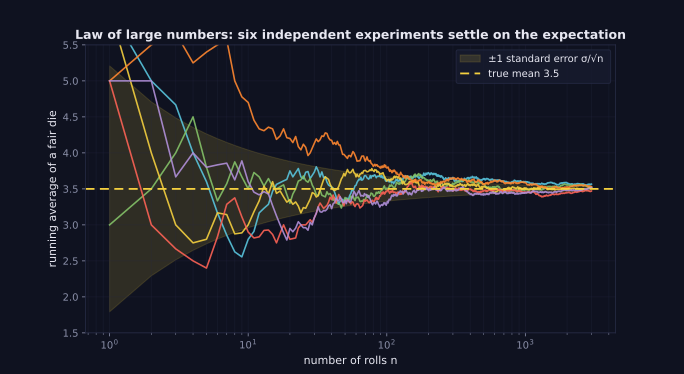
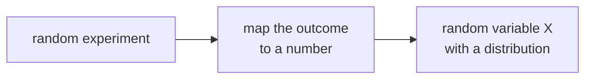

> Tier 1 · Mathematics for AI · **Level: beginner** · Reading time: about 9 minutes

# 1.27 Random variables

**Metadata** — Tier: 1 · Phase: 1 · Priority: P0 · Difficulty: 2/5 · Interview: Medium-High · Hands-on: High
Prerequisites: 1.26 Probability · Leads to: 1.28–1.32, sampling, noise, stochastic training

> **In plain words**
> A **random variable** is **a number that comes from something uncertain**: the value of a die roll, the time a web page takes to load, the next word a model picks (as a word number).
> Turning "what happened" into a number lets us **average it, measure its spread and describe how likely each value is**.

**You need first:** 1.26 Probability.

> **Figure 1.27-1 — the law of large numbers**
>
> 
>
> *How to read it:* each line is the running average of one simulated fair die. With few rolls the averages are far apart; as the number of rolls `n` grows they settle onto the true mean 3.5, and the shaded band (one standard error, `σ/√n`) narrows like `1/√n`. The x-axis is logarithmic.
>
> *Generated by* `tier-01-mathematics/figures/src/t1_prob.py`.

**Words you'll meet on this page**

| Word | What it means here |
|---|---|
| random variable `X` | a number produced by a random process |
| discrete / continuous | takes separate values (die) / any value in a range (height) |
| i.i.d. | independent and identically distributed draws |
| sample | the values you actually observed |
| seed | a starting number that makes "random" results repeatable |
| law of large numbers | averages settle on the true mean as samples grow |

### 1. What is it?
A function `X: Ω → ℝ` that maps every outcome of a random experiment to a number. We can then ask `P(X = 3)` or `P(X ≤ 2)`.

### 2. Why does it exist?
Outcomes (a coin face, a word, an image) are not numbers. A random variable converts them into numbers so we can compute averages, spreads and distributions.

### 3. Detailed explanation
- **Discrete** values can be listed (die roll, token ID). **Continuous** values fill a range (height, noise).
- Input features, labels, activations under dropout and sampled tokens can all be treated as random variables.
- **i.i.d.** means each draw is independent of the others and comes from the same distribution. It is the standard assumption behind generalisation, and it is often violated (time series, user sessions, duplicated documents cause leakage).
- **Law of large numbers:** the sample mean approaches the true mean as the sample grows.
- **Randomness in code:** a seeded generator (`np.random.default_rng(seed)`) gives the same numbers every time. Seeds do not guarantee identical results across different devices or frameworks in GPU training.

### 4. How does it work?
Define the mapping from outcome to number, then describe its distribution (1.28). Several variables can be related through joint distributions, covariance (1.32) and conditional probability (1.33).

### 5. Simple example
Roll two dice and let `X` be the sum.

| `X` | Ways | Probability |
|---|---|---|
| 2 | 1 | 1/36 |
| 7 | 6 | 6/36 |
| 12 | 1 | 1/36 |

`X` takes the values 2 to 12, and **not equally often**: 7 is the most likely.

### 6. Technical example
A mini-batch loss is a random variable: it depends on which examples were drawn. Its expected value equals the full-data loss (1.29), which is why stochastic gradient descent works. Dropout masks and sampled tokens are random variables too.

### 7. Code
**① By hand (plain Python).** Running averages of a die settle near 3.5.

```python
import random

random.seed(0)
total = 0
for n in range(1, 100_001):
    total += random.randint(1, 6)
    if n in (10, 100, 1_000, 100_000):
        print(f"after {n:>6} rolls the average is {total / n:.3f}")
```

```text
after     10 rolls the average is 3.500
after    100 rolls the average is 3.490
after   1000 rolls the average is 3.445
after 100000 rolls the average is 3.489
```

**② With NumPy.** Seeds make results repeatable.

```python
import numpy as np

rolls = np.random.default_rng(0).integers(1, 7, size=200_000)
same = np.random.default_rng(0).integers(1, 7, size=200_000)
print("average of 200,000 rolls:", round(float(rolls.mean()), 3))
print("same seed, same numbers:", bool((rolls == same).all()))
```

```text
average of 200,000 rolls: 3.5
same seed, same numbers: True
```

**③ With PyTorch.**

```python
import torch

torch.manual_seed(0)
a = torch.randint(1, 7, (5,))
torch.manual_seed(0)
b = torch.randint(1, 7, (5,))
print(a.tolist(), b.tolist(), "identical:", torch.equal(a, b))
```

```text
[3, 4, 6, 1, 2] [3, 4, 6, 1, 2] identical: True
```

### 8. Input → Process → Output



<details>
<summary><b>Beyond the basics (sections 9–16)</b> — real-world use, limits, mistakes. Skip on a first read.</summary>

### 9. Enterprise use case
Latency per request is a random variable. Service-level objectives are statements about its distribution (p50, p95, p99), not about single values.

### 10. AI engineering connection
Stochastic gradient descent, dropout, data augmentation, LLM decoding (temperature, top-k, top-p), and evaluation noise across seeds.

### 11. Advantages
One formalism for averages, spread, tails and uncertainty.

### 12. Limitations
The true distribution is unknown; estimates from finite samples are noisy.

### 13. Trade-offs
More samples reduce noise (error shrinks like `1/√n`) but cost grows linearly.

### 14. Common mistakes
Treating a single run as the truth (one seed); assuming i.i.d. with correlated data (leakage between train and test); not seeding or not logging seeds; reporting a mean without its spread.

### 15. Performance / cost
Monte-Carlo accuracy improves as `1/√n`: 100 times more samples for 10 times less error.

### 16. Security
Weak or predictable random generators are a security problem when randomness protects something (tokens, keys). Use a cryptographic generator (`secrets`), not `numpy` or `random`, for security purposes.

</details>

### 17. Interview explanation
"A random variable assigns numbers to random outcomes so we can talk about their distribution, mean and variance. In ML, the mini-batch loss, sampled tokens and dropout masks are random variables, and I report results over several seeds because a single run is just one draw."

### 18. Rapid-fire answer
A random variable maps outcomes to numbers; discrete or continuous; i.i.d. is an assumption.

### 19. Interview questions
- **Basic:** What is the difference between a discrete and a continuous random variable?
- **Intermediate:** What does i.i.d. mean, and when does it fail?
- **Advanced:** State the law of large numbers. Why is SGD's mini-batch gradient an unbiased estimate?
- **Scenario:** Two model versions differ by 0.4% accuracy on one seed. How do you decide which is better?

### 20. Hands-on exercise
**Goal:** see how seed-to-seed noise can hide a small difference.

1. Simulate "accuracy on 500 test examples" for a model with true accuracy 0.80, using 5 different seeds.
2. Print the 5 accuracies and their mean ± standard deviation.
3. Is a 0.4% (0.004) difference between two models larger than this noise?

<details>
<summary>Show a solution</summary>

```python
import numpy as np

accs = []
for seed in range(5):
    rng = np.random.default_rng(seed)
    accs.append(np.mean(rng.random(500) < 0.80))      # 500 test examples, true accuracy 0.80
print("accuracies:", np.round(accs, 3))
print(f"mean {np.mean(accs):.3f} ± {np.std(accs, ddof=1):.3f}")
```

```text
accuracies: [0.766 0.804 0.8   0.824 0.762]
mean 0.791 ± 0.026
```

The standard deviation (about 1–2 points) is bigger than 0.4 points, so a 0.4-point gap on one seed means little.
</details>

### 21. Revision questions
1. Why do we need random variables?
2. What does i.i.d. mean?
3. How fast does Monte-Carlo error shrink?

### 22. Related concepts
1.26 Probability · 1.28 Distributions · 1.29 Expectation · Tier 4 SGD

### 23. One-line memory hook
**A random variable turns "what happened" into "a number we can average".**

<details>
<summary><b>For reviewers</b> (not part of the lesson)</summary>

- Status: DRAFT, learner-first layout (Author: Claude). Code is executed by `tests/test_md_snippets.py`.
- TESTED earlier: `test_law_of_large_numbers_die` (`code/calculus_prob.py`).
- Seeded outputs are tied to the pinned library versions; the md-snippet test would flag changes after upgrades.
</details>
