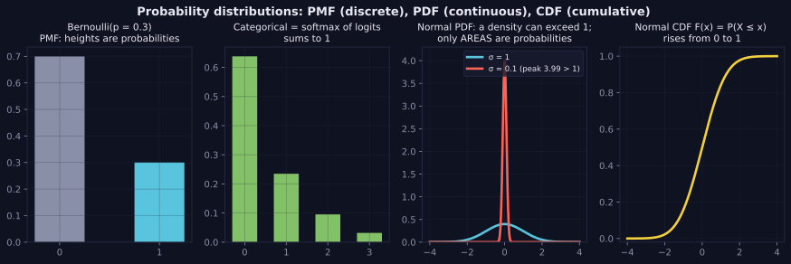
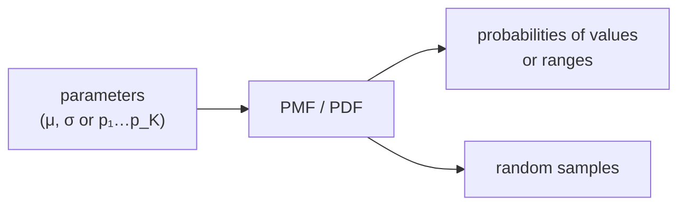

> Tier 1 · Mathematics for AI · **Level: beginner** · Reading time: about 11 minutes

# 1.28 Probability distributions

**Metadata** — Tier: 1 · Phase: 1 · Priority: P0 · Difficulty: 3/5 · Interview: High · Hands-on: High
Prerequisites: 1.26, 1.27 · Leads to: 1.29–1.38, Tier 2 (generative and discriminative), Tier 16 sampling

> **In plain words**
> A **distribution** shows **how the probability is spread over the possible values**. For a die it is six equal bars; for adult heights it is a bell shape.
> A single number (the average) is not enough: the distribution also says how spread out the values are and how likely extreme ones are.

**You need first:** 1.26 Probability, 1.27 Random variables.

> **Figure 1.28-1 — PMF, categorical, PDF and CDF**
>
> 
>
> *How to read it:* discrete distributions are **bar heights that sum to 1** (Bernoulli, categorical/softmax). For a continuous variable only **areas** under the curve (the PDF) are probabilities: the narrow normal (σ = 0.1) peaks at 3.99, above 1, which is fine because a density is not a probability. The CDF accumulates the area and rises from 0 to 1.
>
> *Generated by* `tier-01-mathematics/figures/src/t1_prob.py`.

**Words you'll meet on this page**

| Word | What it means here |
|---|---|
| PMF | probability of each value (discrete); sums to 1 |
| PDF | density curve (continuous); area under it is probability |
| CDF | `P(X ≤ x)`; rises from 0 to 1 |
| Bernoulli | one yes/no trial |
| categorical | one of K classes (a softmax output) |
| normal (Gaussian) | the bell curve, described by mean `μ` and spread `σ` |
| temperature | a dial that makes a categorical sharper or flatter |

### 1. What is it?
A description of how probability is spread over the values of a random variable:
- **PMF** `p(x) = P(X = x)` for discrete variables; sums to 1.
- **PDF** `f(x)` for continuous variables; `P(a ≤ X ≤ b) = ∫ₐᵇ f(x)dx`; the total area is 1.
- **CDF** `F(x) = P(X ≤ x)`; never decreases, goes from 0 to 1.

### 2. Why does it exist?
The mean alone does not say how spread out values are, or how heavy the tails are. Models either **output** a distribution (a classifier, a language model) or **assume** one (noise, priors, weight initialisation).

### 3. Detailed explanation
**Core families**
- **Bernoulli(p):** one yes/no trial; probability `p` of 1.
- **Categorical(p₁…p_K):** one of `K` classes; the softmax output. A language model's next word is a categorical over its vocabulary.
- **Binomial(n, p):** number of successes in `n` Bernoulli trials.
- **Uniform(a, b):** all values equally likely.
- **Normal 𝒩(μ, σ²):** `f(x) = exp(−(x − μ)²/2σ²) / (σ√2π)`. It appears whenever many small effects add up (the central limit theorem) and is the default for noise and weight initialisation. About **68%** of values fall within 1σ of the mean, **95%** within 2σ and **99.7%** within 3σ.

**Careful points**
- A **density can exceed 1** (a normal with σ = 0.1 peaks at about 3.99). Only *areas* are probabilities.
- Real data often has **heavy tails** (latencies, word frequencies, losses). A normal assumption underestimates extremes.
- **Temperature** `T` reshapes a categorical: `softmax(z/T)`. As `T → 0` it approaches "pick the best"; a large `T` approaches uniform. Top-k and top-p cut the categorical before sampling.

### 4. How does it work?
Choose a family and its parameters (for example `μ`, `σ`), compute the PMF/PDF/CDF, sample from it, or fit its parameters to data (maximum likelihood, 1.35).

### 5. Simple example
- A coin: Bernoulli(0.5). A die: categorical with six probabilities of 1/6.
- Adult heights: roughly a bell curve.

**With numbers:** heights with mean 170 cm and σ = 10 cm. About 68% of adults lie between 160 and 180 cm, and about 95% between 150 and 190 cm.

### 6. Technical example
Initialising weights from `𝒩(0, σ²)` with `σ` chosen from the layer size. Decoding a language model samples from the softmax categorical after applying temperature or top-p.

### 7. Code
**① By hand (plain Python).** A normal density, and the area under it computed by adding thin slices.

```python
import math

def normal_pdf(x, mu=0.0, sigma=1.0):
    return math.exp(-((x - mu) ** 2) / (2 * sigma ** 2)) / (sigma * math.sqrt(2 * math.pi))

dx = 0.001
area = sum(normal_pdf(-8 + i * dx) * dx for i in range(int(16 / dx)))
print("total area under the curve:", round(area, 4))
print("height at the peak for sigma = 0.1:", round(normal_pdf(0, sigma=0.1), 2), "(a density can exceed 1)")
within = sum(normal_pdf(-1 + i * dx) * dx for i in range(int(2 / dx)))
print("share within one sigma:", round(within, 3))
```

```text
total area under the curve: 1.0
height at the peak for sigma = 0.1: 3.99 (a density can exceed 1)
share within one sigma: 0.683
```

**② With NumPy.** Temperature reshapes a categorical.

```python
import numpy as np

def softmax(z):
    e = np.exp(z - z.max())
    return e / e.sum()

z = np.array([2.0, 1.0, 0.1])
for T in (0.5, 1.0, 5.0):
    print("T =", T, softmax(z / T).round(3))
```

```text
T = 0.5 [0.864 0.117 0.019]
T = 1.0 [0.659 0.242 0.099]
T = 5.0 [0.4   0.327 0.273]
```

**③ With PyTorch.** Distribution objects can sample and give probabilities.

```python
import torch
from torch.distributions import Normal, Categorical

n = Normal(0.0, 1.0)
print("P(-1 < X < 1):", round((n.cdf(torch.tensor(1.0)) - n.cdf(torch.tensor(-1.0))).item(), 3))
c = Categorical(probs=torch.tensor([0.7, 0.2, 0.1]))
print("log-probability of class 0:", round(c.log_prob(torch.tensor(0)).item(), 4))
```

```text
P(-1 < X < 1): 0.683
log-probability of class 0: -0.3567
```

### 8. Input → Process → Output



<details>
<summary><b>Beyond the basics (sections 9–16)</b> — real-world use, limits, mistakes. Skip on a first read.</summary>

### 9. Enterprise use case
Service-level engineering models latency with heavy-tailed distributions (log-normal, Pareto), not a normal, when estimating the 99th percentile. Capacity planning uses the tail, not the mean.

### 10. AI engineering connection
Classification heads (categorical), regression with Gaussian noise (MSE corresponds to a Gaussian likelihood), VAEs and diffusion (Gaussians), sampling controls (temperature, top-k, top-p), weight initialisation and priors.

### 11. Advantages
Compact descriptions of uncertainty; they enable sampling and likelihood-based training.

### 12. Limitations
The wrong family gives wrong conclusions; parametric assumptions rarely hold exactly.

### 13. Trade-offs
Simple parametric forms are data-efficient but may be misspecified; flexible nonparametric forms need more data.

### 14. Common mistakes
Reading a PDF value as a probability; assuming normality for skewed or heavy-tailed data; computing softmax unstably; applying temperature to probabilities instead of logits.

### 15. Performance / cost
Sampling from a 100,000-word vocabulary each step is cheap next to the forward pass, but top-p needs sorting and cumulative sums; careful implementations avoid full sorts.

### 16. Security
Sampling randomness affects reproducibility and safety testing. Set seeds for evaluation runs, and test safety at the sampling settings used in production, not just greedy decoding.

</details>

### 17. Interview explanation
"A distribution says how likely each value is. For discrete variables that's a PMF, for continuous ones a PDF where only areas are probabilities. A classifier or language model outputs a categorical distribution via softmax, and temperature or top-p simply reshape it before sampling."

### 18. Rapid-fire answer
PMF, PDF, CDF; Bernoulli, categorical, normal; a density can exceed 1; temperature reshapes the softmax.

### 19. Interview questions
- **Basic:** What is the difference between a PMF and a PDF? What does the CDF give?
- **Intermediate:** Why is the normal distribution so common? What does 3σ cover?
- **Advanced:** How are MSE and Gaussian likelihood related? What does temperature do to entropy?
- **Scenario:** Mean latency is 200 ms yet users complain. What distribution facts explain it?

### 20. Hands-on exercise
**Goal:** see why the mean hides the tail.

1. Draw 100,000 numbers from a normal distribution with mean 1 and σ = 0.5, and 100,000 from a log-normal distribution with the same mean (hint: for a log-normal with log-σ = 1 use log-mean = `ln(1) − 0.5`).
2. Print the median (p50) and the 99th percentile (p99) of each.
3. What does this say about reporting only the mean?

<details>
<summary>Show a solution</summary>

```python
import numpy as np

rng = np.random.default_rng(0)
normal = rng.normal(1.0, 0.5, 100_000)
lognormal = rng.lognormal(mean=-0.5, sigma=1.0, size=100_000)     # mean = exp(-0.5 + 0.5) = 1
for name, x in (("normal", normal), ("log-normal", lognormal)):
    print(f"{name:<10} mean {x.mean():.2f}  p50 {np.percentile(x, 50):.2f}  p99 {np.percentile(x, 99):.2f}")
```

```text
normal     mean 1.00  p50 1.00  p99 2.17
log-normal mean 1.00  p50 0.61  p99 6.23
```

Both have mean about 1, but the log-normal's 99th percentile is several times larger: the mean hides the tail.
</details>

### 21. Revision questions
1. Can a PDF exceed 1?
2. Which distribution is a softmax output?
3. What does `T → 0` do to a softmax?

### 22. Related concepts
1.27 Random variables · 1.29 Expectation · 1.35 Maximum likelihood · 1.36 Entropy · Tier 16 Decoding

### 23. One-line memory hook
**A distribution is the shape of uncertainty: bar heights are probabilities for PMFs, areas for PDFs.**

<details>
<summary><b>For reviewers</b> (not part of the lesson)</summary>

- Status: DRAFT, learner-first layout (Author: Claude). Code is executed by `tests/test_md_snippets.py`.
- TESTED earlier: normal PDF integrates to 1, peak value, density > 1, `sigma ≤ 0` rejected, Bernoulli PMF and invalid `p`, softmax properties (`code/calculus_prob.py`).
- The 68/95/99.7 rule is a standard result for the normal distribution.
</details>
