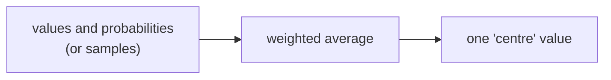

> Tier 1 · Mathematics for AI · **Level: beginner** · Reading time: about 9 minutes

# 1.29 Mean and expectation

**Metadata** — Tier: 1 · Phase: 1 · Priority: P0 · Difficulty: 2/5 · Interview: High · Hands-on: High
Prerequisites: 1.27, 1.28 · Leads to: 1.30–1.32, 1.35–1.38, SGD, loss functions

> **In plain words**
> The **mean** is the ordinary average. The **expectation** is the same idea for a random variable: **each value weighted by how likely it is**.
> Training a model means **minimising the expected loss**, which we estimate with the average loss over a batch of examples.

**You need first:** 1.27 Random variables, 1.28 Distributions.

> **Figure 1.29-1 — the mean is the balance point**
>
> ```mermaid
> flowchart LR
>     V["values and probabilities<br/>0 (p = 0.8), 10 (p = 0.2)"] --> W["weight each value<br/>0×0.8 and 10×0.2"]
>     W --> S["add up<br/>0 + 2 = 2"]
>     S --> E["E[X] = 2"]
> ```
>
> *How to read it:* multiply each possible value by its probability and add. A game paying 10 with probability 0.2 (and 0 otherwise) is worth 2 per play on average, even though you never actually win exactly 2.

**Words you'll meet on this page**

| Word | What it means here |
|---|---|
| expectation `E[X]` | probability-weighted average of a random variable |
| sample mean `x̄` | the plain average of observed values |
| linearity | `E[aX + b] = aE[X] + b` |
| median | the middle value; robust to outliers |
| unbiased estimator | its average over many samples equals the true value |
| Jensen's inequality | for convex `g`, `E[g(X)] ≥ g(E[X])` |

### 1. What is it?
- **Expectation** (population mean): `E[X] = Σ x·p(x)` for discrete variables, or `∫ x f(x) dx` for continuous ones.
- **Sample mean:** `x̄ = (1/n) Σ xᵢ`, an estimate of `E[X]` from data.

### 2. Why does it exist?
To summarise a distribution by its centre and, more importantly, to define **expected loss**. Training minimises the expected loss over the data distribution, which in practice we approximate by averaging over samples.

### 3. Detailed explanation
- **Linearity (always true):** `E[aX + b] = aE[X] + b` and `E[X + Y] = E[X] + E[Y]`, even when `X` and `Y` depend on each other.
- **A function of `X`:** `E[g(X)] = Σ g(x)p(x)`. It is **not** `g(E[X])` in general. (Jensen: for convex `g`, `E[g(X)] ≥ g(E[X])`.)
- `E[XY] = E[X]E[Y]` only if `X` and `Y` are uncorrelated or independent.
- A fair die has `E[X] = 3.5`, a value you can never roll: the mean need not be a possible outcome.
- The mean is sensitive to outliers; the **median** is robust. For skewed data (latency, income) report percentiles as well.
- **A mini-batch gradient is an unbiased estimate** of the full gradient, because the average over a random batch has the same expectation as the full-data average.
- The error of a sample mean shrinks like `σ/√n` (1.31).

### 4. How does it work?
Weight each value by its probability and add (or integrate). Or average samples: a Monte-Carlo estimate.

### 5. Simple example
A game pays 10 with probability 0.2 and 0 otherwise: `E = 10 × 0.2 + 0 × 0.8 = 2`.

**A die:** `E = (1 + 2 + 3 + 4 + 5 + 6) / 6 = 3.5`.

**A warning with outliers.** Salaries `[30, 32, 35, 36, 400]` (in thousands): the mean is 106.6, but the median is 35. The mean describes nobody here.

### 6. Technical example
The training objective is `θ* = argmin E_{(x, y)~D}[ℓ(f(x; θ), y)]`, which we estimate with the batch average `(1/B) Σ ℓᵢ`.

### 7. Code
**① By hand (plain Python).**

```python
values = [10, 0]
probs = [0.2, 0.8]
print("game:", sum(v * p for v, p in zip(values, probs)))
print("die :", sum(v * (1 / 6) for v in range(1, 7)))

salaries = [30, 32, 35, 36, 400]
print("mean:", sum(salaries) / len(salaries), " median:", sorted(salaries)[len(salaries) // 2])
```

```text
game: 2.0
die : 3.5
mean: 106.6  median: 35
```

**② With NumPy.** Linearity, and E[g(X)] versus g(E[X]).

```python
import numpy as np

x = np.random.default_rng(1).standard_normal(100_000)
print("linearity: mean(3x+5) =", round(float((3 * x + 5).mean()), 4), "  3·mean(x)+5 =", round(float(3 * x.mean() + 5), 4))
print("E[x²] =", round(float((x ** 2).mean()), 3), "  but (E[x])² =", round(float(x.mean() ** 2), 6), " (Jensen: E[g(X)] ≥ g(E[X]))")
```

```text
linearity: mean(3x+5) = 4.9862   3·mean(x)+5 = 4.9862
E[x²] = 0.993   but (E[x])² = 2.1e-05  (Jensen: E[g(X)] ≥ g(E[X]))
```

**③ With PyTorch.** The loss is a mean.

```python
import torch

predictions = torch.tensor([2.5, 0.0, 2.0, 8.0])
targets = torch.tensor([3.0, -0.5, 2.0, 7.0])
loss = torch.nn.functional.mse_loss(predictions, targets)      # mean of squared errors
print("mean squared error:", loss.item())
```

```text
mean squared error: 0.375
```

### 8. Input → Process → Output



<details>
<summary><b>Beyond the basics (sections 9–16)</b> — real-world use, limits, mistakes. Skip on a first read.</summary>

### 9. Enterprise use case
Expected cost or revenue of a decision, `E[cost] = Σ P(outcome)·cost(outcome)`, sets thresholds for fraud blocking, human escalation and model routing.

### 10. AI engineering connection
Loss as expected error; mean pooling; batch-normalisation statistics; moving averages (EMA) of weights and metrics; accuracy is the mean of correct/incorrect indicators.

### 11. Advantages
Simple, linear and easy to estimate and optimise.

### 12. Limitations
Sensitive to outliers; may not exist (heavy-tailed distributions such as Cauchy have no mean); hides the shape of the distribution and differences between groups.

### 13. Trade-offs
Mean: efficient but sensitive. Median or trimmed mean: robust but less efficient.

### 14. Common mistakes
Averaging averages with unequal group sizes; using the mean for skewed metrics; assuming `E[g(X)] = g(E[X])`; averaging probabilities versus logits without thought; reporting an aggregate that masks a failing subgroup.

### 15. Performance / cost
Running means need `O(1)` memory; averaging across distributed workers needs an all-reduce.

### 16. Security
Aggregate metrics can hide targeted attacks or poisoned slices. Evaluate per slice.

</details>

### 17. Interview explanation
"Expectation is the probability-weighted average of a random variable. In ML the training loss is an expectation over the data distribution, which we estimate with a mini-batch average. Linearity makes it easy to work with, but I remember the mean is outlier-sensitive and the expectation of a function is not the function of the mean."

### 18. Rapid-fire answer
`E[X] = Σ x·p(x)`; linear; the sample mean estimates it; `E[g(X)] ≠ g(E[X])`.

### 19. Interview questions
- **Basic:** What is the expected value of a fair die?
- **Intermediate:** Mean versus median: when does the mean fail?
- **Advanced:** Why is the mini-batch gradient unbiased? State Jensen's inequality.
- **Scenario:** Overall accuracy is up 1% but one customer segment got worse. How could the mean hide that?

### 20. Hands-on exercise
**Goal:** compare mean, median and trimmed mean on data with outliers.

1. Make 1,000 numbers from a standard normal and replace 10 of them (1%) with the value 1,000.
2. Compute the mean, the median and a 10%-trimmed mean (drop the lowest and highest 10%).
3. Which stay close to 0?

<details>
<summary>Show a solution</summary>

```python
import numpy as np

x = np.random.default_rng(0).standard_normal(1000)
x[:10] = 1000.0                                         # 1% outliers
srt = np.sort(x)
trimmed = srt[100:900].mean()                           # drop 10% on each side
print("mean   :", round(float(x.mean()), 2))
print("median :", round(float(np.median(x)), 2))
print("trimmed:", round(float(trimmed), 2))
```

```text
mean   : 9.95
median : -0.06
trimmed: -0.03
```

The mean is dragged to about 10; the median and trimmed mean stay near 0.
</details>

### 21. Revision questions
1. What is the formula for expectation?
2. Is linearity true for dependent variables?
3. Why is a mini-batch average an unbiased estimate?

### 22. Related concepts
1.30 Variance · 1.32 Covariance · 1.37 Cross-entropy · Tier 4 SGD

### 23. One-line memory hook
**Expectation = the balance point; losses are expectations estimated by batches.**

<details>
<summary><b>For reviewers</b> (not part of the lesson)</summary>

- Status: DRAFT, learner-first layout (Author: Claude). Code is executed by `tests/test_md_snippets.py`.
- TESTED earlier: fair die = 3.5, invalid probabilities rejected, linearity (`code/calculus_prob.py`).
- Cauchy-has-no-mean is a standard fact; kept as stated in the first draft.
</details>
