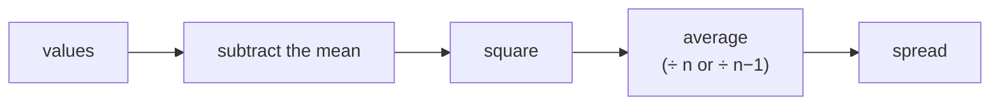

> Tier 1 · Mathematics for AI · **Level: beginner** · Reading time: about 10 minutes

# 1.30 Variance

**Metadata** — Tier: 1 · Phase: 1 · Priority: P0 · Difficulty: 2/5 · Interview: High · Hands-on: High
Prerequisites: 1.29 · Leads to: 1.31, 1.32, normalisation layers, initialisation, Adam

> **In plain words**
> **Variance** measures **how spread out** numbers are around their average. Two classes can both average 70 marks, but in one everyone scored 68–72 (low variance) and in the other scores range from 20 to 100 (high variance).
> Formula in words: **average the squared distance from the mean.**

**You need first:** 1.29 Mean and expectation.

> **Figure 1.30-1 — computing variance step by step**
>
> ```mermaid
> flowchart LR
>     D["data<br/>2 4 4 4 5 5 7 9"] --> M["mean = 5"]
>     M --> Q["squared distances<br/>9 1 1 1 0 0 4 16"]
>     Q --> S["sum = 32"]
>     S --> V1["÷ 8 → 4.0<br/>(population)"]
>     S --> V2["÷ 7 → 4.571<br/>(sample)"]
> ```
>
> *How to read it:* subtract the mean from every value, square, add up, then divide. Dividing by `n` gives the **population** variance; dividing by `n − 1` gives the **sample** estimate, which corrects for the fact that the mean itself was estimated from the same data.

**Words you'll meet on this page**

| Word | What it means here |
|---|---|
| variance `Var(X)` | `E[(X − μ)²]`: average squared deviation |
| population / sample variance | divide by `n` / by `n − 1` |
| `ddof` | "delta degrees of freedom": 0 for `n`, 1 for `n − 1` |
| Bessel's correction | using `n − 1` to remove the bias |
| Welford's algorithm | a stable one-pass way to compute variance |
| catastrophic cancellation | losing all accurate digits when subtracting nearly equal big numbers |

### 1. What is it?
`Var(X) = E[(X − μ)²] = E[X²] − (E[X])²`. It measures spread.

### 2. Why does it exist?
The mean alone does not tell you how reliable or variable data is. Squaring stops positive and negative deviations from cancelling, and makes the quantity smooth to differentiate and easy to add for independent variables.

### 3. Detailed explanation
- `Var(aX + b) = a²·Var(X)`: shifting changes nothing, scaling squares.
- For **independent** `X` and `Y`: `Var(X + Y) = Var(X) + Var(Y)`. In general add `2·Cov(X, Y)` (1.32).
- A fair die: `Var = 35/12 ≈ 2.92`.
- **Population versus sample:** the population formula divides by `n` (`ddof=0`). The *unbiased sample estimate* divides by `n − 1` (`ddof=1`, Bessel's correction). **NumPy defaults to `ddof=0`; PyTorch's `var` defaults to `n − 1`** (tested: 4.0 versus 4.571 on the same data). pandas' `.var()` also defaults to `n − 1` (REVIEW_REQUIRED: pandas is not installed in this environment). Always know your library's default.
- **A numerical trap:** the shortcut `E[X²] − E[X]²` can lose all precision when the mean is large compared with the spread (values near 10⁹ with σ = 1). Use the two-pass formula or **Welford's** one-pass algorithm.
- **Dot-product link:** for independent, zero-mean, unit-variance entries, `Var(q·k) = d`, hence the `1/√d` scaling in attention (1.10).
- **Normalisation layers** divide by `√(variance + ε)`; the tiny `ε` prevents division by zero.

### 4. How does it work?
Compute the mean, then average the squared deviations. For streaming data, update the mean and the sum of squared deviations incrementally (Welford).

### 5. Simple example
Two archers both hit the bullseye on average. One scatters widely (high variance); the other clusters tightly (low variance).

**By hand.** Data `[2, 4, 4, 4, 5, 5, 7, 9]`:

| Value | Distance from mean (5) | Squared |
|---|---|---|
| 2 | −3 | 9 |
| 4 | −1 | 1 |
| 4 | −1 | 1 |
| 4 | −1 | 1 |
| 5 | 0 | 0 |
| 5 | 0 | 0 |
| 7 | 2 | 4 |
| 9 | 4 | 16 |
| **Sum** | | **32** |

Population variance: `32 / 8 = 4.0`. Sample variance: `32 / 7 ≈ 4.571`. The standard deviation (1.31) is `√4 = 2`.

### 6. Technical example
**Weight initialisation** (Xavier, He) picks the weight variance from the layer width so that activations and gradients keep roughly the same variance from layer to layer. **Adam** keeps a moving average of squared gradients, a second-moment estimate.

### 7. Code
**① By hand (plain Python).**

```python
data = [2, 4, 4, 4, 5, 5, 7, 9]
n = len(data)
mean = sum(data) / n
ss = sum((x - mean) ** 2 for x in data)            # sum of squared distances
print("mean:", mean, " sum of squares:", ss)
print("population variance:", ss / n)
print("sample variance    :", round(ss / (n - 1), 3))
```

```text
mean: 5.0  sum of squares: 32.0
population variance: 4.0
sample variance    : 4.571
```

**② With NumPy.** The `ddof` default, and the cancellation trap.

```python
import numpy as np

x = np.array([2, 4, 4, 4, 5, 5, 7, 9.0])
print("ddof=0:", np.var(x), " ddof=1:", round(float(np.var(x, ddof=1)), 3))

big = np.random.default_rng(7).standard_normal(10_000) + 1e9      # values near a billion, spread 1
naive = np.mean(big ** 2) - np.mean(big) ** 2                       # the shortcut formula
print("true spread is about 1.  shortcut formula gives:", round(float(naive), 1))
print("two-pass formula gives:", round(float(np.var(big)), 3))
```

```text
ddof=0: 4.0  ddof=1: 4.571
true spread is about 1.  shortcut formula gives: 128.0
two-pass formula gives: 0.989
```

**③ With PyTorch.** Its default differs from NumPy's.

```python
import torch

x = torch.tensor([2., 4., 4., 4., 5., 5., 7., 9.])
print("torch default (n-1):", round(x.var().item(), 3))
print("population (n)     :", round(x.var(correction=0).item(), 3))
```

```text
torch default (n-1): 4.571
population (n)     : 4.0
```

### 8. Input → Process → Output



<details>
<summary><b>Beyond the basics (sections 9–16)</b> — real-world use, limits, mistakes. Skip on a first read.</summary>

### 9. Enterprise use case
Data-drift monitoring compares the mean and variance of features between training and production. A sudden change in variance is an early warning.

### 10. AI engineering connection
LayerNorm and BatchNorm, initialisation schemes, attention scaling, Adam's second moment, variance of gradient estimates (tuning batch size), and seed-to-seed variance in evaluation.

### 11. Advantages
Smooth, additive for independent variables, with well-understood estimators.

### 12. Limitations
Its units are squared; outlier-sensitive; may be infinite for heavy tails; says nothing about shape.

### 13. Trade-offs
Variance is mathematically convenient; MAD or IQR are more robust. A larger batch lowers gradient variance but costs more compute and sometimes generalises worse.

### 14. Common mistakes
Wrong `ddof` default; the naive one-pass formula; forgetting `ε` in normalisation; computing the sample variance of a single value (dividing by zero); mixing population and sample variance across libraries.

### 15. Performance / cost
A single pass and `O(1)` memory with Welford; parallel merges via Chan's algorithm for distributed statistics.

### 16. Security
Drift monitors based on variance can be evaded by an attacker who matches the first two moments. Combine with other checks.

</details>

### 17. Interview explanation
"Variance is the average squared distance from the mean. It tells me how spread out the data is and, for independent variables, it adds. I watch the n versus n−1 convention across libraries, and I use a stable algorithm like Welford's when values are large relative to their spread."

### 18. Rapid-fire answer
`Var = E[(X − μ)²] = E[X²] − μ²`; `Var(aX + b) = a²·Var`; sample variance uses `n − 1`; compute it stably.

### 19. Interview questions
- **Basic:** What is the variance of a constant? Of a fair die?
- **Intermediate:** Why divide by `n − 1`? What is NumPy's default?
- **Advanced:** Why does attention need the `1/√d` factor? What breaks in BatchNorm with tiny batches?
- **Scenario:** The model works in training but outputs NaN in production; some features have near-zero variance. What happens in standardisation, and how do you guard against it?

### 20. Hands-on exercise
**Goal:** see why we divide by `n − 1`.

1. Draw 20,000 small samples of size 5 from a standard normal distribution (true variance 1).
2. For each, compute the variance with `ddof=0` and with `ddof=1`.
3. Average each estimate over all samples. Which is closer to 1?

<details>
<summary>Show a solution</summary>

```python
import numpy as np

samples = np.random.default_rng(0).standard_normal((20_000, 5))
print("average of ddof=0 estimates:", round(float(samples.var(axis=1, ddof=0).mean()), 3), "(too low)")
print("average of ddof=1 estimates:", round(float(samples.var(axis=1, ddof=1).mean()), 3), "(about 1)")
```

```text
average of ddof=0 estimates: 0.801 (too low)
average of ddof=1 estimates: 1.001 (about 1)
```

With `ddof=0` the estimate is about `(n − 1)/n = 0.8` of the truth; `n − 1` fixes it.
</details>

### 21. Revision questions
1. What are the two formulas for variance?
2. What does scaling or shifting do to variance?
3. Why is the shortcut formula numerically unstable?

### 22. Related concepts
1.29 Expectation · 1.31 Standard deviation · 1.32 Covariance · 1.10 Dot product · Tier 3 Normalisation

### 23. One-line memory hook
**Variance: the average squared surprise; shifting is free, scaling is squared.**

<details>
<summary><b>For reviewers</b> (not part of the lesson)</summary>

- Status: DRAFT, learner-first layout (Author: Claude). Code is executed by `tests/test_md_snippets.py`.
- TESTED earlier: die variance, `ddof` agreement with NumPy, `Var(aX + b) = a²Var`, Welford vs NumPy at a 10⁹ offset, the naive formula's larger error, and library defaults (`t_1_30_var_defaults`: 4.0 vs 4.571). The Welford class itself remains in `code/calculus_prob.py`; this page shows the two-pass fix instead.
- pandas default (`ddof=1`) is REVIEW_REQUIRED (pandas not installed here).
</details>
