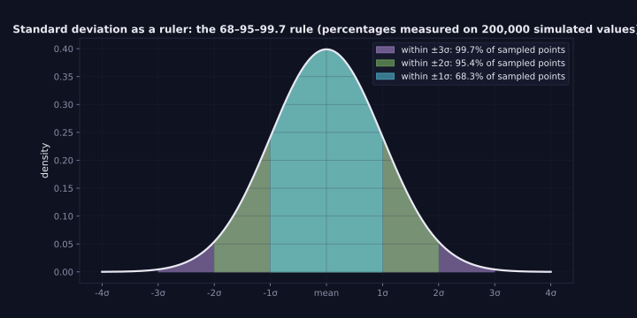
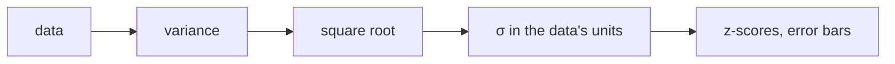

> Tier 1 · Mathematics for AI · **Level: absolute beginner** · Reading time: about 8 minutes

# 1.31 Standard deviation

**Metadata** — Tier: 1 · Phase: 1 · Priority: P0 · Difficulty: 1/5 · Interview: High · Hands-on: Very high
Prerequisites: 1.30 Variance · Leads to: 1.32, feature scaling, normalisation, evaluation reporting

> **In plain words**
> **Standard deviation (σ)** is the **typical distance of the data from its average**, in the data's own units. If exam marks have mean 70 and σ = 10, most students scored between 60 and 80.
> It is simply the **square root of the variance**, which puts the "spread" back into units you can understand (marks, milliseconds, dollars) instead of squared units.

**You need first:** 1.30 Variance.

> **Figure 1.31-1 — the 68–95–99.7 rule**
>
> 
>
> *How to read it:* for a bell-shaped (normal) distribution about **68%** of values fall within ±1σ of the mean, **95%** within ±2σ and **99.7%** within ±3σ. The percentages in the legend were measured on 200,000 simulated values (68.3%, 95.4%, 99.7%), so the rule can be checked rather than memorised.
>
> *Generated by* `tier-01-mathematics/figures/src/t1_prob.py`.

**Words you'll meet on this page**

| Word | What it means here |
|---|---|
| standard deviation `σ` | `√variance`: typical distance from the mean |
| z-score | `(x − μ)/σ`: how many σ a value is from the mean |
| standardisation | converting data to z-scores (mean 0, std 1) |
| standard error | `σ/√n`: uncertainty of a sample mean |
| outlier | a value very far from the rest |
| data leakage | using information from test data when preparing training data |

### 1. What is it?
The square root of the variance: `σ = √Var(X)`. It measures spread in the **same units as the data**.

### 2. Why does it exist?
Variance is in squared units (ms², dollars²), which are hard to picture. Taking the square root gives a practical "typical distance from the mean".

### 3. Detailed explanation
- **Empirical rule** (for roughly bell-shaped data): ~68% within ±1σ, ~95% within ±2σ, ~99.7% within ±3σ. Do not use it for skewed or heavy-tailed data.
- **z-score:** `z = (x − μ)/σ` has mean 0 and std 1. Used to rescale features and to flag outliers (`|z| > 3`).
- **Standard error of the mean:** `σ/√n`. **Four times as many samples halves the uncertainty** of the mean.
- **Population versus sample:** `ddof` as in 1.30. NumPy defaults to `ddof=0`; use `ddof=1` for a sample estimate.
- **Zero spread:** if `σ = 0` (a constant feature) z-scores are undefined; guard with a tiny `ε` or drop the feature.
- σ is **not robust**: one huge outlier can dominate it. Robust alternatives are MAD and the IQR.

### 4. How does it work?
`std = sqrt(variance)`. To standardise: subtract the mean, divide by the std. Compute the mean and std on the **training set only**, then reuse them for validation, test and production data.

### 5. Simple example
Exam marks with mean 70 and σ = 10:

| Mark | z-score `(x − 70)/10` | Meaning |
|---|---|---|
| 70 | 0 | exactly average |
| 85 | 1.5 | 1.5σ above |
| 45 | −2.5 | 2.5σ below: unusually low |

**By hand.** `[2, 4, 4, 4, 5, 5, 7, 9]` has variance 4 (1.30), so σ = 2.0. The sample version divides by `n − 1`: `√4.571 ≈ 2.138`.

### 6. Technical example
Report results as "accuracy 87.2 ± 0.6 (std over 5 seeds)". Standardise features before k-NN, SVMs or gradient descent. LayerNorm gives each token zero mean and unit variance across its features (before a learned scale and shift).

### 7. Code
**① By hand (plain Python).**

```python
import math

data = [2, 4, 4, 4, 5, 5, 7, 9]
mean = sum(data) / len(data)
var_pop = sum((x - mean) ** 2 for x in data) / len(data)
var_sample = sum((x - mean) ** 2 for x in data) / (len(data) - 1)
print("population std:", math.sqrt(var_pop))
print("sample std    :", round(math.sqrt(var_sample), 3))
print("z-score of 9  :", (9 - mean) / math.sqrt(var_pop))
```

```text
population std: 2.0
sample std    : 2.138
z-score of 9  : 2.0
```

**② With NumPy.** Z-scores, the empirical rule, and the standard error.

```python
import numpy as np

x = np.random.default_rng(1).normal(10, 3, size=200_000)
z = (x - x.mean()) / x.std()
print("z-scores: mean", round(float(z.mean()), 6), " std", round(float(z.std()), 6))
print("within 1σ:", round(float((np.abs(z) < 1).mean()), 3), " within 2σ:", round(float((np.abs(z) < 2).mean()), 3))

m100 = np.random.default_rng(2).normal(0, 1, (5000, 100)).mean(axis=1).std()
m400 = np.random.default_rng(2).normal(0, 1, (5000, 400)).mean(axis=1).std()
print("std of the mean, n=100:", round(float(m100), 3), " n=400:", round(float(m400), 3), " ratio:", round(float(m100 / m400), 2))
```

```text
z-scores: mean 0.0  std 1.0
within 1σ: 0.683  within 2σ: 0.954
std of the mean, n=100: 0.1  n=400: 0.05  ratio: 2.01
```

**③ With PyTorch.** Standardising a batch of features, with a guard against zero spread.

```python
import torch

x = torch.tensor([[1.0, 100.0], [2.0, 100.0], [3.0, 100.0]])        # second feature never changes
mean, std = x.mean(dim=0), x.std(dim=0)
z = (x - mean) / (std + 1e-8)                                         # ε avoids 0/0
print("z-scores:\n", z)
```

```text
z-scores:
 tensor([[-1.,  0.],
        [ 0.,  0.],
        [ 1.,  0.]])
```

### 8. Input → Process → Output



<details>
<summary><b>Beyond the basics (sections 9–16)</b> — real-world use, limits, mistakes. Skip on a first read.</summary>

### 9. Enterprise use case
Alerting on metrics: flag a value above `mean + 3σ` of a rolling baseline (with care for non-normal data); reporting experiments with error bars.

### 10. AI engineering connection
Feature standardisation, normalisation layers, weight-initialisation scales, variance across seeds and bootstrap resamples, confidence intervals.

### 11. Advantages
Interpretable units and universal in reporting.

### 12. Limitations
Outlier-sensitive; assumes the mean is a good centre; the empirical rule fails for non-normal data.

### 13. Trade-offs
Std is efficient for normal data; MAD or IQR are robust for skewed or contaminated data.

### 14. Common mistakes
Fitting the scaler on the whole dataset including test data (**data leakage**); dividing by a zero std; mixing population and sample std; writing "±" without saying what it is (std across seeds? standard error? 95% interval?); applying 68-95-99.7 to heavy tails.

### 15. Performance / cost
Online computation (Welford) needs `O(1)` memory: useful for monitoring streams and large preprocessing jobs.

### 16. Security
A z-score anomaly detector can be nudged slowly by an attacker ("boiling frog" drift). Anchor baselines and monitor drift separately.

</details>

### 17. Interview explanation
"Standard deviation is the square root of the variance, so it's the typical distance from the mean in the data's own units. I use it to standardise features, flag outliers, and report results as mean ± std across seeds. I fit the scaler on training data only, to avoid leakage."

### 18. Rapid-fire answer
`σ = √Var`; `z = (x − μ)/σ`; 68-95-99.7 for normal data; `SE = σ/√n`.

### 19. Interview questions
- **Basic:** What is the (population) std of `[2, 4, 4, 4, 5, 5, 7, 9]`?
- **Intermediate:** Standardisation versus min-max scaling: when do you use each?
- **Advanced:** Standard deviation versus standard error: how does a confidence interval follow?
- **Scenario:** A latency alert fires constantly after a deploy. What do you check about the baseline's mean and std?

### 20. Hands-on exercise
**Goal:** build a safe standardiser that learns only from training data.

1. Write `fit(train)` to store the mean and std per column, and `transform(data)` to apply them.
2. Guard against a zero std.
3. Show that the test data's own statistics are *not* used (the test data's mean will not be exactly 0).

<details>
<summary>Show a solution</summary>

```python
import numpy as np

class Standardizer:
    def fit(self, X):
        self.mean, self.std = X.mean(axis=0), X.std(axis=0)
        self.std[self.std == 0] = 1.0                      # constant column: avoid 0/0
        return self
    def transform(self, X):
        return (X - self.mean) / self.std

rng = np.random.default_rng(0)
train = rng.normal(50, 10, (1000, 2))
test = rng.normal(55, 10, (200, 2))                        # slightly shifted
s = Standardizer().fit(train)
print("train mean after:", s.transform(train).mean(axis=0).round(3))
print("test  mean after:", s.transform(test).mean(axis=0).round(2), "(not 0: we used the train statistics)")
```

```text
train mean after: [-0. -0.]
test  mean after: [0.46 0.57] (not 0: we used the train statistics)
```

</details>

### 21. Revision questions
1. Why take the square root of the variance?
2. What is a z-score?
3. What is the difference between standard deviation and standard error?

### 22. Related concepts
1.30 Variance · 1.32 Covariance · 1.15 Norms · Tier 2 Feature scaling

### 23. One-line memory hook
**Std = the typical distance from the mean, in the data's own units.**

<details>
<summary><b>For reviewers</b> (not part of the lesson)</summary>

- Status: DRAFT, learner-first layout (Author: Claude). Code is executed by `tests/test_md_snippets.py`.
- TESTED earlier: `test_zscore_and_empirical_rule`, `test_standard_error_shrinks_with_sqrt_n`, Welford std (`code/calculus_prob.py`).
- Figure percentages (68.3 / 95.4 / 99.7) are from the figure script.
</details>
