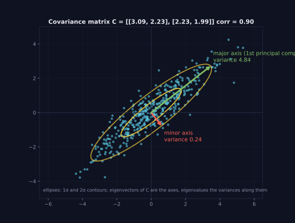
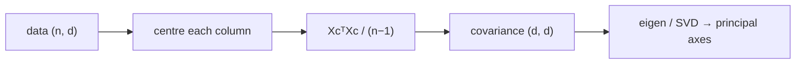

> Tier 1 · Mathematics for AI · **Level: beginner–intermediate** · Reading time: about 10 minutes

# 1.32 Covariance

**Metadata** — Tier: 1 · Phase: 1 · Priority: P0 · Difficulty: 3/5 · Interview: High · Hands-on: High
Prerequisites: 1.18, 1.29, 1.30 · Leads to: PCA (Tier 2), whitening, Gaussian models, embedding analysis

> **In plain words**
> **Covariance** tells you whether **two things rise and fall together**. Ice-cream sales and temperature go up together (positive covariance). Umbrella sales and sunshine move in opposite ways (negative).
> **Correlation** is the same idea rescaled to run from −1 to 1, so it does not depend on units.
> With many features you collect all pairs into a **covariance matrix**.

**You need first:** 1.29 Mean, 1.30 Variance; eigenvectors (1.18) for the last part.

> **Figure 1.32-1 — a covariance matrix as an ellipse**
>
> 
>
> *How to read it:* the cloud of points is long in one diagonal direction because the two features are strongly correlated (corr 0.90). The yellow ellipses mark 1σ and 2σ. The arrows are the eigenvectors of the covariance matrix: the long green axis (variance 4.84) is the **first principal component**, the short red axis (variance 0.24) the second.
>
> *Generated by* `tier-01-mathematics/figures/src/t1_geometry.py`.

**Words you'll meet on this page**

| Word | What it means here |
|---|---|
| covariance `Cov(X, Y)` | average of `(X − μₓ)(Y − μᵧ)` |
| correlation `ρ` | covariance divided by both standard deviations; in [−1, 1] |
| covariance matrix `C` | table of `Cov(featureᵢ, featureⱼ)`; variances on the diagonal |
| centring | subtracting each feature's mean |
| PCA | principal component analysis: the eigenvectors of `C` |
| whitening | transforming data so its covariance is the identity |

### 1. What is it?
`Cov(X, Y) = E[(X − μₓ)(Y − μᵧ)] = E[XY] − E[X]E[Y]`

For a dataset with `d` features, the **covariance matrix** `C` (`d × d`) holds `Cov(feature i, feature j)`; its diagonal holds the variances. **Correlation** is `ρ = Cov(X, Y) / (σₓ σᵧ)`, always between −1 and 1.

### 2. Why does it exist?
Variance describes one variable. Real data has many variables that move together (height and weight, neighbouring pixels, embedding dimensions). Covariance captures those linear relationships and defines the shape of a cloud of data.

### 3. Detailed explanation
- `Cov > 0`: tend to rise together. `Cov < 0`: one up, the other down. `Cov ≈ 0`: no **linear** relationship.
- `Cov(X, X) = Var(X)`, and `Var(X + Y) = Var(X) + Var(Y) + 2·Cov(X, Y)`.
- Covariance depends on units; **correlation does not**: rescaling a column by 1000 leaves it unchanged.
- **Uncorrelated does not mean independent.** If `Y = X²` and `X` is symmetric around 0, the correlation is about 0 yet `Y` is completely determined by `X`. Correlation only sees *straight-line* dependence. And correlation is not causation.
- **Matrix form** with centred data `Xc` (`n × d`): `C = XcᵀXc / (n − 1)`. It is symmetric and positive semi-definite, so its eigenvalues are real and non-negative (1.18).
- **PCA** is the eigendecomposition of `C` (or the SVD of `Xc`, 1.19): eigenvectors are the principal directions, eigenvalues are the variances along them.
- If `n < d`, the sample covariance is rank-deficient (cannot be inverted); use shrinkage or `C + λI` (1.13).

### 4. How does it work?
Centre each feature, compute `XcᵀXc`, divide by `n − 1`. To get correlation, divide further by the outer product of the standard deviations.

### 5. Simple example
**By hand.** Temperature (°C) and ice-creams sold (hundreds) over 4 days:

| Day | Temp `x` | Sales `y` | `x − 20` | `y − 5` | product |
|---|---|---|---|---|---|
| 1 | 16 | 3 | −4 | −2 | 8 |
| 2 | 18 | 4 | −2 | −1 | 2 |
| 3 | 22 | 6 | 2 | 1 | 2 |
| 4 | 24 | 7 | 4 | 2 | 8 |

(means: 20 and 5). Sum of products = 20, so the sample covariance is `20/3 ≈ 6.67`: positive, they rise together. (The correlation comes out as exactly 1.0 only because these made-up numbers lie exactly on a straight line.)

### 6. Technical example
Embedding vectors often show strong correlation between dimensions (a stretched cloud). **Whitening** with `C^(−1/2)` makes the cloud round. Gaussian models and priors also use covariance.

### 7. Code
**① By hand (plain Python).**

```python
x = [16, 18, 22, 24]
y = [3, 4, 6, 7]
n = len(x)
mx, my = sum(x) / n, sum(y) / n
cov = sum((a - mx) * (b - my) for a, b in zip(x, y)) / (n - 1)
sx = (sum((a - mx) ** 2 for a in x) / (n - 1)) ** 0.5
sy = (sum((b - my) ** 2 for b in y) / (n - 1)) ** 0.5
print("covariance :", round(cov, 3))
print("correlation:", round(cov / (sx * sy), 4))
```

```text
covariance : 6.667
correlation: 1.0
```

**② With NumPy.** The matrix form, and the "uncorrelated but dependent" trap.

```python
import numpy as np

X = np.random.default_rng(11).standard_normal((200, 4))
Xc = X - X.mean(axis=0)
C = Xc.T @ Xc / (len(X) - 1)
print("matches np.cov:", np.allclose(C, np.cov(X, rowvar=False)), " symmetric:", np.allclose(C, C.T))
print("smallest eigenvalue ≥ 0:", bool(np.linalg.eigvalsh(C).min() >= 0))

x = np.random.default_rng(0).standard_normal(200_000)
print("corr(x, x²) =", round(float(np.corrcoef(x, x ** 2)[0, 1]), 3), "  although x² is a function of x")
```

```text
matches np.cov: True  symmetric: True
smallest eigenvalue ≥ 0: True
corr(x, x²) = -0.002   although x² is a function of x
```

**③ With PyTorch.**

```python
import torch

x = torch.tensor([16., 18., 22., 24.])
y = torch.tensor([3., 4., 6., 7.])
print(torch.cov(torch.stack([x, y])))             # 2x2 covariance matrix
print("correlation:", round(torch.corrcoef(torch.stack([x, y]))[0, 1].item(), 4))
```

```text
tensor([[13.3333,  6.6667],
        [ 6.6667,  3.3333]])
correlation: 1.0
```

### 8. Input → Process → Output



<details>
<summary><b>Beyond the basics (sections 9–16)</b> — real-world use, limits, mistakes. Skip on a first read.</summary>

### 9. Enterprise use case
Feature-selection pipelines drop highly correlated features; portfolio and risk models use covariance matrices; monitoring tracks correlation drift.

### 10. AI engineering connection
PCA and whitening of embeddings, normalisation statistics, Gaussian models, multicollinearity in linear models, analysis of embedding anisotropy, and (advanced) Fisher information and natural gradients.

### 11. Advantages
A compact summary of pairwise linear structure; closed form and cheap.

### 12. Limitations
Linear only; sensitive to outliers; unstable when `n` is not much larger than `d`; the `d × d` memory grows quadratically (4096² = 16.8 million entries).

### 13. Trade-offs
Full covariance (expressive, `O(d²)`) versus diagonal (cheap, ignores correlation) versus low-rank plus diagonal (a compromise). Rank correlations (Spearman) handle monotone non-linear relations robustly.

### 14. Common mistakes
Forgetting to centre; `n` versus `n − 1`; treating zero correlation as independence; reading correlation as causation; computing along the wrong axis (`rowvar`); fitting statistics on test data (leakage).

### 15. Performance / cost
`O(n·d²)` time and `O(d²)` memory. For large `d` use randomised or truncated SVD, or streaming estimators.

### 16. Security
The covariance of embeddings can leak distributional information about private training data. Treat it as sensitive if derived from private data.

</details>

### 17. Interview explanation
"Covariance measures how two variables move together; the covariance matrix collects all pairs, with the variances on the diagonal. Its eigenvectors are the principal components, which is PCA. I remember that zero correlation only means no linear relationship, not independence."

### 18. Rapid-fire answer
`Cov = E[(X − μₓ)(Y − μᵧ)]`; the matrix is symmetric and positive semi-definite; PCA diagonalises it; uncorrelated does not mean independent.

### 19. Interview questions
- **Basic:** What is the sign of the covariance of ice-cream sales and temperature?
- **Intermediate:** Covariance versus correlation: why is correlation scale-free?
- **Advanced:** Why is the sample covariance singular when `n < d`? How does PCA use it?
- **Scenario:** Two features have correlation 0.98. What happens to a linear model's coefficients, and what do you do?

### 20. Hands-on exercise
**Goal:** find the main direction of correlated data.

1. Make 2-D data with `y = 0.8x + noise`.
2. Compute the covariance matrix and its eigendecomposition.
3. Report the share of variance carried by the first eigenvector.

<details>
<summary>Show a solution</summary>

```python
import numpy as np

rng = np.random.default_rng(0)
x = rng.standard_normal(2000)
y = 0.8 * x + 0.3 * rng.standard_normal(2000)
C = np.cov(np.stack([x, y]))
w, Q = np.linalg.eigh(C)
print("covariance matrix:\n", C.round(2))
print("explained variance ratios:", (w[::-1] / w.sum()).round(3))
print("first principal direction:", (Q[:, -1] * np.sign(Q[0, -1])).round(2))
```

```text
covariance matrix:
 [[1.   0.8 ]
 [0.8  0.72]]
explained variance ratios: [0.969 0.031]
first principal direction: [0.77 0.64]
```

The first direction (slope about 0.8) carries almost all of the variance.
</details>

### 21. Revision questions
1. What is the formula for covariance?
2. Which properties does `C` have?
3. Why does `Cov = 0` not imply independence?

### 22. Related concepts
1.18 Eigenvalues · 1.19 SVD · 1.30 Variance · Tier 2 PCA

### 23. One-line memory hook
**Covariance: do two variables wiggle together, in a straight line only?**

<details>
<summary><b>For reviewers</b> (not part of the lesson)</summary>

- Status: DRAFT, learner-first layout (Author: Claude). Code is executed by `tests/test_md_snippets.py`.
- TESTED earlier: matches `np.cov`, symmetric and PSD, correlation bounded and scale-invariant, zero-variance feature rejected, uncorrelated-but-dependent example (`code/info_numerics.py`).
- PCA is referenced as Tier 2; its roadmap status is the open PROPOSE_ADDITION.
</details>
