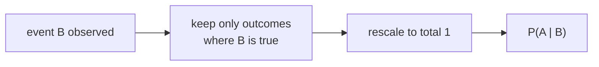

> Tier 1 · Mathematics for AI · **Level: beginner** · Reading time: about 9 minutes

# 1.33 Conditional probability

**Metadata** — Tier: 1 · Phase: 1 · Priority: P0 · Difficulty: 2/5 · Interview: Very high · Hands-on: High
Prerequisites: 1.26, 1.28 · Leads to: 1.34 Bayes, 1.35 MLE, language models (autoregression), precision and recall

> **In plain words**
> **Conditional probability** answers: "**given that I already know B happened, how likely is A?**"
> It shrinks the world to the cases where B is true and asks how often A is also true. The probability of rain is low, but the probability of rain **given dark clouds** is much higher.
> Language models are built on it: each next word is predicted **given the words so far**.

**You need first:** 1.26 Probability, 1.28 Distributions.

> **Figure 1.33-1 — shrink the world, then count**
>
> ```mermaid
> flowchart LR
>     W["all 36 outcomes<br/>of two dice"] --> B["keep only: first die = 3<br/>6 outcomes remain"]
>     B --> A["among those, sum = 7<br/>only (3, 4)"]
>     A --> P["P(sum = 7 | first = 3) = 1/6"]
> ```
>
> *How to read it:* conditioning on "first die = 3" throws away every other outcome. Of the 6 that remain, only one (the second die shows 4) gives a sum of 7, so the answer is 1/6. Without the condition, `P(sum = 7)` is 6/36 = 1/6 as well: for a sum of 7 the first die gives no information (whatever it shows, exactly one value of the second die works). For a sum of 12 the condition matters a lot: `P(sum = 12) = 1/36`, but `P(sum = 12 | first = 6) = 1/6`.

**Words you'll meet on this page**

| Word | What it means here |
|---|---|
| `P(A \| B)` | probability of A given B |
| joint probability `P(A ∩ B)` | both A and B happen |
| chain rule | `P(A ∩ B) = P(A \| B)·P(B)` |
| total probability | split `P(A)` over cases B₁, B₂, … |
| independent | `P(A \| B) = P(A)` |
| autoregressive | each item depends on the ones before it |

### 1. What is it?
The probability of `A` given that `B` has happened:

`P(A | B) = P(A ∩ B) / P(B)`, defined when `P(B) > 0`.

### 2. Why does it exist?
New information changes what is likely. Conditioning restricts the sample space to the cases where `B` holds, then rescales so the total is 1 again.

### 3. Detailed explanation
- **Product (chain) rule:** `P(A ∩ B) = P(A | B)·P(B)`. For sequences: `P(x₁, …, x_T) = Π P(x_t | x_<t)`. This is exactly how **autoregressive language models** split a sentence into word-by-word predictions.
- **Law of total probability:** `P(A) = Σᵢ P(A | Bᵢ)·P(Bᵢ)` over a complete set of cases `Bᵢ`.
- **Independence:** `P(A | B) = P(A)` (learning B tells you nothing about A).
- `P(A | B) ≠ P(B | A)` in general. Mixing them up is the "prosecutor's fallacy"; Bayes' theorem (1.34) is the fix.
- Conditioning on a random variable gives a **conditional distribution** `p(y | x)`: what a classifier learns.
- ML metrics are conditional probabilities: **precision** = `P(actually positive | predicted positive)`; **recall** = `P(predicted positive | actually positive)`.
- Conditional independence (`A ⟂ B | C`) underlies Naive Bayes and graphical models.

### 4. How does it work?
Count only the outcomes where `B` happened, and within them the fraction where `A` also happened.

### 5. Simple example
**A bag of marbles.** 10 marbles: 6 red, 4 blue. Of the 6 red, 2 are shiny; of the 4 blue, 3 are shiny.

| | shiny | matte | total |
|---|---|---|---|
| red | 2 | 4 | 6 |
| blue | 3 | 1 | 4 |
| total | 5 | 5 | 10 |

- `P(shiny) = 5/10 = 0.5`.
- `P(shiny | red) = 2/6 ≈ 0.33`: look only at the red row.
- `P(red | shiny) = 2/5 = 0.4`: look only at the shiny column.

The two conditionals differ: `P(A | B) ≠ P(B | A)`.

### 6. Technical example
A language model computes `P(next word | previous words)`. A spam filter computes `P(spam | words in the email)`. In retrieval-augmented generation, `P(answer | question, retrieved passages)`.

### 7. Code
**① By hand (plain Python).** Count by listing every outcome.

```python
dice = [(a, b) for a in range(1, 7) for b in range(1, 7)]
first3 = [d for d in dice if d[0] == 3]                      # shrink the world
hit = [d for d in first3 if sum(d) == 7]
print("P(sum=7 | first=3) =", len(hit), "/", len(first3), "=", round(len(hit) / len(first3), 4))

marbles = {"red": (2, 4), "blue": (3, 1)}                    # (shiny, matte)
print("P(shiny | red)  =", round(2 / 6, 3), "   P(red | shiny) =", round(2 / 5, 3))
```

```text
P(sum=7 | first=3) = 1 / 6 = 0.1667
P(shiny | red)  = 0.333    P(red | shiny) = 0.4
```

**② With NumPy.** By simulation.

```python
import numpy as np

rolls = np.random.default_rng(3).integers(1, 7, size=(300_000, 2))
s = rolls.sum(axis=1)
first3 = rolls[:, 0] == 3
print("P(sum=7 | first=3) ≈", round(float((first3 & (s == 7)).mean() / first3.mean()), 4))
print("P(sum=7)           ≈", round(float((s == 7).mean()), 4))
first6 = rolls[:, 0] == 6
print("P(sum=12)           ≈", round(float((s == 12).mean()), 4), "  (exact 1/36 = 0.0278)")
print("P(sum=12 | first=6) ≈", round(float((first6 & (s == 12)).mean() / first6.mean()), 4))
```

```text
P(sum=7 | first=3) ≈ 0.1682
P(sum=7)           ≈ 0.1673
P(sum=12)           ≈ 0.0279   (exact 1/36 = 0.0278)
P(sum=12 | first=6) ≈ 0.1687
```

**③ With PyTorch.** The chain rule for a sentence, in log space.

```python
import math
import torch

# P(next word | previous word) for a tiny 3-word vocabulary: rows = previous word
table = torch.tensor([[0.1, 0.6, 0.3],
                      [0.5, 0.2, 0.3],
                      [0.3, 0.3, 0.4]])
sentence = [0, 1, 2, 0]                                   # word ids
log_p = sum(math.log(table[a, b].item()) for a, b in zip(sentence, sentence[1:]))
print("log P(rest of sentence | first word) =", round(log_p, 4), " -> probability", round(math.exp(log_p), 4))
```

```text
log P(rest of sentence | first word) = -2.9188  -> probability 0.054
```

### 8. Input → Process → Output



<details>
<summary><b>Beyond the basics (sections 9–16)</b> — real-world use, limits, mistakes. Skip on a first read.</summary>

### 9. Enterprise use case
Fraud systems report `P(fraud | flagged)`. "Alert fatigue" is a precision problem, `P(real problem | alert fired)`, and it depends on base rates.

### 10. AI engineering connection
Autoregressive factorisation, classifiers `p(y | x)`, conditional generation (a prompt conditions the distribution), precision and recall, conditioning on context in RAG and agents.

### 11. Advantages
An exact framework for updating beliefs with evidence; breaks huge joint distributions into manageable conditionals.

### 12. Limitations
Conditionals are only as good as the data in each condition (rare conditions give noisy estimates); conditioning on a zero-probability event is undefined.

### 13. Trade-offs
Full conditional tables explode combinatorially, so use independence assumptions (Naive Bayes) or neural networks to parameterise them.

### 14. Common mistakes
Confusing `P(A | B)` with `P(B | A)`; ignoring base rates; conditioning on the wrong population (selection bias); assuming independence just to multiply probabilities; evaluating a model on data conditioned differently from production.

### 15. Performance / cost
Autoregressive decoding computes one conditional per word, one after another; this is why generation time grows with the length of the output.

### 16. Security
Prompt injection can be seen as adversarial conditioning: attacker-controlled text shifts `P(output | context)`.

</details>

### 17. Interview explanation
"Conditional probability is the chance of A once I know B happened: P(A and B) over P(B). Language models are built on it: the probability of a text is the product of each token's probability given the previous ones. And I'm careful that P(A given B) is not P(B given A)."

### 18. Rapid-fire answer
`P(A | B) = P(A ∩ B)/P(B)`; the chain rule splits sequences; it is not symmetric.

### 19. Interview questions
- **Basic:** With two dice, what is `P(sum = 7 | first = 3)`?
- **Intermediate:** State the chain rule. How does it give the language-model objective?
- **Advanced:** Define precision and recall as conditional probabilities. When are events conditionally independent?
- **Scenario:** A detector with 99% recall still floods analysts with false alerts. Explain it with conditionals.

### 20. Hands-on exercise
**Goal:** compute precision and recall as conditional probabilities.

1. A detector looked at 1,000 items: 50 truly bad. It flagged 60 items, of which 40 were truly bad.
2. Compute `precision = P(bad | flagged)` and `recall = P(flagged | bad)`.
3. Check your answers in code.

<details>
<summary>Show a solution</summary>

```python
flagged, true_bad, flagged_and_bad = 60, 50, 40
print("precision = P(bad | flagged) =", round(flagged_and_bad / flagged, 3))
print("recall    = P(flagged | bad) =", round(flagged_and_bad / true_bad, 3))
```

```text
precision = P(bad | flagged) = 0.667
recall    = P(flagged | bad) = 0.8
```

Same events, different conditions: precision conditions on "flagged", recall on "truly bad".
</details>

### 21. Revision questions
1. What is the formula for `P(A | B)`?
2. What is the chain rule?
3. Is `P(A | B) = P(B | A)`?

### 22. Related concepts
1.34 Bayes' theorem · 1.35 Maximum likelihood · 1.43 Log-sum-exp · Tier 15 Evaluation metrics

### 23. One-line memory hook
**Conditioning: shrink the world to where B is true, then ask how often A is also true.**

<details>
<summary><b>For reviewers</b> (not part of the lesson)</summary>

- Status: DRAFT, learner-first layout (Author: Claude). Code is executed by `tests/test_md_snippets.py`.
- TESTED earlier: `test_conditional_probability_by_simulation` (`code/info_numerics.py`).
- The marble table and the bigram table are made-up illustrations, not data.
</details>
