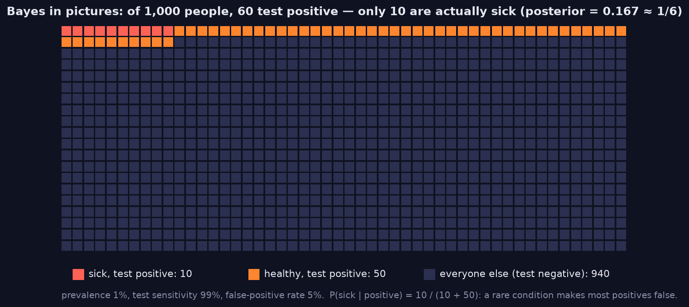
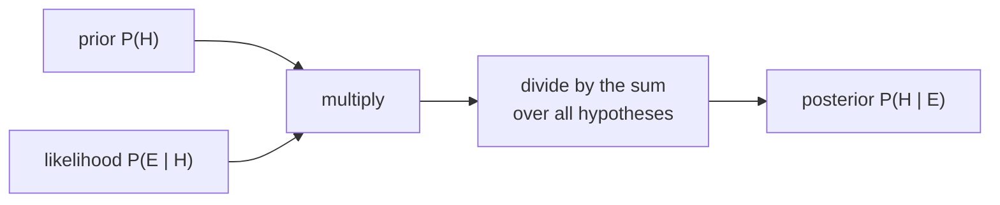

> Tier 1 · Mathematics for AI · **Level: beginner** · Reading time: about 11 minutes

# 1.34 Bayes' theorem

**Metadata** — Tier: 1 · Phase: 1 · Priority: P0 · Difficulty: 3/5 · Interview: Very high · Hands-on: Medium-High
Prerequisites: 1.33 · Leads to: 1.35 MLE, Naive Bayes and Bayesian methods (Tier 2), calibration, detection systems

> **In plain words**
> **Bayes' theorem** tells you how to **update what you believe after seeing evidence**. You start with a **prior** guess, see how well the evidence fits each possibility (the **likelihood**), and end with a better guess (the **posterior**).
> Its classic lesson: a test that is 99% accurate for a **rare** disease still gives mostly **false alarms**, because healthy people vastly outnumber sick ones.

**You need first:** 1.33 Conditional probability.

> **Figure 1.34-1 — why most positives are false: 1,000 people**
>
> 
>
> *How to read it:* each square is a person. With 1% prevalence, 10 people are sick and the test finds them; the 5% false-positive rate wrongly flags 50 of the 990 healthy people. Of the 60 positives, only 10 are really sick: `P(sick | positive) = 10/60 ≈ 1/6`. When a condition is rare, false positives can outnumber true ones.
>
> *Generated by* `tier-01-mathematics/figures/src/t1_prob.py`. The posterior in the title is computed by `info_numerics.bayes_posterior`; the counts are rounded per 1,000 people.

**Words you'll meet on this page**

| Word | What it means here |
|---|---|
| prior `P(H)` | belief before seeing the evidence |
| likelihood `P(E \| H)` | how probable the evidence is if `H` is true |
| evidence `P(E)` | overall probability of the evidence (a normaliser) |
| posterior `P(H \| E)` | updated belief after the evidence |
| base rate | how common something is in the population |
| MAP | the most probable hypothesis after seeing the data |

### 1. What is it?
A rule for reversing a conditional probability:

`P(H | E) = P(E | H) · P(H) / P(E)`

- `P(H)` — **prior**: belief before the evidence.
- `P(E | H)` — **likelihood**: how likely the evidence is if `H` is true.
- `P(E)` — **evidence**: `Σ P(E | Hᵢ)·P(Hᵢ)` (total probability); it rescales so the answers add up to 1.
- `P(H | E)` — **posterior**: the updated belief.

### 2. Why does it exist?
We usually know `P(evidence | cause)` (how a test behaves) but want `P(cause | evidence)` (is this patient sick? is this fraud? which class is it?). Bayes converts one into the other.

### 3. Detailed explanation
- **Base-rate neglect.** A test with 99% sensitivity and 5% false positives, for a disease with 1% prevalence, gives
  `P(disease | positive) = 0.99·0.01 / (0.99·0.01 + 0.05·0.99) = 1/6 ≈ 16.7%`, **not 99%**. With a 50% prior the same test gives over 90%.
- **Posterior ∝ likelihood × prior.** Compute the unnormalised products for every hypothesis, then divide by their sum.
- **Sequential updating:** today's posterior is tomorrow's prior.
- **MAP estimate** = the hypothesis with the highest posterior. Maximum likelihood (1.35) is MAP with a flat prior. L2 weight decay corresponds to a Gaussian prior on the weights; L1 to a Laplace prior.
- **Naive Bayes** assumes features are independent given the class: `P(c | x) ∝ P(c)·Π P(xᵢ | c)`, computed in log space (1.41).
- Bayes' theorem is a mathematical identity that is always valid. *Bayesian inference* additionally treats parameters themselves as random.

### 4. How does it work?
For every hypothesis: multiply prior by likelihood. Add the products to get the evidence. Divide each product by that sum.

### 5. Simple example
**Counting people (no formulas needed).** Take 1,000 people. 1% are sick: 10 sick, 990 healthy.

| | Test positive | Test negative | Total |
|---|---|---|---|
| sick (10) | 9.9 ≈ 10 (99% detected) | 0 | 10 |
| healthy (990) | 49.5 ≈ 50 (5% false alarms) | 940 | 990 |
| **positives** | **≈ 60** | | |

Of about 60 positives, only 10 are sick: `10/60 ≈ 1/6`.

**Hoofbeats.** You hear hoofbeats outside: horses or zebras? Even if zebras make the sound just as well, the prior (horses are far more common) favours horses.

### 6. Technical example
- **Spam filter:** `P(spam | "free money") ∝ P("free money" | spam)·P(spam)`.
- **Alert triage:** `P(real incident | alert)` depends on the alert's precision **and** on how often real incidents occur.

### 7. Code
**① By hand (plain Python).** The theorem as one function, and the disease example.

```python
def posterior(prior, p_pos_given_h, p_pos_given_not_h):
    evidence = p_pos_given_h * prior + p_pos_given_not_h * (1 - prior)
    return p_pos_given_h * prior / evidence

print("1% prevalence :", round(posterior(0.01, 0.99, 0.05), 4))
print("50% prevalence:", round(posterior(0.50, 0.99, 0.05), 4))
```

```text
1% prevalence : 0.1667
50% prevalence: 0.9519
```

**② With NumPy.** Several hypotheses at once (a categorical posterior).

```python
import numpy as np

prior = np.array([0.5, 0.3, 0.2])              # three possible classes
likelihood = np.array([0.1, 0.4, 0.5])         # how well the evidence fits each class
unnormalised = prior * likelihood
post = unnormalised / unnormalised.sum()
print("unnormalised:", unnormalised.round(3))
print("posterior   :", post.round(3), " sums to", post.sum().round(6))
```

```text
unnormalised: [0.05 0.12 0.1 ]
posterior   : [0.185 0.444 0.37 ]  sums to 1.0
```

**③ With PyTorch.** Sequential updating: yesterday's posterior becomes today's prior.

```python
import torch

belief = torch.tensor([0.5, 0.5])                    # prior for hypotheses A, B
for lik in ([0.8, 0.3], [0.7, 0.4], [0.9, 0.2]):     # three pieces of evidence
    belief = belief * torch.tensor(lik)
    belief = belief / belief.sum()
    print("belief in A, B:", [round(v, 3) for v in belief.tolist()])
```

```text
belief in A, B: [0.727, 0.273]
belief in A, B: [0.824, 0.176]
belief in A, B: [0.955, 0.045]
```

### 8. Input → Process → Output



<details>
<summary><b>Beyond the basics (sections 9–16)</b> — real-world use, limits, mistakes. Skip on a first read.</summary>

### 9. Enterprise use case
Triage systems (fraud, security alerts, medical screening): the policy must account for base rates, otherwise teams drown in false positives or ignore real ones.

### 10. AI engineering connection
Naive Bayes, Bayesian optimisation (hyperparameter search), uncertainty estimation, regularisation as priors, probabilistic reasoning in agents, and interpreting classifier scores as posteriors only if they are calibrated.

### 11. Advantages
Principled evidence updating; handles small data with informative priors; interpretable.

### 12. Limitations
Priors and likelihoods can be hard to specify; the exact posterior is intractable for complex models (approximations: MCMC, variational inference); the Naive Bayes independence assumption is rarely true.

### 13. Trade-offs
Strong priors help with little data but bias the result; weak priors let the data speak but need more of it.

### 14. Common mistakes
Ignoring base rates; confusing likelihood with posterior; forgetting to normalise; double-counting evidence that is not independent; treating a classifier's softmax score as the Bayesian posterior without calibration or a prior-shift correction.

### 15. Performance / cost
The exact normalisation sums over all hypotheses: fine for a few classes, impossible for huge discrete spaces without approximation.

### 16. Security
Adversaries can shift base rates (flood a system with benign alerts or poisoned examples) to degrade a posterior-based rule. Monitor prior drift.

</details>

### 17. Interview explanation
"Bayes' theorem flips a conditional: the posterior is the likelihood times the prior, normalised. The classic lesson is base rates: a 99%-sensitive test for a rare disease still gives mostly false positives, about 1 in 6 true. I apply the same thinking to fraud and alert triage."

### 18. Rapid-fire answer
Posterior ∝ likelihood × prior; base rates matter; MLE = MAP with a flat prior.

### 19. Interview questions
- **Basic:** State Bayes' theorem; define prior, likelihood and posterior.
- **Intermediate:** Work through the disease-test example. Why is the posterior low?
- **Advanced:** How does L2 regularisation relate to a Gaussian prior? MAP versus MLE?
- **Scenario:** An alerting model's precision drops after a traffic surge of benign events. Explain it with Bayes.

### 20. Hands-on exercise
**Goal:** find how rare a disease can be before a positive test is still more likely false than true.

1. Use the same test (99% sensitivity, 5% false-positive rate).
2. Compute `P(disease | positive)` for prevalences 0.1%, 1%, 5%, 20%, 50%.
3. At which prevalence does the posterior pass 50%?

<details>
<summary>Show a solution</summary>

```python
def posterior(prior, sens=0.99, fpr=0.05):
    return sens * prior / (sens * prior + fpr * (1 - prior))

for prev in (0.001, 0.01, 0.05, 0.20, 0.50):
    print(f"prevalence {prev:>5.1%}  ->  P(disease | positive) = {posterior(prev):.3f}")
# the posterior is 0.5 when sens*prior = fpr*(1-prior)  ->  prior = fpr / (sens + fpr)
print("crossing point:", round(0.05 / (0.99 + 0.05), 4))
```

```text
prevalence  0.1%  ->  P(disease | positive) = 0.019
prevalence  1.0%  ->  P(disease | positive) = 0.167
prevalence  5.0%  ->  P(disease | positive) = 0.510
prevalence 20.0%  ->  P(disease | positive) = 0.832
prevalence 50.0%  ->  P(disease | positive) = 0.952
crossing point: 0.0481
```

The posterior crosses 50% at a prevalence of about 4.8%.
</details>

### 21. Revision questions
1. What is the formula, and what are the four names?
2. What is base-rate neglect?
3. What is the difference between MAP and MLE?

### 22. Related concepts
1.33 Conditional probability · 1.35 Maximum likelihood · Tier 2 Naive Bayes · Tier 15 Calibration

### 23. One-line memory hook
**Posterior = prior × likelihood, then normalise, and never forget the base rate.**

<details>
<summary><b>For reviewers</b> (not part of the lesson)</summary>

- Status: DRAFT, learner-first layout (Author: Claude). Code is executed by `tests/test_md_snippets.py`.
- TESTED earlier: the 1/6 result, prior sensitivity, invalid probability and zero-evidence errors, categorical posterior sums to 1 (`code/info_numerics.py`).
- Naive Bayes and the Gaussian/Laplace-prior remarks are forward references; Naive Bayes' roadmap status is the open PROPOSE_ADDITION.
</details>
