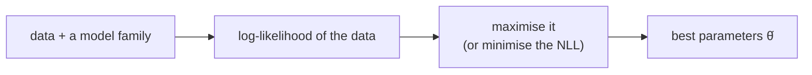

> Tier 1 · Mathematics for AI · **Level: beginner–intermediate** · Reading time: about 11 minutes

# 1.35 Maximum likelihood

**Metadata** — Tier: 1 · Phase: 1 · Priority: P0 · Difficulty: 3/5 · Interview: High · Hands-on: High
Prerequisites: 1.28, 1.33, 1.34, 1.41 · Leads to: 1.36–1.38, loss functions in Tiers 2–4, LLM pretraining

> **In plain words**
> **Maximum likelihood** means: **choose the settings of your model that make the data you actually saw as probable as possible.**
> You flipped a coin 10 times and got 7 heads. Which coin bias `p` would make "7 heads in 10" most likely? `p = 0.7`.
> Almost every loss function in machine learning (cross-entropy, squared error) comes from this one idea.

**You need first:** 1.28 Distributions, 1.33 Conditional probability, a feel for logarithms (1.41).

> **Figure 1.35-1 — which coin bias explains 7 heads in 10?**
>
> ```mermaid
> flowchart LR
>     D["data: 7 heads, 3 tails"] --> L["likelihood of the data<br/>for each p:<br/>p⁷ (1−p)³"]
>     L --> T["try p = 0.3, 0.5, 0.7, 0.9"]
>     T --> B["highest at p = 0.7"]
> ```
>
> *How to read it:* for each candidate `p`, compute how probable the observed flips are: `p⁷(1 − p)³` (up to a constant). It is small for `p = 0.3`, larger for `0.5`, **largest at 0.7**, and falls again at `0.9`. The best `p` is the one that "would have been least surprised" by the data.

**Words you'll meet on this page**

| Word | What it means here |
|---|---|
| likelihood | how probable the observed data is, as a function of the parameters |
| log-likelihood | its logarithm (turns products into sums) |
| NLL | negative log-likelihood: the loss we minimise |
| MLE | the parameters that maximise the likelihood |
| i.i.d. | independent, identically distributed data |
| biased estimator | its average over many datasets is not the true value |

### 1. What is it?
Choose the parameters `θ` that make the observed data most probable:

`θ̂ = argmax_θ P(data | θ)`

For independent data the likelihood is a product `Π p(xᵢ | θ)`. Products of many small numbers underflow and are awkward to differentiate, so we maximise the **log-likelihood** `Σ log p(xᵢ | θ)`, or equivalently minimise the **negative log-likelihood (NLL)**.

### 2. Why does it exist?
It is a general recipe for turning "a model with parameters" into "a loss to minimise". Most losses in ML are the NLL of some assumed distribution.

### 3. Detailed explanation
- `log` never reverses order, so the best parameters stay the same, and it turns products into sums (1.41).
- **Bernoulli (coin):** the MLE is `p̂ = fraction of ones`. The NLL is **binary cross-entropy**.
- **Gaussian with fixed σ:** maximising the likelihood equals minimising squared error: the **MSE loss**. A Laplace distribution gives the L1 loss.
- **Categorical (softmax):** NLL is **cross-entropy** (1.37). Language-model pretraining is MLE of next-word probabilities.
- **A bias:** the Gaussian MLE of the variance divides by `n` and is **biased low**: on average `(n − 1)/n·σ²` (about 0.8 for `n = 5`). Dividing by `n − 1` fixes it. MLE is *consistent* (right as `n → ∞`) but not always unbiased.
- **Overfitting with little data:** 3 heads in 3 flips gives `p̂ = 1`, claiming tails are impossible. Priors or regularisation (MAP, 1.34) fix this.
- The likelihood is a function of the **parameters** for fixed data. It is not a probability distribution over `θ`.
- If the model family is wrong, MLE finds the best-fitting wrong model (it minimises KL divergence from the truth, 1.38).

### 4. How does it work?
Write the log-likelihood, differentiate and set to zero (a closed form exists for simple models), or run gradient descent on the NLL for complex ones.

### 5. Simple example
**Seven heads in ten flips.** The likelihood (ignoring a constant) of `p`:

| `p` | `p⁷ · (1−p)³` |
|---|---|
| 0.3 | 0.0000750 |
| 0.5 | 0.000977 |
| **0.7** | **0.002224** |
| 0.9 | 0.000478 |

The best of these is `p = 0.7`, which matches the common-sense answer 7/10.

### 6. Technical example
A language model with parameters `θ` minimises `−Σ_t log p_θ(x_t | x_<t)` over a text corpus. **Perplexity** is `exp(mean NLL)`.

### 7. Code
**① By hand (plain Python).** Try many values of `p`.

```python
import math

flips = [1, 1, 0, 1, 0, 1, 1, 1, 0, 1]            # 7 heads, 3 tails

def nll(p):
    return -sum(math.log(p if f == 1 else 1 - p) for f in flips)

candidates = [i / 100 for i in range(1, 100)]
best = min(candidates, key=nll)
print("best p by grid search:", best, "   closed form (fraction of ones):", sum(flips) / len(flips))
print("NLL at 0.3, 0.7, 0.9:", [round(nll(p), 3) for p in (0.3, 0.7, 0.9)])
```

```text
best p by grid search: 0.7    closed form (fraction of ones): 0.7
NLL at 0.3, 0.7, 0.9: [9.498, 6.109, 7.645]
```

**② With NumPy.** The Gaussian MLE, and its bias for small samples.

```python
import numpy as np

x = np.random.default_rng(0).normal(5, 2, 10_000)
print("Gaussian MLE of (mean, std):", round(float(x.mean()), 2), round(float(x.std()), 2))

small = np.random.default_rng(1).standard_normal((50_000, 5))       # many samples of size 5, true variance 1
print("average MLE variance (÷n)  :", round(float(small.var(axis=1, ddof=0).mean()), 3), "(biased low)")
print("average unbiased (÷(n-1))  :", round(float(small.var(axis=1, ddof=1).mean()), 3))
```

```text
Gaussian MLE of (mean, std): 5.01 2.0
average MLE variance (÷n)  : 0.799 (biased low)
average unbiased (÷(n-1))  : 0.999
```

**③ With PyTorch.** Gradient descent on the NLL finds the same answer.

```python
import torch

flips = torch.tensor([1., 1., 0., 1., 0., 1., 1., 1., 0., 1.])
logit = torch.tensor(0.0, requires_grad=True)                 # p = sigmoid(logit)
opt = torch.optim.SGD([logit], lr=0.5)
for _ in range(200):
    opt.zero_grad()
    p = torch.sigmoid(logit)
    loss = -(flips * torch.log(p) + (1 - flips) * torch.log(1 - p)).mean()
    loss.backward()
    opt.step()
print("learned p:", round(torch.sigmoid(logit).item(), 3))
```

```text
learned p: 0.7
```

### 8. Input → Process → Output



<details>
<summary><b>Beyond the basics (sections 9–16)</b> — real-world use, limits, mistakes. Skip on a first read.</summary>

### 9. Enterprise use case
Fitting parametric models of failure rates, latency or demand; the fitted distribution drives capacity and service-level decisions.

### 10. AI engineering connection
Cross-entropy, MSE and BCE are NLLs; pretraining and supervised fine-tuning are MLE; RLHF and DPO add other objectives on top; calibration problems arise from MLE on overfit models.

### 11. Advantages
General, principled, consistent, and efficient with large samples.

### 12. Limitations
Overfits small data; sensitive to model misspecification and outliers (the Gaussian assumption); gives a single estimate with no uncertainty.

### 13. Trade-offs
MLE is simple and data-driven; MAP or fully Bayesian methods add priors and uncertainty at more complexity.

### 14. Common mistakes
Maximising the raw product (underflow); a sign slip (maximising LL is minimising NLL); taking the log of 0 without a tiny `ε`; treating the likelihood as a distribution over `θ`; ignoring the `n` versus `n − 1` bias; assuming a Gaussian for heavy-tailed data.

### 15. Performance / cost
Summing log-probabilities is `O(n)`. Large-corpus MLE runs as mini-batch gradient descent.

### 16. Security
Memorisation: MLE on small or duplicated data can reproduce training examples (privacy leakage). Deduplicate, and consider differential privacy for sensitive data.

</details>

### 17. Interview explanation
"Maximum likelihood picks the parameters that make the observed data most probable. In practice I minimise the negative log-likelihood: cross-entropy for classification and LLMs, squared error when I assume Gaussian noise. It overfits small data, which is why regularisation, a prior in Bayesian terms, helps."

### 18. Rapid-fire answer
`argmax Σ log p(x | θ)`; NLL = the loss; cross-entropy = categorical NLL; MSE = Gaussian NLL.

### 19. Interview questions
- **Basic:** What is the MLE of a Bernoulli parameter from 7 heads in 10?
- **Intermediate:** Why use the log-likelihood? Show that MSE comes from a Gaussian.
- **Advanced:** Why is the Gaussian MLE variance biased? MLE versus MAP?
- **Scenario:** The model assigns probability ≈ 0 to the correct word and the loss explodes. What are the causes and fixes (label smoothing, `ε` clipping, a data bug)?

### 20. Hands-on exercise
**Goal:** find the MLE of an exponential distribution's rate and check it numerically.

1. For data from an exponential distribution with rate `λ`, the NLL is `−n·log λ + λ·Σxᵢ`. Setting the derivative to zero gives `λ̂ = n / Σxᵢ = 1 / mean`.
2. Generate 5,000 samples with `λ = 2`.
3. Compare the formula with a grid search of the NLL.

<details>
<summary>Show a solution</summary>

```python
import numpy as np

x = np.random.default_rng(0).exponential(scale=1 / 2.0, size=5000)      # true rate 2
nll = lambda lam: -len(x) * np.log(lam) + lam * x.sum()
grid = np.linspace(0.5, 4, 3501)
print("closed form 1/mean:", round(1 / float(x.mean()), 3))
print("grid search       :", round(float(grid[np.argmin([nll(g) for g in grid])]), 3))
```

```text
closed form 1/mean: 1.971
grid search       : 1.971
```

</details>

### 21. Revision questions
1. Why do we take the logarithm?
2. Which losses are NLLs?
3. Is the likelihood a probability density over `θ`?

### 22. Related concepts
1.34 Bayes · 1.36–1.38 Information theory · 1.41 Logarithms · Tier 4 Loss functions

### 23. One-line memory hook
**MLE: pick the parameters that would have been least surprised by the data.**

<details>
<summary><b>For reviewers</b> (not part of the lesson)</summary>

- Status: DRAFT, learner-first layout (Author: Claude). Code is executed by `tests/test_md_snippets.py`.
- TESTED earlier: grid argmin equals closed-form MLE; Gaussian MLE variance bias (`code/info_numerics.py`).
- The likelihood table in section 5 is `p⁷(1−p)³` without the binomial coefficient; values are arithmetic.
</details>
