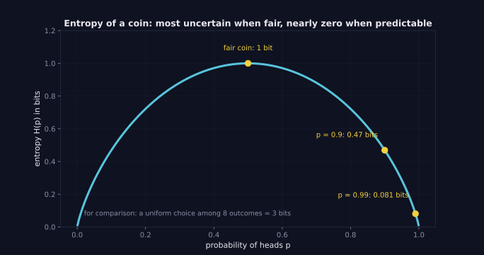
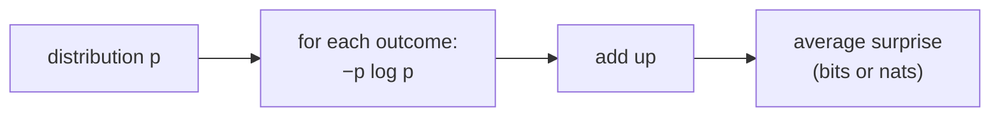

> Tier 1 · Mathematics for AI · **Level: beginner–intermediate** · Reading time: about 9 minutes

# 1.36 Entropy

**Metadata** — Tier: 1 · Phase: 1 · Priority: P1 · Difficulty: 3/5 · Interview: Medium-High · Hands-on: Medium
Prerequisites: 1.28, 1.41 · Leads to: 1.37, 1.38, decision trees (Tier 2), perplexity, sampling

> **In plain words**
> **Entropy** measures **how uncertain (surprising) an outcome is on average**. A coin that always lands heads has zero entropy: no surprise. A fair coin has the most (1 bit) for two outcomes.
> You can think of it as "how many yes/no questions do I need, on average, to find out what happened?"

**You need first:** 1.28 Distributions and the logarithm (1.41).

> **Figure 1.36-1 — entropy of a coin**
>
> 
>
> *How to read it:* entropy is highest (1 bit) when the coin is fair and shrinks toward 0 as the outcome becomes predictable: 0.47 bits at `p = 0.9` and 0.081 bits at `p = 0.99`. Less uncertainty means fewer yes/no questions on average.
>
> *Generated by* `tier-01-mathematics/figures/src/t1_prob.py`.

**Words you'll meet on this page**

| Word | What it means here |
|---|---|
| surprise (information) | `−log p(x)`: bigger for rarer outcomes |
| entropy `H(p)` | average surprise `−Σ p log p` |
| bit / nat | unit using `log₂` / the natural log |
| uniform | all outcomes equally likely (maximum entropy) |
| perplexity | `exp(H)`: the effective number of equally likely choices |
| information gain | how much a question reduces entropy (used by decision trees) |

### 1. What is it?
The average surprise of a distribution:

`H(p) = −Σ p(x) log p(x)`

With `log₂` the unit is **bits**; with the natural log, **nats**. By convention `0·log 0 = 0`.

### 2. Why does it exist?
It quantifies uncertainty: on average how many yes/no questions are needed to identify the outcome, or the best possible average code length for the source.

### 3. Detailed explanation
- **Surprise of one outcome:** `−log p(x)`. Rare events are more surprising.
- **A fair coin:** 1 bit. **A certain outcome:** 0. **Uniform over 8 outcomes:** 3 bits. For `K` outcomes the maximum is `log K`, reached by the uniform distribution.
- A **peaked** distribution has low entropy (predictable); a **flat** one has high entropy.
- **Temperature** in softmax directly changes entropy: high `T` means higher entropy.
- **Perplexity** = `exp(H)` (in nats): the effective number of equally likely choices. For a language model it is `exp(cross-entropy)` on a test set (1.37).
- **Decision trees** choose the question that maximises **information gain**, the reduction in entropy.
- Entropy depends only on the probabilities, not on the labels of the outcomes.
- Continuous ("differential") entropy exists but can be negative; this page covers discrete entropy.

### 4. How does it work?
For each outcome multiply its probability by `−log p`, then add. Outcomes with `p = 0` contribute 0.

### 5. Simple example
**Guess a number from 1 to 8** with yes/no questions: 3 questions suffice ("is it above 4?", …). That is 3 bits.

**Entropy by hand for a biased coin** (`p = 0.9` heads):

| Outcome | `p` | `−log₂ p` (surprise) | `p × surprise` |
|---|---|---|---|
| heads | 0.9 | 0.152 | 0.137 |
| tails | 0.1 | 3.322 | 0.332 |
| | | **entropy** | **0.469 bits** |

Compare a fair coin: `0.5 × 1 + 0.5 × 1 = 1` bit. At `p = 0.99` it falls to 0.081 bits.

### 6. Technical example
Monitoring the entropy of a language model's next-word distribution flags uncertain steps; high entropy often comes before made-up content (a heuristic, not a guarantee). The entropy of a dataset's labels tells you how balanced the classes are.

### 7. Code
**① By hand (plain Python).**

```python
import math

def entropy(p, base=2):
    return -sum(x * math.log(x, base) for x in p if x > 0)        # 0·log 0 counts as 0

print("fair coin    :", entropy([0.5, 0.5]))
print("uniform of 8 :", round(entropy([1 / 8] * 8), 4))
print("certain      :", entropy([1.0, 0.0]) + 0.0)
print("biased 0.9   :", round(entropy([0.9, 0.1]), 3))
print("biased 0.99  :", round(entropy([0.99, 0.01]), 3))
```

```text
fair coin    : 1.0
uniform of 8 : 3.0
certain      : 0.0
biased 0.9   : 0.469
biased 0.99  : 0.081
```

**② With NumPy.** Temperature changes entropy; perplexity as the effective number of choices.

```python
import numpy as np

def softmax(z):
    e = np.exp(z - z.max())
    return e / e.sum()

def entropy_nats(p):
    p = p[p > 0]
    return float(-(p * np.log(p)).sum())

z = np.array([2.0, 1.0, 0.1, -1.0])
for T in (0.2, 1.0, 5.0):
    h = entropy_nats(softmax(z / T))
    print(f"T = {T:<3}  entropy = {h:.3f} nats   perplexity = {np.exp(h):.2f} of 4 choices")
```

```text
T = 0.2  entropy = 0.041 nats   perplexity = 1.04 of 4 choices
T = 1.0  entropy = 0.961 nats   perplexity = 2.61 of 4 choices
T = 5.0  entropy = 1.362 nats   perplexity = 3.91 of 4 choices
```

**③ With PyTorch.**

```python
import torch
from torch.distributions import Categorical

print("fair die entropy (nats):", round(Categorical(probs=torch.full((6,), 1 / 6)).entropy().item(), 4))
print("log 6                  :", round(float(torch.log(torch.tensor(6.0))), 4))
```

```text
fair die entropy (nats): 1.7918
log 6                  : 1.7918
```

### 8. Input → Process → Output



<details>
<summary><b>Beyond the basics (sections 9–16)</b> — real-world use, limits, mistakes. Skip on a first read.</summary>

### 9. Enterprise use case
Data compression, anomaly detection (a sudden change in log entropy), and feature engineering for tree models (information gain).

### 10. AI engineering connection
Cross-entropy loss and perplexity, sampling temperature, entropy bonuses in reinforcement learning (exploration), uncertainty measures for language-model outputs, decision trees.

### 11. Advantages
A single number for uncertainty, with strong theory behind it.

### 12. Limitations
Depends on the distribution you believe; says nothing about meaning; token-level entropy is not factual uncertainty; estimating it from small samples is biased.

### 13. Trade-offs
Entropy versus Gini impurity in trees (similar results, Gini is cheaper); bits versus nats (just a constant factor `ln 2`).

### 14. Common mistakes
Mixing bits and nats when comparing perplexities; treating `0·log 0` as NaN; computing entropy of unnormalised scores; assuming high entropy means "wrong".

### 15. Performance / cost
`O(K)` per distribution. Compute it from log-probabilities (`log_softmax`) to avoid `log(0)`.

### 16. Security
Low-entropy outputs may reveal memorised content; the high-entropy randomness needed for keys and tokens is a different, cryptographic notion.

</details>

### 17. Interview explanation
"Entropy is the average surprise of a distribution: minus the sum of p log p. A fair coin has one bit, a uniform choice among eight things has three. In ML it shows up as the floor of cross-entropy, as perplexity for language models, and in decision-tree splits."

### 18. Rapid-fire answer
`H = −Σ p log p`; maximum at uniform (`log K`); perplexity = `exp(H)`.

### 19. Interview questions
- **Basic:** What is the entropy of a fair die in bits?
- **Intermediate:** Which distribution maximises entropy, and why?
- **Advanced:** Relate temperature to entropy; relate entropy, cross-entropy and KL.
- **Scenario:** Perplexity went from 12 to 9 after a change. What does that say, and what caveats apply (tokeniser change, dataset)?

### 20. Hands-on exercise
**Goal:** tabulate how temperature changes the entropy of a softmax.

1. Take scores `[3.0, 1.0, 0.5, 0.0]`.
2. For `T` = 0.1, 0.5, 1, 2, 10 compute the softmax and its entropy in bits.
3. What do you see at very low and very high `T`?

<details>
<summary>Show a solution</summary>

```python
import numpy as np

z = np.array([3.0, 1.0, 0.5, 0.0])
for T in (0.1, 0.5, 1, 2, 10):
    e = np.exp((z - z.max()) / T)
    p = e / e.sum()
    h = -(p[p > 0] * np.log2(p[p > 0])).sum()
    print(f"T = {T:<4} entropy = {h:.3f} bits (maximum {np.log2(4):.0f} bits)")
```

```text
T = 0.1  entropy = 0.000 bits (maximum 2 bits)
T = 0.5  entropy = 0.210 bits (maximum 2 bits)
T = 1    entropy = 1.053 bits (maximum 2 bits)
T = 2    entropy = 1.724 bits (maximum 2 bits)
T = 10   entropy = 1.990 bits (maximum 2 bits)
```

Low `T` approaches 0 bits (one clear winner); high `T` approaches the maximum, 2 bits for four choices.
</details>

### 21. Revision questions
1. What are the units of entropy?
2. Which distribution has maximum entropy?
3. How is perplexity defined?

### 22. Related concepts
1.37 Cross-entropy · 1.38 KL divergence · 1.41 Logarithms · Tier 2 Decision trees

### 23. One-line memory hook
**Entropy: how surprised you are on average; flat distributions surprise most.**

<details>
<summary><b>For reviewers</b> (not part of the lesson)</summary>

- Status: DRAFT, learner-first layout (Author: Claude). Code is executed by `tests/test_md_snippets.py`.
- TESTED earlier: known values, base conversion, invalid distribution rejected, uniform = maximum entropy (`code/info_numerics.py`).
- Decision trees are a forward reference; their roadmap status is the open PROPOSE_ADDITION.
</details>
