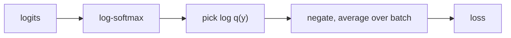

> Tier 1 · Mathematics for AI · **Level: intermediate** · Reading time: about 10 minutes

# 1.37 Cross-entropy

**Metadata** — Tier: 1 · Phase: 1 · Priority: P0 · Difficulty: 3/5 · Interview: Very high · Hands-on: Very high
Prerequisites: 1.35, 1.36, 1.43 · Leads to: 1.38 KL, classification and LLM training (Tiers 3–10), distillation

> **In plain words**
> **Cross-entropy** is the standard **score for how wrong a model's predicted probabilities are**. For a classifier it is simply **minus the log of the probability the model gave to the correct answer**.
> Give the right answer 90% and the penalty is small; give it 1% and the penalty is huge. Almost every classifier and language model is trained by making this number smaller.

**You need first:** 1.35 Maximum likelihood, 1.36 Entropy.

> **Figure 1.37-1 — the penalty for the correct class's probability**
>
> ```mermaid
> flowchart LR
>     A["model gives the correct<br/>class probability q"] --> B["loss = −ln q"]
>     B --> C["q = 0.9 → 0.105<br/>q = 0.25 → 1.386<br/>q = 0.01 → 4.605<br/>q → 0 → ∞"]
> ```
>
> *How to read it:* the loss is small when the model is confident and right, and grows without limit as the probability it gave to the truth approaches 0. This steep penalty for confident mistakes is what pushes models to give the true answer a high probability.

**Words you'll meet on this page**

| Word | What it means here |
|---|---|
| cross-entropy `H(p, q)` | `−Σ p log q`: average surprise using `q` when truth is `p` |
| one-hot | a target with 1 for the correct class, 0 elsewhere |
| logits | the raw scores before softmax |
| log-softmax | `log(softmax(z))`, computed stably |
| perplexity | `exp(cross-entropy)` in nats |
| label smoothing | softening the one-hot target to avoid over-confidence |

### 1. What is it?
The average surprise when events come from `p` but you use model `q` to assign probabilities:

`H(p, q) = −Σ p(x) log q(x)`

When `p` is one-hot for the true class `y`, this is just `−log q(y)`, the **negative log-probability of the correct class**.

### 2. Why does it exist?
It scores how well a predicted distribution matches the true one. It is the negative log-likelihood (1.35) of a categorical model, it punishes confident wrong answers heavily, and it has well-behaved gradients with softmax.

### 3. Detailed explanation
- **Decomposition:** `H(p, q) = H(p) + KL(p‖q)`. Since KL ≥ 0, `H(p, q) ≥ H(p)` (Gibbs' inequality). Minimising cross-entropy over `q` is the same as minimising KL to `p`, because `H(p)` is a constant.
- If `q(x) = 0` where `p(x) > 0`, the cross-entropy is infinite: the model called a possible event impossible.
- **Softmax + cross-entropy gradient:** `∂L/∂logits = softmax(z) − onehot(y)`. It is simple and bounded, which is why this pairing is standard (compare the softmax Jacobian in 1.24).
- **Compute from logits, never from probabilities:** `L = −z_y + logsumexp(z)` (1.43). Taking `log(softmax(z))` naively can overflow or underflow. With extreme logits `[−1000, 1000]` and target 0 the stable form gives the finite loss 2000.
- **Binary cross-entropy:** `−[y log p + (1 − y) log(1 − p)]`.
- **Perplexity** = `exp(mean cross-entropy in nats)`.
- **Label smoothing** replaces the one-hot target with a softened one to reduce over-confidence.
- With **imbalanced classes**, weight the classes or use focal loss; the loss value alone does not tell you the accuracy.
- Units: bits (`log₂`) or nats (`ln`); frameworks use nats.

### 4. How does it work?
Compute `log q` stably (log-softmax), pick or weight by `p`, sum, and average over the batch.

### 5. Simple example
You predict 90% rain and it rains: small surprise, `−ln 0.9 ≈ 0.105`. You predicted 1% and it rains: large surprise, `−ln 0.01 ≈ 4.6`.

**A 3-class example.** The model's probabilities are `q = [0.7, 0.2, 0.1]` and the correct class is class 0 (a one-hot target `[1, 0, 0]`):

`loss = −(1·ln 0.7 + 0·ln 0.2 + 0·ln 0.1) = −ln 0.7 = 0.357`.

If the correct class had been 2: `−ln 0.1 = 2.303`. The same model, much worse on that example.

### 6. Technical example
Language-model pretraining loss at each position is the cross-entropy between the one-hot next word and the model's softmax over the vocabulary, averaged over positions. A uniform guess over 50,000 words starts at `ln 50000 ≈ 10.8` nats.

### 7. Code
**① By hand (plain Python).**

```python
import math

q = [0.7, 0.2, 0.1]                               # model probabilities
print("correct = class 0:", round(-math.log(q[0]), 3))
print("correct = class 2:", round(-math.log(q[2]), 3))
print("rain predicted 90%:", round(-math.log(0.9), 3), "  predicted 1%:", round(-math.log(0.01), 3))
print("uniform guess over 50,000 words:", round(math.log(50_000), 2), "nats")
```

```text
correct = class 0: 0.357
correct = class 2: 2.303
rain predicted 90%: 0.105   predicted 1%: 4.605
uniform guess over 50,000 words: 10.82 nats
```

**② With NumPy.** The stable computation from logits, and the decomposition.

```python
import numpy as np

def cross_entropy_from_logits(z, y):
    z = np.asarray(z, float)
    lse = z.max() + np.log(np.exp(z - z.max()).sum())        # log-sum-exp
    return lse - z[y]

print("moderate logits:", round(float(cross_entropy_from_logits([2.0, 0.5, -1.0], 0)), 4))
print("extreme logits [-1000, 1000], target 0:", cross_entropy_from_logits([-1000.0, 1000.0], 0))

p, q = np.array([0.7, 0.2, 0.1]), np.array([0.5, 0.3, 0.2])
H = -(p * np.log(p)).sum()
CE = -(p * np.log(q)).sum()
KL = (p * np.log(p / q)).sum()
print("cross-entropy:", round(float(CE), 5), "  entropy + KL:", round(float(H + KL), 5))
```

```text
moderate logits: 0.2413
extreme logits [-1000, 1000], target 0: 2000.0
cross-entropy: 0.88694   entropy + KL: 0.88694
```

**③ With PyTorch.** The built-in loss, the gradient, and the "double softmax" bug.

```python
import torch
import torch.nn.functional as F

logits = torch.tensor([[2.0, 0.5, -1.0]], requires_grad=True)
target = torch.tensor([0])
loss = F.cross_entropy(logits, target)                      # takes LOGITS, applies log-softmax itself
loss.backward()
p = torch.softmax(logits.detach(), dim=1)
print("loss:", round(loss.item(), 4))
print("gradient equals softmax - onehot:", torch.allclose(logits.grad, p - torch.tensor([[1., 0., 0.]])))

wrong = F.cross_entropy(torch.softmax(logits.detach(), dim=1), target)   # softmax applied twice
print("double-softmax 'loss' (wrong):", round(wrong.item(), 4))
```

```text
loss: 0.2413
gradient equals softmax - onehot: True
double-softmax 'loss' (wrong): 0.7017
```

### 8. Input → Process → Output



<details>
<summary><b>Beyond the basics (sections 9–16)</b> — real-world use, limits, mistakes. Skip on a first read.</summary>

### 9. Enterprise use case
Training and validation loss curves are the main health signal in model-training pipelines; evaluation perplexity compares model versions on the same tokeniser and data.

### 10. AI engineering connection
Classification and language-model training, knowledge distillation (cross-entropy to the teacher's probabilities), calibration (NLL is a proper scoring rule), RLHF's KL-regularised objectives.

### 11. Advantages
Matches probabilistic modelling, gives a smooth gradient, and is a proper scoring rule (minimised only by the true probabilities).

### 12. Limitations
Sensitive to label noise (confidently wrong labels give a huge loss); can encourage over-confidence; says little about ranking quality or business metrics.

### 13. Trade-offs
Cross-entropy is probabilistic and smooth; accuracy and F1 are decision-based and not differentiable. Train with cross-entropy, judge with task metrics.

### 14. Common mistakes
Applying softmax and then a loss that applies softmax again (the "double softmax": it runs without error but returns a wrong loss; tested in PyTorch); taking `log(p)` of probabilities instead of using logits; comparing perplexities across different tokenisers; mixing bits and nats; including padding tokens in the average.

### 15. Performance / cost
For large vocabularies the `(batch·sequence, vocabulary)` logits tensor is a major memory cost; fused or chunked cross-entropy kernels reduce it.

### 16. Security
Loss values and per-token log-probabilities can enable membership inference (training examples have lower loss). Restrict exposure of log-probabilities for sensitive models.

</details>

### 17. Interview explanation
"Cross-entropy measures how surprised the model is by the true label: minus the log of the probability it gave the correct class. It's the negative log-likelihood for classification, equals entropy plus KL, and with softmax its gradient is simply prediction minus target. I always compute it from logits with log-sum-exp for stability."

### 18. Rapid-fire answer
`H(p, q) = H(p) + KL(p‖q)`; the one-hot case is `−log q(y)`; gradient = softmax − one-hot; compute from logits.

### 19. Interview questions
- **Basic:** What is the cross-entropy loss if the model gives the correct class 0.25?
- **Intermediate:** Why cross-entropy rather than MSE for classification?
- **Advanced:** Derive `softmax(z) − onehot` as the gradient. Why must you not apply softmax before `CrossEntropyLoss` in PyTorch?
- **Scenario:** The loss is NaN after a few hundred steps. List numerical and data causes.

### 20. Hands-on exercise
**Goal:** implement cross-entropy and its gradient, then check the gradient numerically.

1. Write a function `ce(z, y)` computing the loss from logits `z` and class `y` stably.
2. The gradient should be `softmax(z) − onehot(y)`.
3. Compare it with finite differences.

<details>
<summary>Show a solution</summary>

```python
import numpy as np

def ce(z, y):
    return z.max() + np.log(np.exp(z - z.max()).sum()) - z[y]

def grad(z, y):
    p = np.exp(z - z.max()); p /= p.sum()
    p[y] -= 1.0                                   # softmax - onehot
    return p

z, y, h = np.array([2.0, 0.5, -1.0]), 0, 1e-6
numeric = np.array([(ce(z + h * e, y) - ce(z - h * e, y)) / (2 * h) for e in np.eye(3)])
print("analytic:", grad(z, y).round(5))
print("numeric :", numeric.round(5))
```

```text
analytic: [-0.2144   0.17529  0.03911]
numeric : [-0.2144   0.17529  0.03911]
```

</details>

### 21. Revision questions
1. What is the formula for cross-entropy?
2. What is the decomposition `H(p, q) = …`?
3. What is the gradient with respect to the logits?

### 22. Related concepts
1.35 MLE · 1.36 Entropy · 1.38 KL · 1.43 Log-sum-exp · Tier 4 Loss functions

### 23. One-line memory hook
**Cross-entropy: how many bits you pay for the truth when you bet with the wrong distribution.**

<details>
<summary><b>For reviewers</b> (not part of the lesson)</summary>

- Status: DRAFT, learner-first layout (Author: Claude). Code is executed by `tests/test_md_snippets.py`.
- TESTED earlier: decomposition, Gibbs inequality, one-hot equals −log q, extreme logits finite, zero probability gives infinity (`code/info_numerics.py`); the PyTorch double-softmax behaviour (runs, wrong value).
</details>
