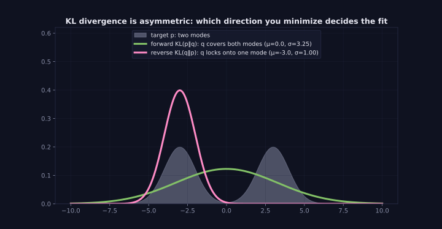
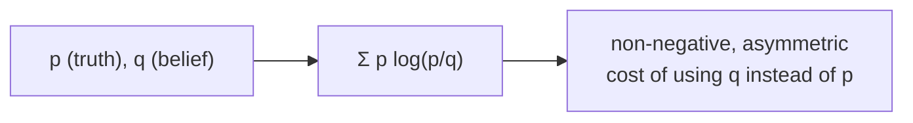

> Tier 1 · Mathematics for AI · **Level: intermediate** · Reading time: about 10 minutes

# 1.38 KL divergence

**Metadata** — Tier: 1 · Phase: 1 · Priority: P0 · Difficulty: 3/5 · Interview: High · Hands-on: Medium
Prerequisites: 1.36, 1.37 · Leads to: VAEs, distillation, RLHF/PPO/DPO (Tier 10), drift detection

> **In plain words**
> **KL divergence** measures **how much extra surprise you suffer by believing distribution `q` when the truth is `p`**. It is 0 when they match and grows the more they differ.
> It is **not symmetric**: "`p` seen through `q`" and "`q` seen through `p`" give different numbers, so it is not a true distance.

**You need first:** 1.36 Entropy and 1.37 Cross-entropy.

> **Figure 1.38-1 — forward versus reverse KL**
>
> 
>
> *How to read it:* the target `p` has two peaks. Minimising `KL(p‖q)` (the likelihood direction) gives a wide `q` centred between the peaks that **covers both modes** (μ = 0, σ = 3.25): *mass-covering*. Minimising `KL(q‖p)` gives a narrow `q` sitting on **one** mode (μ = −3, σ = 1): *mode-seeking*. The two directions are different objectives.
>
> *Generated by* `tier-01-mathematics/figures/src/t1_prob.py`.

**Words you'll meet on this page**

| Word | What it means here |
|---|---|
| KL divergence `KL(p‖q)` | `Σ p log(p/q)`: extra cost of using `q` for data from `p` |
| asymmetric | `KL(p‖q) ≠ KL(q‖p)` |
| forward KL | `KL(p‖q)`: what maximum likelihood minimises |
| reverse KL | `KL(q‖p)`: used in variational inference |
| distillation | training a small model to match a big one |
| drift | the data distribution changing over time |

### 1. What is it?
Kullback–Leibler divergence from `q` to `p`:

`KL(p ‖ q) = Σ p(x) log (p(x) / q(x)) = H(p, q) − H(p)`

It is the **extra** surprise (in bits or nats) you pay for using `q` when the truth is `p`: cross-entropy minus entropy.

### 2. Why does it exist?
We need a way to say how different two distributions are: one that is 0 only when they match, and that fits likelihood-based training.

### 3. Detailed explanation
- `KL ≥ 0`, and `KL = 0` only when `p = q`.
- **Not symmetric:** for `p = [0.5, 0.5]` and `q = [0.9, 0.1]`: `KL(p‖q) = 0.737` bits but `KL(q‖p) = 0.531` bits. It is not a metric (no triangle inequality).
- **Infinite** if `q(x) = 0` where `p(x) > 0` (you called something impossible that happens). Terms with `p(x) = 0` contribute 0.
- **The direction matters.**
  - *Forward* `KL(p‖q)` (data → model) is what maximum likelihood minimises. It is **mass-covering**: `q` is punished for missing any region where `p` has mass.
  - *Reverse* `KL(q‖p)` is **mode-seeking**: `q` may collapse onto one mode of `p`. Variational inference uses this direction.
- A closed form exists for two Gaussians (used in VAEs).
- **RLHF/PPO:** a KL penalty keeps the tuned policy close to the reference model. **Distillation** minimises KL from teacher to student. **Drift detection** compares feature distributions.
- Jensen–Shannon divergence is a symmetric, bounded smoothing of KL. Estimating KL from samples needs care (binning, smoothing, epsilons).

### 4. How does it work?
Compare the log-ratios `log(p/q)`, weighted by `p`. Compute in log space to avoid zeros and underflow.

### 5. Simple example
You navigate a city using a map of a different city: the extra detours are the KL cost.

**By hand.** `p = [0.5, 0.5]`, `q = [0.9, 0.1]`:

`KL(p‖q) = 0.5·log₂(0.5/0.9) + 0.5·log₂(0.5/0.1) = 0.5·(−0.848) + 0.5·(2.322) = 0.737` bits.

`KL(q‖p) = 0.9·log₂(0.9/0.5) + 0.1·log₂(0.1/0.5) = 0.9·(0.848) + 0.1·(−2.322) = 0.531` bits.

Different numbers: asymmetry.

### 6. Technical example
In RLHF each token's penalty `β·log(π_θ(a|s)/π_ref(a|s))` is a sample estimate of the KL between the tuned and the reference policy.

### 7. Code
**① By hand (plain Python).**

```python
import math

def kl(p, q):
    total = 0.0
    for a, b in zip(p, q):
        if a == 0:
            continue                              # 0·log(0/q) = 0
        if b == 0:
            return math.inf                       # truth says possible, model says impossible
        total += a * math.log2(a / b)
    return total

p, q = [0.5, 0.5], [0.9, 0.1]
print("KL(p||q) =", round(kl(p, q), 3), "  KL(q||p) =", round(kl(q, p), 3))
print("q has a zero where p does not:", kl([0.5, 0.5], [1.0, 0.0]))
print("p has a zero, q does not:", kl([1.0, 0.0], [0.5, 0.5]))
```

```text
KL(p||q) = 0.737   KL(q||p) = 0.531
q has a zero where p does not: inf
p has a zero, q does not: 1.0
```

**② With NumPy.** KL equals cross-entropy minus entropy.

```python
import numpy as np

p = np.array([0.5, 0.3, 0.2])
q = np.array([0.4, 0.4, 0.2])
cross_entropy = -(p * np.log2(q)).sum()
entropy = -(p * np.log2(p)).sum()
kl = (p * np.log2(p / q)).sum()
print("cross-entropy - entropy =", round(float(cross_entropy - entropy), 5))
print("KL(p||q)                =", round(float(kl), 5))
```

```text
cross-entropy - entropy = 0.03645
KL(p||q)                = 0.03645
```

**③ With PyTorch.**

```python
import torch
import torch.nn.functional as F

p = torch.tensor([0.5, 0.3, 0.2])
q = torch.tensor([0.4, 0.4, 0.2])
# F.kl_div(input=log q, target=p) computes KL(p || q) in nats
print("KL(p||q) in nats:", round(F.kl_div(q.log(), p, reduction="sum").item(), 5))
```

```text
KL(p||q) in nats: 0.02527
```

### 8. Input → Process → Output



<details>
<summary><b>Beyond the basics (sections 9–16)</b> — real-world use, limits, mistakes. Skip on a first read.</summary>

### 9. Enterprise use case
Data-drift monitors compare today's feature (or prediction) distribution with a training baseline using KL, JS or PSI, and alert beyond a threshold.

### 10. AI engineering connection
VAE loss, knowledge distillation, the RLHF/PPO KL penalty, DPO's implicit KL constraint, comparing outputs before and after quantisation or fine-tuning.

### 11. Advantages
Principled, differentiable, and tied to likelihood.

### 12. Limitations
Asymmetric, unbounded, infinite when the supports are disjoint; sample estimates are noisy and sensitive to binning; says nothing about *which* differences matter to users.

### 13. Trade-offs
KL (sensitive, linked to likelihood) versus JS (symmetric, bounded) versus Wasserstein (respects geometry, harder to compute).

### 14. Common mistakes
Swapping the arguments; calling KL a "distance"; forgetting smoothing so that a single zero bin gives infinity; mixing log bases; using unnormalised inputs.

### 15. Performance / cost
`O(K)` per distribution. In RLHF, the per-token log-ratios cost an extra forward pass of the reference model.

### 16. Security
Drift alarms based on KL can be evaded by gradual shifts (each window stays under the threshold). Track cumulative drift as well.

</details>

### 17. Interview explanation
"KL divergence measures the extra surprise from using a model q when the truth is p. It's zero only when they match, but it's asymmetric, so it isn't a distance. Training with cross-entropy minimises the forward KL to the data, and in RLHF we add a KL penalty to stay close to the reference model."

### 18. Rapid-fire answer
`KL(p‖q) = Σ p log(p/q) ≥ 0`; asymmetric; infinite if `q = 0` where `p > 0`; `CE = H + KL`.

### 19. Interview questions
- **Basic:** When is KL zero? Is it symmetric?
- **Intermediate:** Why does minimising cross-entropy minimise KL?
- **Advanced:** Forward versus reverse KL behaviour; the role of KL in RLHF.
- **Scenario:** A drift monitor shows KL = ∞ for one feature. What happened, and how do you fix it (smoothing, a new category)?

### 20. Hands-on exercise
**Goal:** see forward and reverse KL give different answers.

1. Take `p = [0.7, 0.2, 0.1]` and `q = [0.4, 0.4, 0.2]`.
2. Compute `KL(p‖q)` and `KL(q‖p)`.
3. Add a tiny smoothing (`+1e-6`, then renormalise) to a `q` that has an exact zero and show the KL becomes finite.

<details>
<summary>Show a solution</summary>

```python
import numpy as np

def kl(p, q):
    p, q = np.asarray(p, float), np.asarray(q, float)
    m = p > 0
    return float((p[m] * np.log2(p[m] / q[m])).sum())

p, q = [0.7, 0.2, 0.1], [0.4, 0.4, 0.2]
print("KL(p||q) =", round(kl(p, q), 4), "  KL(q||p) =", round(kl(q, p), 4))

q_zero = np.array([0.8, 0.2, 0.0])
smoothed = (q_zero + 1e-6) / (q_zero + 1e-6).sum()
print("with a zero in q (smoothed):", round(kl(p, smoothed), 2), "bits: large but finite")
```

```text
KL(p||q) = 0.2651   KL(q||p) = 0.2771
with a zero in q (smoothed): 1.53 bits: large but finite
```

</details>

### 21. Revision questions
1. What is the formula for KL divergence?
2. How is it related to cross-entropy?
3. What does mass-covering versus mode-seeking mean?

### 22. Related concepts
1.36 Entropy · 1.37 Cross-entropy · Tier 10 RLHF/DPO · Tier 31 Drift monitoring

### 23. One-line memory hook
**KL: the extra bits you pay for believing q when the truth is p, and it matters which is which.**

<details>
<summary><b>For reviewers</b> (not part of the lesson)</summary>

- Status: DRAFT, learner-first layout (Author: Claude). Code is executed by `tests/test_md_snippets.py`.
- TESTED earlier: non-negativity, zero at equality, asymmetry, infinity, decomposition (`code/info_numerics.py`).
- Figure numbers (μ = 0, σ = 3.25; μ = −3, σ = 1) come from the figure script.
</details>
