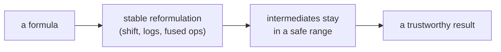

> Tier 1 · Mathematics for AI · **Level: beginner–intermediate** · Reading time: about 10 minutes

# 1.39 Numerical stability

**Metadata** — Tier: 1 · Phase: 1 · Priority: P0 · Difficulty: 3/5 · Interview: High · Hands-on: Very high
Prerequisites: 1.14, 1.40–1.44 · Leads to: mixed precision (Tier 4/11), stable softmax and loss, normalisation layers

> **In plain words**
> Computers store numbers with limited precision. Two formulas that are **identical on paper** can give **very different answers** on a computer: one correct, the other `NaN` (not a number).
> **Numerical stability** is the habit of choosing the version that keeps numbers in a safe range. Many "mysterious" training failures (loss turns NaN, accuracy silently drops) are stability bugs.

**You need first:** 1.14 Matrix inverse (conditioning); 1.40 Floating-point precision helps (you can read it right after).

> **Figure 1.39-1 — same maths, different arithmetic**
>
> ```mermaid
> flowchart LR
>     A["softmax of [1000, 1001, 1002]"] --> B["naive: exp(1000) overflows<br/>→ inf / inf = NaN"]
>     A --> C["stable: subtract the max first<br/>→ [0.09, 0.245, 0.665]"]
> ```
>
> *How to read it:* the naive formula tries to compute `e¹⁰⁰⁰`, which is far too big for a float, so it becomes infinity and the division gives `NaN`. Subtracting the largest score first changes nothing mathematically but keeps every number small and safe.

**Words you'll meet on this page**

| Word | What it means here |
|---|---|
| stable algorithm | small rounding errors do not blow up |
| well / ill-conditioned problem | the answer changes little / a lot when the input changes slightly |
| overflow / underflow | a number too large / too close to zero to store |
| catastrophic cancellation | subtracting nearly equal numbers wipes out the accurate digits |
| `log1p`, `expm1` | accurate `log(1+x)` and `exp(x)−1` for tiny `x` |
| `ε` (epsilon) | a tiny safety number added to avoid dividing by zero |

### 1. What is it?
An algorithm is **numerically stable** if small errors (rounding, noise in the input) do not grow into large errors in the result. A problem is **well-conditioned** if its answer barely moves when the input changes slightly, and **ill-conditioned** otherwise.

### 2. Why does it matter?
Computers use finite-precision arithmetic (1.40). Mathematically equivalent formulas can behave very differently in floating point. Most training "mysteries" (a NaN loss, a silent accuracy drop) are stability issues.

### 3. Detailed explanation
Two different things:
- **Conditioning** belongs to the *problem*. Error in the output is roughly `κ ×` the error in the input, where `κ = σ_max/σ_min` is the condition number (1.14, 1.19).
- **Stability** belongs to the *algorithm*. A stable algorithm returns the exact answer to a slightly disturbed problem.

**Standard tricks**
1. **Subtract the max before `exp`** (stable softmax and log-sum-exp, 1.43).
2. **Work in log space** for products of probabilities (1.41, 1.44). A product of 400 numbers equal to `1e-3` underflows to 0; the *sum* of their logs does not.
3. **Fuse operations** (`log_softmax`, cross-entropy from logits, `log1p`, `expm1`). `log(1 + 1e-20)` gives 0 but `log1p(1e-20)` gives `1e-20`.
4. **Add ε** to denominators (`√(var + ε)`), choosing ε to suit the data type.
5. **Avoid subtracting nearly equal numbers**, such as `E[X²] − E[X]²` (1.30); use the two-pass formula or Welford.
6. **Solve, don't invert** (1.14).
7. **Normalise** inputs and activations, use residual connections, clip gradients (1.15).
8. **Accumulate in higher precision** (sum in float32 or float64 while computing in fp16/bf16); use loss scaling for fp16 gradients (1.40).
9. **Order of summation** matters; pairwise or compensated (Kahan) summation reduces the error.

### 4. How does it work?
Rewrite the computation algebraically so that intermediate values stay in a safe range and big cancellations are avoided; check against a higher-precision reference.

### 5. Simple example
In float64, `(10¹⁶ + 1) − 10¹⁶` gives `0`, not `1`: the `+ 1` is lost to rounding, because neighbouring floats near `10¹⁶` are 2 apart.

### 6. Technical example
Attention's softmax over scores in fp16 can overflow, so implementations subtract the row maximum; flash-attention uses an online (streaming) version of the same trick.

### 7. Code
**① By hand (plain Python).** Three classic traps.

```python
import math

print("(1e16 + 1) - 1e16        =", (1e16 + 1) - 1e16, "(should be 1)")
print("log(1 + 1e-20)           =", math.log(1 + 1e-20), "  log1p(1e-20) =", math.log1p(1e-20))
product = 1.0
for _ in range(400):
    product *= 1e-3
print("product of 400 × 1e-3    =", product, " but the sum of logs is", round(400 * math.log(1e-3), 1))
```

```text
(1e16 + 1) - 1e16        = 0.0 (should be 1)
log(1 + 1e-20)           = 0.0   log1p(1e-20) = 1e-20
product of 400 × 1e-3    = 0.0  but the sum of logs is -2763.1
```

**② With NumPy.** The stable softmax.

```python
import numpy as np

z = np.array([1000.0, 1001.0, 1002.0])
with np.errstate(all="ignore"):                        # silence the overflow warning
    naive = np.exp(z) / np.exp(z).sum()
stable = np.exp(z - z.max()) / np.exp(z - z.max()).sum()
print("naive :", naive)
print("stable:", stable.round(4))
print("shift invariance (same answer for z+5):", np.allclose(stable, np.exp((z + 5) - (z + 5).max()) / np.exp((z + 5) - (z + 5).max()).sum()))
```

```text
naive : [nan nan nan]
stable: [0.09   0.2447 0.6652]
shift invariance (same answer for z+5): True
```

**③ With PyTorch.** The library's fused versions.

```python
import torch

z = torch.tensor([1000.0, 1001.0, 1002.0])
print("log_softmax:", [round(v, 4) for v in torch.log_softmax(z, dim=0).tolist()])
print("probabilities:", [round(v, 4) for v in torch.softmax(z, dim=0).tolist()])
print("naive log(softmax) breaks on extreme logits:",
      torch.log(torch.softmax(torch.tensor([-1000.0, 1000.0]), dim=0)).tolist())
```

```text
log_softmax: [-2.4076, -1.4076, -0.4076]
probabilities: [0.09, 0.2447, 0.6652]
naive log(softmax) breaks on extreme logits: [-inf, 0.0]
```

### 8. Input → Process → Output



<details>
<summary><b>Beyond the basics (sections 9–16)</b> — real-world use, limits, mistakes. Skip on a first read.</summary>

### 9. Enterprise use case
Training pipelines add NaN/Inf checks and loss-scale monitoring; financial and risk code uses higher precision and compensated summation for aggregates.

### 10. AI engineering connection
Stable softmax and cross-entropy, LayerNorm's ε, mixed-precision training, quantisation error, attention kernels, gradient clipping, RMSNorm.

### 11. Advantages
Prevents silent corruption and wasted compute.

### 12. Limitations
Stability tricks add code complexity; some problems are inherently ill-conditioned and cannot be rescued by any algorithm.

### 13. Trade-offs
Higher precision is safer, slower and uses more memory; lower precision with careful scaling is faster but riskier.

### 14. Common mistakes
`log(softmax(x))` instead of `log_softmax`; `exp` of large numbers; dividing by a variance without ε; comparing floats with `==`; detecting NaNs only at the end of an epoch; assuming "it ran without error" means "it is right".

### 15. Performance / cost
Stable forms are usually free or fused. Debugging a NaN run can cost days of GPU time, so add early checks (`isfinite` on the loss, gradient norms).

### 16. Security
Numerical edge cases (NaN, Inf, huge values) in user-controlled inputs can crash or poison services. Validate and clamp inputs.

</details>

### 17. Interview explanation
"Numerical stability is about keeping floating-point errors from blowing up. Mathematically identical formulas can differ wildly: naive softmax overflows, so we subtract the max; products of probabilities underflow, so we use logs; and we compute the loss from logits with log-sum-exp. I also watch the condition number for linear solves."

### 18. Rapid-fire answer
Shift before `exp`, logs for products, fused ops, add ε, solve don't invert, check for NaN.

### 19. Interview questions
- **Basic:** Why subtract the max in softmax?
- **Intermediate:** Stability versus conditioning: what is the difference?
- **Advanced:** Why does fp16 training need loss scaling while bf16 usually doesn't?
- **Scenario:** The loss turns NaN at step 8,000. Give a systematic debugging plan.

### 20. Hands-on exercise
**Goal:** compare three ways to compute a variance when values sit near 10⁹.

1. Generate 10,000 numbers `1e9 + N(0, 1)`. The true variance is about 1.
2. Compute it with the naive shortcut `mean(x²) − mean(x)²`, with the two-pass formula, and with `np.var`.
3. Which is wrong?

<details>
<summary>Show a solution</summary>

```python
import numpy as np

x = np.random.default_rng(7).standard_normal(10_000) + 1e9
naive = np.mean(x ** 2) - np.mean(x) ** 2
two_pass = np.mean((x - x.mean()) ** 2)
print("naive   :", round(float(naive), 3))
print("two-pass:", round(float(two_pass), 3))
print("np.var  :", round(float(np.var(x)), 3))
```

```text
naive   : 128.0
two-pass: 0.989
np.var  : 0.989
```

The shortcut subtracts two numbers of size about 10¹⁸ and loses all the accurate digits.
</details>

### 21. Revision questions
1. Name four stability tricks.
2. Define the condition number.
3. What is catastrophic cancellation?

### 22. Related concepts
1.40 Floating-point precision · 1.43 Log-sum-exp · 1.44 Overflow and underflow · 1.14 Inverse

### 23. One-line memory hook
**Same maths, different arithmetic: pick the form that keeps numbers small and subtractions safe.**

<details>
<summary><b>For reviewers</b> (not part of the lesson)</summary>

- Status: DRAFT, learner-first layout (Author: Claude). Code is executed by `tests/test_md_snippets.py`.
- TESTED earlier: naive vs stable softmax, shift invariance, `log1p`/`expm1`, underflow of probability products, finite loss for extreme logits (`code/info_numerics.py`).
</details>
