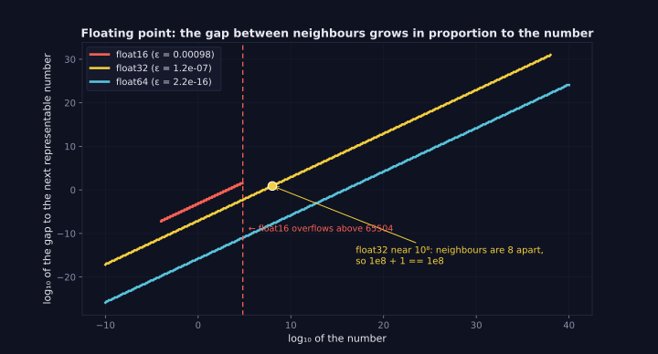
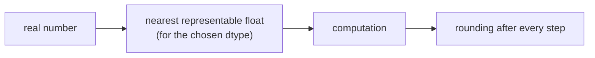

> Tier 1 · Mathematics for AI · **Level: beginner–intermediate** · Reading time: about 11 minutes

# 1.40 Floating-point precision

**Metadata** — Tier: 1 · Phase: 1 · Priority: P0 · Difficulty: 3/5 · Interview: High · Hands-on: Very high
Prerequisites: 1.1, 1.4 · Leads to: 1.39, 1.44, mixed precision, quantisation (Tier 11), GPU memory budgeting

> **In plain words**
> A computer stores a decimal number in a **fixed number of bits**, so it can only represent certain numbers exactly and rounds everything else. That is why `0.1 + 0.2` is **not exactly** `0.3`.
> The number of bits you spend (**64, 32 or 16**) decides how much **memory** a model needs, how fast it runs, and how many digits you can trust.

**You need first:** 1.1 Scalars and 1.4 Tensors (to talk about "bytes per number").

> **Figure 1.40-1 — the gap between representable numbers grows with the number**
>
> 
>
> *How to read it:* each line is the distance to the next representable number, as a function of magnitude. The spacing is proportional to the number (that is what "relative precision" means) and is lower for float64. The yellow point marks float32 near 10⁸, where neighbours are 8 apart, so `1e8 + 1` equals `1e8`. float16 stops at 65,504.
>
> *Generated by* `tier-01-mathematics/figures/src/t1_prob.py`.

**Words you'll meet on this page**

| Word | What it means here |
|---|---|
| float32 / float64 / float16 | numbers stored in 32 / 64 / 16 bits |
| bfloat16 (bf16) | a 16-bit format with float32's range but less precision |
| mantissa | the digits part of the stored number (sets precision) |
| exponent | the "power of two" part (sets range) |
| machine epsilon `ε` | the gap between 1 and the next float; the relative precision |
| mixed precision | computing in 16 bits but keeping key values in 32 bits |
| quantisation | storing weights in very few bits (int8, 4-bit) |

### 1. What is it?
Real numbers are stored as `±(1.mantissa) × 2^exponent` (the IEEE 754 standard). Only a finite set of values can be represented; everything else is rounded.

| dtype | bits | exponent bits | mantissa bits | largest value | machine ε (relative precision) |
|---|---|---|---|---|---|
| float64 | 64 | 11 | 52 | ≈ 1.8 × 10³⁰⁸ | 2.2 × 10⁻¹⁶ |
| float32 | 32 | 8 | 23 | ≈ 3.4 × 10³⁸ | 1.19 × 10⁻⁷ |
| float16 | 16 | 5 | 10 | 65,504 | ≈ 9.8 × 10⁻⁴ |
| bfloat16 | 16 | 8 | 7 | ≈ 3.4 × 10³⁸ | ≈ 7.8 × 10⁻³ |

### 2. Why does it matter?
Memory, speed and accuracy all depend on the data type. Halving the precision halves memory and can double throughput on modern hardware, but introduces rounding and range problems that show up as NaNs or degraded quality.

### 3. Detailed explanation
- **Exponent bits set the range; mantissa bits set the precision.** fp16 has a tiny range (max 65,504, overflows easily) but moderate precision. bf16 has float32's range but coarse precision. That is why bf16 training rarely needs loss scaling while fp16 does.
- **Spacing grows with magnitude.** Near 1, float32 spacing is about `1.2e-7`; near `10⁸` it is 8. So `1e8 + 1` stays `1e8` in float32, and float32 cannot count past `2²⁴ = 16,777,216` by adding 1.
- **Not associative:** `(a + b) + c ≠ a + (b + c)` in general. The order of summation changes results, so parallel reductions can differ from run to run or device to device.
- **Decimal inexactness:** `0.1 + 0.2 ≠ 0.3` (the error is about `5e-17`). Never compare floats with `==`; use `np.isclose` with a tolerance.
- **Special values:** `inf`, `-inf`, `NaN` (and `NaN != NaN`), signed zero, subnormals (gradual underflow).
- **Overflow / underflow:** `float16(70000)` becomes `inf`; `float16(1e-8)` becomes `0`.
- **Mixed-precision recipe:** do the matrix multiplications in fp16 or bf16, but keep **master weights and optimiser states in fp32**, accumulate sums in fp32, and use **loss scaling** with fp16 so small gradients don't underflow.
- **Low-bit inference:** int8, int4 and fp8 quantisation maps weights to a few levels with scale factors (Tier 11).
- **Memory:** parameters × bytes. A 7-billion-parameter model needs about 28 GB in fp32, 14 GB in fp16/bf16 and 3.5 GB at 4 bits: weights only, excluding activations, KV cache and optimiser states (Adam adds about 8 bytes per parameter in fp32 for its two moments).

### 4. How does it work?
After every operation the result is rounded to the nearest representable value (relative error at most `ε/2`). Over thousands of layers or steps these small errors can accumulate.

### 5. Simple example
A ruler with marks only every whole millimetre: you cannot record 0.3 mm. For large numbers the "ruler" is coarser still.

**With numbers** (float32): `16,777,216 + 1 = 16,777,216`. The `+ 1` vanishes, because float32 has only 24 significant bits.

### 6. Technical example
Add 1000 values of 1.0 to a float32 accumulator that already holds `1e8`: nothing changes (each `+ 1` is absorbed). Accumulating in float64 gives the right `1e8 + 1000`.

### 7. Code
**① By hand (plain Python).** Python floats are 64-bit.

```python
print("0.1 + 0.2 == 0.3 ?", 0.1 + 0.2 == 0.3)
print("difference:", 0.1 + 0.2 - 0.3)
print("close enough?", abs(0.1 + 0.2 - 0.3) < 1e-9)
print("(1e16 + 1) + 1 == 1e16 + (1 + 1) ?", (1e16 + 1 + 1) == (1e16 + (1 + 1)), " <- the order of additions changes the result")
```

```text
0.1 + 0.2 == 0.3 ? False
difference: 5.551115123125783e-17
close enough? True
(1e16 + 1) + 1 == 1e16 + (1 + 1) ? False  <- the order of additions changes the result
```

**② With NumPy.** The limits of each type.

```python
import numpy as np

print("float32 epsilon:", np.finfo(np.float32).eps, "  float16 max:", np.finfo(np.float16).max)
print("float32: 16777216 + 1 =", np.float32(16777216) + np.float32(1))
print("float16(70000) =", np.float16(70000.0), "   float16(1e-8) =", np.float16(1e-8))
acc = np.float32(1e8)
for _ in range(1000):
    acc = acc + np.float32(1.0)
print("1000 additions onto 1e8 in float32:", acc, "   in float64:", 1e8 + 1000)
```

```text
float32 epsilon: 1.1920929e-07   float16 max: 6.55e+04
float32: 16777216 + 1 = 1.6777216e+07
float16(70000) = inf    float16(1e-8) = 0.0
1000 additions onto 1e8 in float32: 1e+08    in float64: 100001000.0
```

**③ With PyTorch.** All four types, including bf16, and a memory estimate.

```python
import torch

for dt in (torch.float32, torch.float16, torch.bfloat16):
    info = torch.finfo(dt)
    print(f"{str(dt):<15} eps {info.eps:.3g}   max {info.max:.3g}")
print("float16(70000) =", torch.tensor(70000.0).to(torch.float16).item(),
      "  bfloat16(70000) =", torch.tensor(70000.0).to(torch.bfloat16).item())
params = 7e9
print("7B-parameter model, weights only:", params * 4 / 1e9, "GB (fp32),", params * 2 / 1e9, "GB (fp16/bf16),", params * 0.5 / 1e9, "GB (4-bit)")
```

```text
torch.float32   eps 1.19e-07   max 3.4e+38
torch.float16   eps 0.000977   max 6.55e+04
torch.bfloat16  eps 0.00781   max 3.39e+38
float16(70000) = inf   bfloat16(70000) = 70144.0
7B-parameter model, weights only: 28.0 GB (fp32), 14.0 GB (fp16/bf16), 3.5 GB (4-bit)
```

### 8. Input → Process → Output



<details>
<summary><b>Beyond the basics (sections 9–16)</b> — real-world use, limits, mistakes. Skip on a first read.</summary>

### 9. Enterprise use case
GPU memory and cost planning, choosing a dtype per workload (bf16 for training, int8 or fp8 for serving), and reproducibility policies (fixed reduction order, deterministic kernels) for regulated settings.

### 10. AI engineering connection
Mixed-precision training, quantisation (GPTQ/AWQ-style), the KV-cache dtype, loss scaling, reproducibility across hardware, FP8 training research.

### 11. Advantages
Wide dynamic range with constant relative precision, and hardware acceleration.

### 12. Limitations
Finite precision, accumulating rounding errors, non-associativity, and fp16's narrow range.

### 13. Trade-offs
float32 (safe) ↔ bf16 (wide range, coarse) ↔ fp16 (more precise, narrow range) ↔ int8/4 (compact, needs calibration). Choose by hardware support and task tolerance.

### 14. Common mistakes
Comparing floats with `==`; summing in low precision; fp16 without loss scaling; assuming bit-identical results across GPUs; casting everything to bf16 including LayerNorm and softmax accumulations; forgetting optimiser-state memory.

### 15. Performance / cost
Lower precision gives more FLOPs per second and less memory traffic, but verify quality on your evaluation set. Always compute memory (`parameters × bytes`) before provisioning.

### 16. Security
Reduced-precision differences can change a safety classifier's output near its threshold. Re-run safety evaluations on the exact deployed dtype or quantisation.

</details>

### 17. Interview explanation
"Floats store a sign, an exponent and a mantissa. The exponent gives range, the mantissa gives precision. fp16 has a narrow range so it overflows and needs loss scaling; bf16 keeps fp32's range with less precision, so it's easier for training. I keep master weights and accumulations in fp32 and compare floats with tolerances."

### 18. Rapid-fire answer
Exponent = range, mantissa = precision; fp16 max 65,504; bf16 has fp32's range; accumulate in fp32; never `==`.

### 19. Interview questions
- **Basic:** Why is `0.1 + 0.2 != 0.3`?
- **Intermediate:** fp16 versus bf16 trade-off. How much memory does a 13B-parameter model need in fp16?
- **Advanced:** Why is floating-point addition not associative, and how does that affect distributed-training reproducibility?
- **Scenario:** After moving inference from fp32 to int8 accuracy dropped 3%. How do you diagnose and recover?

### 20. Hands-on exercise
**Goal:** see how accumulation precision changes a sum.

1. Make 1,000,000 float32 numbers equal to `0.1`.
2. Add them with a plain Python loop in float32, with `np.sum` (which uses pairwise summation), and in float64.
3. Compare the errors against the true value 100,000.

<details>
<summary>Show a solution</summary>

```python
import numpy as np

x = np.full(1_000_000, 0.1, dtype=np.float32)
acc = np.float32(0.0)
for v in x:
    acc = np.float32(acc + v)                       # naive float32 loop
print("naive float32 loop :", float(acc), " error", abs(float(acc) - 100000.0))
print("np.sum (pairwise)  :", float(np.sum(x)), " error", abs(float(np.sum(x)) - 100000.0))
print("float64 accumulate :", float(np.sum(x, dtype=np.float64)), " error", abs(float(np.sum(x, dtype=np.float64)) - 100000.0))
```

```text
naive float32 loop : 100958.34375  error 958.34375
np.sum (pairwise)  : 100000.0078125  error 0.0078125
float64 accumulate : 100000.00149011612  error 0.0014901161193847656
```

The naive float32 loop drifts the most; pairwise summation and float64 accumulation are much closer.
</details>

### 21. Revision questions
1. Which bits set the range?
2. How big is the spacing at large magnitudes?
3. What stays in fp32 in mixed-precision training?

### 22. Related concepts
1.39 Numerical stability · 1.44 Overflow and underflow · Tier 4 Mixed precision · Tier 11 Quantisation

### 23. One-line memory hook
**Floats are a ruler whose marks spread apart as numbers grow; never trust the last digits.**

<details>
<summary><b>For reviewers</b> (not part of the lesson)</summary>

- Status: DRAFT, learner-first layout (Author: Claude). Code is executed by `tests/test_md_snippets.py`.
- TESTED earlier: `test_floating_point_facts`, `test_sum_order_and_error_accumulation` (`code/info_numerics.py`); float64/32/16 constants with `np.finfo`; all four dtype rows with `torch.finfo` on torch 2.14.1 (`lab/lab_04_pytorch.py::t_1_40_dtype_table`), including `float16(70000) = inf` vs `bfloat16(70000) = 70144`.
- The 7B-parameter memory figures are arithmetic on parameter count × bytes.
</details>
