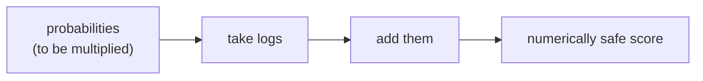

> Tier 1 · Mathematics for AI · **Level: beginner** · Reading time: about 9 minutes

# 1.41 Logarithms

**Metadata** — Tier: 1 · Phase: 1 · Priority: P0 · Difficulty: 2/5 · Interview: Medium-High · Hands-on: High
Prerequisites: 1.20 Functions · Leads to: 1.35–1.38, 1.42–1.44, log-probabilities, perplexity

> **In plain words**
> A **logarithm answers the question "what power?"**: `log₁₀(1000) = 3` because `10³ = 1000`.
> Its superpower: **it turns multiplication into addition**. Multiplying hundreds of tiny probabilities gives a number the computer rounds to zero, but *adding their logs* works perfectly. That is why AI works with log-probabilities everywhere.

**You need first:** 1.20 Functions, and what a power like `2³ = 8` means.

> **Figure 1.41-1 — logs turn products into sums**
>
> ```mermaid
> flowchart LR
>     A["product of 400 numbers<br/>each 0.001"] --> B["computer result: 0.0<br/>(underflow, information lost)"]
>     A --> C["sum of 400 logs<br/>400 × ln(0.001) = −2763.1"]
>     C --> D["a perfectly usable number"]
> ```
>
> *How to read it:* the true product `10⁻¹²⁰⁰` is far smaller than the smallest float, so it becomes 0. Its logarithm is a perfectly ordinary number. Comparing log-probabilities still ranks sequences correctly, because the logarithm never reverses order.

**Words you'll meet on this page**

| Word | What it means here |
|---|---|
| logarithm `log_b(x)` | the power `y` with `b^y = x` |
| natural log `ln` | the log with base `e ≈ 2.718`; the default in ML |
| log-probability | the logarithm of a probability; always ≤ 0 |
| bit / nat | information unit with `log₂` / with `ln` |
| log-odds (logit) | `ln(p/(1−p))` |
| monotonic | never reverses order: bigger in, bigger out |

### 1. What is it?
The inverse of exponentiation: `log_b(x) = y` means `b^y = x`. In ML, `log` almost always means the natural logarithm `ln` (base `e`); information theory often uses base 2. It is only defined for `x > 0`: `log(1) = 0` and `log(0) = −∞`.

### 2. Why does it exist?
It turns multiplication into addition and squeezes huge ranges into manageable ones. The probability of a long sequence is a product of many small numbers; with logs it becomes a sum that fits in floating point.

### 3. Detailed explanation
- **Rules:** `log(ab) = log a + log b`; `log(a/b) = log a − log b`; `log(aᵏ) = k·log a`; change of base: `log_b x = ln x / ln b`.
- **Monotonic:** maximising `f` and maximising `log f` find the same best point. That is the basis of maximum likelihood (1.35).
- **Derivative:** `d/dx ln x = 1/x`. It is large for small `x`, so `−log p` punishes small probabilities on the correct class heavily.
- **Log-probabilities are ≤ 0.** A sequence's log-probability is the sum of its tokens' log-probabilities.
- **Ratios become differences.** A 1% relative change is about 0.01 in log.
- **`log1p(x) = log(1 + x)`** and `expm1(x) = exp(x) − 1` stay accurate for tiny `x`. `log(1 + 1e-20)` gives 0 but `log1p(1e-20)` gives `1e-20`.
- **`log(0)` gives `−inf`** (with a warning), which turns into `inf` or NaN losses downstream. Clip or add `ε` only where it is mathematically justified.
- **Log scales** are the right way to plot heavy-tailed data (latency, loss curves, learning rates).
- **Bits and nats:** 1 nat = `1/ln 2 ≈ 1.4427` bits.

### 4. How does it work?
Library routines compute it accurately. Its gradient `1/x` can blow up near 0, which is why fused, stable operations exist (log-softmax, binary cross-entropy with logits).

### 5. Simple example
Earthquake magnitudes are a log scale: each +1 means 10 times more amplitude.

**By hand:**

| Expression | Value | Why |
|---|---|---|
| `log₂(8)` | 3 | `2³ = 8` |
| `log₁₀(1000)` | 3 | `10³ = 1000` |
| `ln(e³)` | 3 | `e³ = e³` |
| `log(3.7 × 0.25)` | `log 3.7 + log 0.25` | product → sum |

### 6. Technical example
Naive Bayes with 10,000 word features: multiplying 10,000 probabilities gives exactly 0, but summing 10,000 log-probabilities gives a usable score.

### 7. Code
**① By hand (plain Python).**

```python
import math

print("log2(8) =", math.log2(8), "  log10(1000) =", math.log10(1000), "  ln(e^3) =", round(math.log(math.e ** 3), 6))
print("log(3.7*0.25) =", round(math.log(3.7 * 0.25), 6), "  log 3.7 + log 0.25 =", round(math.log(3.7) + math.log(0.25), 6))
print("1 nat in bits:", round(1 / math.log(2), 4))
```

```text
log2(8) = 3.0   log10(1000) = 3.0   ln(e^3) = 3.0
log(3.7*0.25) = -0.077962   log 3.7 + log 0.25 = -0.077962
1 nat in bits: 1.4427
```

**② With NumPy.** The underflow rescue, and `log1p`.

```python
import numpy as np

p = np.full(400, 1e-3)
print("product of 400 × 1e-3:", np.prod(p), "   sum of logs:", round(float(np.sum(np.log(p))), 1))
print("log(1 + 1e-20) =", np.log(1 + 1e-20), "   log1p(1e-20) =", np.log1p(1e-20))
with np.errstate(divide="ignore"):
    print("log(0) =", np.log(0.0))
```

```text
product of 400 × 1e-3: 0.0    sum of logs: -2763.1
log(1 + 1e-20) = 0.0    log1p(1e-20) = 1e-20
log(0) = -inf
```

**③ With PyTorch.** Log-probabilities of a sequence.

```python
import torch

token_probs = torch.tensor([0.5, 0.2, 0.1, 0.4])             # P(each word | the previous words)
log_p = torch.log(token_probs).sum()
print("sequence log-probability:", round(log_p.item(), 4))
print("sequence probability    :", round(token_probs.prod().item(), 6), "(same thing, but it underflows for long text)")
```

```text
sequence log-probability: -5.5215
sequence probability    : 0.004 (same thing, but it underflows for long text)
```

### 8. Input → Process → Output



<details>
<summary><b>Beyond the basics (sections 9–16)</b> — real-world use, limits, mistakes. Skip on a first read.</summary>

### 9. Enterprise use case
Scoring and ranking with log-odds (credit and risk models, logistic regression); latency and cost charts on log scales.

### 10. AI engineering connection
NLL and cross-entropy, perplexity, log-odds (logits), the log-probabilities returned by LLM APIs (`logprobs`), RLHF log-ratio rewards, `logsumexp`.

### 11. Advantages
Stable products, additive structure, and clean gradients together with softmax.

### 12. Limitations
Undefined for values ≤ 0; the gradient explodes near 0; it hides absolute scale.

### 13. Trade-offs
Log space is safer but needs `logsumexp` to add probabilities (1.43).

### 14. Common mistakes
`log(0)`; adding probabilities in log space as if they were ordinary numbers (you must use `logsumexp`); mixing log bases; forgetting that the log of a probability is negative, which causes sign errors in losses.

### 15. Performance / cost
`log` is slightly more expensive than a multiplication but negligible in practice; fused log-softmax saves memory.

### 16. Security
Exposing per-token log-probabilities can leak membership or training information (see 1.37); expose them selectively.

</details>

### 17. Interview explanation
"Logs turn products into sums, which is why we work with log-probabilities: a sentence's probability underflows, but its log-probability is just a sum. Since log is monotonic the best parameters don't change, and it gives the cross-entropy loss."

### 18. Rapid-fire answer
`log(ab) = log a + log b`; monotonic; domain `x > 0`; use log-probabilities; `log1p` for tiny `x`.

### 19. Interview questions
- **Basic:** What is `log₂(8)`? What is `ln(e³)`?
- **Intermediate:** Why use the log-likelihood instead of the likelihood?
- **Advanced:** How do you add two probabilities stored as log-probabilities?
- **Scenario:** The loss turns `inf` when a class never appears in a batch. Why, and what do you do?

### 20. Hands-on exercise
**Goal:** score a very long text two ways.

1. Make 2,000 random word probabilities between 0.01 and 0.5.
2. Compute the sentence probability as a direct product.
3. Compute the log-probability as a sum of logs. Which one is still usable?

<details>
<summary>Show a solution</summary>

```python
import numpy as np

p = np.random.default_rng(0).uniform(0.01, 0.5, 2000)
print("direct product :", np.prod(p), "(underflow)")
print("sum of logs    :", round(float(np.log(p).sum()), 1), "(a normal, usable number)")
```

```text
direct product : 0.0 (underflow)
sum of logs    : -3249.1 (a normal, usable number)
```

The log-probability is a plain number you can compare; the probability itself (about 10⁻³⁰⁰⁰) is too small for any float.
</details>

### 21. Revision questions
1. What does the log of a product become?
2. What is the domain of `log`?
3. How do bits and nats differ?

### 22. Related concepts
1.35 MLE · 1.37 Cross-entropy · 1.42 Exponentials · 1.43 Log-sum-exp

### 23. One-line memory hook
**Log: the ruler that turns multiplication into addition.**

<details>
<summary><b>For reviewers</b> (not part of the lesson)</summary>

- Status: DRAFT, learner-first layout (Author: Claude). Code is executed by `tests/test_md_snippets.py`.
- TESTED earlier: `test_log_and_exp_identities`, `test_log_space_avoids_underflow_of_probability_products` (`code/info_numerics.py`).
</details>
