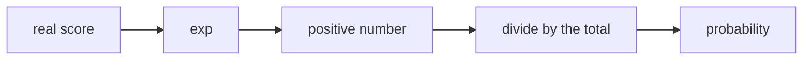

> Tier 1 · Mathematics for AI · **Level: beginner** · Reading time: about 9 minutes

# 1.42 Exponentials

**Metadata** — Tier: 1 · Phase: 1 · Priority: P0 · Difficulty: 2/5 · Interview: Medium · Hands-on: High
Prerequisites: 1.20, 1.21, 1.41 · Leads to: softmax, sigmoid, 1.43, 1.44, temperature, learning-rate decay

> **In plain words**
> The **exponential function** `eˣ` (with `e ≈ 2.718`) is always **positive** and **grows extremely fast**. It is the inverse of the logarithm.
> AI uses it to turn any score (positive or negative) into a **positive weight**, which is then divided by the total to give probabilities (**softmax**). Because it grows so fast, it also **overflows easily**, which is why we handle it with care.

**You need first:** 1.41 Logarithms.

> **Figure 1.42-1 — how fast `exp` grows**
>
> ```mermaid
> flowchart LR
>     A["x = 1"] --> A1["e¹ ≈ 2.7"]
>     B["x = 10"] --> B1["e¹⁰ ≈ 22,026"]
>     C["x = 100"] --> C1["e¹⁰⁰ ≈ 2.7 × 10⁴³"]
>     D["x = 710"] --> D1["overflows a float64 → inf"]
> ```
>
> *How to read it:* every extra `+1` in the exponent multiplies the result by 2.7. A score gap of 5 between two logits turns into a weight ratio of `e⁵ ≈ 148`. At around `x = 710` the result no longer fits in a 64-bit float, and in a 16-bit float it already fails at about `x = 12`.

**Words you'll meet on this page**

| Word | What it means here |
|---|---|
| `exp(x) = eˣ` | the exponential function |
| softmax | `exp(zᵢ) / Σ exp(zⱼ)`: scores → probabilities |
| sigmoid | `1/(1 + e⁻ˣ)`: any number → (0, 1) |
| temperature | divides the scores before `exp`; sharpens or flattens |
| overflow | result too large to store (`inf`) |
| exponential decay | shrinking by a constant factor each step |

### 1. What is it?
The function `exp(x) = eˣ`, where `e ≈ 2.71828`. It is positive for every `x`, increasing, equals its own derivative (`d/dx eˣ = eˣ`), and is the inverse of `ln`.

### 2. Why does it exist?
It describes growth and decay proportional to the current size, and it converts any real number (a *score* or *logit*) into a positive number that can then be normalised into a probability (softmax).

### 3. Detailed explanation
- **Rules:** `e^(a + b) = eᵃ·eᵇ`; `e^(−x) = 1/eˣ`; `exp(ln x) = x`.
- **Growth is explosive:** `exp(10) ≈ 2.2 × 10⁴`, `exp(100) ≈ 2.7 × 10⁴³`. The largest `x` that still fits is about **709.8** in float64, **88.7** in float32 and **11.09** in float16. (So `exp(710)` is `inf` in float64, `exp(89)` in float32 and `exp(12)` in float16.) This is why softmax subtracts the max first (1.43).
- **Decay:** `exp(−x)` underflows to 0 for large `x`.
- **Softmax:** `softmax(z)ᵢ = exp(zᵢ)/Σ exp(zⱼ)` is shift-invariant: adding the same constant to every score changes nothing. Temperature divides the scores before `exp`.
- **Sigmoid:** `σ(x) = 1/(1 + e⁻ˣ)` maps all real numbers into (0, 1); its slope `σ′ = σ(1 − σ)` is at most 0.25.
- **Schedules:** learning-rate decay `η_t = η₀·e^(−kt)`; an exponential moving average (EMA) with decay `β` forgets exponentially.
- **Doubling:** doubling every `T` steps is `2^(t/T)`. Small errors in scores become large relative errors in probabilities.
- **Log-odds:** `logit(p) = ln(p/(1 − p))` is the inverse of the sigmoid.

### 4. How does it work?
Computed by range reduction and polynomial approximation, accurate to a few units in the last place. Overflow happens when the exponent leaves the data type's range.

### 5. Simple example
**Compound interest, or bacteria doubling:** growth proportional to current size.

**Scores to probabilities.** Scores `[2, 1, 0]`:

| Score | `exp(score)` | share of total (≈ 11.11) |
|---|---|---|
| 2 | 7.389 | 0.665 |
| 1 | 2.718 | 0.245 |
| 0 | 1.000 | 0.090 |

Every score became positive, and the shares add up to 1: that is softmax.

### 6. Technical example
Attention weights are `softmax(QKᵀ/√d)`. Because of `exp`, a score gap of 5 gives a weight ratio of `e⁵ ≈ 148`.

### 7. Code
**① By hand (plain Python).**

```python
import math

print("exp(ln 3.7) =", round(math.exp(math.log(3.7)), 6))
scores = [2.0, 1.0, 0.0]
w = [math.exp(s) for s in scores]
print("weights:", [round(v, 3) for v in w], " shares:", [round(v / sum(w), 3) for v in w])
try:
    math.exp(710)
except OverflowError as e:
    print("exp(710) overflows:", e)
```

```text
exp(ln 3.7) = 3.7
weights: [7.389, 2.718, 1.0]  shares: [0.665, 0.245, 0.09]
exp(710) overflows: math range error
```

**② With NumPy.** Where each type overflows.

```python
import numpy as np

with np.errstate(all="ignore"):
    print("exp(710) in float64:", np.exp(np.float64(710.0)), "  exp(-800):", np.exp(np.float64(-800.0)))
    print("exp(89) in float32 :", np.exp(np.float32(89.0)), "  exp(88):", np.exp(np.float32(88.0)))
    print("exp(12) in float16 :", np.exp(np.float16(12.0)), "  exp(11):", np.exp(np.float16(11.0)))
print("expm1(1e-20) =", np.expm1(1e-20), "   exp(1e-20) - 1 =", np.exp(1e-20) - 1)
```

```text
exp(710) in float64: inf   exp(-800): 0.0
exp(89) in float32 : inf   exp(88): 1.6516363e+38
exp(12) in float16 : inf   exp(11): 5.987e+04
expm1(1e-20) = 1e-20    exp(1e-20) - 1 = 0.0
```

**③ With PyTorch.** Softmax and sigmoid.

```python
import torch

z = torch.tensor([2.0, 1.0, 0.0])
print("softmax:", [round(v, 3) for v in torch.softmax(z, dim=0).tolist()])
print("softmax of z + 100 (shift invariant):", [round(v, 3) for v in torch.softmax(z + 100, dim=0).tolist()])
print("sigmoid(-10, 0, 10):", [round(v, 5) for v in torch.sigmoid(torch.tensor([-10.0, 0.0, 10.0])).tolist()])
```

```text
softmax: [0.665, 0.245, 0.09]
softmax of z + 100 (shift invariant): [0.665, 0.245, 0.09]
sigmoid(-10, 0, 10): [5e-05, 0.5, 0.99995]
```

### 8. Input → Process → Output



<details>
<summary><b>Beyond the basics (sections 9–16)</b> — real-world use, limits, mistakes. Skip on a first read.</summary>

### 9. Enterprise use case
Capacity forecasting with exponential growth; exponential back-off with jitter for retries (`delay = base · 2^attempt`) in resilient AI API clients.

### 10. AI engineering connection
Softmax, sigmoid, temperature, attention, learning-rate schedules, EMA of weights, Boltzmann and energy-based views, and retry policies for model APIs.

### 11. Advantages
Smooth, always positive, with a simple derivative.

### 12. Limitations
Overflow and underflow; amplifies small differences; flat tails (sigmoid, softmax) cause vanishing gradients.

### 13. Trade-offs
A sharper softmax (large logits) is more decisive but gives less smooth gradients; temperature controls this.

### 14. Common mistakes
`exp` of unshifted logits; computing `exp(a)/exp(b)` instead of `exp(a − b)`; a naive sigmoid for very negative `x`; forgetting that retries need a cap and jitter.

### 15. Performance / cost
`exp` is relatively expensive; fused softmax kernels and approximations (as in attention) matter at scale.

### 16. Security
Unbounded exponential retries or amplification can create denial-of-service patterns; cap them and add jitter.

</details>

### 17. Interview explanation
"The exponential function is positive, grows fast, and is its own derivative. We use it in softmax to turn scores into positive weights, which is also why we subtract the max first: exp overflows quickly, in fp16 already around 11."

### 18. Rapid-fire answer
`eˣ > 0`, its own derivative, inverse of `ln`; softmax and sigmoid use it; it overflows fast.

### 19. Interview questions
- **Basic:** What is `e⁰`? What is `e^(a+b)`?
- **Intermediate:** Why is softmax shift-invariant?
- **Advanced:** Where does a sigmoid's gradient vanish, and how does that connect to `exp` saturating?
- **Scenario:** An API is rate-limited under heavy load. Design the back-off (exponential, jitter, cap, idempotency).

### 20. Hands-on exercise
**Goal:** find where `exp` overflows for each float type.

1. For float16, float32 and float64, compute `ln(max value)` using `np.finfo`.
2. Check that `exp` of that number (just below) is finite and `exp` just above is `inf`.

<details>
<summary>Show a solution</summary>

```python
import numpy as np

for dt in (np.float16, np.float32, np.float64):
    limit = float(np.log(np.finfo(dt).max))
    with np.errstate(all="ignore"):
        below = np.exp(dt(limit - 0.1))
        above = np.exp(dt(limit + 0.5))
    print(f"{np.dtype(dt).name:<8} ln(max) = {limit:7.2f}   exp(just below) = {below}   exp(just above) = {above}")
```

```text
float16  ln(max) =   11.09   exp(just below) = 59424.0   exp(just above) = inf
float32  ln(max) =   88.72   exp(just below) = 3.0790076982196284e+38   exp(just above) = inf
float64  ln(max) =  709.78   exp(just below) = 1.6266200145697124e+308   exp(just above) = inf
```

</details>

### 21. Revision questions
1. What is `d/dx eˣ`?
2. What is the inverse function of `exp`?
3. Why do we shift logits before `exp`?

### 22. Related concepts
1.41 Logarithms · 1.43 Log-sum-exp · 1.44 Overflow and underflow · Tier 7 Attention

### 23. One-line memory hook
**exp: makes everything positive and makes gaps explode; handle it with a max-shift.**

<details>
<summary><b>For reviewers</b> (not part of the lesson)</summary>

- Status: DRAFT, learner-first layout (Author: Claude). Code is executed by `tests/test_md_snippets.py`.
- TESTED earlier: identities, `expm1`, stable-vs-naive softmax (`code/info_numerics.py`).
- **Correction vs the first draft:** the first draft said `exp(11)` overflows float16. It does not: `e¹¹ ≈ 59,874 < 65,504`. The correct statement is that the largest finite `exp` argument in float16 is `ln(65504) ≈ 11.09`, so `exp(12)` overflows. Thresholds follow from `ln(dtype max)`; the page's code verifies them.
</details>
