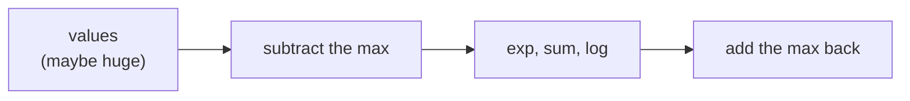

> Tier 1 · Mathematics for AI · **Level: intermediate** · Reading time: about 10 minutes

# 1.43 Log-sum-exp

**Metadata** — Tier: 1 · Phase: 1 · Priority: P0 · Difficulty: 3/5 · Interview: High · Hands-on: Very high
Prerequisites: 1.41, 1.42, 1.39 · Leads to: stable softmax and cross-entropy, CTC/HMM/CRF, flash-attention's online softmax

> **In plain words**
> **Log-sum-exp** computes `log(e^a + e^b + …)` **safely**, even when the numbers are huge. The trick: **factor out the biggest number first**, so every remaining exponent is zero or negative and nothing overflows.
> It is how softmax and cross-entropy are implemented in every deep-learning framework, and it behaves like a smooth version of `max`.

**You need first:** 1.41 Logarithms, 1.42 Exponentials.

> **Figure 1.43-1 — the trick in three steps**
>
> ```mermaid
> flowchart LR
>     A["x = [1000, 1000]"] --> B["m = max = 1000"]
>     B --> C["shift: x − m = [0, 0]"]
>     C --> D["log(e⁰ + e⁰) = ln 2"]
>     D --> E["add m back: 1000 + ln 2 = 1000.693"]
> ```
>
> *How to read it:* the naive formula needs `e¹⁰⁰⁰`, which overflows to `inf`. After subtracting the maximum, the largest term is `e⁰ = 1`, so the sum is at least 1 and never underflows. Adding the maximum back gives the exact answer.

**Words you'll meet on this page**

| Word | What it means here |
|---|---|
| log-sum-exp `LSE` | `log Σ exp(xᵢ)` |
| smooth max | LSE lies between `max` and `max + log n` |
| log-softmax | `zᵢ − LSE(z)` |
| partition function | the normalising sum `Σ exp(·)` |
| online softmax | computing the sum in one streaming pass |
| `keepdims` | keep the reduced axis so broadcasting works |

### 1. What is it?
`LSE(x₁…xₙ) = log Σ exp(xᵢ)`. It is a smooth approximation of `max`:

`max(x) ≤ LSE(x) ≤ max(x) + log n`

### 2. Why does it exist?
Adding probabilities that are stored as log-probabilities needs `log(exp(a) + exp(b))`. Computing that directly overflows or underflows. The log-sum-exp trick does it safely.

### 3. Detailed explanation
**The trick.** Let `m = max(x)`. Then

`LSE(x) = m + log Σ exp(xᵢ − m)`

All exponents are ≤ 0 (no overflow), and at least one term equals 1, so the sum is ≥ 1 and the log never sees 0.

Verified: `LSE([1000, 1000]) = 1000 + ln 2`; `LSE([−1000, −1000]) = −1000 + ln 2`. The naive formulas give `inf` and `−inf`.

**Consequences**
- **Stable log-softmax:** `log softmax(z)ᵢ = zᵢ − LSE(z)`. Softmax is the `exp` of that, and shift-invariance follows.
- **Cross-entropy from logits:** `−z_y + LSE(z)` (1.37). Extreme logits `[−1000, 1000]` give the finite loss 2000.
- **Edge case:** if every input is `−inf`, then `m = −inf`. A careful implementation replaces `m` with 0 so the result is `−inf` (a correct `log 0`), not NaN.
- **Smooth max / soft-min** with temperature, `T·LSE(x/T)`, appears in contrastive losses (InfoNCE) and "soft" dynamic programming.
- **The gradient of LSE is softmax:** `∂LSE/∂xᵢ = softmax(x)ᵢ`. Softmax and LSE are twins.
- **Sequence algorithms** that sum tiny probabilities (the HMM forward algorithm, CTC loss, CRF partition functions) run in log space using LSE.
- **Online (streaming) version:** keep a running maximum and a rescaled running sum. This is the idea inside fused attention kernels, avoiding a second pass over the scores.

### 4. How does it work?
Find the maximum, subtract it, exponentiate, sum, take the log, add the maximum back. Vectorised along an axis with `keepdims` so broadcasting works (1.7).

### 5. Simple example
Add two very unlikely events with probabilities `e⁻¹⁰⁰⁰` and `e⁻¹⁰⁰¹`. Factor out the larger one: `e⁻¹⁰⁰⁰ (1 + e⁻¹)`. In logs: `−1000 + ln(1 + e⁻¹) = −1000 + 0.313 = −999.687`.

### 6. Technical example
CTC loss sums over all alignments of a transcript. The sum of tiny alignment probabilities is done with LSE at every dynamic-programming step.

### 7. Code
**① By hand (plain Python).**

```python
import math

def logsumexp(xs):
    m = max(xs)
    if m == -math.inf:
        return -math.inf                       # log(0)
    return m + math.log(sum(math.exp(x - m) for x in xs))

print("LSE([1000, 1000])  =", round(logsumexp([1000, 1000]), 4), "  (1000 + ln 2 =", round(1000 + math.log(2), 4), ")")
print("LSE([-1000, -1000]) =", round(logsumexp([-1000, -1000]), 4))
print("LSE of all -inf     =", logsumexp([-math.inf, -math.inf]))
try:
    math.log(sum(math.exp(x) for x in [1000, 1000]))
except OverflowError:
    print("the naive formula overflows")
```

```text
LSE([1000, 1000])  = 1000.6931   (1000 + ln 2 = 1000.6931 )
LSE([-1000, -1000]) = -999.3069
LSE of all -inf     = -inf
the naive formula overflows
```

**② With NumPy.** Stable softmax from LSE.

```python
import numpy as np

def logsumexp(x, axis=-1):
    m = np.max(x, axis=axis, keepdims=True)
    return (m + np.log(np.sum(np.exp(x - m), axis=axis, keepdims=True))).squeeze(axis)

z = np.array([1000.0, 1001.0, 1002.0])
log_softmax = z - logsumexp(z)
print("softmax via LSE:", np.exp(log_softmax).round(4))
print("bounds: max =", z.max(), "<= LSE =", round(float(logsumexp(z)), 4), "<= max + ln n =", round(float(z.max() + np.log(len(z))), 4))
```

```text
softmax via LSE: [0.09   0.2447 0.6652]
bounds: max = 1002.0 <= LSE = 1002.4076 <= max + ln n = 1003.0986
```

**③ With PyTorch.** The built-in version and its gradient.

```python
import torch

z = torch.tensor([1000.0, 1001.0, 1002.0], requires_grad=True)
lse = torch.logsumexp(z, dim=0)
lse.backward()
print("LSE:", round(lse.item(), 4))
print("gradient = softmax:", [round(v, 4) for v in z.grad.tolist()])
```

```text
LSE: 1002.4076
gradient = softmax: [0.09, 0.2447, 0.6652]
```

### 8. Input → Process → Output



<details>
<summary><b>Beyond the basics (sections 9–16)</b> — real-world use, limits, mistakes. Skip on a first read.</summary>

### 9. Enterprise use case
Scoring systems that combine probabilities across many hypotheses or segments (speech-recognition decoding, sequence labelling) depend on LSE-based dynamic programming.

### 10. AI engineering connection
Stable softmax, cross-entropy and log-softmax in every framework (`torch.logsumexp`, `log_softmax`), contrastive losses, sequence models, flash-attention.

### 11. Advantages
Exact (not approximate) with stable arithmetic; differentiable.

### 12. Limitations
Needs two passes over the data unless the online variant is used; `−inf` handling needs care; it is not a hard max (it exceeds the max by up to `log n`).

### 13. Trade-offs
Exact LSE versus approximating by `max` (Viterbi) when the soft sum is not needed and speed matters.

### 14. Common mistakes
`np.log(np.sum(np.exp(x)))`; subtracting a max taken across the wrong axis (mixing batch rows); missing `keepdims` so broadcasting misaligns; NaN from `−inf − (−inf)`; computing softmax and then log.

### 15. Performance / cost
One extra reduction (the max) per row; fused kernels remove extra memory traffic. With a 100k vocabulary this is a key memory and time item in the loss.

### 16. Security
Nothing beyond NaN/Inf validation of untrusted numeric inputs.

</details>

### 17. Interview explanation
"Log-sum-exp computes the log of a sum of exponentials without overflow by factoring out the maximum: max plus log of the sum of exp(x minus max). It's how softmax and cross-entropy are implemented stably, and its gradient is exactly the softmax."

### 18. Rapid-fire answer
`LSE = m + log Σ exp(x − m)`; a smooth max; gradient = softmax; cross-entropy = `−z_y + LSE(z)`.

### 19. Interview questions
- **Basic:** Why subtract the max?
- **Intermediate:** Show that `∂LSE/∂xᵢ = softmax(x)ᵢ`. What are the bounds on LSE relative to the max?
- **Advanced:** How does the online softmax in flash-attention keep a running max and sum?
- **Scenario:** Your own HMM forward pass underflows after 300 time steps. Fix it.

### 20. Hands-on exercise
**Goal:** write a streaming (online) log-sum-exp.

1. Process the values in chunks, keeping a running maximum `m` and running sum `s = Σ exp(x − m)`.
2. When a new chunk has a bigger maximum, rescale the old sum by `exp(m_old − m_new)`.
3. Compare with the all-at-once version.

<details>
<summary>Show a solution</summary>

```python
import numpy as np

def lse(x):
    m = x.max()
    return m + np.log(np.exp(x - m).sum())

x = np.random.default_rng(0).normal(0, 50, 1000)             # large spread
m, s = -np.inf, 0.0
for chunk in np.array_split(x, 10):
    m_new = max(m, chunk.max())
    s = s * np.exp(m - m_new) + np.exp(chunk - m_new).sum()   # rescale the old sum, add the new chunk
    m = m_new
print("streaming:", round(float(m + np.log(s)), 6))
print("all at once:", round(float(lse(x)), 6))
```

```text
streaming: 153.301837
all at once: 153.301837
```

</details>

### 21. Revision questions
1. What is the formula?
2. What are the bounds on LSE?
3. Why can the result never overflow?

### 22. Related concepts
1.37 Cross-entropy · 1.39 Stability · 1.44 Overflow and underflow · Tier 7 Attention

### 23. One-line memory hook
**Factor out the biggest number, then add up what's left.**

<details>
<summary><b>For reviewers</b> (not part of the lesson)</summary>

- Status: DRAFT, learner-first layout (Author: Claude). Code is executed by `tests/test_md_snippets.py`.
- TESTED earlier: agreement with naive when safe, extreme positive/negative inputs, all-`−inf` row, softmax shift invariance (`code/info_numerics.py`).
</details>
