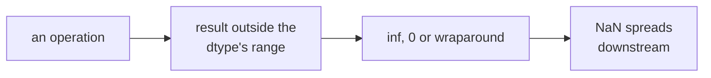

> Tier 1 · Mathematics for AI · **Level: beginner** · Reading time: about 9 minutes

# 1.44 Numerical overflow and underflow

**Metadata** — Tier: 1 · Phase: 1 · Priority: P0 · Difficulty: 2/5 · Interview: High · Hands-on: Very high
Prerequisites: 1.40, 1.42 · Leads to: loss scaling, NaN debugging, mixed-precision training (Tier 4), quantisation

> **In plain words**
> **Overflow**: a number gets too big for its container and turns into `inf` (infinity). **Underflow**: a number gets so tiny it rounds to `0`.
> Both happen **silently**, and then spread: `inf − inf` is `NaN`, and one `NaN` can ruin an entire training run. This page is a field guide to the symptoms and the standard fixes.

**You need first:** 1.40 Floating-point precision, 1.42 Exponentials.

> **Figure 1.44-1 — the usual suspects**
>
> ```mermaid
> flowchart LR
>     A["exp of a large logit"] --> B["inf / inf = NaN"]
>     C["product of tiny probabilities"] --> D["underflow to 0"]
>     E["tiny gradient in fp16"] --> F["silently 0: no learning"]
>     G["integer counter or int8 sum"] --> H["wraps around to negative"]
> ```
>
> *How to read it:* each box on the left is an everyday operation; each box on the right is what goes wrong. The table in section 3 pairs every symptom with its fix.

**Words you'll meet on this page**

| Word | What it means here |
|---|---|
| overflow | result too large: `±inf` for floats, wraparound for integers |
| underflow | result too close to 0: becomes subnormal or exactly 0 |
| NaN | "not a number": the result of `inf − inf`, `0/0`, … |
| loss scaling | multiplying the loss so fp16 gradients do not vanish |
| subnormal | a very tiny number stored with reduced precision |
| gradient clipping | limiting the gradient's norm (1.15) |

### 1. What is it?
- **Overflow:** a result is too large for the data type. It becomes `±inf` (floats) or wraps around (integers).
- **Underflow:** a result is too close to zero. It becomes a subnormal number or exactly `0`.

### 2. Why does it matter?
Both are silent, and the odd values propagate: `inf − inf = NaN`, `0 · inf = NaN`, `0/0 = NaN`, `log(0) = −inf`. One bad value can contaminate a whole training run through the gradient.

### 3. Detailed explanation
**Limits** (see 1.40): float16 max 65,504 (smallest positive normal about `6.1e-5`); float32 max about `3.4e38`; float64 max about `1.8e308`. `float16(70000)` gives `inf`; `float16(1e-8)` gives `0`; a product of 400 values `1e-3` gives `0` even in float64.

**Typical sources in ML**

| Source | Symptom | Fix |
|---|---|---|
| `exp` of large logits (softmax) | `inf/inf = NaN` | subtract the max / log-sum-exp (1.43) |
| product of probabilities | underflow to 0 | work in log space (1.41) |
| exploding activations or gradients | `inf` loss | normalisation, clipping (1.15), lower learning rate |
| fp16 gradients too small | silent zeros | loss scaling, or use bf16 |
| division by zero / tiny variance | `inf`, NaN | add `ε` |
| `log(0)` | `−inf` | clip probability to `[ε, 1−ε]` or use a fused stable operation |
| integer overflow (counts, IDs, int8 accumulation) | wraps to negative | wider type or explicit checks |
| big offset plus small increments | small increments lost (absorption) | higher-precision accumulators (1.40) |

**Detection.** `np.isfinite`, `torch.isnan(x).any()`, anomaly-detection modes, gradient-norm logging, a check on the loss every step. NumPy warns (and can raise errors with `np.errstate(all='raise')`); PyTorch usually propagates silently.

**Subnormals** (gradual underflow) keep tiny numbers non-zero at reduced precision, but are slow on some CPUs and flushed to zero on many GPUs.

**Dynamic loss scaling (fp16).** Multiply the loss by a large factor `S` before the backward pass; unscale the gradients before the optimiser step; if an overflow (`inf`/NaN) is detected, skip the step and reduce `S`; periodically try increasing `S`.

### 4. How does it work?
The hardware follows IEEE 754: it sets exception flags and returns `inf` or `0`. Frameworks mostly ignore the flags unless asked.

### 5. Simple example
A car's **odometer rolling over** after 99,999 is integer overflow. A **kitchen scale** that cannot register anything below 1 g is underflow.

**In numbers (8-bit integer):** `127 + 1` does not give 128 but wraps around to `−128`.

### 6. Technical example
Attention with fp16 scores of size 100: `exp(100)` is `inf`, softmax gives NaN, and the loss is NaN. Subtracting the row maximum fixes it at no cost.

### 7. Code
**① By hand (plain Python).**

```python
import math

print("inf - inf =", math.inf - math.inf, "   0 * inf =", 0 * math.inf)
print("product of 400 × 1e-3 =", math.prod([1e-3] * 400))
print("1e308 * 10 =", 1e308 * 10)
try:
    math.exp(1000)
except OverflowError as e:
    print("exp(1000):", e)
```

```text
inf - inf = nan    0 * inf = nan
product of 400 × 1e-3 = 0.0
1e308 * 10 = inf
exp(1000): math range error
```

**② With NumPy.** Floats and integers.

```python
import numpy as np
import warnings

warnings.simplefilter("ignore")
print("float16(70000) =", np.float16(70000.0), "   float16(1e-8) =", np.float16(1e-8))
print("np.int8(127) + 1 wraps to:", np.array([127], dtype=np.int8) + np.array([1], dtype=np.int8))
x = np.array([1.0, np.nan, 3.0])
print("isfinite check:", np.isfinite(x))
```

```text
float16(70000) = inf    float16(1e-8) = 0.0
np.int8(127) + 1 wraps to: [-128]
isfinite check: [ True False  True]
```

**③ With PyTorch.** Why fp16 needs loss scaling.

```python
import torch

tiny_grad = 1e-8
print("a 1e-8 gradient stored in fp16:", torch.tensor(tiny_grad).to(torch.float16).item())
scaled = torch.tensor(tiny_grad * 2 ** 15).to(torch.float16)
print("scaled by 2^15 first, then unscaled:", (scaled.float() / 2 ** 15).item())
print("int8 wraparound:", (torch.tensor(127, dtype=torch.int8) + torch.tensor(1, dtype=torch.int8)).item())
```

```text
a 1e-8 gradient stored in fp16: 0.0
scaled by 2^15 first, then unscaled: 9.997165761888027e-09
int8 wraparound: -128
```

### 8. Input → Process → Output



<details>
<summary><b>Beyond the basics (sections 9–16)</b> — real-world use, limits, mistakes. Skip on a first read.</summary>

### 9. Enterprise use case
Training platforms gate checkpoints on a finite loss and restart automatically from the last good checkpoint with a lower learning rate when NaNs appear.

### 10. AI engineering connection
Mixed precision, loss scaling, quantisation (int8 matrix products accumulate in int32), attention kernels, normalisation `ε`, gradient clipping, and `logprobs` handling.

### 11. Advantages (of knowing this)
Fast diagnosis of NaN/Inf failures, and cheap prevention.

### 12. Limitations
Detection hooks add overhead; some stabilisations change numerics slightly (clipping, `ε`).

### 13. Trade-offs
Check every step (safe, slower) versus periodic checks (cheap, late detection); bf16 (range-safe) versus fp16 with scaling (more precision).

### 14. Common mistakes
Adding `ε` inside a `log` or `sqrt` that does not need it and biasing results; not checking inputs from users or data pipelines (NaN labels); ignoring warnings; clipping values to hide a bug.

### 15. Performance / cost
A NaN found 12 hours into a run wastes the GPU hours; a per-step `isfinite` check costs microseconds.

### 16. Security
Crafted inputs with huge values or NaN can poison online learning or retrieval scoring. Validate numeric ranges at the API boundary.

</details>

### 17. Interview explanation
"Overflow means a value is too big for the dtype and becomes inf; underflow means it rounds to zero. Both propagate silently into NaNs. The usual fixes are log space, subtracting the max in softmax, ε in denominators, gradient clipping, bf16 or loss scaling for fp16, and cheap isfinite checks on the loss."

### 18. Rapid-fire answer
Overflow → `inf`, underflow → 0, `inf − inf = NaN`; use log space, max-shift, ε, clipping and loss scaling.

### 19. Interview questions
- **Basic:** What happens to `exp(1000)` in float64? To `exp(12)` in float16?
- **Intermediate:** How does loss scaling avoid fp16 gradient underflow?
- **Advanced:** Why do int8 matrix products accumulate in int32?
- **Scenario:** NaN appears at step 5,000 in bf16 training. Walk through bisecting the cause.

### 20. Hands-on exercise
**Goal:** write a guard that stops training when the loss stops being finite.

1. Write a function `check(loss, step)` that raises an error naming the step if the loss is NaN or infinite.
2. Test it on a list of losses that goes wrong at step 3.

<details>
<summary>Show a solution</summary>

```python
import math

def check(loss, step):
    if not math.isfinite(loss):
        raise FloatingPointError(f"non-finite loss {loss} at step {step}")

losses = [2.3, 1.9, 1.6, float("nan"), 1.2]
for step, loss in enumerate(losses, start=1):
    try:
        check(loss, step)
        print("step", step, "ok:", loss)
    except FloatingPointError as e:
        print("STOP:", e)
        break
```

```text
step 1 ok: 2.3
step 2 ok: 1.9
step 3 ok: 1.6
STOP: non-finite loss nan at step 4
```

</details>

### 21. Revision questions
1. What is the maximum float16 value?
2. What do `0·inf` and `inf − inf` give?
3. What are the steps of dynamic loss scaling?

### 22. Related concepts
1.39 Stability · 1.40 Floating-point · 1.43 Log-sum-exp · Tier 4 Mixed precision

### 23. One-line memory hook
**Too big becomes inf, too small becomes zero, and inf or zero together make NaN.**

<details>
<summary><b>For reviewers</b> (not part of the lesson)</summary>

- Status: DRAFT, learner-first layout (Author: Claude). Code is executed by `tests/test_md_snippets.py`.
- TESTED earlier: float16 overflow/underflow, product underflow, finite results of stable alternatives (`code/info_numerics.py`); int8 wraparound in PyTorch (`t_1_44_int8_wrap` → −128), observed in NumPy 2.5.4 with a `RuntimeWarning` (scalar-overflow behaviour is version-sensitive); fp16 loss-scaling claim (`t_1_44_loss_scaling`).
- The `exp(12)` float16 example corrects the first draft's float16 threshold (see 1.42's reviewer note).
</details>
