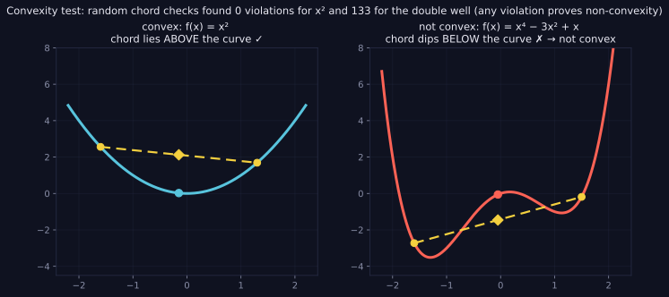

> Tier 1 — Mathematics for AI · Status: DRAFT (Author: Claude) · Code: `code/info_numerics.py` — TESTED

# 1.45 Convexity intuition

**Metadata** — Tier: 1 · Phase: 1 · Priority: P1 · Difficulty: 3/5 · Interview: Medium · Hands-on: Medium
Prerequisites: 1.21, 1.23, 1.18 · Leads to: 1.46, 1.47, linear/logistic regression (Tier 2), optimization theory

### 1. What is it?
A function `f` is **convex** if the line segment between any two points on its graph lies on or above the graph:

`f(λa + (1−λ)b) ≤ λf(a) + (1−λ)f(b)` for all `a, b` and `λ ∈ [0,1]`

Picture a bowl. A **concave** function is an upside-down bowl.

### 2. Why does it matter?
For convex functions, **every local minimum is a global minimum**, and gradient descent with a suitable step size converges to it. This is the "easy" case of optimization and the reason linear regression, logistic regression and SVMs are reliable.

### 3. Detailed explanation
Equivalent tests:
- **1-D:** `f″(x) ≥ 0` everywhere.
- **Multi-D:** the **Hessian** (matrix of second derivatives) is positive semi-definite (all eigenvalues ≥ 0; 1.18). If all eigenvalues > 0, the function is **strictly convex** (unique minimizer).
- **First-order:** the tangent line/plane lies below the graph.

Examples. Convex: `x²`, `|x|`, `eˣ`, `−log x`, norms (1.15), linear functions (both convex and concave), the log-sum-exp (1.43), MSE for linear models, logistic-regression loss, and **cross-entropy as a function of the logits** (1.37). Non-convex: `sin x`, `x⁴−3x²+x` (two minima), any loss of a deep network as a function of its weights.

Important distinction: cross-entropy is convex in the **logits**, but not in the **weights** of a multi-layer network, because the logits are non-linear functions of the weights. Convexity in some variables does not make the whole problem convex.

Operations preserving convexity: sums of convex functions, non-negative scaling, composition with an affine map, pointwise maximum. (ReLU `max(0,x)` is convex, but composing many layers is not.)

Sampling test: a function that violates the midpoint inequality for even one pair of points is **not** convex (tested: `x²`, `|x|`, `eˣ` have zero violations; the double well and `sin` have violations). Passing a random test does not *prove* convexity.

Convexity also gives **Jensen's inequality**: `f(E[X]) ≤ E[f(X)]` (1.29). It underlies `KL ≥ 0` (1.38).

Gradient descent on a convex quadratic converges at a speed governed by the **condition number** `κ = λ_max/λ_min` of the Hessian: stretched bowls give zig-zag paths and need small steps (stable only for `η < 2/λ_max`). Example: `f = x² + 10y²` has Hessian eigenvalues 2 and 20, stable for `η < 0.1` (1.23).

### 4. How does it work?
The graph never curves downward, so a flat point (`∇f = 0`) must be the bottom of the bowl. No hidden valleys exist.

> **Figure 1.45-1 — the chord test for convexity**



*How to read it:* For a convex function every chord lies on or above the graph (left). If any chord dips below the curve, the function is not convex (right). The random chord search found 0 violations for x² and 133 for the double well; one violation is enough to prove non-convexity, while zero violations only suggests convexity.

*Generated by* `tier-01-mathematics/figures/src/t1_geometry.py` *from this chapter's code, so the numbers are computed, not typed in.*

### 5. Simple example
A marble in a smooth bowl always rolls to the same lowest point, wherever you drop it.

### 6. Technical example
Training logistic regression: the loss surface over weights is convex, so any reasonable optimizer reaches the same optimum (up to ties/regularization). Deep nets lack this guarantee, yet SGD works well in practice.

### 7. Code
```python
import numpy as np
from info_numerics import midpoint_convex_violations, double_well
print(midpoint_convex_violations(lambda x: x**2, -5, 5))      # 0
print(midpoint_convex_violations(np.exp, -3, 3))             # 0
print(midpoint_convex_violations(double_well, -2.5, 2.5))    # > 0  → not convex
print(midpoint_convex_violations(np.sin, 0, 2*np.pi))        # > 0
```
TESTED (`test_convex_functions_have_no_midpoint_violations`, `test_nonconvex_function_has_violation`).

### 8. Input → Process → Output
`function → second-derivative / Hessian test (or sampling) → convex? → guarantee on minima`

### 9. Enterprise use case
Choosing a convex baseline (regularized logistic regression) provides a reproducible, auditable benchmark before investing in non-convex deep models.

### 10. AI engineering connection
Classical ML (linear/logistic/SVM/lasso/ridge), convex relaxations, proper-scoring losses, understanding why deep nets are harder (1.46–1.47), Jensen's inequality in ELBO and KL.

### 11. Advantages
Guarantees, predictable convergence rates, no initialization sensitivity.

### 12. Limitations
Most modern models are non-convex; convex theory only approximates their local behavior; convex ≠ easy when ill-conditioned or huge.

### 13. Trade-offs
Convex models: reliable, limited capacity. Non-convex deep models: expressive, no guarantees, need good init/optimizers.

### 14. Common mistakes
Claiming a deep network's loss is convex because the final loss is cross-entropy; treating a sampled check as proof; ignoring conditioning; forgetting regularizers (L2 makes it strongly convex, L1 convex but non-smooth).

### 15. Performance / cost
Convex problems with `n` features cost modest iterations; ill-conditioning multiplies iteration counts (scale features, precondition).

### 16. Security
N/A.

### 17. Interview explanation
"A convex function is bowl-shaped: the segment between two points lies above the graph, so any local minimum is the global one. Linear and logistic regression are convex. Neural networks aren't, even though their final loss is convex in the logits, so we rely on good initialization and SGD-like optimizers rather than guarantees."

### 18. Rapid-fire
Convex = bowl; Hessian PSD; local min = global min; deep nets are non-convex.

### 19. Interview questions
- Basic: Is `x²` convex? `sin x`?
- Intermediate: Why is logistic regression's loss convex but a 2-layer net's isn't?
- Advanced: State Jensen's inequality; how does the condition number affect gradient descent?
- Scenario: Same data, different seeds give different final losses with a linear model. Is that expected? (No: check for non-convexity, e.g. bugs, nondeterminism, early stopping.)

### 20. Hands-on exercise
Fit logistic regression from 10 random initializations and show the same optimum; fit a 1-hidden-layer net from 10 initializations and compare.

### 21. Revision questions
1) Definition? 2) Hessian test? 3) Why convex ⇒ local = global?

### 22. Related concepts
1.18 Eigenvalues · 1.23 Gradients · 1.46 Landscapes · 1.47 Local/global minima · Tier 2 Regression

### 23. Memory hook
**Convex: a bowl with one bottom; deep learning is a mountain range.**
