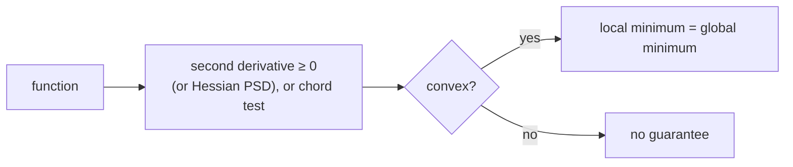

> Tier 1 · Mathematics for AI · **Level: beginner–intermediate** · Reading time: about 9 minutes

# 1.45 Convexity intuition

**Metadata** — Tier: 1 · Phase: 1 · Priority: P1 · Difficulty: 3/5 · Interview: Medium · Hands-on: Medium
Prerequisites: 1.21, 1.23, 1.18 · Leads to: 1.46, 1.47, linear and logistic regression (Tier 2), optimisation theory

> **In plain words**
> A **convex** function is shaped like a **bowl**: it has exactly one bottom, and if you roll downhill you always end up there, wherever you start.
> That is the "easy" case of optimisation. Linear and logistic regression have bowl-shaped losses, so they train reliably. Deep networks do **not** have bowl-shaped losses, which is why training them is harder.

**You need first:** 1.21 Derivatives, 1.23 Gradients (and 1.18 Eigenvalues for the Hessian test).

> **Figure 1.45-1 — the chord test for convexity**
>
> 
>
> *How to read it:* for a convex function every **chord** (a straight line joining two points on the curve) lies on or **above** the curve (left). If any chord dips **below** the curve, the function is not convex (right). The random chord search found 0 violations for `x²` and 133 for the double well. One violation proves non-convexity; zero violations only *suggests* convexity.
>
> *Generated by* `tier-01-mathematics/figures/src/t1_geometry.py`.

**Words you'll meet on this page**

| Word | What it means here |
|---|---|
| convex | every chord lies on or above the graph (bowl shape) |
| concave | upside-down bowl |
| chord | a straight line between two points of the graph |
| Hessian | the matrix of second derivatives (curvature) |
| positive semi-definite | all eigenvalues ≥ 0 |
| Jensen's inequality | for convex `f`: `f(E[X]) ≤ E[f(X)]` |
| condition number `κ` | `λ_max/λ_min`; how stretched the bowl is |

### 1. What is it?
A function `f` is **convex** if the line segment between any two points of its graph lies on or above the graph:

`f(λa + (1 − λ)b) ≤ λ·f(a) + (1 − λ)·f(b)` for all `a, b` and `λ ∈ [0, 1]`.

Picture a bowl. A **concave** function is an upside-down bowl.

### 2. Why does it matter?
For a convex function, **every local minimum is a global minimum**, and gradient descent with a suitable step size converges to it. This is the "easy" case of optimisation, and the reason linear regression, logistic regression and SVMs are reliable.

### 3. Detailed explanation
**Equivalent tests**
- **One variable:** `f″(x) ≥ 0` everywhere (the curve never bends downward).
- **Many variables:** the **Hessian** (matrix of second derivatives) is positive semi-definite, i.e. all eigenvalues ≥ 0 (1.18). If all are `> 0` the function is **strictly convex** (a single, unique minimiser).
- **First-order:** the tangent line (or plane) lies below the graph.

**Examples**
- Convex: `x²`, `|x|`, `eˣ`, `−log x`, norms (1.15), linear functions (both convex and concave), log-sum-exp (1.43), MSE for linear models, logistic-regression loss, and **cross-entropy as a function of the logits** (1.37).
- Non-convex: `sin x`, `x⁴ − 3x² + x` (two minima), and the loss of any deep network as a function of its weights.

**An important distinction.** Cross-entropy is convex in the **logits**, but not in the **weights** of a multi-layer network, because the logits are non-linear functions of the weights. Convexity in some variables does not make the whole problem convex.

**What preserves convexity:** sums of convex functions, non-negative scaling, composition with an affine map, and the pointwise maximum. (ReLU, `max(0, x)`, is convex, but composing many layers is not.)

**Sampling test.** A function that violates the chord inequality for even one pair of points is **not** convex. Passing a random test does not *prove* convexity.

Convexity gives **Jensen's inequality** `f(E[X]) ≤ E[f(X)]` (1.29), which underlies `KL ≥ 0` (1.38).

**Speed of gradient descent on a convex quadratic** depends on the **condition number** `κ = λ_max/λ_min` of the Hessian: a stretched bowl gives a zig-zag path and needs a small step (stable only for `η < 2/λ_max`). Example: `f = x² + 10y²` has Hessian eigenvalues 2 and 20, so it is stable for `η < 0.1` (1.23).

### 4. How does it work?
The graph never curves downward, so a flat point (`∇f = 0`) must be the bottom of the bowl. There are no hidden valleys.

### 5. Simple example
A marble in a smooth bowl always rolls to the same lowest point, wherever you drop it.

**The chord test by hand** for `f(x) = x²` with points `a = −1`, `b = 3`, `λ = 0.5`:
- the chord's value at the midpoint: `0.5·f(−1) + 0.5·f(3) = 0.5·1 + 0.5·9 = 5`;
- the function's value at the midpoint `x = 1`: `f(1) = 1`.

`1 ≤ 5`: the chord is above the curve ✓. For the double well `f(x) = x⁴ − 3x² + x` take `a = −1.3`, `b = 1.1`, `λ = 0.5`:
- `f(−1.3) = −3.51` and `f(1.1) = −1.07`, so the chord's value at the midpoint is `(−3.51 − 1.07)/2 = −2.29`;
- the function's value at the midpoint `x = −0.1` is `f(−0.1) = −0.13`.

Here the function (−0.13) is **above** the chord (−2.29): the chord dips below the curve, so the double well is **not convex**.

### 6. Technical example
Training logistic regression: the loss surface over the weights is convex, so any reasonable optimiser reaches the same optimum (up to ties or regularisation). Deep networks lack this guarantee, yet SGD works well in practice.

### 7. Code
**① By hand (plain Python).** The chord test on a few functions.

```python
import math, random

def violations(f, lo, hi, trials=5000, seed=0):
    rng = random.Random(seed)
    bad = 0
    for _ in range(trials):
        a, b, lam = rng.uniform(lo, hi), rng.uniform(lo, hi), rng.random()
        if f(lam * a + (1 - lam) * b) > lam * f(a) + (1 - lam) * f(b) + 1e-12:
            bad += 1                                       # the chord dipped below the curve
    return bad

double_well = lambda x: x ** 4 - 3 * x ** 2 + x
print("x^2        :", violations(lambda x: x ** 2, -5, 5))
print("exp(x)     :", violations(math.exp, -3, 3))
print("double well:", violations(double_well, -2.5, 2.5), "(> 0: not convex)")
print("sin(x)     :", violations(math.sin, 0, 2 * math.pi), "(> 0: not convex)")
```

```text
x^2        : 0
exp(x)     : 0
double well: 1464 (> 0: not convex)
sin(x)     : 2509 (> 0: not convex)
```

**② With NumPy.** The Hessian test on two quadratic bowls.

```python
import numpy as np

for name, H in (("x^2 + y^2   ", np.array([[2.0, 0.0], [0.0, 2.0]])),
                ("x^2 - y^2   ", np.array([[2.0, 0.0], [0.0, -2.0]])),
                ("x^2 + 10y^2 ", np.array([[2.0, 0.0], [0.0, 20.0]]))):
    ev = np.linalg.eigvalsh(H)
    kind = "convex (bowl)" if ev.min() >= 0 else "not convex (saddle)"
    print(f"{name} Hessian eigenvalues {ev}  ->  {kind}   condition number {ev.max() / ev.min() if ev.min() > 0 else float('nan'):.1f}")
```

```text
x^2 + y^2    Hessian eigenvalues [2. 2.]  ->  convex (bowl)   condition number 1.0
x^2 - y^2    Hessian eigenvalues [-2.  2.]  ->  not convex (saddle)   condition number nan
x^2 + 10y^2  Hessian eigenvalues [ 2. 20.]  ->  convex (bowl)   condition number 10.0
```

**③ With PyTorch.** Convex logistic-regression loss: different starts reach the same answer.

```python
import torch

torch.manual_seed(0)
X = torch.randn(200, 2)
y = (X[:, 0] + 0.5 * X[:, 1] + 0.3 * torch.randn(200) > 0).float()
finals = []
for start in range(5):
    torch.manual_seed(100 + start)
    w = (torch.randn(2) * 3).requires_grad_()               # very different starting points
    opt = torch.optim.LBFGS([w], max_iter=200)
    def closure():
        opt.zero_grad()
        loss = torch.nn.functional.binary_cross_entropy_with_logits(X @ w, y)
        loss.backward()
        return loss
    opt.step(closure)
    finals.append([round(v, 3) for v in w.tolist()])
print("final weights from 5 different starts:", finals)
```

```text
final weights from 5 different starts: [[7.323, 3.803], [7.323, 3.803], [7.323, 3.803], [7.323, 3.803], [7.323, 3.803]]
```

### 8. Input → Process → Output



<details>
<summary><b>Beyond the basics (sections 9–16)</b> — real-world use, limits, mistakes. Skip on a first read.</summary>

### 9. Enterprise use case
A convex baseline (regularised logistic regression) gives a reproducible, auditable benchmark before investing in non-convex deep models.

### 10. AI engineering connection
Classical ML (linear, logistic, SVM, lasso, ridge), convex relaxations, proper-scoring losses, understanding why deep nets are harder (1.46–1.47), and Jensen's inequality in the ELBO and in KL.

### 11. Advantages
Guarantees, predictable convergence rates, and no sensitivity to initialisation.

### 12. Limitations
Most modern models are non-convex; convex theory only approximates their local behaviour; convex does not mean easy when badly conditioned or huge.

### 13. Trade-offs
Convex models are reliable but limited in capacity. Non-convex deep models are expressive but have no guarantees and need good initialisation and optimisers.

### 14. Common mistakes
Claiming a deep network's loss is convex because the last step is cross-entropy; treating a sampled check as proof; ignoring conditioning; forgetting regularisers (L2 makes it strongly convex; L1 is convex but not smooth).

### 15. Performance / cost
Convex problems with `n` features need a modest number of iterations; ill-conditioning multiplies the iteration count (scale the features, or precondition).

### 16. Security
Nothing specific.

</details>

### 17. Interview explanation
"A convex function is bowl-shaped: the segment between two points lies above the graph, so any local minimum is the global one. Linear and logistic regression are convex. Neural networks aren't, even though their final loss is convex in the logits, so we rely on good initialisation and SGD-like optimisers rather than guarantees."

### 18. Rapid-fire answer
Convex = bowl; Hessian PSD; local minimum = global minimum; deep nets are non-convex.

### 19. Interview questions
- **Basic:** Is `x²` convex? Is `sin x`?
- **Intermediate:** Why is logistic regression's loss convex but a 2-layer network's isn't?
- **Advanced:** State Jensen's inequality. How does the condition number affect gradient descent?
- **Scenario:** The same data and different seeds give different final losses with a linear model. Is that expected? (No: look for non-convexity, bugs, nondeterminism or early stopping.)

### 20. Hands-on exercise
**Goal:** see why a convex problem has one answer and a non-convex one does not.

1. Run gradient descent on `f(x) = x²` from five starting points between −5 and 5.
2. Run it on the double well `x⁴ − 3x² + x` (gradient `4x³ − 6x + 1`) from the same starts, with step 0.01 for 2,000 steps.
3. How many different end points do you see in each case?

<details>
<summary>Show a solution</summary>

```python
import numpy as np

def descend(grad, x0, lr=0.01, steps=2000):
    x = x0
    for _ in range(steps):
        x -= lr * grad(x)
    return round(x, 3)

starts = [-2.0, -1.0, 0.5, 1.0, 2.0]
print("x^2        :", [descend(lambda x: 2 * x, s) for s in starts])
print("double well:", [descend(lambda x: 4 * x ** 3 - 6 * x + 1, s) for s in starts])
```

```text
x^2        : [-0.0, -0.0, 0.0, 0.0, 0.0]
double well: [-1.301, -1.301, 1.131, 1.131, 1.131]
```

Convex: everyone ends at 0. Double well: two different valleys, depending on the start.
</details>

### 21. Revision questions
1. What is the definition of convexity?
2. What is the Hessian test?
3. Why does convexity make a local minimum global?

### 22. Related concepts
1.18 Eigenvalues · 1.23 Gradients · 1.46 Landscapes · 1.47 Local and global minima · Tier 2 Regression

### 23. One-line memory hook
**Convex: a bowl with one bottom; deep learning is a mountain range.**

<details>
<summary><b>For reviewers</b> (not part of the lesson)</summary>

- Status: DRAFT, learner-first layout (Author: Claude). Code is executed by `tests/test_md_snippets.py`.
- TESTED earlier: `test_convex_functions_have_no_midpoint_violations`, `test_nonconvex_function_has_violation` (`code/info_numerics.py`).
- Figure numbers (0 vs 133 violations) are from the figure script; this page's chord counts use a different random sample and will differ.
- The double-well hand-check in section 5 is only a sketch of the idea; the code on the page is the authoritative check.
</details>
