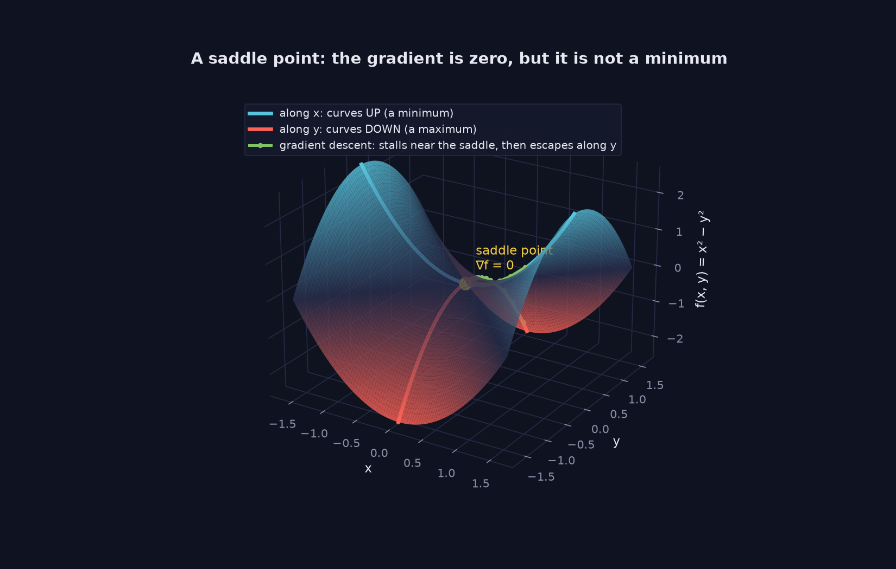
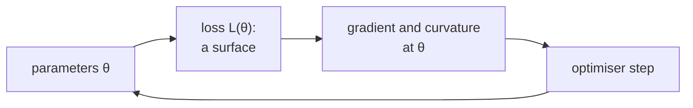

> Tier 1 · Mathematics for AI · **Level: intermediate** · Reading time: about 11 minutes

# 1.46 Optimization landscapes

**Metadata** — Tier: 1 · Phase: 1 · Priority: P1 · Difficulty: 3/5 · Interview: Medium-High · Hands-on: Medium
Prerequisites: 1.23, 1.45 · Leads to: 1.47, Tier 4 (optimisers, learning-rate schedules, initialisation, normalisation)

> **In plain words**
> Imagine the loss as **hilly terrain**: each position is a choice of model parameters and the height is how wrong the model is. Training is **walking downhill in thick fog**: you can feel the slope under your feet but cannot see the map.
> The shape of the terrain (valleys, flat plains, narrow ravines, **saddle points**) explains why training sometimes crawls, zig-zags or blows up.

**You need first:** 1.23 Gradients, 1.45 Convexity.

> **Figure 1.46-1 — a saddle point in 3D**
>
> 
>
> *How to read it:* at the yellow point the gradient is zero, yet it is **not** a minimum: moving along `x` (blue curve) goes up, moving along `y` (red curve) goes down. Gradient descent started almost exactly on the stable axis (green path) creeps toward the saddle and then escapes along `y`. In high dimensions most zero-gradient points look like this.
>
> *Generated by* `tier-01-mathematics/figures/src/fig_1_46_saddle.py`.

**Words you'll meet on this page**

| Word | What it means here |
|---|---|
| loss landscape | the loss plotted against the parameters |
| saddle point | zero gradient, but curves up in some directions and down in others |
| plateau | a flat region where the gradient is almost 0 |
| ravine | a narrow valley: steep in one direction, gentle in another |
| cliff | a sudden steep region |
| sharp / flat minimum | a narrow / wide valley bottom |
| momentum, Adam | optimisers that smooth or rescale the steps |

### 1. What is it?
The **loss landscape** is the surface you get by plotting the loss `L(θ)` against the parameters `θ`. Training is a walk across this surface from a starting point toward low regions. Real landscapes have millions to billions of dimensions, so we reason with simplified pictures and local measurements (gradient and curvature).

### 2. Why does it exist as a concept?
An optimiser's behaviour (stuck, slow, oscillating, diverging) is explained by the shape of the landscape. Choosing learning rates, momentum, batch size, warm-up and normalisation is all about navigating this shape.

### 3. Detailed explanation
**Features to know**
- **Minima** (local and global): see 1.47.
- **Saddle points:** the gradient is zero, but the surface curves up in some directions and down in others (the Hessian has mixed-sign eigenvalues). Example: `f(x, y) = x² − y²` at the origin. In high dimensions a random zero-gradient point is far more likely to be a saddle than a minimum, because a minimum needs *every* curvature direction to go up. Gradient descent started exactly on the saddle's stable axis stalls; any tiny disturbance (mini-batch noise) lets it escape.
- **Plateaus:** the gradient is about 0 over a large area (saturated sigmoids or tanh, dead ReLUs); progress is very slow.
- **Ravines:** very different curvature in different directions (large condition number `κ = λ_max/λ_min`, 1.45). Gradient descent zig-zags across the valley and crawls along it. Momentum and adaptive methods (Adam) help.
- **Cliffs:** sudden steep regions (common in RNNs) cause exploding gradients: use gradient clipping (1.15).
- **Sharp versus flat minima:** flat minima (low curvature) are often argued to generalise better, since small changes of the parameters barely change the loss. This is supported empirically in places but contested (REVIEW_REQUIRED before stating it strongly).
- **Symmetries:** permuting hidden units gives different parameters with the identical function, so there are many equivalent minima.
- **Over-parameterisation:** with many more parameters than needed, there are many near-zero-loss solutions and training is easier than low-dimensional intuition suggests.

**Levers that reshape or navigate the landscape:** initialisation, normalisation (BatchNorm, LayerNorm), residual connections (known to give smoother landscapes), learning-rate warm-up and decay, batch size (noise), momentum or Adam, regularisation, data augmentation.

**What we can measure:** loss curves, gradient norm (1.15), the top Hessian eigenvalue (power iteration with Hessian-vector products, 1.18), and the loss along a straight line between two parameter vectors.

**Caution:** 2-D landscape pictures are projections and can mislead.

### 4. How does it work?
At each step the optimiser uses the local gradient (and perhaps curvature or running statistics) to choose a step. It sees only the neighbourhood, never the whole landscape.

### 5. Simple example
A hiker in fog on a mountain range: you feel the slope underfoot but cannot see valleys. You may follow a ridge, wander over a flat meadow, or get stuck on a pass between two valleys.

**A saddle with numbers:** `f(x, y) = x² − y²`.

| Point | `f` | Gradient `(2x, −2y)` |
|---|---|---|
| (0, 0.1) | −0.01 (lower!) | (0, −0.2) |
| (0, 0) | 0 | (0, 0): **zero gradient** |
| (0.1, 0) | +0.01 (higher) | (0.2, 0) |

At the origin the gradient is zero, but one direction goes up and another goes down: a saddle, not a minimum.

### 6. Technical example
Learning-rate **warm-up** avoids large early steps in a landscape whose early curvature is sharp. **Adam** rescales each parameter's step, which helps in ill-conditioned valleys.

### 7. Code
**① By hand (plain Python).** Escape from a saddle.

```python
def grad(x, y):                  # gradient of f(x, y) = x² − y²
    return 2 * x, -2 * y

print("gradient at the saddle:", grad(0, 0))
x, y = 0.0, 1e-8                 # a tiny disturbance
for _ in range(200):
    gx, gy = grad(x, y)
    x, y = x - 0.1 * gx, y - 0.1 * gy
print("after 200 steps from y = 1e-8:  y =", f"{y:.3g}", "(grew: it escaped the saddle along y)")
```

```text
gradient at the saddle: (0, 0)
after 200 steps from y = 1e-8:  y = 6.86e+07 (grew: it escaped the saddle along y)
```

**② With NumPy.** Curvature from the Hessian's eigenvalues, and the zig-zag in a ravine.

```python
import numpy as np

H = np.array([[2.0, 0.0], [0.0, -2.0]])                 # Hessian of x² − y²
print("saddle Hessian eigenvalues:", np.linalg.eigvalsh(H), "(mixed signs)")

# ravine: f = x² + 10y², gradient (2x, 20y); steps of size 0.09 zig-zag across y
p = np.array([1.0, 1.0])
for step in range(1, 6):
    p = p - 0.09 * np.array([2 * p[0], 20 * p[1]])
    print(f"step {step}: x = {p[0]:6.3f}  y = {p[1]:6.3f}   (y flips sign each step)")
```

```text
saddle Hessian eigenvalues: [-2.  2.] (mixed signs)
step 1: x =  0.820  y = -0.800   (y flips sign each step)
step 2: x =  0.672  y =  0.640   (y flips sign each step)
step 3: x =  0.551  y = -0.512   (y flips sign each step)
step 4: x =  0.452  y =  0.410   (y flips sign each step)
step 5: x =  0.371  y = -0.328   (y flips sign each step)
```

**③ With PyTorch.** Plain gradient descent versus momentum in the ravine.

```python
import torch

def run(momentum, lr=0.05, steps=60):
    p = torch.tensor([1.0, 1.0], requires_grad=True)
    opt = torch.optim.SGD([p], lr=lr, momentum=momentum)
    for _ in range(steps):
        opt.zero_grad()
        (p[0] ** 2 + 10 * p[1] ** 2).backward()
        opt.step()
    return round((p[0] ** 2 + 10 * p[1] ** 2).item(), 6)

print("loss after 60 steps, plain SGD :", run(0.0))
print("loss after 60 steps, momentum 0.5:", run(0.5))
```

```text
loss after 60 steps, plain SGD : 3e-06
loss after 60 steps, momentum 0.5: 0.0
```

### 8. Input → Process → Output



<details>
<summary><b>Beyond the basics (sections 9–16)</b> — real-world use, limits, mistakes. Skip on a first read.</summary>

### 9. Enterprise use case
Training runbooks include diagnostics for plateaus (flat loss), instability (spikes) and divergence, mapped to remedies (learning rate, warm-up, clipping, data checks).

### 10. AI engineering connection
Learning-rate schedules, Adam and AdamW, momentum, normalisation layers, residual connections, loss spikes in LLM pretraining, fine-tuning stability, sharpness-aware minimisation (SAM).

### 11. Advantages (of the mental model)
Turns a vague "training is unstable" into actionable hypotheses (curvature, conditioning, saddles, cliffs).

### 12. Limitations
Low-dimensional intuition can mislead; pictures are projections; the theory for deep networks is incomplete.

### 13. Trade-offs
A larger learning rate crosses plateaus faster but risks divergence in sharp regions. A larger batch has less noise, which can mean sharper minima and less help escaping saddles; a smaller batch is noisier and regularising.

### 14. Common mistakes
Assuming a zero gradient means a minimum; blaming "local minima" for most training failures (it is often the learning rate, the data, a bug, or a saddle or plateau); relying on a 2-D picture as proof; ignoring conditioning (unscaled features).

### 15. Performance / cost
Curvature estimates need Hessian-vector products (about 2× a backward pass per product); use them sparingly in diagnostic runs.

### 16. Security
Poisoned data can carve adversarial basins (backdoors) into the landscape that standard validation misses.

</details>

### 17. Interview explanation
"The loss landscape is loss as a function of parameters. In high dimensions the main obstacles are usually saddle points, plateaus and ill-conditioned ravines rather than bad local minima. I handle them with sensible initialisation, normalisation and residual connections, momentum or Adam, warm-up and gradient clipping."

### 18. Rapid-fire answer
Saddles outnumber bad minima in high dimensions; ravines need momentum or Adam; cliffs need clipping; flat minima may generalise better (contested).

### 19. Interview questions
- **Basic:** What is a saddle point?
- **Intermediate:** Why does gradient descent zig-zag in a narrow valley? How does momentum help?
- **Advanced:** Why are saddles more common than local minima in high dimensions? What is the sharp-versus-flat-minima debate?
- **Scenario:** The loss plateaus at 2.3 (= ln 10) for a 10-class problem. What does that tell you, and what do you check?

### 20. Hands-on exercise
**Goal:** find the stability limit of gradient descent on `x² + 10y²`.

1. Run gradient descent from `(1, 1)` for 100 steps with `η` = 0.05, 0.09, 0.11.
2. Print the final loss for each.
3. Compare with the prediction `η < 2/20 = 0.1`.

<details>
<summary>Show a solution</summary>

```python
import numpy as np

for lr in (0.05, 0.09, 0.11):
    p = np.array([1.0, 1.0])
    for _ in range(100):
        p = p - lr * np.array([2 * p[0], 20 * p[1]])
    print(f"lr = {lr}: loss after 100 steps = {p[0] ** 2 + 10 * p[1] ** 2:.3g}")
```

```text
lr = 0.05: loss after 100 steps = 7.06e-10
lr = 0.09: loss after 100 steps = 6.21e-18
lr = 0.11: loss after 100 steps = 6.86e+16
```

Below 0.1 the loss shrinks; above 0.1 the steep `y` direction overshoots more each time and the loss explodes.
</details>

### 21. Revision questions
1. What is the definition of a saddle point?
2. What causes the zig-zag?
3. Name four levers that tame the landscape.

### 22. Related concepts
1.18 Eigenvalues · 1.23 Gradients · 1.45 Convexity · 1.47 Local and global minima · Tier 4 Optimisers

### 23. One-line memory hook
**Training is hiking in fog: you feel the slope, not the map; saddles, ravines and plateaus decide the journey.**

<details>
<summary><b>For reviewers</b> (not part of the lesson)</summary>

- Status: DRAFT, learner-first layout (Author: Claude). Code is executed by `tests/test_md_snippets.py`.
- TESTED earlier: zero gradient, mixed-sign Hessian eigenvalues (±2), escape from the saddle under a tiny perturbation (`code/info_numerics.py`).
- Sharp-vs-flat-minima claim remains REVIEW_REQUIRED, as in the first draft.
</details>
