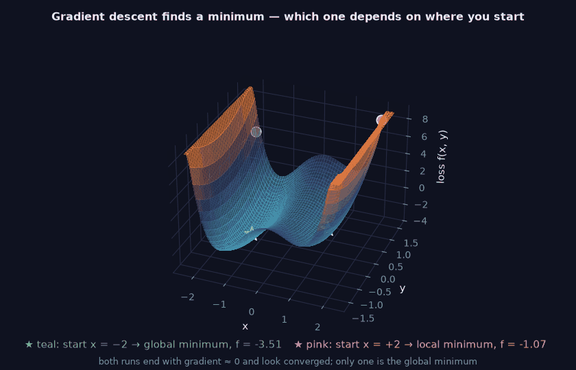
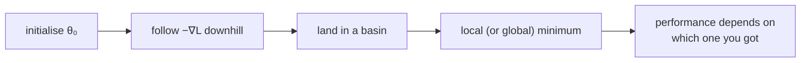

> Tier 1 · Mathematics for AI · **Level: beginner** · Reading time: about 9 minutes

# 1.47 Local and global minima (intuition)

**Metadata** — Tier: 1 · Phase: 1 · Priority: P1 · Difficulty: 2/5 · Interview: High · Hands-on: Medium
Prerequisites: 1.23, 1.45, 1.46 · Leads to: Tier 4 training and optimisation, initialisation, ensembling, multiple restarts

> **In plain words**
> A **local minimum** is the bottom of *a* valley. The **global minimum** is the bottom of the *deepest* valley. Gradient descent just rolls downhill from wherever it starts, so it lands in **the nearest valley, not necessarily the best one**.
> That is why the same model trained twice with different random starts can end up slightly different, and why we run several seeds.

**You need first:** 1.23 Gradients, 1.45 Convexity, 1.46 Landscapes.

> **Figure 1.47-1 — two gradient-descent runs on a double-well surface (animated, rotating)**
>
> 
>
> *How to read it:* the surface is `f(x, y) = x⁴ − 3x² + x + y²`. The teal run starts at `x = −2` and ends at the **global** minimum (`f = −3.51`); the pink run starts at `x = +2` and ends at the **local** minimum (`f = −1.07`). Both stop with gradient ≈ 0 and look converged. **Where you start decides which valley you fall into.**
>
> *Generated by* `tier-01-mathematics/figures/src/fig_1_47_double_well.py`. The two end points match the values in the text (−1.30 and 1.13).

**Words you'll meet on this page**

| Word | What it means here |
|---|---|
| local minimum | lower than all nearby points |
| global minimum | the lowest point overall |
| basin of attraction | all starting points that roll into the same minimum |
| initialisation | the starting parameters |
| random restart | training again from a new random start |
| ensemble | combining several trained models |
| generalisation | performance on new, unseen data |

### 1. What is it?
- **Local minimum:** a point where the loss is lower than at all nearby points (zero gradient, curving up in every direction).
- **Global minimum:** the lowest loss over the entire parameter space.

### 2. Why does it matter?
Gradient descent sees only the local slope, so it finds *a* minimum near where it began, not necessarily the best one. This explains seed-to-seed variation, the value of good initialisation, and why we compare multiple runs.

### 3. Detailed explanation
- For the double well `f(x) = x⁴ − 3x² + x`, gradient descent from `x = −2` reaches `x ≈ −1.30` (global), but from `x = +2` it reaches `x ≈ 1.13` (a worse, local minimum). Both stop with gradient ≈ 0, so **from the optimiser's view both look converged**.
- The starting point (initialisation) decides which **basin** you fall into. The learning rate and noise can hop between basins.
- **Convex problems:** local = global (1.45). **Deep networks:** many local minima exist, but in practice (a) many have loss close to the global one (empirical and theoretical results in over-parameterised settings; REVIEW_REQUIRED for precise statements), and (b) many apparent "stuck" cases are really saddles, plateaus or bad hyper-parameters (1.46).
- **The global minimum of the training loss isn't the goal.** A model that drives training loss to zero may overfit; we want low *generalisation* error. Early stopping, regularisation and flat-minimum preferences matter more than hitting the exact global minimum.
- **First-order test** `∇f = 0` only finds critical points. The **second-order test** (Hessian eigenvalues, 1.18) distinguishes: minimum (all > 0), maximum (all < 0), saddle (mixed).
- **Practical strategies:** random restarts (pick the best on validation data), ensembles of several runs, SGD noise, learning-rate schedules with restarts, better initialisation, bigger models.
- **Non-uniqueness:** equivalent minima exist by symmetry (permuting neurons), so "which minimum?" can be a meaningless question about parameters even when the function is identical.

### 4. How does it work?
Think of **basins of attraction**: all starting points that roll into the same minimum. Basin sizes differ; the step size and noise change which basin you land in.

### 5. Simple example
Rainwater collects in many lakes. The lake you see may not be the lowest point of the land, but the water cannot know about the other valleys.

**With numbers (double well).** Start at `x = −2` and at `x = +2`; run `x ← x − 0.01·f′(x)` with `f′ = 4x³ − 6x + 1`:

| Start | Ends at | `f` there | Quality |
|---|---|---|---|
| −2 | ≈ −1.30 | ≈ −3.51 | global minimum |
| +2 | ≈ 1.13 | ≈ −1.07 | a worse, local minimum |

### 6. Technical example
Training the same architecture with 5 seeds gives validation accuracies between 91.2% and 92.0%. The spread reflects different paths and basins, not a bug. Report mean ± std (1.31) and use the same seed policy when comparing methods.

### 7. Code
**① By hand (plain Python).**

```python
f = lambda x: x ** 4 - 3 * x ** 2 + x
df = lambda x: 4 * x ** 3 - 6 * x + 1

def descend(x, lr=0.01, steps=2000):
    for _ in range(steps):
        x -= lr * df(x)
    return x

for start in (-2.0, 2.0):
    end = descend(start)
    print(f"start {start:+.1f}  ends at x = {end:+.4f}   f = {f(end):+.4f}   gradient = {df(end):+.1e}")
```

```text
start -2.0  ends at x = -1.3008   f = -3.5139   gradient = -1.1e-14
start +2.0  ends at x = +1.1309   f = -1.0702   gradient = +9.8e-15
```

**② With NumPy.** Which minimum do 2,000 random starts reach? Where is the basin boundary?

```python
import numpy as np

df = lambda x: 4 * x ** 3 - 6 * x + 1
def descend(x, lr=0.01, steps=3000):
    for _ in range(steps):
        x = x - lr * df(x)
    return x

starts = np.random.default_rng(0).uniform(-2, 2, 2000)
ends = np.array([descend(s) for s in starts])
print("reached the left (global) minimum :", int((ends < 0).sum()), "times")
print("reached the right (local) minimum :", int((ends > 0).sum()), "times")
roots = sorted(np.roots([4, 0, -6, 1]).real)         # the three places where the gradient is 0
print("gradient is zero at x =", [round(float(r), 3) for r in roots], "(valley, barrier top, valley)")
```

```text
reached the left (global) minimum : 1076 times
reached the right (local) minimum : 924 times
gradient is zero at x = [-1.301, 0.17, 1.131] (valley, barrier top, valley)
```

**③ With PyTorch.** Restarts: train from several random starts and keep the best.

```python
import torch

f = lambda x: x ** 4 - 3 * x ** 2 + x
results = []
for seed in range(6):
    torch.manual_seed(seed)
    x = (torch.rand(1) * 4 - 2).requires_grad_()
    opt = torch.optim.SGD([x], lr=0.01)
    for _ in range(2000):
        opt.zero_grad(); f(x).backward(); opt.step()
    results.append((round(f(x).item(), 3), round(x.item(), 3)))
print("(loss, x) per restart:", results)
print("best restart:", min(results))
```

```text
(loss, x) per restart: [(-3.514, -1.301), (-1.07, 1.131), (-1.07, 1.131), (-3.514, -1.301), (-1.07, 1.131), (-1.07, 1.131)]
best restart: (-3.514, -1.301)
```

### 8. Input → Process → Output



<details>
<summary><b>Beyond the basics (sections 9–16)</b> — real-world use, limits, mistakes. Skip on a first read.</summary>

### 9. Enterprise use case
Model-selection pipelines run several seeds or restarts, track the variance, then pick or ensemble. "One lucky seed" results are rejected in review.

### 10. AI engineering connection
Initialisation schemes, seeds and reproducibility, ensembling, learning-rate restarts, checkpoint averaging (weight averaging often lands in flatter regions), and why fine-tuning from pretrained weights beats a random start.

### 11. Advantages (of the viewpoint)
Explains run-to-run variance and motivates restarts and ensembles.

### 12. Limitations
1-D intuition misleads in high dimensions; there is no practical way to certify global optimality for deep networks.

### 13. Trade-offs
More restarts or ensembles give better, more robust results at higher compute. Pretrained initialisation gives a much better starting basin but inherits its biases.

### 14. Common mistakes
Equating "gradient is zero" with "best possible"; judging a method from a single seed; blaming local minima for generic training problems; chasing zero training loss.

### 15. Performance / cost
Each restart costs a whole training run; cheaper alternatives are checkpoint averaging, snapshot ensembles and warm restarts.

### 16. Security
Backdoored or poisoned pretrained initialisations bias fine-tuning toward bad basins. Verify the provenance of pretrained weights.

</details>

### 17. Interview explanation
"A local minimum is lower than its neighbours; the global minimum is the lowest overall. Gradient descent only follows the local slope, so where you start decides which basin you end in. For convex problems that doesn't matter, but in deep nets I run multiple seeds, use good initialisation or pretrained weights, and care more about validation performance than about reaching the exact global minimum."

### 18. Rapid-fire answer
Local versus global; initialisation decides the basin; zero gradient does not mean best; for deep nets use seeds, ensembles and validation.

### 19. Interview questions
- **Basic:** What is the difference between a local and a global minimum?
- **Intermediate:** Why can two seeds give different results? Convex versus non-convex?
- **Advanced:** Why are bad local minima considered less of a problem in over-parameterised networks? Why isn't the global training minimum the goal?
- **Scenario:** Two runs differ by 0.5% accuracy. How do you decide whether a change in method is real?

### 20. Hands-on exercise
**Goal:** estimate the sizes of the two basins.

1. The gradient of the double well is zero at the barrier top between the two valleys. Run gradient descent (step 0.01, 3,000 steps) from the starts 0.10, 0.16, 0.18 and 0.25.
2. Which valley does each reach?
3. Where does the boundary between the two basins lie?

<details>
<summary>Show a solution</summary>

```python
df = lambda x: 4 * x ** 3 - 6 * x + 1

for start in (0.10, 0.16, 0.18, 0.25):
    x = start
    for _ in range(3000):
        x -= 0.01 * df(x)
    print(f"start {start:.2f} -> ends at {x:+.3f}  ({'left, deeper valley' if x < 0 else 'right, shallower valley'})")
```

```text
start 0.10 -> ends at -1.301  (left, deeper valley)
start 0.16 -> ends at -1.301  (left, deeper valley)
start 0.18 -> ends at +1.131  (right, shallower valley)
start 0.25 -> ends at +1.131  (right, shallower valley)
```

The boundary is the barrier top, near `x ≈ 0.17`: starts to its left roll into the deeper valley, starts to its right into the shallower one. Because that boundary sits right of the centre of the range, the deeper valley catches a bit more than half of random starts.
</details>

### 21. Revision questions
1. What are the first- and second-order tests for a minimum?
2. What decides which minimum you reach?
3. Why validate rather than push the training loss to zero?

### 22. Related concepts
1.45 Convexity · 1.46 Landscapes · 1.31 Standard deviation · Tier 4 Initialisation and regularisation

### 23. One-line memory hook
**Gradient descent rolls downhill into the nearest valley, not necessarily the deepest one.**

<details>
<summary><b>For reviewers</b> (not part of the lesson)</summary>

- Status: DRAFT, learner-first layout (Author: Claude). Code is executed by `tests/test_md_snippets.py`.
- TESTED earlier: `test_gradient_descent_on_nonconvex_depends_on_start` (`code/info_numerics.py`).
- The figure's end values (−3.51 and −1.07) include the `+y²` term at its minimum (y = 0), so they equal the 1-D values on this page.
- The "deeper valley catches a bit more than half" statement is supported by the section-② run (2,000 random starts); the exact fraction depends on the sampled starts.
</details>
