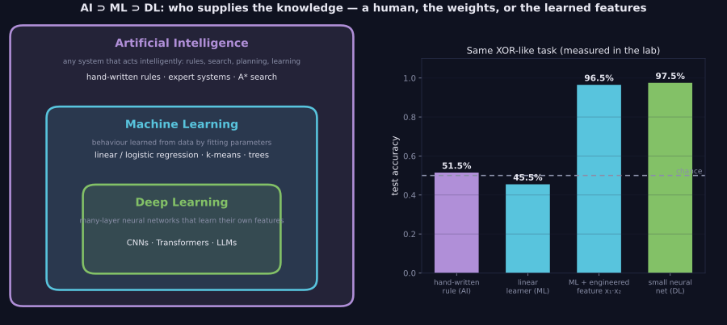

> Tier 2 — Machine Learning Fundamentals · Status: DRAFT (Author: Claude) · Code: `code/mlkit.py`, `lab/lab_01_paradigms_and_data.py` — TESTED

# 2.1 Artificial Intelligence vs Machine Learning vs Deep Learning

**Metadata** — Tier: 2 · Phase: 1 · Priority: P0 · Difficulty: 1/5 · Interview: High · Hands-on: Low
Prerequisites: Tier 1 · Leads to: 2.2–2.6, Tiers 3, 8, 16

### 1. What is it?
Three nested terms:
- **Artificial Intelligence (AI):** any system that performs tasks we associate with intelligence: search, planning, rules/expert systems, learning.
- **Machine Learning (ML):** the subset of AI where behaviour is *learned from data* by fitting parameters, instead of being written by hand.
- **Deep Learning (DL):** the subset of ML that uses many-layer neural networks that learn their own intermediate features.

Large language models and most generative AI are deep-learning systems.

### 2. Why does it exist?
Writing rules by hand works when the rules are known and few. It fails for perception, language and anything with too many edge cases. ML replaces "write the rule" with "show examples and fit a function". DL replaces "design the features" with "learn the features".

### 3. Detailed explanation
- **What changed between the three:** who supplies the knowledge. AI-by-rules: a human writes it. Classical ML: a human designs features, the algorithm learns weights. DL: the network learns features and weights end to end.
- **Not every AI system is ML** (a chess engine using search and a hand-written evaluation is AI without learning), and **not every ML system is deep** (linear/logistic regression, k-means, gradient-boosted trees).
- **Data/compute trade-off:** DL typically needs much more data and compute but handles unstructured inputs (pixels, audio, text) where hand-made features are hard. On small tabular data, simpler ML often wins.
- **Terminology discipline (see `GLOSSARY.md`):** "agent" and "AI system" are not synonyms for "LLM". Use "model" for the learned function and "system" for everything around it.
- **Demonstration (XOR-like task, 400 train / 200 test):** a plausible hand-written rule scores 51.5%; a linear learner 45.5% (it cannot represent the interaction); the same learner with one engineered feature (`x₁·x₂`) 96.5%; a small neural network that learns the feature itself 97.5%.

### 4. How does it work?
The common pipeline: define a task → collect data → choose a model family → define a loss (2.17) → fit parameters by optimization (2.19) → evaluate on unseen data (2.13) → deploy and monitor (2.34). The rule-based, classical ML and DL variants differ only in what the "model family" step supplies.

> **Figure 2.1-1 — AI contains ML contains DL, and the XOR ladder**



*How to read it:* Left: the three terms are nested. Right: one XOR-like task solved four ways (measured in the lab): a hand-written rule scores 51.5% (chance), a linear learner 45.5%, the same learner with one engineered feature 96.5%, and a small neural network that learns the feature itself 97.5%.

*Generated by* `tier-02-ml-fundamentals/figures/src/t2_basics.py` *from this chapter's code, so the numbers are computed, not typed in.*

### 5. Simple example
A recipe written by a chef (AI by rules) vs a cook who learns recipes by tasting many dishes (ML) vs a cook who also invents which ingredients matter (DL).

### 6. Technical example
Fraud detection: a rule ("block if amount > $5,000") is AI without ML; a logistic regression on engineered features is classical ML; a sequence model on raw transaction histories is DL.

### 7. Code
```python
import numpy as np, mlkit as M
from lab_01_paradigms_and_data import ex_2_1, tiny_mlp_fit
print(ex_2_1())
# {'rule_based': 0.515, 'linear_ml': 0.455, 'ml_with_engineered_feature': 0.965, 'neural_net': 0.975}
```
TESTED (`lab/test_lab_01_paradigms_and_data.py::test_ai_ml_dl_ladder_on_xor_task`).

### 8. Input → Process → Output
`task + data (or rules) → model family → fitted behaviour → predictions`

### 9. Enterprise use case
Teams choose the *simplest* approach that meets the requirement: rules for stable policies, classical ML for tabular prediction, DL/LLMs for text, images and audio. Mixed systems (rules as guardrails around a model) are common.

### 10. AI engineering connection
Everything later in this book is DL-based AI engineering (Tiers 3–15) or systems built around DL models (Tiers 16+). The ML fundamentals in this tier (splits, losses, metrics, leakage) apply unchanged to LLM evaluation.

### 11. Advantages
Shared vocabulary; helps pick the right tool and cost level.

### 12. Limitations
Boundaries are blurry (a transformer plus a rule-based router is both); the terms are marketing-diluted.

### 13. Trade-offs
Rules: transparent, no data needed, brittle. ML: adaptable, needs data/labels. DL: powerful on unstructured data, needs scale, harder to interpret.

### 14. Common mistakes
Calling every product 'AI' or every model 'deep learning'; defaulting to DL for small tabular data; skipping a simple baseline (2.46); treating 'AI' as a single technology.

### 15. Performance / cost
Compute and data cost rise from rules → classical ML → DL. Always compare against a cheap baseline before paying for a bigger model.

### 16. Security
Learned systems inherit data biases and are attackable (poisoning, adversarial inputs); rule systems have predictable but exploitable gaps. Both need testing.

### 17. Interview explanation
"AI is the broad goal of machines doing intelligent tasks; machine learning is the part where the behaviour is learned from data instead of hand-coded; deep learning is ML using many-layer neural networks that learn their own features. LLMs sit inside deep learning. I'd still start with a simple baseline, because on small tabular data a linear model or trees often beats a neural net."

### 18. Rapid-fire
AI ⊃ ML ⊃ DL: AI = intelligent behaviour, ML = learned from data, DL = learned with deep neural nets.

### 19. Interview questions
- Basic: Define AI, ML and DL and how they relate.
- Intermediate: Give an AI system that is not ML, and an ML system that is not DL.
- Advanced: Why do deep models need more data than linear models? What do they give in return?
- Scenario: A team wants an LLM to validate postal codes. What do you recommend instead and why?

### 20. Hands-on exercise
Re-run `ex_2_1` with 40 instead of 400 training points. Which approach degrades most and why?

### 21. Revision questions
1) Which term is the broadest? 2) What does DL learn that classical ML needs humans for? 3) Name one non-ML AI technique.

### 22. Related concepts
2.2–2.6 Learning paradigms · 2.46 Baseline models · Tier 3 Neural networks

### 23. Memory hook
**Rules write behaviour by hand; ML fits it from examples; DL also learns the features.**
