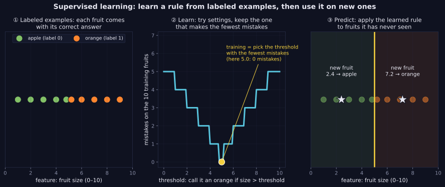
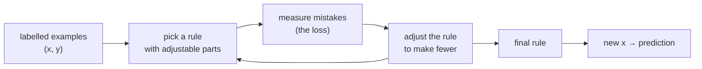

> Tier 2 · Machine Learning Fundamentals · **Level: beginner** · Reading time: about 8 minutes

# 2.2 Supervised learning

**Metadata** — Tier: 2 · Phase: 1 · Priority: P0 · Difficulty: 1/5 · Interview: Very high · Hands-on: Very high
Prerequisites: 2.1 What is machine learning · Leads to: 2.14 Classification, 2.15 Regression, 2.17 Loss functions, Tier 10 Fine-tuning

> **In plain words**
> **Supervised learning** means learning from examples that already come with the right answer.
> You show the computer many fruit with the answer "apple" or "orange" written on each. It finds a rule. Then you give it a new fruit it has never seen and it answers.
> "Supervised" just means someone supplied the answers.

**You need first:** nothing beyond knowing what a list of numbers is. The idea of machine learning (2.1) helps but is explained again below.

> **Figure 2.2-1 — learn from labelled examples, then predict new ones**
>
> 
>
> *How to read it:* **Panel ①** — each dot is a fruit placed by its size; its colour is its **label** (the right answer). **Panel ②** — we try many thresholds ("orange if bigger than this"); the curve counts mistakes on the ten fruit, and training picks the lowest point (5.0: 0 mistakes). **Panel ③** — the learned rule is applied to two new fruit it never saw: size 2.4 is called an apple, size 7.2 an orange.
>
> *Generated by* `tier-02-ml-fundamentals/figures/src/fig_2_02_supervised_learning.py`.

**Words you'll meet on this page**

| Word | What it means here |
|---|---|
| example | one item we learn from, such as one fruit |
| feature (`x`) | what we measure about an example (here: its size) |
| label (`y`) | the correct answer for that example (apple or orange) |
| training data | the examples with labels we learn from |
| model | the rule that turns a feature into an answer |
| prediction | the answer the model gives for a new example |
| classification / regression | the answer is a category / the answer is a number |

### 1. What is it?
Learning a function from **labelled examples** `(x, y)` so that it predicts `y` for a new `x`. The labels are the "supervision": during training the model is told what the right answer was.

### 2. Why does it exist?
Writing rules by hand is hard (what exactly makes an email spam?). But collecting past cases with known outcomes is often easy. Supervised learning turns those past cases into a rule that works on new ones.

### 3. Detailed explanation
1. **Two kinds of answer.** If the answer is a category (apple / orange, spam / not spam) it is **classification** (2.14). If it is a number (a price, a temperature) it is **regression** (2.15).
2. **Learning means finding the rule that makes the fewest mistakes** on the training examples. A *loss* (2.17) is the score for how wrong the rule is; lower is better.
3. **The real test is new data.** A rule that only works on the examples it studied is useless, like a student who memorised the answers. So we always keep some labelled examples **hidden** and check the rule on them (2.13).
4. **Labels are the expensive part.** Someone has to supply them. That is why methods that need fewer labels exist (2.4, 2.5).
5. **Assumption:** new data should look like the training data. If the world changes, the rule can fail (2.34).
6. **Fine-tuning a large language model** on question–answer pairs is also supervised learning (Tier 10).

### 4. How does it work?



### 5. Simple example — apples and oranges by size
We measured the size of ten fruit and wrote down what each one is:

| Apples (size) | 1.0 | 2.0 | 3.0 | 4.0 | 4.8 |
|---|---|---|---|---|---|
| **Oranges (size)** | 5.2 | 6.0 | 7.0 | 8.0 | 9.0 |

**Our rule has one adjustable part: a threshold.** "If size is below the threshold, say apple; otherwise say orange."

**Learning = trying thresholds and counting mistakes.**

| Threshold | Apples wrongly called oranges | Oranges wrongly called apples | Total mistakes |
|---|---|---|---|
| 2.5 | 3 (sizes 3.0, 4.0, 4.8) | 0 | 3 |
| 4.5 | 1 (size 4.8) | 0 | 1 |
| 5.0 | 0 | 0 | **0** |
| 6.5 | 0 | 2 (sizes 5.2, 6.0) | 2 |

The threshold 5.0 (halfway between the largest apple, 4.8, and the smallest orange, 5.2) makes **zero** mistakes, so that is our learned rule.

**Using it.** A new fruit of size 2.4 is below 5.0, so we answer *apple*. A new fruit of size 7.2 is above, so we answer *orange*. We never needed anyone to tell us these two answers; that is the point.

### 6. Technical example
A spam filter. Each email is turned into numbers (for example, how many times "free" appears). Thousands of emails are labelled spam or not spam by people. A model such as logistic regression finds the rule, which is then applied to every new email.

### 7. Code
The same fruit problem three ways.

**① By hand (plain Python, no libraries).** Try every sensible threshold and keep the best.

```python
apples = [1.0, 2.0, 3.0, 4.0, 4.8]
oranges = [5.2, 6.0, 7.0, 8.0, 9.0]

def mistakes(threshold):
    wrong_apples = sum(1 for s in apples if s >= threshold)      # apples we called oranges
    wrong_oranges = sum(1 for s in oranges if s < threshold)     # oranges we called apples
    return wrong_apples + wrong_oranges

sizes = sorted(apples + oranges)
candidates = [(a + b) / 2 for a, b in zip(sizes, sizes[1:])]    # halfway between neighbours
best = min(candidates, key=mistakes)
print("best threshold:", round(best, 2), "mistakes:", mistakes(best))

for new_size in (2.4, 7.2):
    print(new_size, "->", "apple" if new_size < best else "orange")
```

```text
best threshold: 5.0 mistakes: 0
2.4 -> apple
7.2 -> orange
```

**② With NumPy.** The same search without writing the loops.

```python
import numpy as np

sizes = np.array([1.0, 2.0, 3.0, 4.0, 4.8, 5.2, 6.0, 7.0, 8.0, 9.0])
is_orange = np.array([0, 0, 0, 0, 0, 1, 1, 1, 1, 1])

order = np.sort(sizes)
candidates = (order[:-1] + order[1:]) / 2
errors = [np.sum((sizes >= t) != is_orange) for t in candidates]
best = candidates[int(np.argmin(errors))]
print("best threshold:", round(float(best), 2), "mistakes:", min(errors))

new = np.array([2.4, 7.2])
print("predictions (1 = orange):", (new >= best).astype(int))
```

```text
best threshold: 5.0 mistakes: 0
predictions (1 = orange): [0 1]
```

**③ With scikit-learn.** A library that does the learning for you. It learns a smooth rule (logistic regression, 2.14) rather than a hard threshold, but the idea is the same: fit on labelled data, then predict.

```python
import numpy as np
from sklearn.linear_model import LogisticRegression

X = np.array([1.0, 2.0, 3.0, 4.0, 4.8, 5.2, 6.0, 7.0, 8.0, 9.0]).reshape(-1, 1)
y = np.array([0, 0, 0, 0, 0, 1, 1, 1, 1, 1])               # 0 = apple, 1 = orange

model = LogisticRegression(C=1000).fit(X, y)                  # "fit" = learn from labelled examples
print("training accuracy:", model.score(X, y))
print("predictions for 2.4 and 7.2:", model.predict([[2.4], [7.2]]))
```

```text
training accuracy: 1.0
predictions for 2.4 and 7.2: [0 1]
```

*Notice:* all three follow the same two steps, **fit** on labelled examples and then **predict** on new ones.

### 8. Input → Process → Output
`labelled examples (x, y)` → *fit: find the rule with the fewest mistakes* → `rule f` → `f(new x)` → *prediction*

<details>
<summary><b>Beyond the basics (sections 9–16)</b> — real-world use, limits, mistakes. Skip on a first read.</summary>

### 9. Enterprise use case
Customer churn prediction, credit risk, demand forecasting, document sorting, defect detection: any place with history and known outcomes.

### 10. AI engineering connection
Reward models, safety classifiers (Tier 32), rerankers (Tier 21), evaluators and instruction-tuned language models are all supervised models.

### 11. Advantages
Clear goal, solid theory, and easy to check the answers against labels.

### 12. Limitations
Needs labels; learns only what the labels reflect, including their mistakes and biases; gets worse if the world changes.

### 13. Trade-offs
More labels help but cost money. Cheap, automatic labels are noisier (2.8).

### 14. Common mistakes
Judging the model on the examples it trained on; letting the answer leak into the features (2.33); ignoring label quality; having no simple baseline to compare against.

### 15. Performance / cost
Training cost grows with data size and model size. Getting labels is often the biggest cost of all.

### 16. Security
Someone who can tamper with the labels can corrupt the model. Protect the labelling process and audit a sample.

</details>

### 17. Interview explanation
"Supervised learning fits a function to input–label pairs by minimising a loss, and I check it on held-out data. Classification predicts categories and regression predicts numbers. The main costs are getting labels and making sure training data matches what we see in production."

### 18. Rapid-fire answer
Learn `f(x) → y` from labelled pairs by minimising a loss; evaluate on unseen data.

### 19. Interview questions
- **Basic:** What is supervised learning? What are the two task types?
- **Intermediate:** Why do we need a train/test split?
- **Advanced:** How do squared error and cross-entropy follow from maximum likelihood?
- **Scenario:** You have 500 labels and 500,000 unlabelled rows. What are your options?

### 20. Hands-on exercise
**Goal:** see that learning needs the groups to be different.

1. Use the NumPy code from section 7.
2. Add one confusing fruit: an apple of size 5.5.
3. Re-run the threshold search. How many mistakes does the best threshold make now? Can any single threshold get 0?

<details>
<summary>Show a solution</summary>

```python
import numpy as np

sizes = np.array([1.0, 2.0, 3.0, 4.0, 4.8, 5.5, 5.2, 6.0, 7.0, 8.0, 9.0])
is_orange = np.array([0, 0, 0, 0, 0, 0, 1, 1, 1, 1, 1])      # the 5.5 fruit is an apple

order = np.sort(sizes)
candidates = (order[:-1] + order[1:]) / 2
errors = [int(np.sum((sizes >= t) != is_orange)) for t in candidates]
print("fewest mistakes:", min(errors))
print("best thresholds:", [round(float(t), 2) for t, e in zip(candidates, errors) if e == min(errors)])
```

```text
fewest mistakes: 1
best thresholds: [5.0, 5.75]
```

With the odd apple, one mistake is unavoidable: no single threshold can separate the groups. Real data is usually like this, which is why we measure the *amount* of error and test on unseen examples.
</details>

### 21. Revision questions
1. What does "supervision" mean?
2. What is the difference between a feature and a label?
3. Why do we keep some labelled examples hidden?

### 22. Related concepts
2.14 Classification · 2.15 Regression · 2.17 Loss functions · 2.4 Semi-supervised · 2.5 Self-supervised

### 23. One-line memory hook
**Supervised: learn from answered questions, then take the exam on new ones.**

<details>
<summary><b>For reviewers</b> (not part of the lesson)</summary>

- Status: DRAFT, learner-first pilot layout (Author: Claude).
- TESTED earlier: `ex_2_2` in `lab/lab_01_paradigms_and_data.py` (two Gaussian classes, 600 samples: logistic regression 91.4% train / 91.7% held-out vs 50% majority baseline) and `test_mlkit.py` (our logistic regression matches scikit-learn coefficients to 2e-2). Those results are no longer shown in the lesson body.
- The code blocks on this page are executed by `tests/test_md_snippets.py`; scikit-learn is used only as a library example here, as elsewhere in the book it is a test reference.
- The "maximum likelihood → squared error / cross-entropy" statement is kept as an interview question; the derivation lives in 1.35 and 2.17.
</details>
