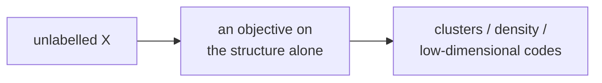

> Tier 2 · Machine Learning Fundamentals · **Level: beginner** · Reading time: about 9 minutes

# 2.3 Unsupervised learning

**Metadata** — Tier: 2 · Phase: 1 · Priority: P0 · Difficulty: 2/5 · Interview: Medium-High · Hands-on: High
Prerequisites: 2.1, 1.16, 1.32 · Leads to: 2.16 Clustering, embeddings (Tier 6), anomaly detection

> **In plain words**
> **Unsupervised learning** finds **patterns in data that has no answers attached**. Nobody tells the computer "this is a cat". It just looks at many items and discovers groups, unusual cases or compact summaries.
> Like sorting a pile of unlabelled photos into piles of similar-looking ones.

**You need first:** 2.1 (what ML is) and the idea of distance between points (1.16).

> **Figure 2.3-1 — grouping points without labels**
>
> ```mermaid
> flowchart LR
>     D["unlabelled points"] --> A["pick k group centres"]
>     A --> B["assign every point<br/>to its nearest centre"]
>     B --> C["move each centre to<br/>the middle of its points"]
>     C --> B
>     C --> E["stop when nothing moves:<br/>k groups found"]
> ```
>
> *How to read it:* this is **k-means**, the simplest clustering method. Nobody says which point belongs where; the algorithm finds groups by repeating "assign, then re-centre". Figure 2.16-1 (concept 2.16) shows the same loop as an animation.

**Words you'll meet on this page**

| Word | What it means here |
|---|---|
| cluster | a group of similar points |
| `k` | the number of clusters you ask for |
| centroid | the centre (mean) of a cluster |
| inertia | total squared distance from points to their centroid |
| elbow | the bend in the inertia-versus-`k` curve |
| density estimation | learning where data is common or rare |
| dimensionality reduction | summarising many features with a few |

### 1. What is it?
Learning structure from data **without labels**: grouping similar items, estimating how common different regions are, finding low-dimensional summaries, and flagging outliers.

### 2. Why does it exist?
Most data has no labels. Unsupervised methods reveal structure, compress data and create features without paying for labels.

### 3. Detailed explanation
- **Main families:** clustering (2.16), density estimation and anomaly detection, and dimensionality reduction or representation learning (for example principal components of the covariance matrix, 1.32/1.18/1.19).
- **No answer key, so evaluation is harder.** You rely on internal scores (inertia, silhouette), on stability across runs, on performance in a later task, or on human inspection. A cluster is only "right" if it is useful.
- **Choices matter:** the distance (1.16), feature scaling (2.47), the number of clusters, the starting points.
- **Elbow heuristic:** inertia always falls as `k` grows (more groups fit better). Look for the bend after which the drop becomes small.
- **Self-supervised learning (2.5)** is often lumped with unsupervised learning because it also uses no human labels. This book separates them because self-supervised methods *create* labels from the data.

### 4. How does it work?
Define a similarity or objective on the data alone (for example "minimise the distance between points and their cluster centre"), optimise it, then **interpret** the result.

### 5. Simple example
Sorting unlabelled photos into piles of similar ones. Or a shopkeeper looking at customers' monthly spending and noticing three natural groups: small, regular and big spenders. Nobody told them the groups.

**k-means by hand, with 1-D data.** Points `1, 2, 3, 10, 11, 12`, `k = 2`, starting centres `1` and `2`:

| Round | Centres | Assignment | New centres |
|---|---|---|---|
| 1 | 1 and 2 | {1}, {2, 3, 10, 11, 12} | 1 and 7.6 |
| 2 | 1 and 7.6 | {1, 2, 3}, {10, 11, 12} | 2 and 11 |
| 3 | 2 and 11 | same as round 2 | 2 and 11 (no change: stop) |

The two natural groups were found without any labels.

### 6. Technical example
Customer segmentation by behaviour; clustering support tickets; detecting unusual server metrics; compressing embeddings.

### 7. Code
**① By hand (plain Python).** k-means on 1-D data.

```python
points = [1, 2, 3, 10, 11, 12]
centres = [1.0, 2.0]                                   # starting guesses
for round_ in range(1, 6):
    groups = [[], []]
    for p in points:                                    # assign each point to the nearest centre
        nearest = min(range(2), key=lambda i: abs(p - centres[i]))
        groups[nearest].append(p)
    new_centres = [sum(g) / len(g) for g in groups]     # move each centre to the middle of its group
    print("round", round_, "groups", groups, "centres", [round(c, 2) for c in new_centres])
    if new_centres == centres:
        break
    centres = new_centres
```

```text
round 1 groups [[1], [2, 3, 10, 11, 12]] centres [1.0, 7.6]
round 2 groups [[1, 2, 3], [10, 11, 12]] centres [2.0, 11.0]
round 3 groups [[1, 2, 3], [10, 11, 12]] centres [2.0, 11.0]
```

**② With NumPy.** The same idea on 2-D data, and the elbow.

```python
import numpy as np

rng = np.random.default_rng(0)
X = np.vstack([rng.normal(0, 1, (200, 2)), rng.normal(6, 1, (200, 2))])      # two true groups

def kmeans(X, k, iters=50, seed=0):
    r = np.random.default_rng(seed)
    centres = X[r.choice(len(X), k, replace=False)]
    for _ in range(iters):
        d = ((X[:, None, :] - centres[None, :, :]) ** 2).sum(axis=2)         # (n, k) squared distances
        labels = d.argmin(axis=1)
        centres = np.array([X[labels == j].mean(axis=0) if (labels == j).any() else centres[j] for j in range(k)])
    return labels, ((X - centres[labels]) ** 2).sum()

for k in (1, 2, 3, 4, 6):
    print(f"k = {k}   inertia = {kmeans(X, k)[1]:8.1f}")
```

```text
k = 1   inertia =   8048.9
k = 2   inertia =    798.6
k = 3   inertia =    674.8
k = 4   inertia =    569.3
k = 6   inertia =    345.6
```

**③ With scikit-learn.**

```python
import numpy as np
from sklearn.cluster import KMeans

rng = np.random.default_rng(0)
truth = np.repeat([0, 1], 200)
X = np.vstack([rng.normal(0, 1, (200, 2)), rng.normal(6, 1, (200, 2))])
km = KMeans(n_clusters=2, n_init=10, random_state=0).fit(X)                  # never sees `truth`
agree = max(np.mean(km.labels_ == truth), np.mean(km.labels_ != truth))      # cluster numbers are arbitrary
print("clusters found without labels agree with the true groups:", round(float(agree), 3))
print("centres:", km.cluster_centers_.round(2).tolist())
```

```text
clusters found without labels agree with the true groups: 1.0
centres: [[5.96, 6.01], [-0.1, 0.02]]
```

### 8. Input → Process → Output



<details>
<summary><b>Beyond the basics (sections 9–16)</b> — real-world use, limits, mistakes. Skip on a first read.</summary>

### 9. Enterprise use case
Marketing segmentation, log and anomaly triage, de-duplication, and exploratory analysis before deciding what to label.

### 10. AI engineering connection
Clustering embeddings to organise corpora, topic discovery for RAG corpora, anomaly detection in LLM traffic, dimensionality reduction for vector stores.

### 11. Advantages
No labels needed; scales with raw data; exposes hidden structure.

### 12. Limitations
Results depend on the metric, the scaling and `k`; clusters may not match business categories; hard to validate.

### 13. Trade-offs
More clusters fit the data better but become less interpretable.

### 14. Common mistakes
Not scaling features; treating clusters as ground truth; choosing `k` by inertia alone; ignoring stability across random starts.

### 15. Performance / cost
k-means costs `O(n·k·d)` per iteration (distance computation dominates); use mini-batch variants at scale.

### 16. Security
Clusters of user data can reveal sensitive groupings; do a privacy review before use.

</details>

### 17. Interview explanation
"Unsupervised learning finds structure without labels: clustering, density estimation, dimensionality reduction. Since there is no answer key, I validate with stability, internal metrics and whether it helps a downstream task, and I'm careful to scale features first."

### 18. Rapid-fire answer
Structure discovery without labels: clustering, density, representation; judge it by usefulness.

### 19. Interview questions
- **Basic:** Give three unsupervised tasks.
- **Intermediate:** Why does inertia always decrease with `k`, and how do you choose `k` anyway?
- **Advanced:** How would you evaluate a clustering without labels?
- **Scenario:** Marketing wants "natural customer segments". What risks do you flag?

### 20. Hands-on exercise
**Goal:** check how stable k-means is on overlapping groups.

1. Make two groups whose centres are only 1.5 apart (so they overlap).
2. Run k-means with `k = 2` using 20 different random starts.
3. Print the smallest and largest inertia found. Are all runs equally good?

<details>
<summary>Show a solution</summary>

```python
import numpy as np
from sklearn.cluster import KMeans

rng = np.random.default_rng(0)
X = np.vstack([rng.normal(0, 1, (200, 2)), rng.normal(1.5, 1, (200, 2))])      # overlapping groups
inertias = [KMeans(2, n_init=1, init="random", random_state=s).fit(X).inertia_ for s in range(20)]
print("inertia over 20 starts: min", round(min(inertias), 1), " max", round(max(inertias), 1))
print("different local solutions found:", len({round(v, 1) for v in inertias}))
```

```text
inertia over 20 starts: min 643.3  max 643.4
different local solutions found: 2
```

Different starts can end in different solutions (here the two inertias are almost equal, but with more clusters or messier data the gap can be large); this is why libraries restart several times and keep the best (`n_init`).
</details>

### 21. Revision questions
1. Why is evaluation harder without labels?
2. What is the elbow heuristic?
3. How does unsupervised differ from self-supervised learning?

### 22. Related concepts
2.16 Clustering · 2.5 Self-supervised · 2.47 Feature scaling · 1.16 Distance metrics

### 23. One-line memory hook
**Unsupervised: find the shape of the data when nobody gave you the answers.**

<details>
<summary><b>For reviewers</b> (not part of the lesson)</summary>

- Status: DRAFT, learner-first layout (Author: Claude). Code is executed by `tests/test_md_snippets.py`.
- TESTED earlier: `ex_2_3` and `test_kmeans_recovers_blobs_and_inertia_decreases_with_k` (blobs `sep=6`: inertia 8049 at k=1, 799 at k=2, 661 at k=3, 354 at k=6; labels agree with the true groups 100%). The page's snippets use different data and seeds.
- PCA is mentioned as a dimensionality-reduction example; its roadmap status is the open PROPOSE_ADDITION.
</details>
