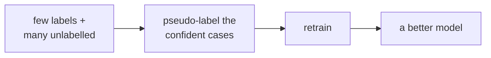

> Tier 2 · Machine Learning Fundamentals · **Level: beginner** · Reading time: about 8 minutes

# 2.4 Semi-supervised learning

**Metadata** — Tier: 2 · Phase: 1 · Priority: P1 · Difficulty: 2/5 · Interview: Medium · Hands-on: Medium
Prerequisites: 2.2, 2.3 · Leads to: pseudo-labelling in modern pipelines, LLM-generated labels (Tier 10)

> **In plain words**
> **Semi-supervised learning** uses **a few labelled examples plus lots of unlabelled ones**. Labels are expensive; raw data is cheap.
> The classic trick is **self-training**: learn from the few labels, predict the unlabelled data, **keep only the predictions you are very sure about** as new "pseudo-labels", then learn again.

**You need first:** 2.2 Supervised learning and 2.3 Unsupervised learning.

> **Figure 2.4-1 — the self-training loop**
>
> ```mermaid
> flowchart LR
>     L["few labelled examples"] --> T["train a model"]
>     T --> P["predict the unlabelled data"]
>     P --> C{"confident?<br/>(above a threshold)"}
>     C -->|yes| A["add as pseudo-labelled<br/>training examples"]
>     C -->|no| S["leave unlabelled"]
>     A --> T
> ```
>
> *How to read it:* the model teaches itself. Only the **confident** predictions are added to the training set. If the first model is bad, it confidently teaches itself wrong things, which is called **confirmation bias**, so a clean, never-pseudo-labelled validation set is essential.

**Words you'll meet on this page**

| Word | What it means here |
|---|---|
| labelled / unlabelled | with / without the correct answer |
| pseudo-label | a label the model itself guessed |
| confidence threshold | how sure the model must be to keep a guess |
| self-training | train, pseudo-label, retrain |
| confirmation bias | wrong guesses reinforcing themselves |
| consistency regularisation | predictions should not change under small input tweaks |

### 1. What is it?
Learning from a **small labelled set plus a large unlabelled set**, by letting the unlabelled data shape the model.

### 2. Why does it exist?
Labels cost money and time; unlabelled data is plentiful. Semi-supervised methods trade a little modelling assumption for a lot of free signal.

### 3. Detailed explanation
- **Self-training (pseudo-labelling):** train on the labelled data → predict the unlabelled data → add the **confident** predictions as pseudo-labels → retrain.
- **Consistency regularisation:** a prediction should not change if the input is slightly perturbed.
- **Assumptions:** points in the same dense region share a label (the cluster or smoothness assumption), and the first model must be reasonably good. If the assumptions fail, unlabelled data can **hurt**.
- **Confirmation bias:** wrong pseudo-labels reinforce themselves. Use a high threshold, few rounds, and a clean validation set.
- Labels generated by an LLM to train a smaller model are a modern pseudo-labelling; their errors propagate.

### 4. How does it work?
Loop: fit → score the unlabelled data → keep predictions above the confidence threshold → add them to the training set → refit. Stop when nothing changes.

### 5. Simple example
A student works through a few solved examples, then practises on unmarked problems she feels sure about, and learns from her own answers.

**With numbers.** In the scikit-learn run below, a model with only 10 labels scores about 98% on the test set; after self-training on 590 unlabelled points it scores about 99%. The gain is small, and it depends on the classes being well separated: the more the classes overlap, the less the unlabelled data helps.

### 6. Technical example
Medical imaging with a handful of expert-labelled scans and many unlabelled ones; text classification with a small seed set of labelled tickets.

### 7. Code
**① By hand (plain Python).** The loop with a toy model: "nearest labelled mean".

```python
import random

random.seed(0)
labelled = [(random.gauss(0, 1), 0) for _ in range(3)] + [(random.gauss(6, 1), 1) for _ in range(3)]
unlabelled = [random.gauss(0, 1) for _ in range(200)] + [random.gauss(6, 1) for _ in range(200)]
truth = [0] * 200 + [1] * 200

def means(data):
    return [sum(x for x, y in data if y == c) / sum(1 for _, y in data if y == c) for c in (0, 1)]

for round_ in range(3):
    m = means(labelled)
    pseudo = []
    for x in unlabelled:
        d0, d1 = abs(x - m[0]), abs(x - m[1])
        if abs(d0 - d1) > 3:                                    # confident: much closer to one mean
            pseudo.append((x, 0 if d0 < d1 else 1))
    labelled_plus = labelled + pseudo
    print(f"round {round_}: {len(pseudo)} pseudo-labels, centres now", [round(v, 2) for v in means(labelled_plus)])
    labelled = labelled_plus if round_ < 2 else labelled
```

```text
round 0: 369 pseudo-labels, centres now [-0.28, 6.07]
round 1: 372 pseudo-labels, centres now [-0.25, 6.09]
round 2: 373 pseudo-labels, centres now [-0.23, 6.1]
```

**② With scikit-learn.** Labelled-only versus self-training.

```python
import numpy as np
from sklearn.linear_model import LogisticRegression
from sklearn.semi_supervised import SelfTrainingClassifier

rng = np.random.default_rng(0)
X = np.vstack([rng.normal(0, 1, (400, 2)), rng.normal(3, 1, (400, 2))])
y = np.repeat([0, 1], 400)
order = rng.permutation(800)
X, y = X[order], y[order]
X_test, y_test = X[600:], y[600:]
X_train, y_train = X[:600], y[:600].copy()

y_partial = np.full(600, -1)                                     # -1 means "no label"
y_partial[:10] = y_train[:10]                                    # keep only 10 labels

labelled_only = LogisticRegression().fit(X_train[:10], y_train[:10])
print("labelled-only accuracy :", round(labelled_only.score(X_test, y_test), 3))
st = SelfTrainingClassifier(LogisticRegression(), threshold=0.9).fit(X_train, y_partial)
print("self-training accuracy :", round(st.score(X_test, y_test), 3))
n_pseudo = int((st.labeled_iter_ > 0).sum())
pseudo_ok = float(np.mean(st.transduction_[st.labeled_iter_ > 0] == y_train[st.labeled_iter_ > 0]))
print("pseudo-labels added:", n_pseudo, " of which correct:", round(pseudo_ok, 3))
```

```text
labelled-only accuracy : 0.98
self-training accuracy : 0.99
pseudo-labels added: 562  of which correct: 0.996
```

**③ With PyTorch.** The same idea with a small network: pseudo-label the confident cases and add them.

```python
import numpy as np
import torch

rng = np.random.default_rng(0)
X = np.vstack([rng.normal(0, 1, (400, 2)), rng.normal(3, 1, (400, 2))]).astype("float32")
y = np.repeat([0, 1], 400).astype("float32")
order = rng.permutation(800)
X, y = torch.tensor(X[order]), torch.tensor(y[order])
Xl, yl, Xu = X[:10], y[:10], X[10:600]

def train(X, y):
    torch.manual_seed(0)
    net = torch.nn.Linear(2, 1)
    opt = torch.optim.Adam(net.parameters(), lr=0.1)
    for _ in range(200):
        opt.zero_grad()
        torch.nn.functional.binary_cross_entropy_with_logits(net(X).squeeze(1), y).backward()
        opt.step()
    return net

acc = lambda net: (((net(X[600:]).squeeze(1)) > 0).float() == y[600:]).float().mean().item()
net = train(Xl, yl)
print("labelled-only accuracy:", round(acc(net), 3))
p = torch.sigmoid(net(Xu).squeeze(1)).detach()
confident = (p > 0.95) | (p < 0.05)
net2 = train(torch.cat([Xl, Xu[confident]]), torch.cat([yl, (p[confident] > 0.5).float()]))
print("pseudo-labels added:", int(confident.sum()), "  accuracy after self-training:", round(acc(net2), 3))
```

```text
labelled-only accuracy: 0.98
pseudo-labels added: 522   accuracy after self-training: 0.99
```

### 8. Input → Process → Output



<details>
<summary><b>Beyond the basics (sections 9–16)</b> — real-world use, limits, mistakes. Skip on a first read.</summary>

### 9. Enterprise use case
Reduces annotation spend: label a seed set, let the model pre-label, and have humans verify only the uncertain items (active-learning loops).

### 10. AI engineering connection
Synthetic and LLM-generated training data, distillation on unlabelled corpora, bootstrapping evaluation sets.

### 11. Advantages
Cuts labelling cost; uses abundant data.

### 12. Limitations
Can amplify mistakes; sensitive to the threshold and to class imbalance; the gains vanish if the first model is poor.

### 13. Trade-offs
A low threshold gives more data but more noise; a high threshold is cleaner but adds little new information.

### 14. Common mistakes
Evaluating on pseudo-labelled data; using no confidence threshold; ignoring class imbalance (the majority class dominates the pseudo-labels).

### 15. Performance / cost
Repeated retraining multiplies the training cost by the number of rounds.

### 16. Security
An adversary can plant unlabelled data to steer the pseudo-labels. Control the source of unlabelled data.

</details>

### 17. Interview explanation
"Semi-supervised learning uses a few labels plus lots of unlabelled data, for example self-training: predict, keep the confident predictions as pseudo-labels, retrain. It helps when classes are well separated, and it can backfire through confirmation bias, so I keep a clean validation set."

### 18. Rapid-fire answer
Few labels plus many unlabelled; self-training with confident pseudo-labels; the risk is confirmation bias.

### 19. Interview questions
- **Basic:** What is pseudo-labelling?
- **Intermediate:** Which assumption makes unlabelled data useful?
- **Advanced:** How do you stop pseudo-labelling from reinforcing errors?
- **Scenario:** You have 200 labelled and 2 million unlabelled support tickets. Design a pipeline.

### 20. Hands-on exercise
**Goal:** see how the confidence threshold changes the result.

1. Use the scikit-learn setup above (10 labels, 590 unlabelled).
2. Run `SelfTrainingClassifier` with thresholds 0.6, 0.8, 0.9 and 0.99.
3. Print the number of pseudo-labels, their accuracy and the test accuracy.

<details>
<summary>Show a solution</summary>

```python
import numpy as np
from sklearn.linear_model import LogisticRegression
from sklearn.semi_supervised import SelfTrainingClassifier

rng = np.random.default_rng(0)
X = np.vstack([rng.normal(0, 1, (400, 2)), rng.normal(3, 1, (400, 2))])
y = np.repeat([0, 1], 400)
order = rng.permutation(800)
X, y = X[order], y[order]
y_partial = np.full(600, -1)
y_partial[:10] = y[:10]
for thr in (0.6, 0.8, 0.9, 0.99):
    st = SelfTrainingClassifier(LogisticRegression(), threshold=thr).fit(X[:600], y_partial)
    added = st.labeled_iter_ > 0
    print(f"threshold {thr}: pseudo-labels {int(added.sum()):>3}, correct {np.mean(st.transduction_[added] == y[:600][added]) if added.any() else float('nan'):.3f}, test accuracy {st.score(X[600:], y[600:]):.3f}")
```

```text
threshold 0.6: pseudo-labels 587, correct 0.988, test accuracy 0.985
threshold 0.8: pseudo-labels 576, correct 0.995, test accuracy 0.990
threshold 0.9: pseudo-labels 562, correct 0.996, test accuracy 0.990
threshold 0.99: pseudo-labels 325, correct 1.000, test accuracy 0.980
```

A very low threshold adds many guesses, including wrong ones; a very high one adds few. The best setting is usually in between and should be chosen on a clean validation set.
</details>

### 21. Revision questions
1. What is the core loop?
2. What is the main failure mode?
3. Why keep a clean validation set?

### 22. Related concepts
2.2 Supervised · 2.5 Self-supervised · 2.8 Labels · Tier 10 Fine-tuning

### 23. One-line memory hook
**Teach yourself from the cases you're sure about, and keep an outside examiner.**

<details>
<summary><b>For reviewers</b> (not part of the lesson)</summary>

- Status: DRAFT, learner-first layout (Author: Claude). Code is executed by `tests/test_md_snippets.py`.
- TESTED earlier: `test_self_training_uses_confident_pseudolabels` (10 labels, 800 unlabelled, 400 test: 96.0% labelled-only → 97.25% self-training; 714 pseudo-labels, 98.3% correct). The gain is small and seed-dependent, so the earlier test only asserts no harm and high pseudo-label accuracy.
- The page's snippets use different data and seeds, and gains here may be zero or negative on some runs; that is also a teaching point.
</details>
