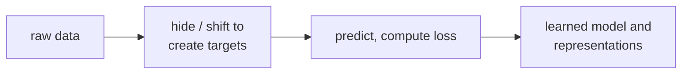

> Tier 2 · Machine Learning Fundamentals · **Level: beginner** · Reading time: about 9 minutes

# 2.5 Self-supervised learning

**Metadata** — Tier: 2 · Phase: 1 · Priority: P0 · Difficulty: 2/5 · Interview: Very high · Hands-on: Medium
Prerequisites: 2.2, 2.3, 1.33 · Leads to: Tier 6 Embeddings, Tier 8 Transformers, Tier 9 Pretraining

> **In plain words**
> In **self-supervised learning** the **labels come from the data itself**. Cover up part of the input and train the model to **guess the hidden part**: the next word in a sentence, a missing word, a missing patch of a picture.
> You get a huge amount of "supervised" training for free, from raw text. This is how large language models learn language before anyone fine-tunes them.

**You need first:** 2.2 Supervised learning and 1.33 Conditional probability ("the next word *given* the words so far").

> **Figure 2.5-1 — the data makes its own labels**
>
> ```mermaid
> flowchart LR
>     T["raw text:<br/>the cat sat on the mat"] --> I["input: the cat sat on the"]
>     T --> L["hidden label: mat"]
>     I --> M["model predicts the next word"]
>     M --> C["compare with the hidden label<br/>(cross-entropy loss)"]
> ```
>
> *How to read it:* no human labelled anything. We simply slide along the text, use everything before a position as the input and the word at that position as the answer. Every position in a large text becomes a free training example.

**Words you'll meet on this page**

| Word | What it means here |
|---|---|
| pretext task | the made-up prediction task (next word, masked word) |
| next-token prediction | guessing the word that comes next |
| masked prediction | guessing a hidden word from its context |
| contrastive learning | learning to match two views of the same thing |
| cross-entropy | the loss for predicted probabilities (1.37) |
| perplexity | `exp(cross-entropy)`: how many choices the model is torn between |
| foundation model | a big model pretrained this way, then adapted |

### 1. What is it?
Learning where the **labels are created automatically from the data itself**: hide part of the input and predict it (next token, masked token, missing image patch, a matching second view).

### 2. Why does it exist?
It turns huge amounts of unlabelled data into supervised-style training signals, which is how foundation models obtain their general abilities.

### 3. Detailed explanation
- **Pretext tasks:** next-token prediction (decoder language models), masked-token prediction (BERT-style), contrastive matching of two views of the same item, image-patch reconstruction.
- **Objective:** usually cross-entropy (1.37) on the hidden part, which is maximum likelihood (1.35) of the data under the model. **Perplexity** is `exp(cross-entropy)`.
- **Why it works:** to predict the hidden part well, the model must capture structure in the data (grammar, facts, correlations), so what it learns transfers to later tasks.
- **Scale is the point:** the labels are free, so the dataset can be as big as the whole corpus. This is the basis of Tier 9 (pretraining).
- **Caveat:** it learns the *statistics of the data*, including its errors and biases. Alignment and fine-tuning (Tier 10) shape behaviour afterwards.

### 4. How does it work?
Take raw data → create (input, target) pairs by masking or shifting → train with an ordinary supervised loss → reuse the learned model or representation.

### 5. Simple example
Reading a book with some words covered and guessing them. You learn the language without a teacher.

**A tiny worked case.** In the text "the cat sat on the mat", predicting the character after `t` gives these pairs: (`t` → `h`), (`t` → ` `), (`t` → `.`)... By counting, the model learns that after `t` the most common next character is `h`. That is a (very small) language model.

### 6. Technical example
GPT-style pretraining: at every position, predict the next token from the previous ones (autoregressive factorisation, 1.33).

### 7. Code
A character-level language model, built three ways.

**① By hand (plain Python).** Count what follows what.

```python
text = "the cat sat on the mat. the dog sat on the log. " * 20
pairs = list(zip(text, text[1:]))                    # (input character, hidden label)
print("first 5 (input -> label) pairs:", pairs[:5])

counts = {}
for a, b in pairs:
    counts.setdefault(a, {}).setdefault(b, 0)
    counts[a][b] += 1
after_t = counts["t"]
best = max(after_t, key=after_t.get)
print("after 't' the most common next character is:", repr(best), "-", after_t)
```

```text
first 5 (input -> label) pairs: [('t', 'h'), ('h', 'e'), ('e', ' '), (' ', 'c'), ('c', 'a')]
after 't' the most common next character is: 'h' - {'h': 80, ' ': 60, '.': 20}
```

**② With NumPy.** Probabilities, loss and perplexity.

```python
import numpy as np

text = "the cat sat on the mat. the dog sat on the log. " * 20
chars = sorted(set(text))
idx = {c: i for i, c in enumerate(chars)}
counts = np.zeros((len(chars), len(chars)))
for a, b in zip(text, text[1:]):
    counts[idx[a], idx[b]] += 1
P = counts / counts.sum(axis=1, keepdims=True)                    # P(next | current)

nll = -np.mean([np.log(P[idx[a], idx[b]]) for a, b in zip(text, text[1:])])
print("symbols:", len(chars), "   uniform-guess loss (nats):", round(float(np.log(len(chars))), 3))
print("bigram model loss (nats)    :", round(float(nll), 3), "   perplexity:", round(float(np.exp(nll)), 2))
```

```text
symbols: 14    uniform-guess loss (nats): 2.639
bigram model loss (nats)    : 0.697    perplexity: 2.01
```

**③ With PyTorch.** A tiny neural version: learn the same table by gradient descent.

```python
import torch

text = "the cat sat on the mat. the dog sat on the log. " * 20
chars = sorted(set(text))
idx = {c: i for i, c in enumerate(chars)}
x = torch.tensor([idx[a] for a in text[:-1]])
y = torch.tensor([idx[b] for b in text[1:]])

torch.manual_seed(0)
logits_table = torch.nn.Embedding(len(chars), len(chars))        # one row of scores per current character
opt = torch.optim.Adam(logits_table.parameters(), lr=0.1)
for _ in range(200):
    opt.zero_grad()
    loss = torch.nn.functional.cross_entropy(logits_table(x), y)
    loss.backward()
    opt.step()
print("loss after training (nats):", round(loss.item(), 3), "   perplexity:", round(float(torch.exp(loss)), 2))
```

```text
loss after training (nats): 0.701    perplexity: 2.02
```

*Notice:* no one wrote any labels. And the neural version reaches the same loss as the counting table, because it is learning the same thing.

### 8. Input → Process → Output



<details>
<summary><b>Beyond the basics (sections 9–16)</b> — real-world use, limits, mistakes. Skip on a first read.</summary>

### 9. Enterprise use case
Organisations pretrain or adapt models on their own unlabelled text and logs, then fine-tune on a small labelled set.

### 10. AI engineering connection
The foundation of LLMs, embedding models and many vision and speech models (Tiers 6, 8, 9, 13, 14).

### 11. Advantages
Uses unlimited unlabelled data; produces transferable representations.

### 12. Limitations
Expensive compute; inherits data biases; the objective is not truthfulness or helpfulness.

### 13. Trade-offs
Bigger models and more data improve the loss predictably, but the cost grows quickly.

### 14. Common mistakes
Calling it "unsupervised" without noting the generated targets; ignoring data quality and duplication; assuming low perplexity means factual accuracy.

### 15. Performance / cost
Pretraining dominates the cost; efficient data pipelines and mixed precision matter (Tier 4/9).

### 16. Security
Training data can contain private or poisoned content, and models can memorise and repeat it.

</details>

### 17. Interview explanation
"Self-supervised learning creates its own labels from the data, such as predicting the next token or a masked token. That lets us train on huge unlabelled corpora with an ordinary cross-entropy loss, and the resulting representations transfer to many tasks. LLM pretraining is the main example."

### 18. Rapid-fire answer
Labels come from the data itself (next or masked token); trained with cross-entropy; basis of foundation models.

### 19. Interview questions
- **Basic:** How is it different from supervised and unsupervised learning?
- **Intermediate:** What is the training target in next-token prediction?
- **Advanced:** Why does low perplexity not guarantee factual answers?
- **Scenario:** You have 50 GB of unlabelled internal documents. How could self-supervised learning help?

### 20. Hands-on exercise
**Goal:** see that more context gives better predictions.

1. Take the text above and split it 80% / 20% into train and test parts.
2. Build a **bigram** model (one character of context) and a **trigram** model (two characters of context) from the training part.
3. Compare their loss on the test part. Add a tiny count (+0.01) to avoid zero probabilities.

<details>
<summary>Show a solution</summary>

```python
import numpy as np
from collections import defaultdict

text = "the cat sat on the mat. the dog sat on the log. " * 20
cut = int(len(text) * 0.8)
train, test = text[:cut], text[cut:]
chars = sorted(set(text))

def fit(order):
    table = defaultdict(lambda: defaultdict(float))
    for i in range(order, len(train)):
        table[train[i - order:i]][train[i]] += 1
    return table

def loss(table, order):
    total = []
    for i in range(order, len(test)):
        row = table[test[i - order:i]]
        denom = sum(row.values()) + 0.01 * len(chars)
        total.append(-np.log((row[test[i]] + 0.01) / denom))
    return float(np.mean(total))

print("bigram  test loss (nats):", round(loss(fit(1), 1), 3))
print("trigram test loss (nats):", round(loss(fit(2), 2), 3))
```

```text
bigram  test loss (nats): 0.697
trigram test loss (nats): 0.237
```

More context lowers the loss on this very regular text. On a *tiny* real corpus a trigram would instead overfit (many unseen contexts), which is the same trade-off larger models face.
</details>

### 21. Revision questions
1. Where do the labels come from?
2. What is the typical loss?
3. Why does what is learned transfer to other tasks?

### 22. Related concepts
2.3 Unsupervised · 1.37 Cross-entropy · Tier 8 Transformers · Tier 9 Pretraining

### 23. One-line memory hook
**Self-supervised: hide a piece, guess it, and let the data grade itself.**

<details>
<summary><b>For reviewers</b> (not part of the lesson)</summary>

- Status: DRAFT, learner-first layout (Author: Claude). Code is executed by `tests/test_md_snippets.py`.
- TESTED earlier: `test_self_supervised_bigram_learns_from_unlabeled_text` (a 1,380-character toy text: NLL from `ln 15 = 2.71` uniform to 0.71, perplexity 2.03; after 't' the most likely next character is 'h'). The page uses a similar but different toy text, so its numbers differ.
</details>
