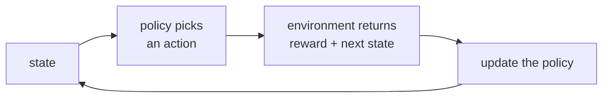

> Tier 2 · Machine Learning Fundamentals · **Level: beginner** · Reading time: about 10 minutes

# 2.6 Reinforcement learning overview

**Metadata** — Tier: 2 · Phase: 1 · Priority: P1 · Difficulty: 2/5 · Interview: Medium-High · Hands-on: Medium
Prerequisites: 2.2, 1.29 · Leads to: Tier 10 RLHF and alignment, Tier 26 Agents (decision loops)

> **In plain words**
> **Reinforcement learning (RL)** learns by **trial and error**. An **agent** tries an **action**, the **environment** answers with a **reward** (a score), and the agent adjusts to earn more reward over time. Nobody tells it the right answer; it only gets scored.
> Like training a dog with treats. The big tension is **explore** (try new things) versus **exploit** (repeat what already works).

**You need first:** 2.2 Supervised learning (to see the contrast) and 1.29 Expectation (an "average reward").

> **Figure 2.6-1 — the agent–environment loop**
>
> ```mermaid
> flowchart LR
>     A["agent<br/>(policy)"] -->|"action"| E["environment"]
>     E -->|"reward + new state"| A
> ```
>
> *How to read it:* the agent looks at the **state**, picks an **action** using its **policy** `π(a|s)`, and the environment returns a **reward** and the next state. Learning means changing the policy so that the total reward over time grows.

**Words you'll meet on this page**

| Word | What it means here |
|---|---|
| agent | the learner/decision-maker |
| environment | everything the agent interacts with |
| state `s`, action `a`, reward `r` | the situation, the choice, the score |
| policy `π(a\|s)` | the rule for choosing an action |
| return | the (discounted) sum of future rewards |
| exploration / exploitation | trying new options / using the best known one |
| bandit | RL with a single state: just "which lever to pull" |
| reward hacking | exploiting a flaw in the reward instead of doing the real task |

### 1. What is it?
Learning to act by **trial and error to maximise cumulative reward**. An *agent* observes a *state*, takes an *action*, receives a *reward* from the *environment*, and updates its *policy*.

### 2. Why does it exist?
Some problems have no labelled "right action", only delayed outcomes (win or lose, user satisfied or not). RL optimises behaviour against such signals.

### 3. Detailed explanation
- **Vocabulary:** state `s`, action `a`, reward `r`, policy `π(a|s)`, return (discounted sum of future rewards), value function, environment dynamics.
- **Exploration versus exploitation:** use what looks best now, but also try other options to discover better ones. A purely greedy agent can lock on to a mediocre option **forever**.
- **How it differs from supervised learning:** the feedback is *evaluative* (a score), not *instructive* (the correct answer); actions change what data you see next; deciding which earlier action deserves credit for a late reward (credit assignment) is hard.
- **In modern AI:** RLHF and preference optimisation adapt LLMs using reward signals (Tier 10). The "agents" of Tier 26 use decision loops, but most LLM agents are *not* trained with RL, so do not use the word "agent" loosely (`GLOSSARY.md`).
- **Safety:** optimising a proxy reward can be gamed ("reward hacking").

### 4. How does it work?
Loop: observe the state → choose an action (policy) → get a reward and next state → update the value or policy estimates → repeat. A **bandit** is the one-state special case.

### 5. Simple example
**A 3-armed bandit.** Three slot machines pay out with probabilities 0.2, 0.5 and 0.8, but you do not know which is which. Each pull gives reward 1 (win) or 0 (lose).

| Strategy | What it does | Result over thousands of pulls |
|---|---|---|
| **greedy** | always pulls the arm that looks best so far | sticks to the first arm that ever paid off (here arm 0, the *worst* one) and never learns about the others |
| **ε-greedy** (ε = 0.1) | 90% of the time pulls the best-looking arm, 10% a random arm | finds the 0.8 arm and uses it most of the time |

### 6. Technical example
Optimising an LLM against a learned reward model, while a KL penalty (1.38) keeps it close to the original model.

### 7. Code
**① By hand (plain Python).** Greedy versus ε-greedy on the 3-armed bandit.

```python
import random

def run(epsilon, steps=3000, seed=0, rates=(0.2, 0.5, 0.8)):
    rng = random.Random(seed)
    wins, pulls = [0, 0, 0], [0, 0, 0]
    total = 0
    for _ in range(steps):
        if rng.random() < epsilon:
            arm = rng.randrange(3)                                       # explore
        else:
            arm = max(range(3), key=lambda a: wins[a] / pulls[a] if pulls[a] else 0.0)   # exploit (untried arms look worth 0)
        reward = 1 if rng.random() < rates[arm] else 0
        wins[arm] += reward; pulls[arm] += 1; total += reward
    return total / steps, pulls[2] / steps

print("greedy (epsilon = 0), five different random seeds:")
for seed in range(5):
    avg, best_share = run(0.0, seed=seed)
    print(f"  seed {seed}: average reward {avg:.3f}, share of pulls on the best arm {best_share:.2f}")
avg, best_share = run(0.1, seed=0)
print(f"epsilon-greedy (0.1), seed 0: average reward {avg:.3f}, share on the best arm {best_share:.2f}")
```

```text
greedy (epsilon = 0), five different random seeds:
  seed 0: average reward 0.193, share of pulls on the best arm 0.00
  seed 1: average reward 0.205, share of pulls on the best arm 0.00
  seed 2: average reward 0.191, share of pulls on the best arm 0.00
  seed 3: average reward 0.190, share of pulls on the best arm 0.00
  seed 4: average reward 0.206, share of pulls on the best arm 0.00
epsilon-greedy (0.1), seed 0: average reward 0.767, share on the best arm 0.92
```

**② With NumPy.** Average over many seeds, to see the typical behaviour.

```python
import numpy as np

def run(epsilon, steps=2000, seed=0, rates=np.array([0.2, 0.5, 0.8])):
    rng = np.random.default_rng(seed)
    wins, pulls = np.zeros(3), np.zeros(3)
    total = 0.0
    for _ in range(steps):
        if rng.random() < epsilon:
            arm = int(rng.integers(3))
        else:
            arm = int(np.argmax(np.where(pulls > 0, wins / np.maximum(pulls, 1), 0.0)))
        r = float(rng.random() < rates[arm])
        wins[arm] += r; pulls[arm] += 1; total += r
    return total / steps

for eps in (0.0, 0.05, 0.1, 0.3):
    print(f"epsilon {eps:<4}: mean reward over 20 seeds = {np.mean([run(eps, seed=s) for s in range(20)]):.3f}   (best possible 0.8)")
```

```text
epsilon 0.0 : mean reward over 20 seeds = 0.203   (best possible 0.8)
epsilon 0.05: mean reward over 20 seeds = 0.771   (best possible 0.8)
epsilon 0.1 : mean reward over 20 seeds = 0.767   (best possible 0.8)
epsilon 0.3 : mean reward over 20 seeds = 0.709   (best possible 0.8)
```

**③ With PyTorch.** Learn a policy directly with the policy-gradient idea (REINFORCE).

```python
import torch

torch.manual_seed(0)
rates = torch.tensor([0.2, 0.5, 0.8])
prefs = torch.zeros(3, requires_grad=True)                 # the policy's preference for each arm
opt = torch.optim.Adam([prefs], lr=0.05)
for _ in range(2000):
    probs = torch.softmax(prefs, dim=0)
    arm = torch.multinomial(probs, 1).item()
    reward = float(torch.rand(1).item() < rates[arm].item())
    loss = -torch.log(probs[arm]) * reward                 # raise the probability of rewarded actions
    opt.zero_grad(); loss.backward(); opt.step()
print("learned policy (probability of each arm):", [round(p, 3) for p in torch.softmax(prefs, dim=0).tolist()])
```

```text
learned policy (probability of each arm): [0.0, 0.001, 0.999]
```

### 8. Input → Process → Output



<details>
<summary><b>Beyond the basics (sections 9–16)</b> — real-world use, limits, mistakes. Skip on a first read.</summary>

### 9. Enterprise use case
Recommendation and ad allocation (bandits), robotics, operations control, game AI. A/B testing is a simple exploration policy.

### 10. AI engineering connection
Preference tuning of LLMs (Tier 10), tool-use policies, exploration in online learning-to-rank.

### 11. Advantages
Optimises the real objective and handles sequences of decisions.

### 12. Limitations
Needs a lot of experience, can be unstable, and is sensitive to how the reward is designed. Hard to debug and evaluate.

### 13. Trade-offs
Exploration costs short-term reward; a higher ε explores more but exploits less.

### 14. Common mistakes
Badly specified rewards; evaluating only in the training environment; no exploration; calling any LLM that loops an "RL agent".

### 15. Performance / cost
Often needs millions of interactions; simulators are used to avoid real-world cost.

### 16. Security
Reward hacking, unsafe exploration in the real world, and manipulation of the feedback channel.

</details>

### 17. Interview explanation
"Reinforcement learning optimises behaviour from reward signals by trial and error. The key tension is exploration versus exploitation; a purely greedy agent can lock onto a bad option, as a simple bandit shows. In LLMs it shows up as RLHF, where a reward model scores outputs and a KL penalty keeps the model close to its base."

### 18. Rapid-fire answer
An agent–environment loop maximising cumulative reward; exploration versus exploitation; RLHF adapts LLMs.

### 19. Interview questions
- **Basic:** Name the five ingredients of RL.
- **Intermediate:** Why does a greedy policy fail on a bandit?
- **Advanced:** What is reward hacking, and how can it appear in RLHF?
- **Scenario:** Is a ReAct-style LLM tool loop reinforcement learning? Explain.

### 20. Hands-on exercise
**Goal:** compare a fixed ε with a decaying ε.

1. Use the NumPy bandit above.
2. Add a decaying exploration rate `ε_t = max(0.01, 1 / (1 + t/100))`.
3. Compare the mean reward over 20 seeds with the fixed ε = 0.1.

<details>
<summary>Show a solution</summary>

```python
import numpy as np

def run(epsilon_fn, steps=2000, seed=0, rates=np.array([0.2, 0.5, 0.8])):
    rng = np.random.default_rng(seed)
    wins, pulls, total = np.zeros(3), np.zeros(3), 0.0
    for t in range(steps):
        if rng.random() < epsilon_fn(t):
            arm = int(rng.integers(3))
        else:
            arm = int(np.argmax(np.where(pulls > 0, wins / np.maximum(pulls, 1), 0.0)))
        r = float(rng.random() < rates[arm])
        wins[arm] += r; pulls[arm] += 1; total += r
    return total / steps

fixed = np.mean([run(lambda t: 0.1, seed=s) for s in range(20)])
decay = np.mean([run(lambda t: max(0.01, 1 / (1 + t / 100)), seed=s) for s in range(20)])
print("fixed epsilon 0.1 :", round(float(fixed), 3))
print("decaying epsilon  :", round(float(decay), 3))
```

```text
fixed epsilon 0.1 : 0.767
decaying epsilon  : 0.757
```

In this run the fixed ε did slightly better: decaying exploration is not automatically superior, and the schedule has to be tuned for the problem. (It does stop wasting pulls on random arms late in a long run, which pays off when there are many more steps.)
</details>

### 21. Revision questions
1. What is the difference between evaluative and instructive feedback?
2. What is a policy?
3. Why use a simulator?

### 22. Related concepts
2.2 Supervised · 1.38 KL divergence · Tier 10 RLHF · Tier 26 AI agents

### 23. One-line memory hook
**RL: act, get scored, adjust, and keep exploring.**

<details>
<summary><b>For reviewers</b> (not part of the lesson)</summary>

- Status: DRAFT, learner-first layout (Author: Claude). Code is executed by `tests/test_md_snippets.py`.
- TESTED earlier: `test_bandit_needs_exploration` (3-armed bandit, rates 0.2/0.5/0.8, 3,000 steps: greedy average reward 0.199 and 0% best-arm share; ε = 0.1 gives 0.764 and 92%). The page's code uses its own implementation and seeds, so numbers differ.
- "Most LLM agents are not trained with RL" is inherited from the first draft (REVIEW_REQUIRED: wording).
</details>
