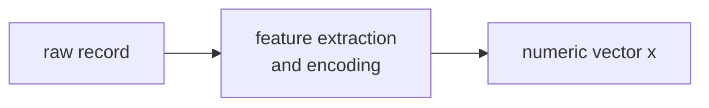

> Tier 2 · Machine Learning Fundamentals · **Level: absolute beginner** · Reading time: about 8 minutes

# 2.7 Features

**Metadata** — Tier: 2 · Phase: 1 · Priority: P0 · Difficulty: 1/5 · Interview: High · Hands-on: Very high
Prerequisites: 1.2, 1.3 · Leads to: 2.47 Scaling, 2.48 Feature engineering, 2.33 Leakage

> **In plain words**
> A **feature** is **one measurable fact about an example**: a house's area, an email's number of links, a customer's age. All the features of one example, written as a list of numbers, form its **feature vector**; all examples together form the **feature matrix `X`**.
> A model can only use what the features tell it. **Better features beat fancier algorithms** more often than you would expect.

**You need first:** 1.2 Vectors and 1.3 Matrices.

> **Figure 2.7-1 — from raw records to the feature matrix**
>
> ```mermaid
> flowchart LR
>     R["raw record<br/>house: 120 m², 3 rooms,<br/>built 2005, city = Pune"] --> F["extract and encode<br/>area, rooms, age,<br/>city one-hot"]
>     F --> V["feature vector<br/>[120, 3, 20, 1, 0, 0]"]
>     V --> X["stack many rows<br/>→ matrix X (n, 6)"]
> ```
>
> *How to read it:* each raw record becomes one **row** of numbers. Text-like facts (the city) must be turned into numbers (here one-hot: a 1 in the column of the city). The model never sees the original record, only this row.

**Words you'll meet on this page**

| Word | What it means here |
|---|---|
| feature | one input variable (a column of `X`) |
| feature vector | all features of one example (a row of `X`) |
| numeric / categorical | a number / a choice among categories |
| one-hot encoding | one 0/1 column per category |
| irrelevant (junk) feature | carries no signal; only adds noise |
| training/serving skew | features computed differently in training and in production |
| leakage | a feature that secretly contains the answer (2.33) |

### 1. What is it?
The **measurable input variables** that describe a sample; the columns of the feature matrix `X`, of shape `(n_samples, n_features)`.

### 2. Why does it exist?
A model only sees features. Their quality, scale and relevance set the ceiling for what any algorithm can achieve.

### 3. Detailed explanation
- **Types:** numeric (continuous, counts), categorical (one-hot or embeddings), ordinal, text (tokens or embeddings), image and audio (pixels, spectrograms), time-based (lags, rolling statistics).
- **Representation matters.** The XOR-like task (2.1) is impossible for a linear model on raw `(x₁, x₂)` but easy once `x₁·x₂` is added.
- **Irrelevant features add noise and variance.** Pure-noise columns make an unregularised model chase patterns that are not there.
- **Availability at prediction time.** A feature that is not known when you must predict (or is computed from the label) is **leakage** (2.33).
- **Scaling and encoding:** distance-based and gradient-based models need comparable scales (2.47); unseen categories need a policy.
- **Learned features:** deep networks and embeddings learn features instead of having them hand-designed (2.1, Tier 6).

### 4. How does it work?
Raw data → clean → encode → derive new features → feature matrix → model. The *same* transformations must run in training and in serving.

### 5. Simple example
The questions on a form: the answers you collect decide what decisions are possible.

**One house as a feature vector.**

| Fact | Kind | As a feature |
|---|---|---|
| area 120 m² | numeric | `120` |
| 3 rooms | numeric (count) | `3` |
| built 2005 (now 2025) | derived: age | `20` |
| city = Pune | categorical | one-hot over [Pune, Delhi, Goa] → `[1, 0, 0]` |

Feature vector: `[120, 3, 20, 1, 0, 0]`.

### 6. Technical example
A loan model: income, debt ratio, account age (numeric), employment type (categorical), number of recent late payments (count).

### 7. Code
**① By hand (plain Python).** Build a feature vector from a raw record.

```python
cities = ["Pune", "Delhi", "Goa"]

def to_features(record, year=2025):
    one_hot = [1 if record["city"] == c else 0 for c in cities]
    return [record["area"], record["rooms"], year - record["built"]] + one_hot

house = {"area": 120, "rooms": 3, "built": 2005, "city": "Pune"}
print(to_features(house))
print(to_features({"area": 80, "rooms": 2, "built": 2018, "city": "Goa"}))
```

```text
[120, 3, 20, 1, 0, 0]
[80, 2, 7, 0, 0, 1]
```

**② With NumPy and scikit-learn.** Junk features hurt, especially with little data.

```python
import numpy as np
from sklearn.linear_model import LogisticRegression

def accuracy(n_junk, n_train=100, seeds=10):
    scores = []
    for s in range(seeds):
        rng = np.random.default_rng(s)
        n = n_train + 2000
        y = rng.integers(0, 2, n)
        useful = rng.normal(0, 1, (n, 2)) + 2.0 * y[:, None]               # two informative features
        junk = rng.normal(0, 1, (n, n_junk))
        X = np.hstack([useful, junk])
        model = LogisticRegression(C=1e6, max_iter=2000).fit(X[:n_train], y[:n_train])   # almost no regularisation
        scores.append(model.score(X[n_train:], y[n_train:]))
    return float(np.mean(scores))

print("2 useful features             :", round(accuracy(0), 3))
print("2 useful + 60 pure-noise ones :", round(accuracy(60), 3))
```

```text
2 useful features             : 0.916
2 useful + 60 pure-noise ones : 0.775
```

**③ With PyTorch.** A categorical feature as a learned embedding (instead of one-hot).

```python
import torch

torch.manual_seed(0)
city_ids = torch.tensor([0, 2, 1, 0])                    # Pune=0, Delhi=1, Goa=2
embed = torch.nn.Embedding(num_embeddings=3, embedding_dim=2)
numeric = torch.tensor([[120., 3.], [80., 2.], [95., 3.], [60., 2.]])
x = torch.cat([numeric, embed(city_ids)], dim=1)         # 2 numeric + 2 learned columns
print("feature matrix shape:", tuple(x.shape))
```

```text
feature matrix shape: (4, 4)
```

### 8. Input → Process → Output



<details>
<summary><b>Beyond the basics (sections 9–16)</b> — real-world use, limits, mistakes. Skip on a first read.</summary>

### 9. Enterprise use case
Feature stores keep one definition of each feature for training and serving, with ownership, freshness and lineage.

### 10. AI engineering connection
Embeddings are learned features; structured-output extraction (Tier 19) produces features from text; RAG metadata filters are features.

### 11. Advantages
Direct control over what the model can see; cheap gains from good features.

### 12. Limitations
Hand-made features need domain knowledge and can encode bias (proxy variables).

### 13. Trade-offs
More features give more signal but also more noise, cost and leakage risk.

### 14. Common mistakes
Training/serving skew (different code paths); forgetting missing-value handling; including identifiers; features unavailable at prediction time.

### 15. Performance / cost
Feature computation often dominates serving latency; precompute or cache.

### 16. Security
Sensitive attributes (and close proxies) create legal and fairness risk. Log and review feature use.

</details>

### 17. Interview explanation
"Features are the inputs the model sees, the columns of X. Their quality and their availability at prediction time matter more than the algorithm, and irrelevant features add variance. I make sure features are computed identically in training and serving, and I check for leakage."

### 18. Rapid-fire answer
Features = model inputs (columns of X); relevance and availability at prediction time matter most.

### 19. Interview questions
- **Basic:** What is a feature? What is a feature vector?
- **Intermediate:** Why might adding features hurt accuracy?
- **Advanced:** What is training/serving skew, and how do you prevent it?
- **Scenario:** Your model uses "days since the last support ticket". What leakage check do you run?

### 20. Hands-on exercise
**Goal:** encode a small table.

1. Three loan applicants: `(income, city)` = `(50, "Pune")`, `(80, "Goa")`, `(65, "Pune")`, with cities `[Pune, Goa]`.
2. Write the feature matrix: the income as it is, plus the city one-hot encoded.
3. Check its shape.

<details>
<summary>Show a solution</summary>

```python
import numpy as np

cities = ["Pune", "Goa"]
rows = [(50, "Pune"), (80, "Goa"), (65, "Pune")]
X = np.array([[income] + [1 if city == c else 0 for c in cities] for income, city in rows])
print(X)
print("shape:", X.shape, "(3 examples, 1 numeric + 2 one-hot columns)")
```

```text
[[50  1  0]
 [80  0  1]
 [65  1  0]]
shape: (3, 3) (3 examples, 1 numeric + 2 one-hot columns)
```

</details>

### 21. Revision questions
1. What is the shape of `X`?
2. Name three kinds of feature.
3. What makes a feature "leaky"?

### 22. Related concepts
2.8 Labels · 2.47 Feature scaling · 2.48 Feature engineering · 2.33 Data leakage

### 23. One-line memory hook
**The model only knows what the features tell it.**

<details>
<summary><b>For reviewers</b> (not part of the lesson)</summary>

- Status: DRAFT, learner-first layout (Author: Claude). Code is executed by `tests/test_md_snippets.py`.
- TESTED earlier: `test_features_labels_samples_effects` (100 training rows, 60 added pure-noise columns: held-out accuracy 92.1% → 79.6% for an unregularised logistic regression, 10-seed average). The page's snippet uses a slightly different data generator, so its numbers differ.
- The XOR example is taught in 2.1 (single authoritative location) and only referenced here.
</details>
