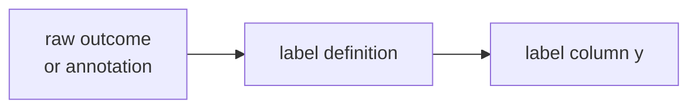

> Tier 2 · Machine Learning Fundamentals · **Level: absolute beginner** · Reading time: about 8 minutes

# 2.8 Labels

**Metadata** — Tier: 2 · Phase: 1 · Priority: P0 · Difficulty: 1/5 · Interview: High · Hands-on: High
Prerequisites: 2.2, 2.7 · Leads to: 2.10 Dataset construction, 2.37–2.43 Metrics, Tier 15 Evaluation

> **In plain words**
> A **label** is **the correct answer attached to an example**: "spam", "price = 250,000", "this reply is helpful". It is the `y` in `(x, y)`.
> A supervised model copies its labels, **mistakes included**. If the answer key is wrong, the student learns the wrong answers. So the quality of the labels sets a ceiling on the quality of the model.

**You need first:** 2.2 Supervised learning and 2.7 Features.

> **Figure 2.8-1 — where labels come from and how they go wrong**
>
> ```mermaid
> flowchart LR
>     S["sources:<br/>human annotators,<br/>logged outcomes,<br/>rules, other models"] --> L["label y"]
>     L --> P["problems:<br/>noise, bias,<br/>proxy labels, delay"]
>     L --> Q["quality controls:<br/>guidelines, several annotators,<br/>agreement checks, gold sets"]
> ```
>
> *How to read it:* labels come from several sources and each source has typical weaknesses. Teams add quality controls (clear written rules, more than one annotator, agreement measurements, trusted "gold" examples) to catch them.

**Words you'll meet on this page**

| Word | What it means here |
|---|---|
| label | the target value the model learns to predict |
| annotator | a person who assigns labels |
| label noise | wrong labels in the data |
| proxy label | a stand-in measure (clicks for satisfaction) |
| inter-annotator agreement | how often annotators agree |
| gold set | a small, carefully checked set of labels |
| weak supervision | cheap labels from rules or heuristics |

### 1. What is it?
The **target values** the model is trained to predict: classes, numbers, spans, rankings, preferences. The `y` in `(x, y)`.

### 2. Why does it exist?
Supervised learning is only as good as its labels. The model optimises agreement with whatever the labels say, right or wrong.

### 3. Detailed explanation
- **Sources:** human annotation; logged outcomes (clicked, defaulted); rules or heuristics (weak supervision); model-generated labels (pseudo-labels, LLM-as-annotator).
- **Proxy labels** measure something correlated with the real goal (clicks for satisfaction). Optimising the proxy can drift away from the goal.
- **Label noise hurts.** As more training labels are flipped at random, held-out accuracy falls; when half are flipped the labels carry no information and accuracy drops to chance. Noise in the *test* labels also caps the accuracy you can measure.
- **Delayed labels:** outcomes (fraud, churn) arrive weeks later, so training data is stale and must handle cases whose outcome is not yet known.
- **Quality controls:** written annotation guidelines, several annotators, agreement measures, gold sets, audits and versioned label definitions.
- **Class balance** of labels drives metric choice (2.45, 2.51).
- **LLM-generated labels** are cheap but share the model's biases; validate them on a human-labelled sample.

### 4. How does it work?
Define the label precisely → collect → check quality → freeze a versioned definition → split without leakage (2.10).

### 5. Simple example
The answer key of an exam. If the key has mistakes, students learn the mistakes.

**Majority vote and agreement.** Three annotators label five reviews:

| Review | Ann | Bo | Cy | Majority |
|---|---|---|---|---|
| 1 | pos | pos | pos | pos |
| 2 | pos | neg | pos | pos |
| 3 | neg | neg | neg | neg |
| 4 | pos | neg | neg | neg |
| 5 | pos | pos | neg | pos |

Reviews 2, 4 and 5 are disagreements, which often point to **ambiguous guidelines** rather than careless annotators.

### 6. Technical example
Sentiment classification: each review labelled positive or negative by three annotators with a majority vote; disagreement items are reviewed by an expert.

### 7. Code
**① By hand (plain Python).** Majority vote and raw agreement.

```python
votes = {1: "ppp", 2: "pnp", 3: "nnn", 4: "pnn", 5: "ppn"}      # p = positive, n = negative
agreements = 0
for review, v in votes.items():
    majority = "p" if v.count("p") >= 2 else "n"
    unanimous = len(set(v)) == 1
    agreements += unanimous
    print("review", review, "-> majority", majority, "(unanimous)" if unanimous else "(disagreement)")
print("unanimous on", agreements, "of", len(votes), "reviews")
```

```text
review 1 -> majority p (unanimous)
review 2 -> majority p (disagreement)
review 3 -> majority n (unanimous)
review 4 -> majority n (disagreement)
review 5 -> majority p (disagreement)
unanimous on 2 of 5 reviews
```

**② With NumPy and scikit-learn.** How much does label noise cost?

```python
import numpy as np
from sklearn.linear_model import LogisticRegression

def accuracy(flip, seeds=10, n_train=200):
    out = []
    for s in range(seeds):
        rng = np.random.default_rng(s)
        n = n_train + 2000
        y = rng.integers(0, 2, n)
        X = rng.normal(0, 1, (n, 2)) + 2.0 * y[:, None]
        y_noisy = y[:n_train].copy()
        flipped = rng.random(n_train) < flip
        y_noisy[flipped] = 1 - y_noisy[flipped]                       # corrupt only the TRAINING labels
        out.append(LogisticRegression().fit(X[:n_train], y_noisy).score(X[n_train:], y[n_train:]))   # test labels are clean
    return float(np.mean(out))

for flip in (0.0, 0.1, 0.2, 0.3, 0.4):
    print(f"{int(flip * 100):>2}% of training labels flipped -> held-out accuracy {accuracy(flip):.3f}")
```

```text
 0% of training labels flipped -> held-out accuracy 0.921
10% of training labels flipped -> held-out accuracy 0.918
20% of training labels flipped -> held-out accuracy 0.905
30% of training labels flipped -> held-out accuracy 0.895
40% of training labels flipped -> held-out accuracy 0.863
```

**③ With scikit-learn.** Measuring annotator agreement with Cohen's kappa.

```python
from sklearn.metrics import cohen_kappa_score

ann = ["pos", "pos", "neg", "pos", "pos"]
bo = ["pos", "neg", "neg", "neg", "pos"]
print("raw agreement:", sum(a == b for a, b in zip(ann, bo)) / len(ann))
print("Cohen's kappa (agreement beyond chance):", round(cohen_kappa_score(ann, bo), 3))
```

```text
raw agreement: 0.6
Cohen's kappa (agreement beyond chance): 0.286
```

### 8. Input → Process → Output



<details>
<summary><b>Beyond the basics (sections 9–16)</b> — real-world use, limits, mistakes. Skip on a first read.</summary>

### 9. Enterprise use case
Labelling programmes need budgets, tooling, guidelines, QA and versioning. Disagreement analysis often exposes ambiguous product requirements.

### 10. AI engineering connection
Preference labels for alignment (Tier 10); evaluation sets with gold answers (Tier 30); LLM judges (use with calibration).

### 11. Advantages
They provide the objective signal and improve directly with data investment.

### 12. Limitations
Subjective, expensive, biased and delayed; they define the problem as much as they measure it.

### 13. Trade-offs
Cheap noisy labels at scale versus expensive clean labels in small amounts; teams often mix both.

### 14. Common mistakes
Vague definitions; using the label to build features; mixing label versions; ignoring annotator disagreement; training and testing on the same noisy source.

### 15. Performance / cost
Annotation throughput is the usual bottleneck; active learning (label the uncertain cases) reduces it.

### 16. Security
Annotators may see sensitive data: manage access, consent and anonymisation. Adversarial labellers can poison data.

</details>

### 17. Interview explanation
"Labels are the targets the model learns. Their quality bounds model quality: I define them precisely, measure annotator agreement, and watch for proxy labels that drift from the real goal. Label noise hurts both training and the reliability of evaluation."

### 18. Rapid-fire answer
Labels = targets `y`; quality caps performance; watch noise, proxies and delay.

### 19. Interview questions
- **Basic:** Where do labels come from?
- **Intermediate:** What is a proxy label, and what can go wrong with it?
- **Advanced:** How do you estimate and handle label noise?
- **Scenario:** Fraud labels arrive 60 days late. How do you train and evaluate responsibly?

### 20. Hands-on exercise
**Goal:** find where noisy labels break a model.

1. Use the noise experiment above, but flip 0%, 10%, 20%, 30%, 40% and 50% of the training labels.
2. Print the held-out accuracy for each.
3. What do you expect at 50%, and why?

<details>
<summary>Show a solution</summary>

```python
import numpy as np
from sklearn.linear_model import LogisticRegression

def accuracy(flip, seeds=10, n_train=200):
    out = []
    for s in range(seeds):
        rng = np.random.default_rng(s)
        n = n_train + 2000
        y = rng.integers(0, 2, n)
        X = rng.normal(0, 1, (n, 2)) + 2.0 * y[:, None]
        y_noisy = y[:n_train].copy()
        f = rng.random(n_train) < flip
        y_noisy[f] = 1 - y_noisy[f]
        out.append(LogisticRegression().fit(X[:n_train], y_noisy).score(X[n_train:], y[n_train:]))
    return np.mean(out)

for flip in (0.0, 0.1, 0.2, 0.3, 0.4, 0.5):
    print(f"flip {flip:.0%}: accuracy {accuracy(flip):.3f}")
```

```text
flip 0%: accuracy 0.921
flip 10%: accuracy 0.918
flip 20%: accuracy 0.905
flip 30%: accuracy 0.895
flip 40%: accuracy 0.863
flip 50%: accuracy 0.630
```

At 50% the labels carry no information about `x`, so accuracy drops to about chance (0.5).
</details>

### 21. Revision questions
1. Name three sources of labels.
2. Why version the label definition?
3. What does label noise do to evaluation?

### 22. Related concepts
2.7 Features · 2.10 Dataset construction · 2.45 Class imbalance · Tier 10 Alignment

### 23. One-line memory hook
**Garbage labels in, confident garbage out.**

<details>
<summary><b>For reviewers</b> (not part of the lesson)</summary>

- Status: DRAFT, learner-first layout (Author: Claude). Code is executed by `tests/test_md_snippets.py`.
- TESTED earlier: `test_features_labels_samples_effects` (40% of training labels flipped: held-out accuracy 92.1% → 72.7%, 10-seed average). The page's snippet uses a different generator, so its numbers differ.
</details>
