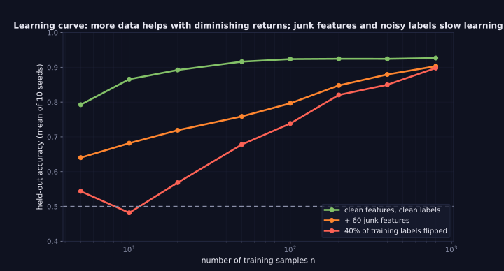
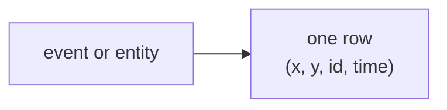

> Tier 2 · Machine Learning Fundamentals · **Level: absolute beginner** · Reading time: about 8 minutes

# 2.9 Samples

**Metadata** — Tier: 2 · Phase: 1 · Priority: P0 · Difficulty: 1/5 · Interview: Medium · Hands-on: High
Prerequisites: 2.7, 2.8, 1.27 · Leads to: 2.10, 2.11–2.13, 2.31 Generalisation, 2.44 Cross-validation

> **In plain words**
> A **sample** is **one example (one row) of your data**: one patient file, one email, one house with its answer. A dataset is a collection of samples.
> More samples help, but with **diminishing returns**, and **what kind** of samples you have (representative, independent, not duplicated) matters more than how many.

**You need first:** 2.7 Features, 2.8 Labels, 1.27 Random variables.

> **Figure 2.9-1 — a learning curve and what slows it**
>
> 
>
> *How to read it:* each point is the mean of 10 random repeats. With clean data, accuracy levels off near 93% after a few hundred samples (diminishing returns). Adding 60 junk features or flipping 40% of the training labels slows learning a lot at small sizes, and even at `n = 800` the two curves stay below the clean one (90.3% and 89.8% versus 92.7%).
>
> *Generated by* `tier-02-ml-fundamentals/figures/src/t2_basics.py`.

**Words you'll meet on this page**

| Word | What it means here |
|---|---|
| sample (example, row) | one `(x, y)` observation |
| i.i.d. | independent and identically distributed (1.27) |
| learning curve | accuracy plotted against training-set size |
| representative | looks like the data the model will meet later |
| sampling bias | the collected samples are not typical |
| duplicate / near-duplicate | the same example more than once |
| stratification | keeping class proportions when sampling |

### 1. What is it?
One **example, instance or row**: a single `(x, y)` observation. A dataset is a collection of samples assumed to be drawn from some data-generating process.

### 2. Why does it exist?
The number, diversity and representativeness of the samples decide how reliably patterns can be learned and measured.

### 3. Detailed explanation
- **The i.i.d. assumption (1.27):** most theory assumes samples are independent and identically distributed. It fails with time series, users who appear many times, duplicates and feedback loops.
- **Sample size (learning curve):** accuracy grows quickly at first and then flattens. Model capacity and noise set the ceiling.
- **Representativeness beats quantity.** Millions of samples from the wrong population still give a model of the wrong population (sampling bias).
- **Rare cases:** rare events (fraud, failures) need enough positive samples; use stratification (2.10) and targeted collection.
- **Duplicates and near-duplicates** inflate counts and can leak across the train/test split.
- **Terminology note:** in statistics, "sample" can mean a whole *set* of observations. In ML it usually means one row. This book uses "sample" for one row and "dataset" for the collection.

### 4. How does it work?
Collect → validate each row (schema, ranges, missing values) → remove duplicates → store with identifiers and timestamps → split.

### 5. Simple example
Each patient file in a clinical study is one sample.

**A learning curve in numbers.** In the run below, accuracy climbs steeply for the first tens of samples and then flattens: after about 100 samples, ten times more data adds very little.

### 6. Technical example
One training sample for an LLM is a tokenised sequence (or a prompt/response pair in fine-tuning).

### 7. Code
**① By hand (plain Python).** Why duplicates are dangerous: the same sample in both train and test.

```python
data = [("a", 1), ("b", 0), ("c", 1), ("d", 0), ("a", 1), ("c", 1)]        # "a" and "c" appear twice
print("rows:", len(data), " unique:", len(set(data)))
train = data[:4]
test = data[4:]
leaked = [row for row in test if row in train]
print("test rows that also appear in train:", leaked, "-> evaluation will look better than it should")
```

```text
rows: 6  unique: 4
test rows that also appear in train: [('a', 1), ('c', 1)] -> evaluation will look better than it should
```

**② With NumPy and scikit-learn.** A learning curve.

```python
import numpy as np
from sklearn.linear_model import LogisticRegression

def accuracy(n_train, seeds=10):
    out = []
    for s in range(seeds):
        rng = np.random.default_rng(s)
        n = n_train + 2000
        y = np.arange(n) % 2                                     # balanced, so even 5 samples contain both classes
        X = rng.normal(0, 1, (n, 2)) + 1.0 * y[:, None]
        out.append(LogisticRegression().fit(X[:n_train], y[:n_train]).score(X[n_train:], y[n_train:]))
    return float(np.mean(out))

for n in (5, 20, 100, 400):
    print(f"n = {n:>3}  -> held-out accuracy {accuracy(n):.3f}")
```

```text
n =   5  -> held-out accuracy 0.641
n =  20  -> held-out accuracy 0.744
n = 100  -> held-out accuracy 0.755
n = 400  -> held-out accuracy 0.756
```

**③ With scikit-learn.** The library's own learning-curve helper.

```python
import numpy as np
from sklearn.linear_model import LogisticRegression
from sklearn.model_selection import learning_curve

rng = np.random.default_rng(0)
y = rng.integers(0, 2, 1500)
X = rng.normal(0, 1, (1500, 2)) + 1.0 * y[:, None]
sizes, _, val = learning_curve(LogisticRegression(), X, y, train_sizes=[20, 100, 400, 1000], cv=5)
for n, v in zip(sizes, val.mean(axis=1)):
    print(f"train size {n:>4}: cross-validated accuracy {v:.3f}")
```

```text
train size   20: cross-validated accuracy 0.709
train size  100: cross-validated accuracy 0.747
train size  400: cross-validated accuracy 0.751
train size 1000: cross-validated accuracy 0.750
```

### 8. Input → Process → Output



<details>
<summary><b>Beyond the basics (sections 9–16)</b> — real-world use, limits, mistakes. Skip on a first read.</summary>

### 9. Enterprise use case
Data contracts define what a valid row is; sampling plans make sure segments, regions and time periods are all covered.

### 10. AI engineering connection
Prompt/response pairs, retrieved passages, conversation turns and tool traces are all "samples" for evaluation and fine-tuning datasets.

### 11. Advantages
A simple unit to count, weight, audit and trace.

### 12. Limitations
A sample may not be independent or representative; one row can hide a group structure.

### 13. Trade-offs
Collect more versus collect better; label more rows versus improve features.

### 14. Common mistakes
Counting duplicates as independent samples; ignoring sampling bias; random-splitting grouped data; drawing conclusions from a single small run.

### 15. Performance / cost
Sample count drives training cost; use learning curves to decide whether more data is worth it.

### 16. Security
Each sample may contain personal data: minimise it, anonymise it and set retention limits.

</details>

### 17. Interview explanation
"A sample is one row of data, an input and usually its label. More samples help with diminishing returns, but representativeness and independence matter more than raw count: duplicates and grouped data break the i.i.d. assumption and make evaluation optimistic."

### 18. Rapid-fire answer
Sample = one `(x, y)` row; representativeness and independence beat raw count.

### 19. Interview questions
- **Basic:** What is the difference between a sample, a feature and a label?
- **Intermediate:** What does a learning curve tell you?
- **Advanced:** How do duplicates distort evaluation?
- **Scenario:** Accuracy rose after you collected 10× more data from one region. Why might production still fail elsewhere?

### 20. Hands-on exercise
**Goal:** relate the learning-curve plateau to how separable the classes are.

1. Run the learning curve for class separations 0.5, 1.0 and 2.0 (the shift between the two classes' means).
2. Print the accuracy at `n` = 20 and `n` = 400 for each.
3. Which separation plateaus highest?

<details>
<summary>Show a solution</summary>

```python
import numpy as np
from sklearn.linear_model import LogisticRegression

def accuracy(n_train, sep, seeds=10):
    out = []
    for s in range(seeds):
        rng = np.random.default_rng(s)
        n = n_train + 2000
        y = np.arange(n) % 2
        X = rng.normal(0, 1, (n, 2)) + sep * y[:, None]
        out.append(LogisticRegression().fit(X[:n_train], y[:n_train]).score(X[n_train:], y[n_train:]))
    return np.mean(out)

for sep in (0.5, 1.0, 2.0):
    print(f"separation {sep}: n=20 -> {accuracy(20, sep):.3f}   n=400 -> {accuracy(400, sep):.3f}")
```

```text
separation 0.5: n=20 -> 0.588   n=400 -> 0.635
separation 1.0: n=20 -> 0.744   n=400 -> 0.756
separation 2.0: n=20 -> 0.909   n=400 -> 0.921
```

More data cannot push accuracy past what the classes' overlap allows: the plateau is set by how separable the problem is.
</details>

### 21. Revision questions
1. What does i.i.d. mean?
2. Why are there diminishing returns?
3. What is sampling bias?

### 22. Related concepts
2.10 Dataset construction · 2.31 Generalisation · 2.44 Cross-validation · 1.27 Random variables

### 23. One-line memory hook
**Quantity is a start; representativeness is the point.**

<details>
<summary><b>For reviewers</b> (not part of the lesson)</summary>

- Status: DRAFT, learner-first layout (Author: Claude). Code is executed by `tests/test_md_snippets.py`.
- TESTED earlier: `test_features_labels_samples_effects` (n=5 → 79.7%, n=20 → 88.9%, n=100 → 92.1%, n=400 → 92.4%; 10-seed averages). The page's snippets use a similar generator but different seeds, so their numbers differ slightly.
- Figure values (92.7% clean vs 90.3% junk vs 89.8% noisy at n = 800) are from the figure script.
</details>
