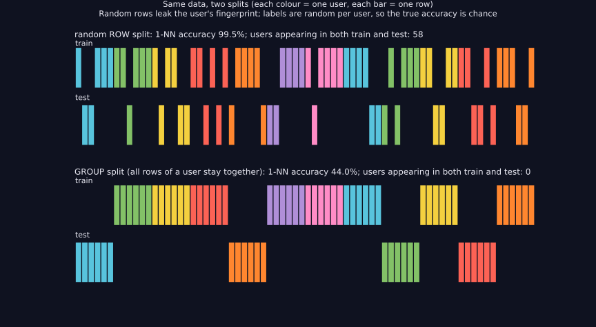
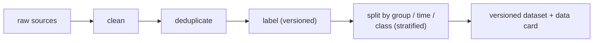
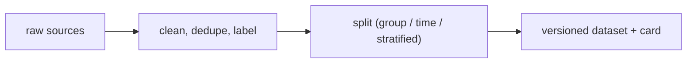

> Tier 2 · Machine Learning Fundamentals · **Level: beginner** · Reading time: about 10 minutes

# 2.10 Dataset construction

**Metadata** — Tier: 2 · Phase: 1 · Priority: P0 · Difficulty: 2/5 · Interview: High · Hands-on: Very high
Prerequisites: 2.7–2.9 · Leads to: 2.11–2.13, 2.33 Leakage, 2.34 Shift, Tier 38 Data engineering

> **In plain words**
> **Dataset construction** is turning raw, messy data into a **clean, documented, split, leak-free dataset** you can train and fairly test on.
> The single most important rule: **split your data by the thing you need to generalise to** (new users, new documents, the future). If the same user appears on both sides of the split, the model can *recognise* the user instead of *learning* anything, and your score will look wonderful and mean nothing.

**You need first:** 2.7 Features, 2.8 Labels, 2.9 Samples.

> **Figure 2.10-1 — random row split versus group split**
>
> 
>
> *How to read it:* each colour is one **user** and each bar one row. A random row split puts rows of the same user in train *and* test (58 of 60 users appear on both sides in the lab), so a nearest-neighbour model looks 99.5% accurate just by recognising users. A group split keeps each colour on one side; with labels that are random per user, the honest accuracy is chance (44%).
>
> *Generated by* `tier-02-ml-fundamentals/figures/src/t2_basics.py`.

**Words you'll meet on this page**

| Word | What it means here |
|---|---|
| split | dividing data into train / validation / test |
| group split | all rows of one user (or document) go to the same side |
| time split | train on the past, test on the future |
| stratified split | each side keeps the class proportions |
| leakage | information from the test side reaching training (2.33) |
| deduplication | removing repeated or near-identical rows |
| data card | a document describing how a dataset was built |

### 1. What is it?
The process of turning raw data into a **documented, versioned, split, leakage-safe** dataset for training and evaluation: define the task, collect, clean, deduplicate, label, split, document.

### 2. Why does it exist?
Models inherit every flaw of the dataset. Most real-world ML failures trace back to data construction, not to the algorithm.

### 3. Detailed explanation
**Steps**
1. Define the unit of prediction, the target, and the *time* at which you must predict.
2. Collect and join sources, keeping timestamps.
3. Clean: schema, ranges, units, missing values.
4. Deduplicate (exact and near-duplicates).
5. Label with versioned definitions (2.8).
6. **Split** (2.11–2.13), respecting groups and time.
7. Document: provenance, intended use, known gaps.
8. Version and checksum the result.

**Split by the unit that must generalise.** If users appear in many rows, a random row split puts the same user into train and test. **Time-based splits** suit forecasting or anything that evolves: train on the past, test on the future. **Stratification** keeps class proportions in each split, important for rare classes.

**Point-in-time correctness:** features must be computed using only information that existed at prediction time.

**Documentation** (datasheets or data cards): purpose, collection method, coverage, label process, licences, limitations. **Fixed seeds and stored split indices** make experiments reproducible.

### 4. How does it work?
Write the dataset recipe as **code** (not a notebook-only process), run it deterministically, and store the output with a version hash.



### 5. Simple example
Preparing exam questions: choose representative questions, remove duplicates, keep the answer key separate, and never reuse practice questions on the final exam.

**Why group splits matter, in numbers.** 60 users × 10 rows each. Each user's label is random (nothing to learn!). A nearest-neighbour model that just *remembers* users:
- on a **random row split**: scores near 100%, because it has seen that user's other rows;
- on a **group split**: scores about 50% (chance), the honest answer (with only a few users in the test side the number is noisy, so use many users).

### 6. Technical example
A churn model: one row per customer-month, features from the previous 90 days, label = churn in the next 30 days. Split by month (time) and by customer (group).

### 7. Code
**① By hand (plain Python).** Count users that appear on both sides of a random split.

```python
import random

random.seed(0)
rows = [(user, i) for user in range(60) for i in range(10)]            # 60 users x 10 rows
random.shuffle(rows)
cut = int(0.7 * len(rows))
train, test = rows[:cut], rows[cut:]
shared = {u for u, _ in train} & {u for u, _ in test}
print("random row split: users on both sides =", len(shared), "of 60")

users = list(range(60))
random.shuffle(users)
train_users = set(users[:42])
print("group split: users on both sides =", len({u for u, _ in rows if u in train_users} & {u for u in range(60) if u not in train_users}))
```

```text
random row split: users on both sides = 59 of 60
group split: users on both sides = 0
```

**② With NumPy and scikit-learn.** Random versus group split: the same model, two honest-or-not scores.

```python
import numpy as np
from sklearn.model_selection import GroupShuffleSplit, train_test_split
from sklearn.neighbors import KNeighborsClassifier

rng = np.random.default_rng(0)
n_users, rows_per_user = 300, 10
user_centre = rng.normal(0, 5, (n_users, 5))
user_label = rng.integers(0, 2, n_users)                      # labels are random per user: nothing to learn
groups = np.repeat(np.arange(n_users), rows_per_user)
X = user_centre[groups] + rng.normal(0, 0.3, (len(groups), 5))
y = user_label[groups]

Xtr, Xte, ytr, yte = train_test_split(X, y, test_size=0.3, random_state=0)
print("random row split accuracy:", round(KNeighborsClassifier(1).fit(Xtr, ytr).score(Xte, yte), 3))

tr, te = next(GroupShuffleSplit(test_size=0.3, random_state=0).split(X, y, groups))
print("group split accuracy     :", round(KNeighborsClassifier(1).fit(X[tr], y[tr]).score(X[te], y[te]), 3))
print("users shared between train and test (group split):", len(set(groups[tr]) & set(groups[te])))
```

```text
random row split accuracy: 1.0
group split accuracy     : 0.518
users shared between train and test (group split): 0
```

**③ With scikit-learn.** Stratified and time-ordered splits.

```python
import numpy as np
from sklearn.model_selection import TimeSeriesSplit, train_test_split

y = np.array([0] * 95 + [1] * 5)                                # rare positive class
X = np.arange(100).reshape(-1, 1)
_, _, y_tr, y_te = train_test_split(X, y, test_size=0.2, stratify=y, random_state=0)
print("stratified: positives in train", int(y_tr.sum()), "of", len(y_tr), "| in test", int(y_te.sum()), "of", len(y_te))

for fold, (tr, te) in enumerate(TimeSeriesSplit(n_splits=3).split(X)):
    print(f"time split {fold}: train rows 0..{tr.max()}  ->  test rows {te.min()}..{te.max()}  (the future)")
```

```text
stratified: positives in train 4 of 80 | in test 1 of 20
time split 0: train rows 0..24  ->  test rows 25..49  (the future)
time split 1: train rows 0..49  ->  test rows 50..74  (the future)
time split 2: train rows 0..74  ->  test rows 75..99  (the future)
```

### 8. Input → Process → Output



<details>
<summary><b>Beyond the basics (sections 9–16)</b> — real-world use, limits, mistakes. Skip on a first read.</summary>

### 9. Enterprise use case
Data platforms (Tier 38) provide lineage, quality checks and access control; datasets are treated as versioned products with owners.

### 10. AI engineering connection
RAG corpora, fine-tuning sets and evaluation sets are constructed datasets; decontamination (removing test items from training data) is part of the process.

### 11. Advantages
Reproducibility, trustworthy evaluation, easier debugging.

### 12. Limitations
Time-consuming; some biases cannot be fixed after collection.

### 13. Trade-offs
Strict group or time splits reduce optimistic bias but leave fewer rows per split.

### 14. Common mistakes
Random-splitting grouped or temporal data; cleaning with test statistics; undocumented label versions; duplicates across splits; building features with future information.

### 15. Performance / cost
Deduplication and joins on large data need scalable tooling; store processed splits to avoid recomputing.

### 16. Security
Remove or protect personal data; check licences and consent; guard against poisoned sources.

</details>

### 17. Interview explanation
"I treat dataset construction as engineering: define the prediction unit and time, clean, deduplicate, label with versioned definitions, then split by the thing that must generalise (user, document or time) and document it. A random row split on grouped data can look 99% accurate and be chance in production."

### 18. Rapid-fire answer
Define → collect → clean → deduplicate → label → split by group/time → document and version.

### 19. Interview questions
- **Basic:** Why stratify a split?
- **Intermediate:** When do you use a time-based split?
- **Advanced:** Explain point-in-time correctness.
- **Scenario:** Users have many rows and your cross-validation score is 98%. What do you check first?

### 20. Hands-on exercise
**Goal:** measure how near-duplicates inflate a score.

1. Take 200 random 5-D points with random 0/1 labels (nothing to learn).
2. Make a "near-duplicate" copy of each point (add noise of size 0.01) and put the copies in the dataset too.
3. Do a random split and score 1-nearest-neighbour. Compare with scoring on the original 200 only.

<details>
<summary>Show a solution</summary>

```python
import numpy as np
from sklearn.model_selection import train_test_split
from sklearn.neighbors import KNeighborsClassifier

rng = np.random.default_rng(0)
X = rng.normal(0, 1, (200, 5))
y = rng.integers(0, 2, 200)

Xa, Xb, ya, yb = train_test_split(X, y, test_size=0.3, random_state=0)
print("original data only    :", round(KNeighborsClassifier(1).fit(Xa, ya).score(Xb, yb), 3), "(chance: nothing to learn)")

X2 = np.vstack([X, X + rng.normal(0, 0.01, X.shape)])                # near-duplicate copies
y2 = np.concatenate([y, y])
Xa, Xb, ya, yb = train_test_split(X2, y2, test_size=0.3, random_state=0)
print("with near-duplicates  :", round(KNeighborsClassifier(1).fit(Xa, ya).score(Xb, yb), 3), "(inflated)")
```

```text
original data only    : 0.483 (chance: nothing to learn)
with near-duplicates  : 0.783 (inflated)
```

</details>

### 21. Revision questions
1. Why use group splits?
2. What goes into a data card?
3. Why store the split indices?

### 22. Related concepts
2.11–2.13 Splits · 2.33 Data leakage · 2.34 Distribution shift · Tier 38 AI data engineering

### 23. One-line memory hook
**Split by the thing you must generalise to.**

<details>
<summary><b>For reviewers</b> (not part of the lesson)</summary>

- Status: DRAFT, learner-first layout (Author: Claude). Code is executed by `tests/test_md_snippets.py`.
- TESTED earlier: `test_group_split_removes_optimistic_bias` (60 users × 10 rows, random labels per user: random row split 99.5% vs group split 44%; 58 shared users vs 0), `test_split_is_disjoint_complete_and_reproducible`, `test_stratified_split_keeps_prevalence`. The page's snippets use different seeds and sizes, so their numbers differ.
</details>
