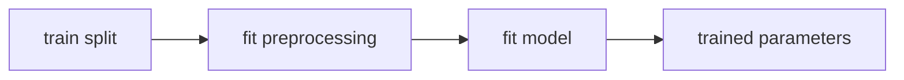

> Tier 2 · Machine Learning Fundamentals · **Level: absolute beginner** · Reading time: about 8 minutes

# 2.11 Training dataset

**Metadata** — Tier: 2 · Phase: 1 · Priority: P0 · Difficulty: 1/5 · Interview: High · Hands-on: Very high
Prerequisites: 2.10 · Leads to: 2.19 Gradient descent, 2.27 Overfitting, 2.47 Scaling

> **In plain words**
> The **training set** is the part of your data the model **learns from**. Everything the model "learns", including preparation steps such as the average used to rescale a feature, must come **only from this part**.
> Why? Because the validation and test sets stand in for the *future*. If anything computed on them leaks into training, your honest exam is no longer honest.

**You need first:** 2.10 Dataset construction.

> **Figure 2.11-1 — what may be learned from the training set only**
>
> ```mermaid
> flowchart LR
>     D["all data"] --> S["split first"]
>     S --> TR["train"]
>     S --> VA["validation"]
>     S --> TE["test"]
>     TR --> F["fit: weights, scaler mean/std,<br/>imputation medians, vocabulary"]
>     F --> A["apply the fitted<br/>transformations"]
>     A --> VA
>     A --> TE
> ```
>
> *How to read it:* **split first**, then fit everything on the training set, then merely *apply* what was fitted to validation and test. The arrows into validation and test carry only "apply", never "learn".

**Words you'll meet on this page**

| Word | What it means here |
|---|---|
| training set | data used to fit the model's parameters |
| fitted quantity | anything learned from data (weights, means, vocabulary) |
| scaler | rescales features using the mean and std it learned |
| imputation | filling in missing values (for example with the median) |
| augmentation | creating modified copies of training examples |
| oversampling | repeating rare-class examples |
| training error | the model's error on the data it learned from (optimistic) |

### 1. What is it?
The subset of data used to **fit the model's parameters**.

### 2. Why does it exist?
Learning needs examples, and keeping them separate from the evaluation data keeps the measured performance honest.

### 3. Detailed explanation
- **Only the training set may influence fitted quantities:** weights, scaler means and standard deviations, imputation medians, vocabularies, PCA directions, feature selection. Fit them on the training data and then *apply* them to validation and test.
- **Training error is optimistic.** It measures fit, not generalisation (2.27, 2.31).
- **Augmentation, resampling and class weights belong to the training set only.** Never oversample before splitting: duplicates would then sit in both train and test.
- **Size:** depends on model capacity and signal strength; use learning curves (2.9).
- **Typical splits:** 60/20/20 or 80/10/10. For huge data a small percentage suffices for validation and test; for tiny data prefer cross-validation (2.44).
- **Shuffle** every epoch for SGD (2.20), except where order matters (time series).

### 4. How does it work?
Fit scalers and encoders → train the model by minimising the loss → monitor training and validation loss over epochs (2.22).

### 5. Simple example
The textbook problems you practise on.

**A scaler, by hand.** Feature values: train `[10, 20, 30]`, test `[40, 50]`.
- Correct: mean and std from train only (mean 20, std 8.16). The test value 50 becomes `(50 − 20)/8.16 = 3.67`: clearly "unusually high", as it should look.
- Leaky: mean from *all* data (30) would turn 50 into a smaller number and quietly hide how far the test data has drifted.

### 6. Technical example
Fine-tuning an LLM on 50,000 prompt–response pairs; the tokeniser vocabulary and any normalisation statistics are fixed beforehand.

### 7. Code
**① By hand (plain Python).** Fit on train, apply to test.

```python
train = [10, 20, 30]
test = [40, 50]

mean = sum(train) / len(train)                                        # learned from train ONLY
std = (sum((x - mean) ** 2 for x in train) / len(train)) ** 0.5
print("train statistics: mean", mean, " std", round(std, 2))
print("test values scaled with the train statistics:", [round((x - mean) / std, 2) for x in test])

all_mean = sum(train + test) / len(train + test)
print("(leaky) mean computed from all data would be", all_mean, "-> the test values would look less extreme")
```

```text
train statistics: mean 20.0  std 8.16
test values scaled with the train statistics: [2.45, 3.67]
(leaky) mean computed from all data would be 30.0 -> the test values would look less extreme
```

**② With NumPy and scikit-learn.** The classic leak: oversampling before the split.

```python
import numpy as np
from sklearn.model_selection import train_test_split
from sklearn.neighbors import KNeighborsClassifier

rng = np.random.default_rng(0)
X = rng.normal(0, 1, (300, 4))
y = (rng.random(300) < 0.1).astype(int)                       # 10% rare class, labels are pure noise
rare = np.where(y == 1)[0]

# WRONG: oversample the rare class first, then split
X_over = np.vstack([X] + [X[rare]] * 5)
y_over = np.concatenate([y] + [y[rare]] * 5)
a, b, ya, yb = train_test_split(X_over, y_over, test_size=0.3, random_state=0)
print("oversample THEN split, rare-class recall:", round(float((KNeighborsClassifier(1).fit(a, ya).predict(b)[yb == 1] == 1).mean()), 3), "(fake: copies leaked into test)")

# RIGHT: split first, oversample only the training part
a, b, ya, yb = train_test_split(X, y, test_size=0.3, random_state=0, stratify=y)
r = np.where(ya == 1)[0]
a2, ya2 = np.vstack([a] + [a[r]] * 5), np.concatenate([ya] + [ya[r]] * 5)
print("split THEN oversample, rare-class recall:", round(float((KNeighborsClassifier(1).fit(a2, ya2).predict(b)[yb == 1] == 1).mean()), 3), "(honest: the labels are noise)")
```

```text
oversample THEN split, rare-class recall: 1.0 (fake: copies leaked into test)
split THEN oversample, rare-class recall: 0.0 (honest: the labels are noise)
```

**③ With scikit-learn.** A `Pipeline` keeps the scaler inside the training fold.

```python
import numpy as np
from sklearn.linear_model import LogisticRegression
from sklearn.model_selection import cross_val_score
from sklearn.pipeline import make_pipeline
from sklearn.preprocessing import StandardScaler

rng = np.random.default_rng(0)
X = rng.normal(0, 1, (200, 5))
y = (X[:, 0] + 0.5 * rng.normal(0, 1, 200) > 0).astype(int)
pipe = make_pipeline(StandardScaler(), LogisticRegression())      # the scaler is re-fitted inside each training fold
print("cross-validated accuracy (no leakage):", round(cross_val_score(pipe, X, y, cv=5).mean(), 3))
```

```text
cross-validated accuracy (no leakage): 0.865
```

### 8. Input → Process → Output



<details>
<summary><b>Beyond the basics (sections 9–16)</b> — real-world use, limits, mistakes. Skip on a first read.</summary>

### 9. Enterprise use case
Training-data snapshots are immutable and versioned so any model can be reproduced.

### 10. AI engineering connection
Pretraining corpora, instruction-tuning data and reward-model preference data are training datasets; decontaminate them against evaluation benchmarks.

### 11. Advantages
A direct learning signal, and many tools to enlarge or augment it.

### 12. Limitations
Can be unrepresentative, noisy or duplicated; large models can memorise it.

### 13. Trade-offs
A larger training share improves the model but weakens the precision of validation and test.

### 14. Common mistakes
Fitting scalers on all data; oversampling before the split; training on validation or test "just a bit"; changing the training set between experiments without recording it.

### 15. Performance / cost
Data loading often limits GPU use; cache and parallelise.

### 16. Security
Training data can leak through memorisation; apply deduplication and access controls.

</details>

### 17. Interview explanation
"The training set is what the model fits on, including any statistics like scaler means. I fit preprocessing on training data only, apply augmentation and resampling only there, and never judge the model on it, because training error is optimistic."

### 18. Rapid-fire answer
The training set fits the parameters and the preprocessing statistics; it is never used to judge generalisation.

### 19. Interview questions
- **Basic:** What is the training set used for?
- **Intermediate:** Why fit the scaler only on the training data?
- **Advanced:** Why must oversampling happen after the split?
- **Scenario:** Test accuracy equals training accuracy exactly. What does that suggest?

### 20. Hands-on exercise
**Goal:** quantify how much a leaky scaler changes the statistics.

1. Make a training set of 100 numbers from `N(0, 1)` and a test set of 100 numbers from `N(1, 1)` (the test data has drifted).
2. Compute the mean of the training set and the mean of *all* data.
3. Standardise the test set with each. How different is the mean of the standardised test set?

<details>
<summary>Show a solution</summary>

```python
import numpy as np

rng = np.random.default_rng(0)
train = rng.normal(0, 1, 100)
test = rng.normal(1, 1, 100)                                # the test data drifted
both = np.concatenate([train, test])

right = (test - train.mean()) / train.std()
leaky = (test - both.mean()) / both.std()
print("test mean after correct scaling:", round(float(right.mean()), 2), "(shows the drift)")
print("test mean after leaky scaling  :", round(float(leaky.mean()), 2), "(hides part of it)")
```

```text
test mean after correct scaling: 0.9 (shows the drift)
test mean after leaky scaling  : 0.41 (hides part of it)
```

</details>

### 21. Revision questions
1. What counts as a "fitted quantity"?
2. Why apply augmentation only to the training set?
3. Why is training error optimistic?

### 22. Related concepts
2.12 Validation · 2.13 Test · 2.47 Scaling · 2.33 Leakage

### 23. One-line memory hook
**Everything learned comes from the training set, and only from it.**

<details>
<summary><b>For reviewers</b> (not part of the lesson)</summary>

- Status: DRAFT, learner-first layout (Author: Claude). Code is executed by `tests/test_md_snippets.py`.
- TESTED earlier: `test_scalers_fit_on_train_only_and_constant_column`, `test_scaling_before_split_changes_statistics_and_feature_leak_inflates_score` (`code/mlkit.py`).
</details>
