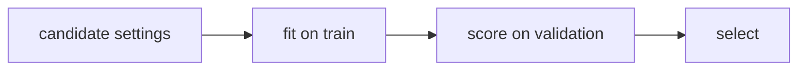

> Tier 2 · Machine Learning Fundamentals · **Level: beginner** · Reading time: about 9 minutes

# 2.12 Validation dataset

**Metadata** — Tier: 2 · Phase: 1 · Priority: P0 · Difficulty: 2/5 · Interview: High · Hands-on: Very high
Prerequisites: 2.11 · Leads to: 2.35 Hyper-parameters, 2.36 Tuning, 2.44 Cross-validation, early stopping

> **In plain words**
> The **validation set** is a **mock exam**. You use it **during development** to make decisions: which settings work best, which model to pick, when to stop training.
> It is held out from training, so its score is fair. But every decision you base on it leaks a little of it into your choices, so after many decisions its score becomes **optimistic**. That is why you keep a separate **test set** for the final, one-time verdict.

**You need first:** 2.11 Training dataset.

> **Figure 2.12-1 — validation steers, test judges**
>
> ```mermaid
> flowchart LR
>     C["candidate settings"] --> F["fit on train"]
>     F --> V["score on validation"]
>     V --> P{"best so far?"}
>     P -->|"try another"| C
>     P -->|"choose"| R["retrain / finalise"]
>     R --> T["score ONCE on test"]
> ```
>
> *How to read it:* the left loop (fit, validate, try another) may run many times; each pass nudges you toward settings that suit the validation set. Only the final box touches the test set, and only once.

**Words you'll meet on this page**

| Word | What it means here |
|---|---|
| validation set | held-out data used to make decisions while developing |
| hyper-parameter | a setting you choose before training (learning rate, depth) |
| early stopping | stop training when validation loss stops improving |
| adaptive overfitting | tuning so much on the validation set that its score becomes optimistic |
| cross-validation | rotating validation folds when data is small (2.44) |
| model selection | choosing among several models |

### 1. What is it?
Held-out data used to **make decisions during development**: choose hyper-parameters, pick among models, select features, decide when to stop training.

### 2. Why does it exist?
You need a fair estimate while you iterate, without touching the final test set.

### 3. Detailed explanation
- **Every decision based on validation scores leaks a little information** into the model ("adaptive overfitting"). The more configurations you try, the more optimistic the best validation score becomes.
- **Early stopping:** stop when the validation loss stops improving, even though the training loss keeps falling (2.27).
- **With little data,** replace one validation split with cross-validation (2.44).
- **Keep it representative:** the same preprocessing and distribution as the test set; stratify for rare classes.
- **Do not reuse a validation set for an unbiased estimate after using it to select something.** Use the test set (2.13) for that.
- **The effect is real and measurable:** if you pick the best of 200 pure-guess models using a 100-item set, the "winner" scores about 62% even though every model is a coin flip (the same idea is shown in 2.13).

### 4. How does it work?
Train candidate settings on the training set → score each on validation → choose → retrain (often on train plus validation) → evaluate once on test.

### 5. Simple example
A mock exam used to adjust your study plan, not the real exam.

**With numbers.** You try 3 learning rates and get validation errors 0.31, 0.24, 0.27. You pick the 0.24 one. If you try 200 settings instead, the best validation error looks better by luck alone.

### 6. Technical example
Tuning learning rate and weight decay by validation loss; picking the decision threshold that maximises validation F1 (2.40).

### 7. Code
**① By hand (plain Python).** Optimism grows with the number of candidates.

```python
import random

random.seed(0)
def best_of(n_models, n_val=100, trials=300):
    scores = []
    for _ in range(trials):
        best = max(sum(random.random() < 0.5 for _ in range(n_val)) / n_val for _ in range(n_models))   # coin-flip models
        scores.append(best)
    return sum(scores) / trials

for n in (1, 10, 50, 200):
    print(f"best of {n:>3} coin-flip models on a 100-item validation set: {best_of(n):.3f}  (true skill 0.5)")
```

```text
best of   1 coin-flip models on a 100-item validation set: 0.497  (true skill 0.5)
best of  10 coin-flip models on a 100-item validation set: 0.579  (true skill 0.5)
best of  50 coin-flip models on a 100-item validation set: 0.612  (true skill 0.5)
best of 200 coin-flip models on a 100-item validation set: 0.636  (true skill 0.5)
```

**② With NumPy.** Early stopping from the validation curve.

```python
import numpy as np

rng = np.random.default_rng(0)
n_train, n_val, d = 30, 300, 60
w_true = np.zeros(d); w_true[:5] = 1.0                       # only 5 features matter
Xtr, Xva = rng.normal(0, 1, (n_train, d)), rng.normal(0, 1, (n_val, d))
ytr = Xtr @ w_true + rng.normal(0, 2, n_train)
yva = Xva @ w_true + rng.normal(0, 2, n_val)

w = np.zeros(d)
best_val, best_epoch = np.inf, 0
for epoch in range(1, 301):
    w -= 0.01 * (2 / n_train) * Xtr.T @ (Xtr @ w - ytr)
    val = np.mean((Xva @ w - yva) ** 2)
    if val < best_val:
        best_val, best_epoch = val, epoch
    if epoch in (1, 10, 50, 100, 300):
        print(f"epoch {epoch:>3}: train loss {np.mean((Xtr @ w - ytr) ** 2):6.3f}   validation loss {val:6.3f}")
print("lowest validation loss at epoch", best_epoch, "-> stop there (early stopping)")
```

```text
epoch   1: train loss  8.279   validation loss  8.322
epoch  10: train loss  3.994   validation loss  7.820
epoch  50: train loss  0.677   validation loss  8.135
epoch 100: train loss  0.144   validation loss  8.651
epoch 300: train loss  0.003   validation loss  9.268
lowest validation loss at epoch 16 -> stop there (early stopping)
```

**③ With scikit-learn.** A small hyper-parameter search scored on validation data.

```python
import numpy as np
from sklearn.linear_model import LogisticRegression
from sklearn.model_selection import train_test_split

rng = np.random.default_rng(0)
y = rng.integers(0, 2, 600)
X = rng.normal(0, 1, (600, 20)) + 0.3 * y[:, None]
Xtr, Xva, ytr, yva = train_test_split(X, y, test_size=0.3, random_state=0)
for C in (0.001, 0.01, 0.1, 1, 10, 100):
    print(f"C = {C:<6} validation accuracy {LogisticRegression(C=C, max_iter=2000).fit(Xtr, ytr).score(Xva, yva):.3f}")
```

```text
C = 0.001  validation accuracy 0.694
C = 0.01   validation accuracy 0.739
C = 0.1    validation accuracy 0.750
C = 1      validation accuracy 0.744
C = 10     validation accuracy 0.744
C = 100    validation accuracy 0.744
```

### 8. Input → Process → Output



<details>
<summary><b>Beyond the basics (sections 9–16)</b> — real-world use, limits, mistakes. Skip on a first read.</summary>

### 9. Enterprise use case
Experiment trackers log validation metrics, settings and seeds; promotion gates use validation first and then test results.

### 10. AI engineering connection
Prompt and RAG configuration choices (chunk size, top-k) should be tuned on a development set separate from the final evaluation set (Tier 30).

### 11. Advantages
Enables principled tuning and detects overfitting.

### 12. Limitations
A finite set gives noisy estimates; reused repeatedly it turns into a training signal.

### 13. Trade-offs
A bigger validation set gives more reliable choices but leaves less training data.

### 14. Common mistakes
Tuning on the test set; leaking preprocessing; a small validation set with many trials; using different distributions for validation and test.

### 15. Performance / cost
A hyper-parameter search multiplies the training cost by the number of trials.

### 16. Security
Validation sets used to approve safety or quality releases must be protected from being trained on.

</details>

### 17. Interview explanation
"The validation set is for decisions during development: hyper-parameters, model choice, early stopping. Because every decision leaks some information into the model, I keep a separate test set for the final unbiased estimate, and I use cross-validation when data is small."

### 18. Rapid-fire answer
Validation = for tuning and selection; reuse makes it optimistic; the final estimate uses the test set.

### 19. Interview questions
- **Basic:** What is the difference between the validation and test sets?
- **Intermediate:** How does early stopping use validation data?
- **Advanced:** Explain adaptive overfitting to a validation set.
- **Scenario:** You tried 500 prompt variants on 80 validation items. How trustworthy is the best score?

### 20. Hands-on exercise
**Goal:** see how validation-set size changes the optimism.

1. For validation sizes 50, 500 and 5,000, pick the best of 100 coin-flip models.
2. Print the winner's validation accuracy (the true skill is 0.5).
3. What happens as the set grows?

<details>
<summary>Show a solution</summary>

```python
import numpy as np

rng = np.random.default_rng(0)
for n_val in (50, 500, 5000):
    best = [rng.binomial(n_val, 0.5, size=100).max() / n_val for _ in range(200)]
    print(f"validation size {n_val:>4}: average winning score of 100 coin-flip models = {np.mean(best):.3f}")
```

```text
validation size   50: average winning score of 100 coin-flip models = 0.676
validation size  500: average winning score of 100 coin-flip models = 0.556
validation size 5000: average winning score of 100 coin-flip models = 0.518
```

A bigger validation set shrinks the optimism: luck cannot lift the winner as far above 0.5.
</details>

### 21. Revision questions
1. Which decisions use validation data?
2. Why does the score become optimistic after many trials?
3. When would you use cross-validation instead?

### 22. Related concepts
2.13 Test dataset · 2.35–2.36 Hyper-parameters · 2.44 Cross-validation · 2.27 Overfitting

### 23. One-line memory hook
**Validation steers; test judges.**

<details>
<summary><b>For reviewers</b> (not part of the lesson)</summary>

- Status: DRAFT, learner-first layout (Author: Claude). Code is executed by `tests/test_md_snippets.py`.
- TESTED earlier: `test_grid_and_random_search_find_good_region`, `test_under_and_overfitting_curves` (`code/mlkit.py`); the best-of-200 selection experiment (62%) is tested for 2.13.
</details>
