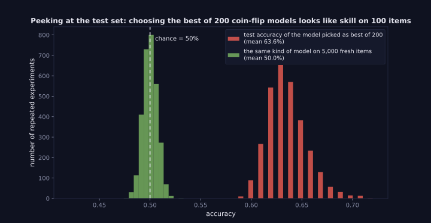
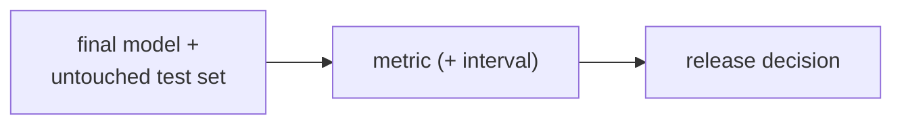

> Tier 2 · Machine Learning Fundamentals · **Level: absolute beginner** · Reading time: about 8 minutes

# 2.13 Test dataset

**Metadata** — Tier: 2 · Phase: 1 · Priority: P0 · Difficulty: 1/5 · Interview: Very high · Hands-on: High
Prerequisites: 2.12 · Leads to: 2.31 Generalisation, 2.37–2.43 Metrics, Tier 30 Evaluation

> **In plain words**
> The **test set** is the **final exam**. It is locked away, used **once, at the very end**, to answer: "How will this model do on data it has never seen?"
> Its score is trustworthy **only if nothing you did earlier was influenced by it**. Peek at it, tune on it, or pick the winner by it, and the score becomes flattering fiction.

**You need first:** 2.11 Training set and 2.12 Validation set.

> **Figure 2.13-1 — what peeking at the test set does**
>
> 
>
> *How to read it:* 3,000 repeated experiments. Each picks the best of 200 **coin-flip** classifiers by accuracy on a 100-item test set (red, mean 63.6%) and then evaluates that pick on 5,000 fresh items (green, mean 50.0%). Selecting on the test set manufactures apparent skill that disappears on new data.
>
> *Generated by* `tier-02-ml-fundamentals/figures/src/t2_basics.py`.

**Words you'll meet on this page**

| Word | What it means here |
|---|---|
| test set | held-out data used once for the final estimate |
| peeking | using test results to make choices |
| standard error | `√(p(1−p)/n)`: how noisy an accuracy estimate is |
| confidence interval | a range that likely contains the true value |
| contamination | test items leaking into training data |
| golden set | a trusted, private evaluation set |

### 1. What is it?
Held-out data used **once, at the end**, to estimate how the final model will perform on new data.

### 2. Why does it exist?
It is the only unbiased estimate of generalisation, provided it never influenced any modelling decision.

### 3. Detailed explanation
- **Lock it away.** No tuning, no feature selection, no studying its errors to design new features. If you do, collect a fresh test set.
- **Peeking inflates scores** (see the figure): the best of 200 pure-guess models picked on a 100-item test set looks 62–64% accurate, but on fresh data the winner is at chance.
- **Size sets precision.** The standard error of an accuracy estimate is `√(p(1 − p)/n)`. With `n = 100` and `p = 0.9` it is 3 points, so "a 1-point gain" is just noise.
- **Representativeness:** it should mimic production: the same time distribution, preprocessing and labelling. For temporal problems the test set is the *latest* period.
- **Report uncertainty:** confidence intervals, multiple seeds or bootstrap resamples.
- **Benchmark contamination:** public test sets can leak into pretraining data, so a model may score high by memorising. Keep a private held-out set (Tiers 15, 30).
- **After release,** production monitoring (2.34) replaces the static test set as the continuing evaluation.

### 4. How does it work?
Freeze the final pipeline → score once on the test set → report the metric with its uncertainty → if you must iterate, collect a new test set.

### 5. Simple example
The final exam: you see it once.

**How noisy is a test score?** A model truly 90% accurate, tested on `n` items:

| `n` | standard error | exact 95% interval (printed in the code below) |
|---|---|---|
| 50 | 4.2 points | 78%–97% |
| 500 | 1.3 points | 87%–92.5% |
| 5,000 | 0.4 points | 89%–91% |

With 50 test items you can't tell a 90% model from an 85% one.

### 6. Technical example
An LLM application: a private, versioned set of real user questions with reference answers, scored only before a release decision.

### 7. Code
**① By hand (plain Python).** Peeking: pick the best of 200 coin-flip models on the test set, then check on fresh data.

```python
import random

random.seed(0)
n_test, n_fresh, n_models = 100, 5000, 200
acc_on_test = [sum(random.random() < 0.5 for _ in range(n_test)) / n_test for _ in range(n_models)]   # each model is a coin flip
winner = max(range(n_models), key=lambda i: acc_on_test[i])
fresh = sum(random.random() < 0.5 for _ in range(n_fresh)) / n_fresh                                  # the winner's real skill is 0.5
print("mean over models on the test set:", round(sum(acc_on_test) / n_models, 3))
print("the winner's test-set accuracy  :", acc_on_test[winner], "(looks skilled!)")
print("the winner on 5,000 fresh items :", round(fresh, 3), "(chance)")
```

```text
mean over models on the test set: 0.496
the winner's test-set accuracy  : 0.61 (looks skilled!)
the winner on 5,000 fresh items : 0.506 (chance)
```

**② With NumPy.** Repeat the experiment many times to see the average inflation.

```python
import numpy as np

rng = np.random.default_rng(0)
best_on_test = [rng.binomial(100, 0.5, size=200).max() / 100 for _ in range(2000)]
print("average 'best of 200' accuracy on a 100-item test set:", round(float(np.mean(best_on_test)), 3))
print("true skill of every model: 0.500  -> the excess is pure selection luck")
```

```text
average 'best of 200' accuracy on a 100-item test set: 0.636
true skill of every model: 0.500  -> the excess is pure selection luck
```

**③ With SciPy.** Confidence intervals for a test accuracy.

```python
from scipy.stats import binomtest

for n in (50, 500, 5000):
    correct = round(0.9 * n)
    ci = binomtest(correct, n).proportion_ci(confidence_level=0.95)
    print(f"n = {n:>4}: accuracy 0.90, 95% interval ({ci.low:.3f}, {ci.high:.3f})   width {ci.high - ci.low:.3f}")
```

```text
n =   50: accuracy 0.90, 95% interval (0.782, 0.967)   width 0.185
n =  500: accuracy 0.90, 95% interval (0.870, 0.925)   width 0.055
n = 5000: accuracy 0.90, 95% interval (0.891, 0.908)   width 0.017
```

### 8. Input → Process → Output



<details>
<summary><b>Beyond the basics (sections 9–16)</b> — real-world use, limits, mistakes. Skip on a first read.</summary>

### 9. Enterprise use case
Release gates require results on a frozen, access-controlled test set; changes to the set are versioned and reviewed.

### 10. AI engineering connection
Golden datasets for RAG and agents (Tier 30) play this role; they need refresh policies as products and users change.

### 11. Advantages
An honest estimate; supports go/no-go decisions.

### 12. Limitations
Single use; finite size means uncertainty; it may not match future data.

### 13. Trade-offs
A big test set is precise but leaves fewer rows for training; refresh cost versus staleness.

### 14. Common mistakes
Using test results to tune; reporting the best of many test runs; tiny test sets; a test set unlike production; contamination.

### 15. Performance / cost
Cheap to compute, expensive to create (labels).

### 16. Security
Protect test sets from leaking into training pipelines or to vendors; log access.

</details>

### 17. Interview explanation
"The test set gives the final unbiased estimate, so I only touch it once, after all decisions are made. If I peek and iterate, the score becomes optimistic: picking the best of 200 coin-flip models on 100 test items gives about 62%, while fresh data gives chance. I also report uncertainty because small test sets are noisy."

### 18. Rapid-fire answer
Use once at the end; peeking inflates; size sets precision; keep a private set.

### 19. Interview questions
- **Basic:** Why can't you tune on the test set?
- **Intermediate:** How large must a test set be to detect a 1-point accuracy change?
- **Advanced:** What is benchmark contamination?
- **Scenario:** A vendor model scores 95% on a public benchmark but fails on your tickets. Why?

### 20. Hands-on exercise
**Goal:** compute the test size needed for a given precision.

1. For accuracy `p = 0.9`, the 95% interval half-width is about `1.96·√(p(1−p)/n)`.
2. Find the `n` that gives a half-width of 1 point (0.01).
3. Check by plugging it back in.

<details>
<summary>Show a solution</summary>

```python
import math

p, half_width = 0.9, 0.01
n = (1.96 ** 2) * p * (1 - p) / half_width ** 2
print("needed test size:", math.ceil(n))
print("half-width with that n:", round(1.96 * math.sqrt(p * (1 - p) / math.ceil(n)), 4))
```

```text
needed test size: 3458
half-width with that n: 0.01
```

Detecting 1-point differences needs thousands of test items.
</details>

### 21. Revision questions
1. When is the test set used?
2. What happens if you peek?
3. What gives a test set its precision?

### 22. Related concepts
2.12 Validation · 2.31 Generalisation · 2.34 Distribution shift · Tier 15 and 30 Evaluation

### 23. One-line memory hook
**Test set: open the envelope once.**

<details>
<summary><b>For reviewers</b> (not part of the lesson)</summary>

- Status: DRAFT, learner-first layout (Author: Claude). Code is executed by `tests/test_md_snippets.py`.
- TESTED earlier: `test_peeking_at_test_set_inflates_score` (best of 200 pure-guess classifiers on a 100-item test set: 62%, mean 50.4%; the chosen classifier on 5,000 fresh items: 47.7%). Figure values (63.6%, 50.0%) come from the figure script.
- The standard errors in section 5 use `√(p(1−p)/n)`; the intervals shown are the exact (Clopper–Pearson) intervals from SciPy.
</details>
