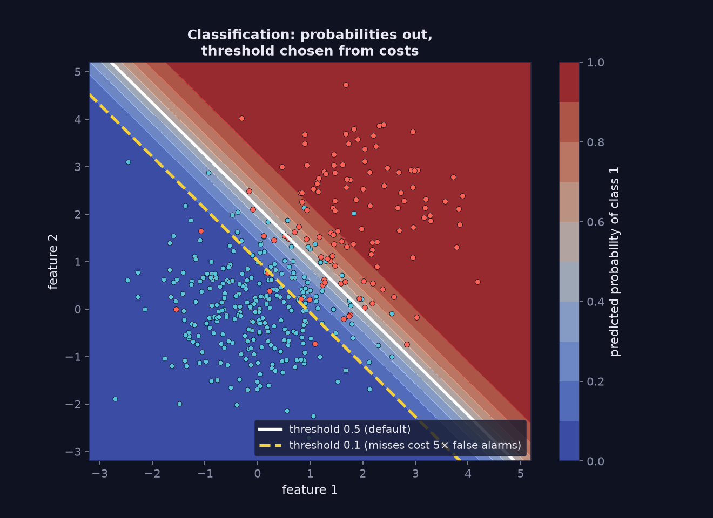
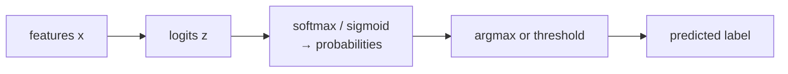

> Tier 2 · Machine Learning Fundamentals · **Level: beginner** · Reading time: about 11 minutes

# 2.14 Classification

**Metadata** — Tier: 2 · Phase: 1 · Priority: P0 · Difficulty: 2/5 · Interview: Very high · Hands-on: Very high
Prerequisites: 2.2, 1.28, 1.37 · Leads to: 2.37–2.43 Metrics, 2.45 Imbalance, Tier 3 Output layer / softmax, Tier 19 Structured outputs

> **In plain words**
> **Classification** means predicting **a category**: spam or not spam, which of 12 intents, cat or dog.
> A classifier usually doesn't just say "spam": it gives a **probability** for each category, and you then pick a **decision rule** (the most likely class, or a **threshold** such as "flag as fraud if the probability is above 0.1").
> The threshold should come from the **cost of mistakes**, not from habit.

**You need first:** 2.2 Supervised learning; a feel for probabilities (1.28) helps.

> **Figure 2.14-1 — probabilities, boundary and threshold**
>
> 
>
> *How to read it:* the colour is the model's predicted **probability of class 1**. The white line is the default 0.5 threshold; the dashed yellow line is the 0.1 threshold you would use when missing a positive costs five times a false alarm. It moves the boundary toward the negative class, so more cases get flagged. **The model is the same; only the decision rule changed.**
>
> *Generated by* `tier-02-ml-fundamentals/figures/src/t2_basics.py`.

**Words you'll meet on this page**

| Word | What it means here |
|---|---|
| binary / multiclass / multilabel | two classes / one of K / several can be true |
| logit `z` | the raw score before it becomes a probability |
| sigmoid / softmax | turns logits into probabilities (binary / multiclass) |
| threshold | the probability above which we say "positive" |
| decision boundary | where the predicted class changes |
| cross-entropy | the usual training loss (1.37) |
| calibration | do "70% sure" predictions come true 70% of the time? (2.43) |

### 1. What is it?
Supervised learning where the target `y` is a **discrete category**: binary (spam / not spam), multiclass (one of K), or multilabel (several can be true).

### 2. Why does it exist?
Many decisions are choices among categories: approve or deny, route to a team, detect an object type. Classification turns evidence into a category, or a probability for each category.

### 3. Detailed explanation
- **Output forms:** a hard class, a score, or a probability vector. Binary models usually output `p = σ(z)` (sigmoid of a logit); multiclass models output `softmax(z)` (1.42, 1.43), a distribution that sums to 1.
- **Training objective:** cross-entropy (negative log-likelihood, 1.35, 1.37); its gradient with respect to the logits is `softmax(z) − onehot(y)`.
- **Decision rule:** pick the `argmax` class; for binary tasks compare `p` with a **threshold**. **0.5 is a default, not a law.** If a missed positive costs 5× a false alarm, the best threshold moves down.
- **Decision boundary:** logistic or softmax regression has *linear* boundaries; engineered features or neural networks give curved ones.
- **Multiclass versus multilabel:** softmax makes classes compete; multilabel uses an independent sigmoid per class.
- **Probabilities are useful only if calibrated** (2.43). A high score is not automatically a true probability.

### 4. How does it work?
Features → scores per class → softmax or sigmoid → probabilities → threshold or argmax → decision; then evaluate with the metrics of 2.37–2.42.



### 5. Simple example
A sorting hat: look at the features, pick a house; the "confidence" says how close the call was.

**By hand, three classes.** Logits `z = [2.0, 1.0, 0.1]`:

| Class | `exp(z)` | probability |
|---|---|---|
| A | 7.39 | 0.659 |
| B | 2.72 | 0.242 |
| C | 1.11 | 0.099 |

The prediction is class A with confidence 66%.

**A threshold chosen by cost.** If a missed fraud costs 20 and a false alarm costs 1, flag a transaction whenever `p(fraud) × 20 > (1 − p(fraud)) × 1`, i.e. `p > 1/21 ≈ 0.048`. Far below 0.5.

### 6. Technical example
Intent classification of customer messages (12 intents); a guard-rail classifier labelling outputs safe or unsafe; the LLM's own output layer is a classifier over the vocabulary (next-token prediction).

### 7. Code
**① By hand (plain Python).** Logits to probabilities to a cost-based decision.

```python
import math

z = [2.0, 1.0, 0.1]
e = [math.exp(v) for v in z]
p = [v / sum(e) for v in e]
print("probabilities:", [round(v, 3) for v in p], " sum:", round(sum(p), 6))
print("predicted class:", "ABC"[p.index(max(p))])

cost_miss, cost_false_alarm = 20, 1
threshold = cost_false_alarm / (cost_miss + cost_false_alarm)
print("flag as fraud when P(fraud) >", round(threshold, 3))
```

```text
probabilities: [0.659, 0.242, 0.099]  sum: 1.0
predicted class: A
flag as fraud when P(fraud) > 0.048
```

**② With NumPy.** Sweep the threshold and find the cheapest one.

```python
import numpy as np

rng = np.random.default_rng(0)
y = (rng.random(2000) < 0.2).astype(int)                          # 20% positives
score = np.clip(0.5 * y + rng.normal(0.25, 0.2, 2000), 0, 1)      # a noisy model score in [0, 1]
for t in (0.1, 0.3, 0.5, 0.7):
    pred = score > t
    misses = int(((~pred) & (y == 1)).sum())
    false_alarms = int((pred & (y == 0)).sum())
    print(f"threshold {t}: misses {misses:>3}, false alarms {false_alarms:>4}, total cost (miss = 5, false alarm = 1): {5 * misses + false_alarms}")
```

```text
threshold 0.1: misses   0, false alarms 1222, total cost (miss = 5, false alarm = 1): 1222
threshold 0.3: misses   1, false alarms  636, total cost (miss = 5, false alarm = 1): 641
threshold 0.5: misses  44, false alarms  182, total cost (miss = 5, false alarm = 1): 402
threshold 0.7: misses 173, false alarms   20, total cost (miss = 5, false alarm = 1): 885
```

**③ With scikit-learn.** A 3-class classifier.

```python
import numpy as np
from sklearn.linear_model import LogisticRegression

rng = np.random.default_rng(0)
centres = np.array([[0, 0], [4, 0], [2, 4]])
y = np.repeat([0, 1, 2], 300)
X = centres[y] + rng.normal(0, 1, (900, 2))
order = rng.permutation(900)
X, y = X[order], y[order]
clf = LogisticRegression(max_iter=1000).fit(X[:600], y[:600])
P = clf.predict_proba(X[600:])
print("test accuracy:", round(clf.score(X[600:], y[600:]), 3), "  (chance 0.333)")
print("each row of probabilities sums to 1:", np.allclose(P.sum(axis=1), 1))
```

```text
test accuracy: 0.98   (chance 0.333)
each row of probabilities sums to 1: True
```

### 8. Input → Process → Output
`x → logits z → softmax / sigmoid → p(class | x) → threshold / argmax → label`

<details>
<summary><b>Beyond the basics (sections 9–16)</b> — real-world use, limits, mistakes. Skip on a first read.</summary>

### 9. Enterprise use case
Classification powers routing, triage, moderation, fraud flags and eligibility checks, usually with human review for borderline scores and thresholds set from business costs.

### 10. AI engineering connection
Intent routers, guard-rail classifiers (Tier 32), re-rankers (Tier 21), LLM-as-judge verdicts and the LLM's own next-token distribution are all classification problems.

### 11. Advantages
Well-understood losses and metrics; probabilistic outputs support cost-based decisions.

### 12. Limitations
Needs labelled categories; the label set is fixed; poor on out-of-distribution inputs; scores need calibration.

### 13. Trade-offs
Hard labels are simple but throw away uncertainty; probabilities allow thresholds and abstention but need calibration.

### 14. Common mistakes
Accuracy on imbalanced data (2.45); the default 0.5 threshold; softmax for a multilabel problem; no "none of the above" class; reading scores as calibrated probabilities.

### 15. Performance / cost
Inference is cheap for linear models; large vocabularies make softmax expensive (cost grows with the number of classes).

### 16. Security
Adversarial inputs can flip classes; classifiers used as safety filters need red-teaming; thresholds are policy decisions.

</details>

### 17. Interview explanation
"Classification predicts a category. The model outputs logits, softmax or sigmoid turns them into probabilities, and I train with cross-entropy. The decision threshold should come from the cost of each error, not default to 0.5, and I check calibration before trusting the probabilities."

### 18. Rapid-fire answer
Predict a discrete class via logits → softmax/sigmoid; train with cross-entropy; set the threshold by cost.

### 19. Interview questions
- **Basic:** Binary versus multiclass versus multilabel?
- **Intermediate:** Why does a softmax output sum to 1 while independent sigmoids don't?
- **Advanced:** Derive the gradient of cross-entropy with respect to the logits for softmax.
- **Scenario:** Missing a fraud case costs 20× a false alarm. How do you pick the threshold?

### 20. Hands-on exercise
**Goal:** see how the best threshold moves with the cost ratio.

1. Use the NumPy score model from above.
2. For miss-to-false-alarm cost ratios 1, 5 and 20, scan thresholds 0.05 to 0.95 and find the cheapest.
3. How does the best threshold change?

<details>
<summary>Show a solution</summary>

```python
import numpy as np

rng = np.random.default_rng(0)
y = (rng.random(2000) < 0.2).astype(int)
score = np.clip(0.5 * y + rng.normal(0.25, 0.2, 2000), 0, 1)
for ratio in (1, 5, 20):
    costs = []
    for t in np.arange(0.05, 0.96, 0.05):
        pred = score > t
        costs.append((ratio * ((~pred) & (y == 1)).sum() + (pred & (y == 0)).sum(), round(float(t), 2)))
    print(f"miss costs {ratio:>2}x a false alarm -> cheapest threshold {min(costs)[1]}")
```

```text
miss costs  1x a false alarm -> cheapest threshold 0.6
miss costs  5x a false alarm -> cheapest threshold 0.5
miss costs 20x a false alarm -> cheapest threshold 0.3
```

The more expensive a miss, the lower the best threshold.
</details>

### 21. Revision questions
1. What does softmax output?
2. What is the training loss?
3. What moves the optimal threshold?

### 22. Related concepts
2.15 Regression · 2.17 Loss functions · 2.37–2.43 Metrics · 2.43 Calibration · 1.37 Cross-entropy

### 23. One-line memory hook
**Classification: scores in, probabilities out, threshold chosen by cost.**

<details>
<summary><b>For reviewers</b> (not part of the lesson)</summary>

- Status: DRAFT, learner-first layout (Author: Claude). Code is executed by `tests/test_md_snippets.py`.
- TESTED earlier: `ex_2_14` (3 Gaussian classes, 600 train / 300 test: 99.7% test accuracy; probabilities sum to 1) and the cost-threshold demo (cost 48 at 0.5 falling to 27 at 0.1); binary logistic regression vs scikit-learn (`code/test_mlkit.py`). The page's snippets use different data, so numbers differ.
- The optimal-threshold formula `c_fp/(c_fn + c_fp)` assumes calibrated probabilities.
</details>
