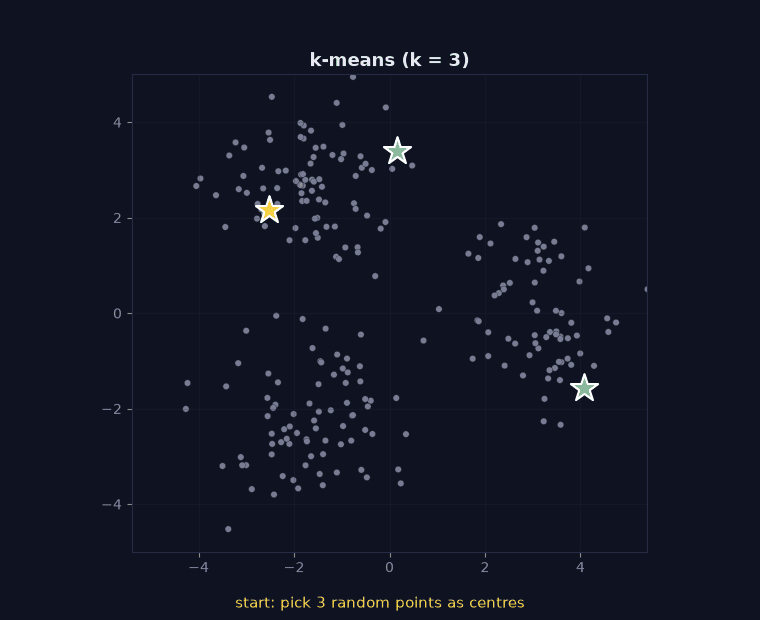

> Tier 2 · Machine Learning Fundamentals · **Level: beginner** · Reading time: about 10 minutes

# 2.16 Clustering

**Metadata** — Tier: 2 · Phase: 1 · Priority: P1 · Difficulty: 2/5 · Interview: Medium-High · Hands-on: High
Prerequisites: 2.3, 1.16 · Leads to: Tier 6 embeddings, Tier 22 GraphRAG communities, anomaly detection

> **In plain words**
> **Clustering** groups similar items **without being told the groups**. The classic method, **k-means**, repeats two moves: *assign each point to its nearest centre*, then *move each centre to the middle of its points*, until nothing changes.
> Three habits make it work in practice: **scale your features**, **restart from several random starts**, and **treat the clusters as hypotheses to check**, not as the truth.

**You need first:** 2.3 Unsupervised learning (the basic idea) and distances (1.16).

> **Figure 2.16-1 — k-means step by step (animated)**
>
> 
>
> *How to read it:* frame by frame: random centres → assign every point to its nearest centre (the colours) → move each centre to the mean of its points → repeat. The inertia in the title drops from about 2,179 to 452 and stops changing after 4 iterations; 452 equals the best of 10 library initialisations.
>
> *Generated by* `tier-02-ml-fundamentals/figures/src/t2_training.py`.

**Words you'll meet on this page**

| Word | What it means here |
|---|---|
| cluster | a group of similar points |
| centroid | the centre (mean) of a cluster |
| inertia | total squared distance from points to their centre |
| silhouette score | how well each point fits its own cluster versus the next nearest (−1 to 1) |
| initialisation | where the centres start |
| local optimum | a stable solution that is not the best one |
| standardise | rescale each feature to mean 0, std 1 |

### 1. What is it?
Unsupervised grouping of samples so that items in a group are more similar to each other than to items in other groups.

### 2. Why does it exist?
To discover segments, compress data into prototypes, organise documents and spot outliers when no labels exist.

### 3. Detailed explanation
- **k-means:** choose `k` centres; assign each point to the nearest centre; move each centre to the mean of its points; repeat until stable. It minimises **inertia**, the within-cluster sum of squared distances.
- **Initialisation matters.** k-means finds a *local* optimum (1.47). With a single random start, different runs can end in different, worse solutions; restarting several times (`n_init`) and keeping the best fixes most of this.
- **Scaling matters.** Distance-based methods are dominated by the feature with the largest numbers. Standardise first (2.47).
- **Choosing `k`:** inertia always falls as `k` grows, so use the elbow, the **silhouette score** `(b − a)/max(a, b)` (`a` = mean distance to its own cluster, `b` = to the nearest other cluster), stability across seeds, or the downstream objective.
- **Assumptions:** k-means likes roughly round, similar-sized clusters. Other algorithms (hierarchical, density-based, Gaussian mixtures) relax this.
- **Clusters are not categories.** They reflect the features and distance you chose.
- **Embeddings:** clustering text embeddings (cosine or L2 on normalised vectors, 1.17) organises corpora; in very high dimension distances lose contrast (1.16).

### 4. How does it work?
Standardise → choose the algorithm and `k` → run several initialisations → evaluate (silhouette, stability, usefulness) → name and validate clusters with a human.

### 5. Simple example
Sorting a drawer of buttons into piles by similarity without being told the categories.

**Why scaling matters, in numbers.** Customers described by *age* (20–60) and *income in dollars* (20,000–120,000). The distance between two customers is almost entirely the income difference, because 40,000 dwarfs 40. Age is effectively ignored until you standardise both features.

### 6. Technical example
Group support tickets by embedding to discover recurring issues; build community summaries for GraphRAG (Tier 22).

### 7. Code
**① By hand (plain Python).** The silhouette score of one point.

```python
points = {"a": [1.0], "b": [2.0], "c": [10.0], "d": [11.0]}
clusters = {"A": ["a", "b"], "B": ["c", "d"]}

def dist(p, q):
    return abs(points[p][0] - points[q][0])

p = "a"
a = sum(dist(p, q) for q in clusters["A"] if q != p) / (len(clusters["A"]) - 1)    # mean distance to its own cluster
b = sum(dist(p, q) for q in clusters["B"]) / len(clusters["B"])                      # mean distance to the other cluster
print("a =", a, " b =", b, " silhouette =", round((b - a) / max(a, b), 3), "(near 1: well clustered)")
```

```text
a = 1.0  b = 9.5  silhouette = 0.895 (near 1: well clustered)
```

**② With NumPy and scikit-learn.** Scaling and restarts.

```python
import numpy as np
from sklearn.cluster import KMeans

rng = np.random.default_rng(0)
truth = np.repeat([0, 1], 150)
age = np.concatenate([rng.normal(25, 4, 150), rng.normal(50, 4, 150)])               # the informative feature
income = rng.normal(70_000, 25_000, 300)                                              # huge numbers, no group information
X = np.column_stack([age, income])

def agreement(labels):
    return max(np.mean(labels == truth), np.mean(labels != truth))

raw = KMeans(2, n_init=10, random_state=0).fit(X)
Z = (X - X.mean(axis=0)) / X.std(axis=0)
scaled = KMeans(2, n_init=10, random_state=0).fit(Z)
print("agreement with the true groups, raw features   :", round(float(agreement(raw.labels_)), 3), "(income dominates the distance)")
print("agreement with the true groups, standardised   :", round(float(agreement(scaled.labels_)), 3))

inertias = [KMeans(5, n_init=1, init="random", random_state=s).fit(Z).inertia_ for s in range(20)]
print("single random starts: inertia ranges from", round(min(inertias), 1), "to", round(max(inertias), 1))
```

```text
agreement with the true groups, raw features   : 0.52 (income dominates the distance)
agreement with the true groups, standardised   : 1.0
single random starts: inertia ranges from 112.7 to 115.1
```

**③ With scikit-learn.** Picking `k` with the silhouette score.

```python
import numpy as np
from sklearn.cluster import KMeans
from sklearn.metrics import silhouette_score

rng = np.random.default_rng(0)
X = np.vstack([rng.normal(c, 1, (150, 2)) for c in ([0, 0], [7, 0], [3.5, 6])])      # three true blobs
for k in (2, 3, 4, 5):
    labels = KMeans(k, n_init=10, random_state=0).fit_predict(X)
    print(f"k = {k}   silhouette score = {silhouette_score(X, labels):.3f}")
```

```text
k = 2   silhouette score = 0.507
k = 3   silhouette score = 0.737
k = 4   silhouette score = 0.593
k = 5   silhouette score = 0.463
```

### 8. Input → Process → Output
`X → scale → assign/update loop → centres + labels → validate`

<details>
<summary><b>Beyond the basics (sections 9–16)</b> — real-world use, limits, mistakes. Skip on a first read.</summary>

### 9. Enterprise use case
Customer segmentation, ticket topic discovery, log-pattern grouping; the results feed product decisions and need business review.

### 10. AI engineering connection
Embedding clustering for corpus organisation and dataset curation, deduplication, and community detection for graph-based retrieval.

### 11. Advantages
No labels needed; simple and fast; produces interpretable prototypes.

### 12. Limitations
Sensitive to scale, initialisation and `k`; no ground truth; assumes cluster shape.

### 13. Trade-offs
More clusters make tighter groups but are less interpretable and less stable.

### 14. Common mistakes
Not scaling; trusting one run; picking `k` by the smallest inertia; treating clusters as ground-truth labels; clustering in raw high-dimensional space.

### 15. Performance / cost
`O(n·k·d)` per iteration; use mini-batch k-means or approximate methods for millions of points.

### 16. Security
Clusters on personal data can expose or create sensitive groupings. Review before using them in decisions.

</details>

### 17. Interview explanation
"Clustering groups similar items without labels. With k-means I standardise features, run several initialisations since it finds local optima, and choose k using silhouette and stability rather than inertia alone. I treat the clusters as hypotheses to validate, not truth."

### 18. Rapid-fire answer
k-means minimises within-cluster squared distance; scale features, use multiple starts, choose `k` by silhouette and stability.

### 19. Interview questions
- **Basic:** What are the steps of k-means?
- **Intermediate:** Why does inertia decrease monotonically with `k`?
- **Advanced:** Why does k-means fail on elongated or unevenly sized clusters?
- **Scenario:** Two runs produce different segments. Is the segmentation usable?

### 20. Hands-on exercise
**Goal:** see where k-means fails.

1. Make two concentric rings (points at radius 1 and radius 3, with a little noise).
2. Run k-means with `k = 2`.
3. Compare the clusters with the true rings. Why does it fail?

<details>
<summary>Show a solution</summary>

```python
import numpy as np
from sklearn.cluster import KMeans

rng = np.random.default_rng(0)
angle = rng.uniform(0, 2 * np.pi, 400)
radius = np.repeat([1.0, 3.0], 200) + rng.normal(0, 0.1, 400)
X = np.column_stack([radius * np.cos(angle), radius * np.sin(angle)])
truth = np.repeat([0, 1], 200)
labels = KMeans(2, n_init=10, random_state=0).fit_predict(X)
print("agreement with the true rings:", round(float(max(np.mean(labels == truth), np.mean(labels != truth))), 3), "(0.5 = chance)")
```

```text
agreement with the true rings: 0.51 (0.5 = chance)
```

k-means cuts the plane with a straight line between two centres; the rings share the same centre, so no such line separates them. Density-based or graph-based methods handle this shape.
</details>

### 21. Revision questions
1. What is inertia?
2. Why use multiple initialisations?
3. Why scale the features?

### 22. Related concepts
2.3 Unsupervised · 2.47 Feature scaling · 1.16 Distance metrics · 1.17 Cosine similarity · Tier 22 GraphRAG

### 23. One-line memory hook
**k-means: scale first, restart often, and treat clusters as hypotheses.**

<details>
<summary><b>For reviewers</b> (not part of the lesson)</summary>

- Status: DRAFT, learner-first layout (Author: Claude). Code is executed by `tests/test_md_snippets.py`.
- TESTED earlier: `ex_2_16`, `test_silhouette_matches_sklearn`, `test_clustering_scaling_and_initialization` (5 well-separated blobs: single-start inertia 1,005–4,412 vs 1,005 with best-of-10; scaling: 77.7% agreement raw vs 98% standardised; silhouette 0.75 at k=2, 0.53 at k=3, 0.29 at k=4 on two blobs). The page's snippets use different data, so numbers differ. The figure's inertia (2,179 → 452) is from the figure script.
- Section 5's age/income illustration is arithmetic, not a measured result.
</details>
