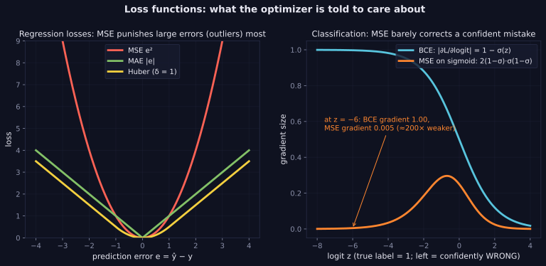

> Tier 2 · Machine Learning Fundamentals · **Level: beginner** · Reading time: about 11 minutes

# 2.17 Loss functions

**Metadata** — Tier: 2 · Phase: 1 · Priority: P0 · Difficulty: 2/5 · Interview: Very high · Hands-on: Very high
Prerequisites: 1.21, 1.35, 1.37 · Leads to: 2.18 Objective, 2.19 Gradient descent, 2.40 F1 (a metric, not a loss), Tier 4 Loss calculation

> **In plain words**
> A **loss function** is the **grading rule**: it turns "how wrong was this prediction?" into one number. Training adjusts the model to make the average loss as small as possible.
> **The model optimises exactly what the loss rewards, nothing more.** So the choice matters: squared error cares a lot about big mistakes, absolute error is relaxed about outliers, cross-entropy punishes confident wrong answers heavily.

**You need first:** 1.21 Derivatives (loss must be differentiable) and 1.37 Cross-entropy (helpful, not required).

> **Figure 2.17-1 — regression losses and the gradient of classification losses**
>
> 
>
> *How to read it:* **left** — MSE grows quadratically, so a single outlier dominates; MAE and Huber grow linearly. **Right** — true label 1, moving left means more confidently wrong. The cross-entropy gradient stays near 1, so the model is corrected strongly, while MSE on a sigmoid has a gradient of only 0.005 at logit −6: about 200× weaker.
>
> *Generated by* `tier-02-ml-fundamentals/figures/src/t2_basics.py`.

**Words you'll meet on this page**

| Word | What it means here |
|---|---|
| loss `ℓ(ŷ, y)` | non-negative error score for one prediction |
| MSE / MAE / Huber | squared / absolute / a blend of both |
| cross-entropy | the loss for probabilities (1.37) |
| outlier | an extreme, probably unrepresentative value |
| robust | not thrown off by outliers |
| metric | what you report (accuracy, F1); not necessarily trainable |
| softplus | `log(1 + eᶻ)`, used to compute BCE from logits stably |

### 1. What is it?
A function `ℓ(ŷ, y)` returning a **non-negative number that measures how wrong one prediction is**. Training minimises its average over the data.

### 2. Why does it exist?
Optimisation needs a single, differentiable score of error. The loss defines what "good" means to the learning algorithm.

### 3. Detailed explanation
The choice follows the task and the assumed noise (1.35):

| Task | Loss | Notes |
|---|---|---|
| Regression | MSE `(y − ŷ)²` | Gaussian MLE; punishes outliers strongly |
| Regression | MAE `\|y − ŷ\|` | Laplace MLE; robust, not smooth at 0 |
| Regression | Huber | quadratic near 0, linear in the tails; robust and smooth |
| Binary classification | binary cross-entropy | compute from logits: `softplus(z) − y·z` |
| Multiclass | categorical cross-entropy | `−log softmax(z)[y]` (1.37) |

- **Outliers:** fit a line to data with a few gross outliers. MSE chases them (the intercept is pulled far from the truth); MAE and Huber barely move.
- **Why not MSE for classification?** With a sigmoid and a confident wrong prediction (logit −6, true label 1), the gradient of BCE with respect to the logit is about −0.9975, while the gradient of MSE-on-sigmoid is about −0.0049: roughly 200× smaller. MSE barely corrects confident mistakes (the sigmoid saturates, 1.42).
- **Compute losses from logits** with the log-sum-exp trick (1.43); a stable `bce_from_logits` stays finite at `z = ±1000`.
- **A loss is not a metric.** Train with a differentiable loss; judge with the metric that matches the business goal (2.37–2.42, 2.51). Accuracy and F1 are not differentiable.
- **Class weights and label smoothing** modify the loss for imbalance and over-confidence (2.45).
- Tier 4 (4.3) covers computing the loss inside a PyTorch training loop; this concept is the authoritative definition.

### 4. How does it work?
For each sample compute `ℓ`, average over the batch, differentiate with respect to the parameters, update (2.19).

### 5. Simple example
A scoring rule for darts: the distance from the bullseye, possibly squared.

**By hand.** True values `y = [0, 0, 0, 0]`, predictions `p = [0, 0, 0, 10]` (one big miss):

| Loss | Calculation | Value |
|---|---|---|
| MSE | `10²/4` | 25 |
| MAE | `10/4` | 2.5 |
| Huber (δ = 1) | `(10 − 0.5)/4` | 2.375 |

The single outlier makes the squared loss 10 times bigger than the absolute loss.

### 6. Technical example
LLM pretraining loss: cross-entropy of the next word, averaged over all positions; perplexity is its exponential.

### 7. Code
**① By hand (plain Python).**

```python
y = [0, 0, 0, 0]
p = [0, 0, 0, 10]
n = len(y)
mse = sum((a - b) ** 2 for a, b in zip(y, p)) / n
mae = sum(abs(a - b) for a, b in zip(y, p)) / n
delta = 1.0
huber = sum(0.5 * (a - b) ** 2 if abs(a - b) <= delta else delta * (abs(a - b) - 0.5 * delta) for a, b in zip(y, p)) / n
print("MSE:", mse, " MAE:", mae, " Huber:", huber)
```

```text
MSE: 25.0  MAE: 2.5  Huber: 2.375
```

**② With NumPy and scikit-learn.** Outliers: which loss resists them?

```python
import numpy as np
from sklearn.linear_model import HuberRegressor, LinearRegression, QuantileRegressor

rng = np.random.default_rng(0)
x = rng.uniform(0, 1, (100, 1))
y = 3 * x[:, 0] + 1 + rng.normal(0, 0.1, 100)                   # true line: y = 3x + 1
y[:5] += 40                                                      # 5 gross outliers

mse_fit = LinearRegression().fit(x, y)
mae_fit = QuantileRegressor(quantile=0.5, alpha=0, solver="highs").fit(x, y)      # minimises MAE
huber_fit = HuberRegressor().fit(x, y)
print("true intercept: 1.0, slope 3.0")
print("MSE   :", round(float(mse_fit.intercept_), 2), round(float(mse_fit.coef_[0]), 2), "(pulled by the outliers)")
print("MAE   :", round(float(mae_fit.intercept_), 2), round(float(mae_fit.coef_[0]), 2))
print("Huber :", round(float(huber_fit.intercept_), 2), round(float(huber_fit.coef_[0]), 2))
```

```text
true intercept: 1.0, slope 3.0
MSE   : 5.3 -1.21 (pulled by the outliers)
MAE   : 1.03 2.96
Huber : 1.03 2.96
```

**③ With PyTorch.** Why cross-entropy, not MSE, for classification.

```python
import torch

z = torch.tensor(-6.0, requires_grad=True)          # a confident WRONG prediction (true label is 1)
y = torch.tensor(1.0)
torch.nn.functional.binary_cross_entropy_with_logits(z, y).backward()
g_bce = z.grad.item()
z.grad = None
((torch.sigmoid(z) - y) ** 2).backward()
g_mse = z.grad.item()
print("gradient of BCE            :", round(g_bce, 4))
print("gradient of MSE on sigmoid :", round(g_mse, 4), " (about", round(abs(g_bce / g_mse)), "times weaker)")
print("BCE stays finite at logit 1000:", torch.nn.functional.binary_cross_entropy_with_logits(torch.tensor(-1000.0), torch.tensor(1.0)).item())
```

```text
gradient of BCE            : -0.9975
gradient of MSE on sigmoid : -0.0049  (about 203 times weaker)
BCE stays finite at logit 1000: 1000.0
```

### 8. Input → Process → Output
`prediction, target → ℓ → average → scalar to minimise`

<details>
<summary><b>Beyond the basics (sections 9–16)</b> — real-world use, limits, mistakes. Skip on a first read.</summary>

### 9. Enterprise use case
Custom business losses (asymmetric costs, quantile loss for demand) align training with money, not just statistics.

### 10. AI engineering connection
Cross-entropy (LLMs), contrastive losses (embeddings, Tier 6), preference losses (Tier 10), KL penalties (1.38).

### 11. Advantages
Makes learning a well-posed optimisation problem.

### 12. Limitations
A proxy for the real goal; the choice affects robustness and calibration.

### 13. Trade-offs
Robust losses resist outliers but may converge more slowly or ignore informative extremes.

### 14. Common mistakes
MSE for classification; applying softmax and then a loss that applies softmax again; unscaled targets; optimising a loss that disagrees with the evaluation metric; averaging over padding tokens.

### 15. Performance / cost
The loss is cheap compared with the forward pass, except for huge vocabularies (logit-tensor memory).

### 16. Security
Loss values can leak membership information; do not expose per-example losses for sensitive models.

</details>

### 17. Interview explanation
"A loss turns an error into a number we can minimise. MSE for regression is Gaussian maximum likelihood; cross-entropy for classification is categorical maximum likelihood and gives a clean softmax-minus-label gradient. I choose robust losses like Huber when outliers are likely, and I always compute classification losses from logits for stability."

### 18. Rapid-fire answer
Loss = per-sample error score; MSE, MAE, Huber for regression; cross-entropy for classification; not the same as the metric.

### 19. Interview questions
- **Basic:** Pick a loss for house prices and one for spam detection.
- **Intermediate:** Why is MSE a poor loss for classification with sigmoid outputs?
- **Advanced:** Relate MSE and MAE to Gaussian and Laplace likelihoods.
- **Scenario:** Your forecasts must avoid under-prediction (stock-outs cost 4× over-stock). What loss?

### 20. Hands-on exercise
**Goal:** see that the pinball (quantile) loss picks a percentile, not the mean.

1. For a list of numbers, the pinball loss for a prediction `c` and quantile `q` is the average of `q·(y − c)` if `y ≥ c`, else `(1 − q)·(c − y)`.
2. Scan `c` over a grid and find the minimiser for `q = 0.5` and `q = 0.8`.
3. Compare with the median and the 80th percentile.

<details>
<summary>Show a solution</summary>

```python
import numpy as np

y = np.random.default_rng(0).exponential(10, 5000)                 # skewed numbers
grid = np.linspace(0, 60, 2401)

def best(q):
    losses = [np.mean(np.where(y >= c, q * (y - c), (1 - q) * (c - y))) for c in grid]
    return grid[int(np.argmin(losses))]

print("q = 0.5 minimiser:", round(float(best(0.5)), 2), "  median:", round(float(np.median(y)), 2))
print("q = 0.8 minimiser:", round(float(best(0.8)), 2), "  80th percentile:", round(float(np.percentile(y, 80)), 2))
```

```text
q = 0.5 minimiser: 6.93   median: 6.92
q = 0.8 minimiser: 16.23   80th percentile: 16.23
```

When under-prediction is costlier than over-prediction, training toward a higher quantile builds the safety margin into the loss.
</details>

### 21. Revision questions
1. Why compute losses from logits?
2. What is the difference between a loss and a metric?
3. Which loss is robust to outliers?

### 22. Related concepts
2.18 Objective functions · 2.19 Gradient descent · 1.35 MLE · 1.37 Cross-entropy · Tier 4 Training loop

### 23. One-line memory hook
**The loss is the teacher's grading rule: the student optimises exactly what it rewards.**

<details>
<summary><b>For reviewers</b> (not part of the lesson)</summary>

- Status: DRAFT, learner-first layout (Author: Claude). Code is executed by `tests/test_md_snippets.py`.
- TESTED earlier: `test_losses_known_values_and_outlier_sensitivity`, `test_bce_from_logits_stable_and_matches_sklearn`, `ex_2_17` (100 points on `y = 3x + 1` plus 5 outliers at +40: MSE intercept 3.00, MAE 1.007, Huber 1.039). The page's snippets use a different generator, so numbers differ.
- Gradient figures (−0.9975 vs −0.0049, about 200×) come from the figure script and are re-derived by the PyTorch snippet.
</details>
