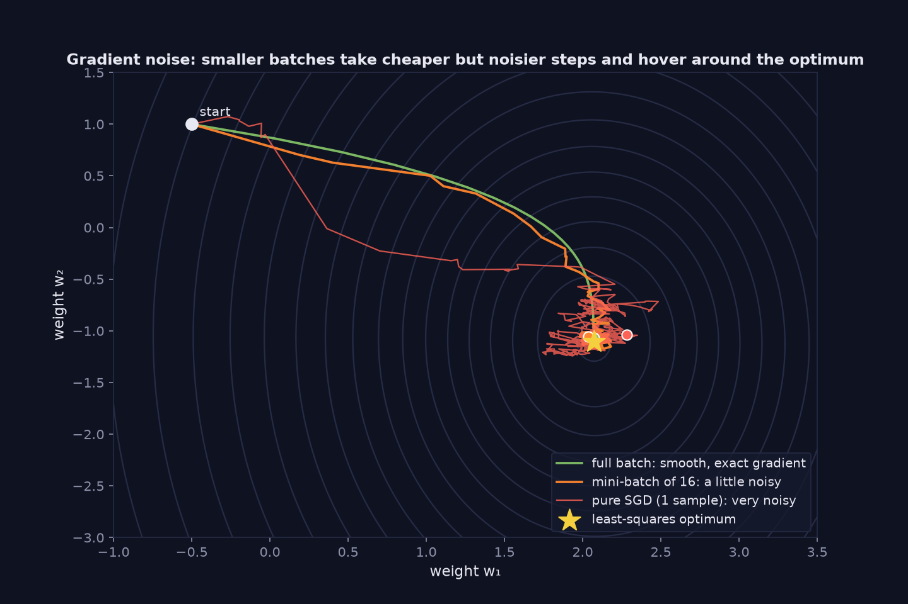

> Tier 2 — Machine Learning Fundamentals · Status: DRAFT (Author: Claude) · Code: `code/mlkit.py`, `lab/lab_02_models_and_training.py` — TESTED

# 2.20 Stochastic gradient descent (SGD)

**Metadata** — Tier: 2 · Phase: 1 · Priority: P0 · Difficulty: 2/5 · Interview: Very high · Hands-on: Very high
Prerequisites: 2.19, 1.27, 1.29 · Leads to: 2.21 Mini-batch, 2.25 Learning rate, Tier 4 SGD/Momentum/Adam

### 1. What is it?
Gradient descent where each step uses the gradient of a **single randomly chosen sample** (or a small random subset) as a noisy estimate of the full gradient.

### 2. Why does it exist?
The full-data gradient is expensive when `n` is large. A random sample's gradient is much cheaper and, on average, points the right way.

### 3. Detailed explanation
- **Unbiased estimator:** `E[∇ℓ(xᵢ)] = ∇J` when the sample is drawn uniformly (1.29). In the lab, averaging the gradients of batches that partition the data reproduces the full gradient to 3·10⁻¹⁵.
- **Noise:** single-sample gradients have high variance. The variance of a batch-mean gradient falls roughly as `1/B`: measured 29.9 (B=1), 3.81 (B=8), 0.43 (B=64), and the ratio 1 : 64 ≈ 69 matches.
- **Constant learning rate ⇒ noise floor:** SGD hovers around the optimum rather than converging. After 6,000 single-sample steps on a noisy regression the distance to the optimum was 0.254 with a constant rate of 0.05 but 0.053 with a decaying rate `0.05/(1+t/200)`: decay shrinks the noise (schedules: Tier 4).
- **Benefits of noise:** helps escape saddles/sharp minima in non-convex problems (1.46); acts as mild regularization.
- **Shuffling:** each epoch uses a fresh random order (sampling without replacement), usually better than with replacement.
- **Convergence conditions** for decreasing steps: `Σηₜ = ∞`, `Σηₜ² < ∞` (e.g., `η/t`).
- **Terminology warning:** frameworks and papers say "SGD" for any mini-batch method (2.21); pure SGD means batch size 1. The optimizer object `torch.optim.SGD` is covered in Tier 4 (4.6).

### 4. How does it work?
Shuffle → pick a sample (or batch) → compute its gradient → update → repeat; after all samples are seen once, an epoch (2.22) ends.

> **Figure 2.20-1 — full batch, mini-batch and pure SGD paths**



*How to read it:* All three methods head to the least-squares optimum (yellow star). Full-batch gradient descent follows the exact gradient, mini-batches of 16 add a little noise, and single-sample SGD is much noisier and hovers around the optimum instead of settling. The noise is cheap to compute and unbiased on average.

*Generated by* `tier-02-ml-fundamentals/figures/src/t2_training.py` *from this chapter's code, so the numbers are computed, not typed in.*

### 5. Simple example
Estimating the average opinion of a town by asking one random person at a time: noisy, but fast and unbiased.

### 6. Technical example
Training logistic regression on 10⁸ rows with batch size 256 and a decaying learning rate.

### 7. Code
```python
import mlkit as M
X, y = M.make_linear(256, noise=0.05, seed=5)
for bs in (None, 32, 1):                         # full batch, mini-batch, pure SGD
    w, b, h = M.sgd_linear(X, y, lr=0.02 if bs == 1 else 0.1, batch_size=bs, epochs=60, seed=0)
    print(bs, h['iterations'][-1], round(h['epoch_loss'][-1], 4))   # iterations: 60, 480, 15360
```
TESTED (`test_sgd_variants_converge_and_count_iterations`, `test_minibatch_noise_larger_than_full_batch`, `ex_2_20_21`).

### 8. Input → Process → Output
`random sample → noisy gradient → small step → repeat`

### 9. Enterprise use case
Online/streaming learning, huge datasets, and any deep-learning training rely on SGD-style updates.

### 10. AI engineering connection
LLM training uses mini-batch SGD variants (AdamW) with very large effective batch sizes via accumulation and parallelism (Tier 4).

### 11. Advantages
Cheap steps; scales to huge data; noise can help generalization; works online.

### 12. Limitations
Noisy convergence; sensitive to learning-rate schedule; hard to parallelize at batch size 1.

### 13. Trade-offs
Smaller batches = more updates per epoch and more noise; larger = stabler but costlier per step.

### 14. Common mistakes
Constant learning rate and expecting exact convergence; not shuffling; evaluating on a single noisy step's loss; confusing SGD with 'any optimizer'.

### 15. Performance / cost
Per-step cost is independent of dataset size; total cost scales with epochs × data.

### 16. Security
Per-example gradients are also what differential-privacy methods clip and noise (DP-SGD).

### 17. Interview explanation
"SGD replaces the full gradient with a gradient from a random sample, which is an unbiased but noisy estimate. That makes each step cheap and the noise even helps escape bad regions, but with a constant learning rate it only hovers near the optimum, so we decay the rate or increase the batch size."

### 18. Rapid-fire
Noisy unbiased gradient from random samples; cheap steps; needs decaying LR to converge exactly.

### 19. Interview questions
- Basic: What does 'stochastic' refer to?
- Intermediate: Why is the mini-batch gradient unbiased, and how does its variance depend on B?
- Advanced: State the Robbins–Monro step-size conditions.
- Scenario: Training loss jitters at the end of training. What are your options?

### 20. Hands-on exercise
Reproduce the noise-floor experiment with learning rates 0.2/0.05/0.01 and a decaying schedule; plot distance to optimum.

### 21. Revision questions
1) Why unbiased? 2) Effect of batch size on variance? 3) Why decay η?

### 22. Related concepts
2.19 Gradient descent · 2.21 Mini-batch · 2.25 Learning rate · Tier 4 SGD (4.6) · 1.29 Expectation

### 23. Memory hook
**SGD: a cheap, noisy compass that still points downhill on average.**
